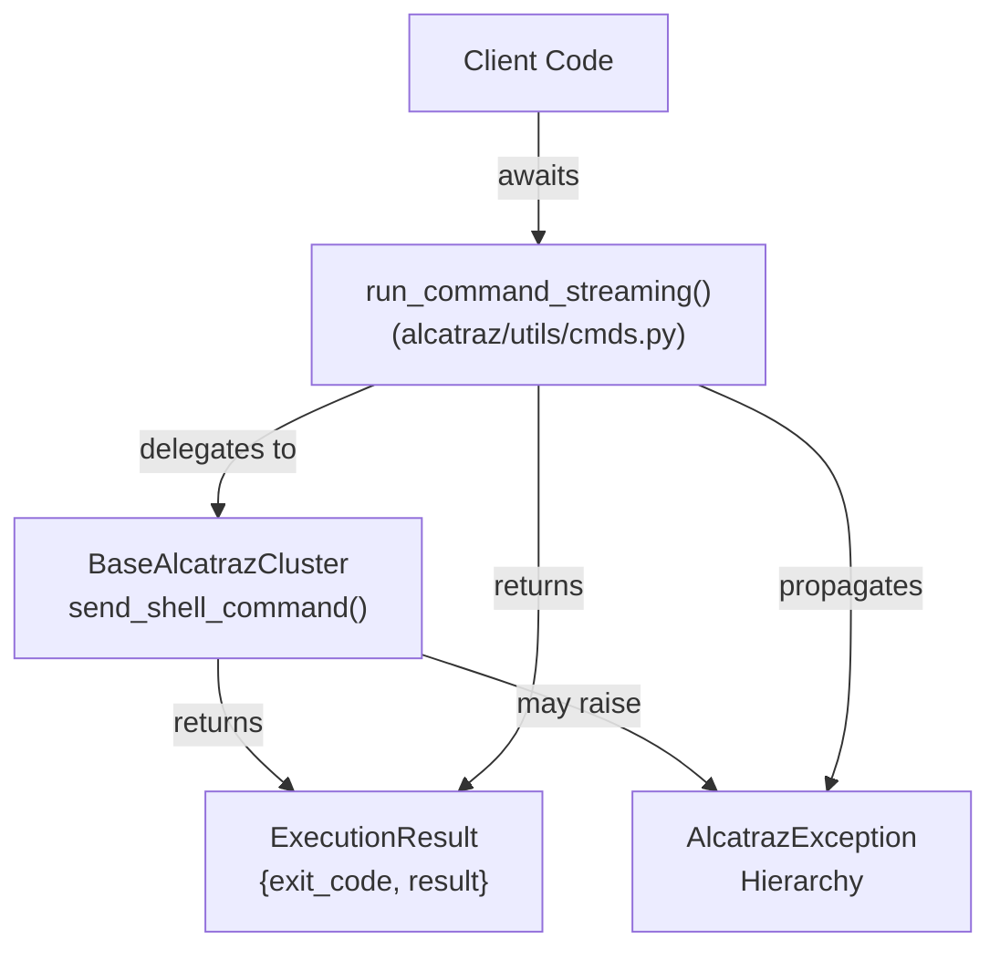
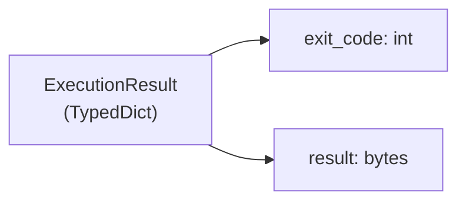
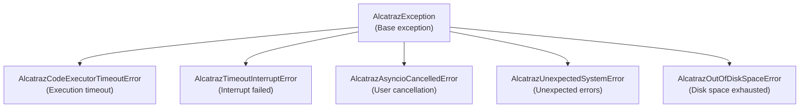
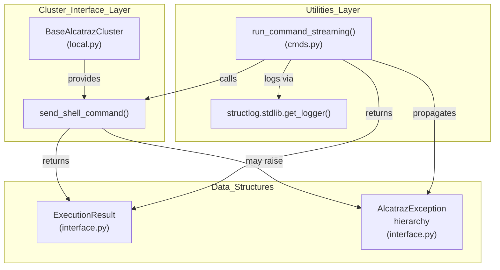

<!-- source: DeepWiki mcp.deepwiki.com · repo openai/frontier-evals · page 5.4 Utilities and Commands · fetched 2026-10-26 -->

# Utilities and Commands

<details>
<summary>Relevant source files</summary>

The following files were used as context for generating this wiki page:

- [project/common/alcatraz/alcatraz/utils/cmds.py](project/common/alcatraz/alcatraz/utils/cmds.py)

</details>


This document covers utility functions and data structures for command execution within the Alcatraz system. The primary focus is the `run_command_streaming` function for reliable command execution, the `ExecutionResult` structure for capturing command outputs, and the exception hierarchy for error handling during command execution.

For details on the cluster interface that these utilities operate on, see [Core Architecture and Local Cluster](#5.1). For information on container process management and low-level I/O handling, see [Container Process Management](#5.2).

## Command Execution Overview

The Alcatraz utilities layer provides a simplified interface for executing shell commands within containerized environments. This layer abstracts the complexity of the underlying cluster operations and provides consistent error handling.

**Diagram: Command Execution Flow**



**Sources:**
- [project/common/alcatraz/alcatraz/utils/cmds.py:1-19]()
- [project/common/alcatraz/alcatraz/clusters/interface.py:1-7]()

## run_command_streaming Function

The `run_command_streaming` function provides a reliable interface for executing long-running shell commands within Alcatraz clusters. It is located in [project/common/alcatraz/alcatraz/utils/cmds.py:9-18]().

**Function Signature:**

```python
async def run_command_streaming(cluster: BaseAlcatrazCluster, command: str) -> ExecutionResult
```

**Parameters:**

| Parameter | Type | Description |
|-----------|------|-------------|
| `cluster` | `BaseAlcatrazCluster` | The cluster instance on which to execute the command |
| `command` | `str` | The shell command to execute |

**Return Value:**

Returns an `ExecutionResult` TypedDict containing the exit code and output bytes.

**Key Benefits:**

The function documentation at [project/common/alcatraz/alcatraz/utils/cmds.py:10-15]() highlights two primary benefits:

1. **Iterative Logging**: The function logs command output every 5 seconds, providing visibility into long-running operations.
2. **Reliability**: More reliable than HTTP long polling on the underlying `send_shell_command` API.

**Implementation Details:**

The current implementation is a thin wrapper that delegates to `cluster.send_shell_command()`. The streaming and polling logic is handled by the underlying cluster implementation:

```python
result = await cluster.send_shell_command(command)
return result
```

**Sources:**
- [project/common/alcatraz/alcatraz/utils/cmds.py:9-18]()

## ExecutionResult Structure

The `ExecutionResult` TypedDict is defined at [project/common/alcatraz/alcatraz/clusters/interface.py:4-6]() and serves as the standardized return type for command execution operations.

**Diagram: ExecutionResult Data Structure**



**Structure Definition:**

| Field | Type | Description |
|-------|------|-------------|
| `exit_code` | `int` | The exit code returned by the command (0 for success, non-zero for errors) |
| `result` | `bytes` | The raw byte output from the command execution |

**Usage Example Context:**

The `ExecutionResult` is returned by:
- `run_command_streaming()` in the utilities layer [project/common/alcatraz/alcatraz/utils/cmds.py:9-18]()
- `send_shell_command()` in the cluster interface [project/common/alcatraz/alcatraz/clusters/interface.py:4-6]()

**Sources:**
- [project/common/alcatraz/alcatraz/clusters/interface.py:4-6]()

## Exception Hierarchy

Alcatraz provides a comprehensive exception hierarchy for handling errors during command execution and cluster operations. All exceptions inherit from the base `AlcatrazException` class, defined at [project/common/alcatraz/alcatraz/clusters/interface.py:9-12]().

**Diagram: Exception Hierarchy**



**Exception Classes:**

| Exception | Location | Purpose |
|-----------|----------|---------|
| `AlcatrazException` | [interface.py:9-12]() | Base exception for all Alcatraz errors that are not client errors (e.g., improper auth) |
| `AlcatrazCodeExecutorTimeoutError` | [interface.py:15-16]() | Raised when code execution exceeds the specified timeout |
| `AlcatrazTimeoutInterruptError` | [interface.py:19-22]() | Raised when interrupting code execution is unsuccessful |
| `AlcatrazAsyncioCancelledError` | [interface.py:25-27]() | Raised when asyncio execution is cancelled by the user/client |
| `AlcatrazUnexpectedSystemError` | [interface.py:31-34]() | Catch-all for unexpected errors during code execution |
| `AlcatrazOutOfDiskSpaceError` | [interface.py:37-40]() | Raised when code execution runs out of disk space |

**Sources:**
- [project/common/alcatraz/alcatraz/clusters/interface.py:9-40]()

## Integration with Cluster Operations

The utilities and commands layer integrates with the broader Alcatraz system through the `BaseAlcatrazCluster` interface.

**Diagram: Utilities Integration Architecture**



**Component Dependencies:**

The utilities layer has minimal dependencies:
- `structlog.stdlib` for logging at [project/common/alcatraz/alcatraz/utils/cmds.py:1]()
- `alcatraz.clusters.interface` for `ExecutionResult` at [project/common/alcatraz/alcatraz/utils/cmds.py:3]()
- `alcatraz.clusters.local` for `BaseAlcatrazCluster` at [project/common/alcatraz/alcatraz/utils/cmds.py:4]()

**Logger Configuration:**

The logger is configured with a component identifier at [project/common/alcatraz/alcatraz/utils/cmds.py:6]():

```python
logger = structlog.stdlib.get_logger(component=__name__)
```

This allows tracking of command execution through structured logging.

**Sources:**
- [project/common/alcatraz/alcatraz/utils/cmds.py:1-6]()
- [project/common/alcatraz/alcatraz/clusters/interface.py:4-40]()

## Usage Patterns

### Basic Command Execution

To execute a shell command using the utilities layer:

```python
from alcatraz.clusters.local import LocalCluster
from alcatraz.utils.cmds import run_command_streaming

# Assume cluster is already initialized
result = await run_command_streaming(cluster, "ls -la /workspace")
print(f"Exit code: {result['exit_code']}")
print(f"Output: {result['result'].decode('utf-8')}")
```

### Error Handling

Implement robust error handling using the exception hierarchy:

```python
from alcatraz.clusters.interface import (
    AlcatrazCodeExecutorTimeoutError,
    AlcatrazOutOfDiskSpaceError,
    AlcatrazException
)

try:
    result = await run_command_streaming(cluster, command)
except AlcatrazCodeExecutorTimeoutError:
    # Handle timeout specifically
    pass
except AlcatrazOutOfDiskSpaceError:
    # Handle disk space issues
    pass
except AlcatrazException:
    # Handle all other Alcatraz errors
    pass
```

**Sources:**
- [project/common/alcatraz/alcatraz/utils/cmds.py:9-18]()
- [project/common/alcatraz/alcatraz/clusters/interface.py:4-40]()

---

