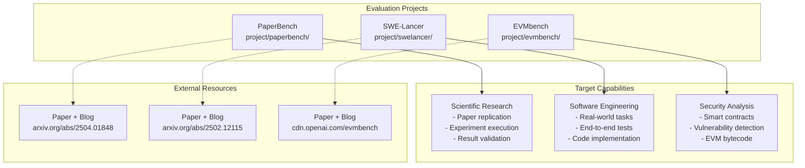
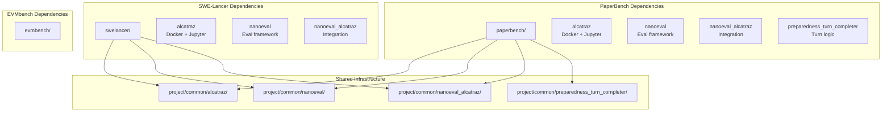

<!-- source: DeepWiki mcp.deepwiki.com · repo openai/frontier-evals · page 6 Evaluation Projects · fetched 2026-10-26 -->

# Evaluation Projects

<details>
<summary>Relevant source files</summary>

The following files were used as context for generating this wiki page:

- [.github/workflows/paperbench_lint.yml](.github/workflows/paperbench_lint.yml)
- [.github/workflows/swelancer_lint.yml](.github/workflows/swelancer_lint.yml)
- [README.md](README.md)

</details>


## Purpose and Scope

This page provides an overview of the three main evaluation benchmarks in the frontier-evals repository: PaperBench, SWE-Lancer, and EVMbench. These evaluation projects measure frontier AI model capabilities across different domains. Each project is an independent evaluation suite with its own configuration, dependencies, and execution environment.

For detailed information about individual evaluations, see:
- PaperBench: [PaperBench](#6.1)
- SWE-Lancer: [SWE-Lancer](#6.2)
- Preparedness Turn Completer: [Preparedness Turn Completer](#6.3)
- EVMbench: [EVMbench](#6.4)

For information about the shared infrastructure these projects use, see:
- Alcatraz container orchestration: [Alcatraz System](#5)
- Compatibility API: [Compatibility API](#4.1)
- Core Evaluation Framework: [Core Evaluation Framework](#4)

**Sources:** [README.md:1-47]()

---

## Evaluation Project Overview

The repository contains three distinct evaluation benchmarks, each targeting different aspects of AI model capabilities:



**Diagram: Evaluation Projects and Their Target Capabilities**

| Project | Directory | Purpose | External Links |
|---------|-----------|---------|----------------|
| **PaperBench** | `project/paperbench/` | End-to-end replication of state-of-the-art AI papers | [Paper](https://arxiv.org/abs/2504.01848), [Blog](https://openai.com/index/paperbench) |
| **SWE-Lancer** | `project/swelancer/` | Real freelance software engineering tasks with end-to-end tests | [Paper](https://arxiv.org/abs/2502.12115), [Blog](https://openai.com/index/swe-lancer) |
| **EVMbench** | `project/evmbench/` | Smart contract security tasks | [Paper](https://cdn.openai.com/evmbench/evmbench.pdf), [Blog](https://openai.com/index/introducing-evmbench/) |

**Sources:** [README.md:3-7]()

---

## Project Structure and Organization

Each evaluation project follows the monorepo pattern with isolated dependencies and configuration:

```mermaid
graph TB
    subgraph "Repository Root"
        ROOT["project/"]
    end
    
    subgraph "Common Infrastructure"
        COMMON["common/<br/>Shared libraries"]
        ALC["common/alcatraz/<br/>Container orchestration"]
        COMPAT["common/compatibility_api/<br/>Environment abstraction"]
        NANOEVAL["common/nanoeval/<br/>Evaluation framework"]
        NANOEVAL_ALC["common/nanoeval_alcatraz/<br/>Integration layer"]
        PREP_TC["common/preparedness_turn_completer/<br/>Turn completion logic"]
    end
    
    subgraph "PaperBench"
        PB_ROOT["paperbench/"]
        PB_README["paperbench/README.md"]
        PB_PYPROJECT["paperbench/pyproject.toml"]
        PB_LOCK["paperbench/uv.lock"]
    end
    
    subgraph "SWE-Lancer"
        SWL_ROOT["swelancer/"]
        SWL_README["swelancer/README.md"]
        SWL_PYPROJECT["swelancer/pyproject.toml"]
        SWL_LOCK["swelancer/uv.lock"]
    end
    
    subgraph "EVMbench"
        EVM_ROOT["evmbench/"]
        EVM_README["evmbench/README.md"]
        EVM_PYPROJECT["evmbench/pyproject.toml"]
        EVM_LOCK["evmbench/uv.lock"]
    end
    
    ROOT --> COMMON
    ROOT --> PB_ROOT
    ROOT --> SWL_ROOT
    ROOT --> EVM_ROOT
    
    COMMON --> ALC
    COMMON --> COMPAT
    COMMON --> NANOEVAL
    COMMON --> NANOEVAL_ALC
    COMMON --> PREP_TC
    
    PB_ROOT --> PB_README
    PB_ROOT --> PB_PYPROJECT
    PB_ROOT --> PB_LOCK
    
    SWL_ROOT --> SWL_README
    SWL_ROOT --> SWL_PYPROJECT
    SWL_ROOT --> SWL_LOCK
    
    EVM_ROOT --> EVM_README
    EVM_ROOT --> EVM_PYPROJECT
    EVM_ROOT --> EVM_LOCK
```



**Diagram: Directory Structure and Project Organization**

Each evaluation project is self-contained with:
- **`README.md`**: Project-specific documentation for setup and execution [README.md:37]()
- **`pyproject.toml`**: Python project configuration and dependency declarations [README.md:37]()
- **`uv.lock`**: Locked dependency versions managed by `uv` [README.md:37]()
- **Project-specific directories**: Scripts, runtime configurations, and evaluation data [README.md:17-18]()

**Sources:** [README.md:25-37]()

---

## Common Patterns Across Projects

All evaluation projects share common architectural patterns:

### Isolated Virtual Environments

Each project maintains its own virtual environment through `uv`:

```bash
cd project/paperbench    # or swelancer, evmbench
uv sync                  # Create/update environment from uv.lock
uv run pytest            # Execute tests in project environment
```

**Sources:** [README.md:11-13](), [README.md:40-44]()

### Dependency Management

Projects use `uv` for deterministic dependency resolution:

| File | Purpose |
|------|---------|
| `pyproject.toml` | Declares direct dependencies and development tools [README.md:29]() |
| `uv.lock` | Locks all transitive dependencies with exact versions [README.md:13]() |

Shared utilities from `project/common/` are typically included as editable dependencies, allowing changes to propagate immediately during development [README.md:46-47]().

**Sources:** [README.md:11-13](), [README.md:46-47]()

### Execution Workflow

The standard workflow for running evaluations:

1. Navigate to the evaluation directory [README.md:19]()
2. Run `uv sync` to ensure dependencies are installed [README.md:20]()
3. Follow project-specific instructions in `README.md` [README.md:21]()
4. Check `scripts/` or `runtime_*/` directories for orchestration details [README.md:17]()

**Sources:** [README.md:15-22]()

---

## Infrastructure Dependencies

Each evaluation project composes different subsets of the common infrastructure based on its needs:



**Diagram: Evaluation Projects and Infrastructure Dependencies**

### Dependency Triggers in CI/CD

The CI/CD system uses path-based filters to determine which projects are affected by changes to common infrastructure:

| Common Component Change | Triggers CI/CD For |
|------------------------|-------------------|
| `project/common/alcatraz/**` | PaperBench, SWE-Lancer |
| `project/common/nanoeval/**` | PaperBench, SWE-Lancer |
| `project/common/nanoeval_alcatraz/**` | PaperBench, SWE-Lancer |
| `project/common/preparedness_turn_completer/**` | PaperBench |

**Sources:** [.github/workflows/paperbench_lint.yml:6-10](), [.github/workflows/swelancer_lint.yml:6-9]()

---

## Key Infrastructure Components Used

### Alcatraz Container Orchestration

Both PaperBench and SWE-Lancer rely on Alcatraz for container lifecycle management. Changes to `project/common/alcatraz/` trigger linting and testing for both projects.

See [Alcatraz System](#5) for detailed Alcatraz documentation.

**Sources:** [.github/workflows/paperbench_lint.yml:7](), [.github/workflows/swelancer_lint.yml:9]()

### Nanoeval Framework

The `nanoeval` library provides the core evaluation framework that both PaperBench and SWE-Lancer build upon. The `nanoeval_alcatraz` integration layer connects the evaluation framework to the container orchestration system.

**Sources:** [.github/workflows/paperbench_lint.yml:8-9](), [.github/workflows/swelancer_lint.yml:7-8]()

### Preparedness Turn Completer

PaperBench specifically uses the `preparedness_turn_completer` component for managing turn-based interaction logic.

See [Preparedness Turn Completer](#6.3) for detailed documentation.

**Sources:** [.github/workflows/paperbench_lint.yml:10]()

---

## Development and Testing Infrastructure

Each evaluation project has dedicated CI/CD workflows:

### PaperBench

- **Linting:** [.github/workflows/paperbench_lint.yml]()
  - Type checking with `mypy` [line 50]()
  - Style checking with `ruff` [line 55]()
  - Triggers on changes to `project/paperbench/**` and shared dependencies [lines 6-10]()
  - Uses `uv sync` for dependency installation [line 45]()

### SWE-Lancer

- **Linting:** [.github/workflows/swelancer_lint.yml]()
  - Type checking with `poe typecheck` [line 49]()
  - Style checking with `ruff` [line 54]()
  - Triggers on changes to `project/swelancer/**` and shared dependencies [lines 6-9]()

### EVMbench

EVMbench currently has limited CI/CD coverage in the main repository workflow files. Developers should consult `project/evmbench/README.md` for project-specific instructions.

**Sources:** [README.md:7](), [.github/workflows/paperbench_lint.yml](), [.github/workflows/swelancer_lint.yml]()

---

## Project-Specific Characteristics

### PaperBench

- **Focus:** End-to-end replication of state-of-the-art AI papers [README.md:5]().
- **Tooling:** Uses `mypy` and `ruff` directly via `uv run` in CI [.github/workflows/paperbench_lint.yml:50-55]().

### SWE-Lancer

- **Focus:** Real freelance software engineering tasks with end-to-end tests [README.md:6]().
- **Tooling:** Uses `poe` as a task runner for type checking in CI [.github/workflows/swelancer_lint.yml:49]().

### EVMbench

- **Domain:** Smart contract security tasks and Ethereum Virtual Machine analysis [README.md:7]().
- **Independence:** While part of the monorepo, it has fewer documented dependencies on the `common/` infrastructure in the CI configuration compared to the other two projects.

**Sources:** [README.md:5-7](), [.github/workflows/paperbench_lint.yml](), [.github/workflows/swelancer_lint.yml]()

---

