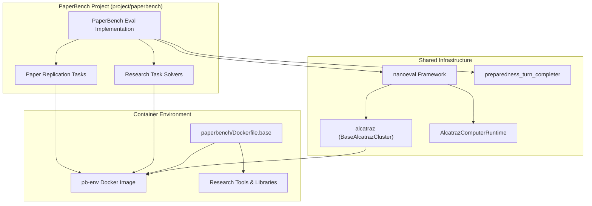
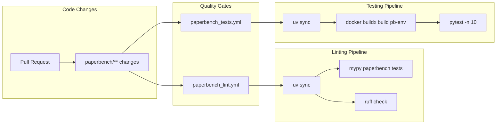
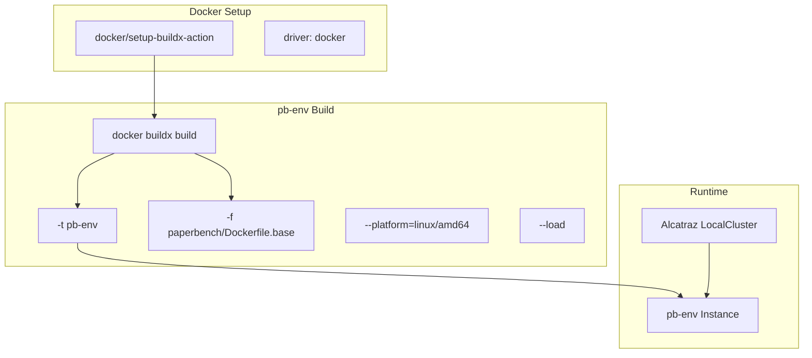
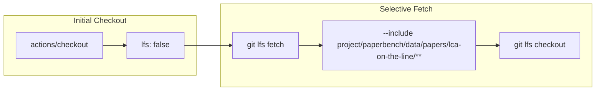

<!-- source: DeepWiki mcp.deepwiki.com · repo openai/frontier-evals · page 6.1 PaperBench · fetched 2026-10-26 -->

# PaperBench

Relevant source files

The following files were used as context for generating this wiki page:

- [.github/workflows/paperbench_lint.yml](.github/workflows/paperbench_lint.yml)
- [.github/workflows/paperbench_tests.yml](.github/workflows/paperbench_tests.yml)

PaperBench is an evaluation project that measures AI model capabilities on end-to-end replication of state-of-the-art AI research papers. The system provides a containerized environment for reproducibly executing paper implementations and assessing whether models can replicate published research results.

**External Resources:**
- [Paper](https://arxiv.org/abs/2504.01848)
- [Blog Post](https://openai.com/index/paperbench)

This document covers the PaperBench system architecture, CI/CD workflows, container infrastructure, and data management. For information about the underlying evaluation framework, see page 4. For details about container orchestration, see page 5.1.

Sources: [README.md:5]()

## System Overview

PaperBench implements paper replication evaluations by leveraging shared frontier-evals infrastructure. The system executes model-generated code in isolated Docker containers (`pb-env`) to replicate research papers, using the `alcatraz` container orchestration system for process management and the `nanoeval` framework for evaluation logic.

Project Location: `project/paperbench/`

### Core Architecture

The PaperBench evaluation is built as a specialized application of the `nanoeval` framework. It utilizes the `nanoeval_alcatraz` bridge to run code within a specialized `pb-env` Docker container.

Sources: [.github/workflows/paperbench_tests.yml:54-62](), [.github/workflows/paperbench_lint.yml:6-10](), [README.md:5]()

### Dependency Structure

PaperBench depends on multiple shared infrastructure components. The CI workflows monitor these dependencies and trigger when any of them change:

| Component | Purpose | CI Trigger Path |
|-----------|---------|-----------------|
| `nanoeval` | Core evaluation framework (Eval/Task/Solver) | `project/common/nanoeval/**` |
| `alcatraz` | Container orchestration and `ContainerProc` management | `project/common/alcatraz/**` |
| `nanoeval_alcatraz` | Bridge connecting `ComputerInterface` to `AlcatrazComputerRuntime` | `project/common/nanoeval_alcatraz/**` |
| `preparedness_turn_completer` | Turn-based completion logic for model interactions | `project/common/preparedness_turn_completer/**` |

Sources: [.github/workflows/paperbench_lint.yml:6-10](), [.github/workflows/paperbench_tests.yml:6-10]()

## Evaluation Pipeline

The PaperBench evaluation follows a multi-stage pipeline integrated into the `nanoeval` execution flow.

### Three-Stage Pipeline

1.  **Agent Rollout**: The solver (agent) interacts with the `pb-env` environment via `AlcatrazComputerRuntime` to attempt the replication task.
2.  **Reproduction**: The generated code and experimental setup are executed within the container to produce results (plots, metrics, logs).
3.  **Grading**: A judge system (typically a model-based judge) evaluates the reproduction outputs against a structured rubric.

### Judge and Rubric Structure
PaperBench uses a sophisticated grading system where a judge model compares the agent's findings against the original paper's results. This uses the `preparedness_turn_completer` to handle complex multi-turn reasoning if required during the grading phase.

Sources: [.github/workflows/paperbench_lint.yml:10](), [.github/workflows/paperbench_tests.yml:10]()

## Development Workflow

### CI/CD Pipeline

PaperBench implements a comprehensive development workflow with separate linting and testing pipelines managed via `uv`.

Sources: [.github/workflows/paperbench_lint.yml:25-56](), [.github/workflows/paperbench_tests.yml:21-66]()

### Code Quality Standards

The linting workflow enforces two quality gates:

1.  **Type Checking**: `uv run mypy paperbench tests` validates type annotations for the PaperBench implementation and its test suite.
2.  **Style Enforcement**: `uv run ruff check --output-format=github --no-fix` enforces strict style rules.

Sources: [.github/workflows/paperbench_lint.yml:47-56]()

### Testing Infrastructure

The testing workflow executes the following steps:

1.  **Data Hydration**: Selectively fetches paper data using Git LFS (e.g., `lca-on-the-line`).
2.  **Dependency Installation**: Runs `uv sync` with `UV_GIT_LFS=1` to ensure LFS-backed dependencies are resolved.
3.  **Container Build**: Builds the `pb-env` Docker image from `paperbench/Dockerfile.base`.
4.  **Test Execution**: Runs `pytest -n 10 -vrs` using `pytest-xdist` for parallel execution.

Sources: [.github/workflows/paperbench_tests.yml:34-67]()

## Container Environment

### Docker Integration

PaperBench uses a containerized execution environment to ensure that research code (which often has complex library dependencies) runs in a controlled setting.

**Container Build Process**

Sources: [.github/workflows/paperbench_tests.yml:49-62]()

### Build Configuration

The `pb-env` image is built using the following parameters:

| Parameter | Value | Purpose |
|-----------|-------|---------|
| `--platform` | `linux/amd64` | Ensures consistency for research libraries (e.g., PyTorch/CUDA deps) |
| `--load` | (flag) | Exports the build result to the local Docker daemon for `alcatraz` to use |
| `-t` | `pb-env` | The standard tag used by PaperBench tasks to identify the runtime image |
| `-f` | `paperbench/Dockerfile.base` | The definition of the research environment |

Sources: [.github/workflows/paperbench_tests.yml:54-62]()

## Data Management

### Git LFS Configuration

PaperBench uses Git LFS to manage the large datasets associated with AI papers. The CI pipeline uses a selective hydration strategy to minimize overhead.

**LFS Hydration Process**

Sources: [.github/workflows/paperbench_tests.yml:29-37]()

This strategy ensures that only the data required for specific tests (like the `lca-on-the-line` paper) is downloaded during CI, rather than the entire corpus of research papers.

### Dependency Management

The `uv sync` command is the primary tool for environment management. When running in the PaperBench context, `UV_GIT_LFS=1` is set to allow `uv` to correctly resolve any python packages or resources that might be stored via LFS.

Sources: [.github/workflows/paperbench_tests.yml:42-47](), [.github/workflows/paperbench_lint.yml:40-45]()

---

