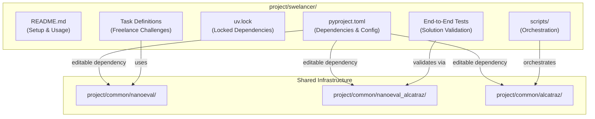
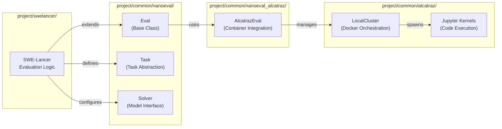
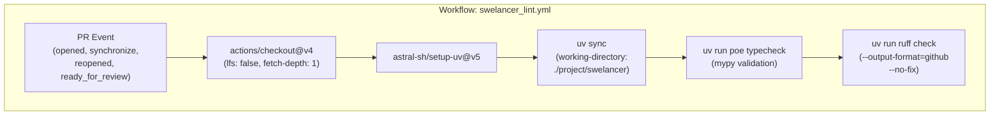
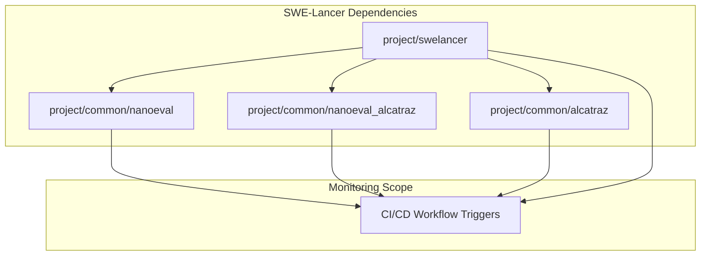

<!-- source: DeepWiki mcp.deepwiki.com · repo openai/frontier-evals · page 6.2 SWE-Lancer · fetched 2026-10-26 -->

# SWE-Lancer

Relevant source files

The following files were used as context for generating this wiki page:

- [.github/workflows/swelancer_lint.yml](.github/workflows/swelancer_lint.yml)

## Purpose and Scope

SWE-Lancer is an evaluation benchmark that measures AI model capabilities on real freelance software engineering tasks with end-to-end tests. The benchmark uses authentic programming challenges sourced from real freelance work, enabling assessment of model performance on practical software development tasks including implementation, debugging, and testing.

The evaluation leverages the shared evaluation infrastructure (nanoeval, nanoeval_alcatraz, alcatraz) to execute code in isolated containers and validate solutions against comprehensive test suites. SWE-Lancer specifically focuses on two roles:
- **IC SWE**: Individual Contributor tasks involving direct code implementation and bug fixing.
- **SWE Manager**: Higher-level tasks involving technical planning and coordination.

**Key Resources:**
- Paper: https://arxiv.org/abs/2502.12115
- Blog: https://openai.com/index/swe-lancer
- Project Directory: [project/swelancer/]()

This document covers the SWE-Lancer project structure, its integration with core evaluation infrastructure, and its CI/CD quality gates. For the underlying evaluation framework, see page 4. For container orchestration, see page 5.

Sources: [README.md:6](), [README.md:34]()

## Project Structure

SWE-Lancer is organized as a self-contained evaluation project within the monorepo structure at [project/swelancer/](). The project follows the standard pattern of having its own `pyproject.toml`, `uv.lock`, and `README.md` for isolated dependency management.

**SWE-Lancer Project Structure**

The SWE-Lancer directory contains task definitions for freelance software engineering challenges, end-to-end tests for solution validation, and orchestration scripts. The project declares editable dependencies on the shared infrastructure components through its `pyproject.toml`.

Sources: [README.md:34](), [README.md:37](), [.github/workflows/swelancer_lint.yml:6-9]()

## Framework Integration

SWE-Lancer integrates with the core evaluation framework through explicit dependencies monitored by the CI/CD system. It utilizes the `Alcatraz` system for Docker-based isolation.

**SWE-Lancer Framework Dependencies**

SWE-Lancer extends the base `Eval` classes from nanoeval, defines software engineering `Task` instances, and configures `Solver` implementations for code generation. The nanoeval_alcatraz integration layer manages `LocalCluster` instances that orchestrate Docker containers and spawn Jupyter kernels for executing and testing generated code.

Sources: [.github/workflows/swelancer_lint.yml:6-9]()

## CI/CD Pipeline

SWE-Lancer has a dedicated GitHub Actions workflow at [.github/workflows/swelancer_lint.yml]() that enforces code quality through automated linting and type checking.

### Workflow Triggers

The workflow activates on pull requests affecting:
- [project/swelancer/**]()
- [project/common/nanoeval/**]()
- [project/common/nanoeval_alcatraz/**]()
- [project/common/alcatraz/**]()

This path-based triggering ensures that changes to any dependency trigger SWE-Lancer validation, catching breaking changes early.

Sources: [.github/workflows/swelancer_lint.yml:3-16]()

### Quality Gates

**swelancer_lint.yml Workflow Steps**

The workflow runs on `ubuntu-latest` and executes a series of quality checks in the [project/swelancer/]() directory. It uses the `uv` package manager for dependency management, `poe` task runner for invoking `mypy`, and `ruff` for strict linting with GitHub-formatted output.

Sources: [.github/workflows/swelancer_lint.yml:24-54]()

### Environment Configuration

| Configuration | Value | Purpose |
|--------------|-------|---------|
| `OPENAI_API_KEY` | `${{ secrets.OPENAI_API_KEY }}` | Model API access |
| `UV_GIT_LFS` | `1` | Enable Git LFS support |
| `lfs` | `false` | Skip LFS checkout (not needed for linting) |
| `fetch-depth` | `1` | Shallow clone for performance |
| `working-directory` | `./project/swelancer` | Isolated execution context |

Sources: [.github/workflows/swelancer_lint.yml:26-43]()

### Quality Enforcement

**Type Checking**: Executes `uv run poe typecheck` which invokes `mypy` for static type validation [.github/workflows/swelancer_lint.yml:49](). This ensures type safety across the codebase and catches type-related errors before runtime.

**Strict Linting**: Runs `uv run ruff check --output-format=github --no-fix` [.github/workflows/swelancer_lint.yml:54]() which performs comprehensive linting without auto-fixing, ensuring all code style issues are explicitly addressed. The GitHub output format provides inline PR comments for detected issues.

**Dependency Locking**: The `uv sync` command [.github/workflows/swelancer_lint.yml:44]() ensures reproducible dependency installation from the checked-in `uv.lock` file, preventing environment drift between local development and CI.

Sources: [.github/workflows/swelancer_lint.yml:44-54]()

## Framework Dependencies

SWE-Lancer has explicit dependencies on core framework components that enable its evaluation capabilities:

### Core Dependencies

**SWE-Lancer Dependency Graph**

The CI/CD workflow monitors changes across all dependencies to ensure that modifications to core components trigger appropriate testing of SWE-Lancer functionality. This ensures that breaking changes in the evaluation framework are caught before they impact the software engineering evaluation capabilities.

Sources: [.github/workflows/swelancer_lint.yml:5-8]()

### Environment Configuration

SWE-Lancer uses modern Python tooling for development and deployment:

- **Package Management**: Uses `uv` for fast, reliable dependency resolution [.github/workflows/swelancer_lint.yml:37]()
- **API Access**: Requires `OPENAI_API_KEY` for model evaluation [.github/workflows/swelancer_lint.yml:28]()
- **Git LFS Support**: Configured with `UV_GIT_LFS=1` for handling large datasets often found in software repositories [.github/workflows/swelancer_lint.yml:42]()

The project maintains isolation through dedicated working directory execution and separate dependency management, ensuring that SWE-Lancer evaluations run in controlled, reproducible environments.

Sources: [.github/workflows/swelancer_lint.yml:28-44]()

---

