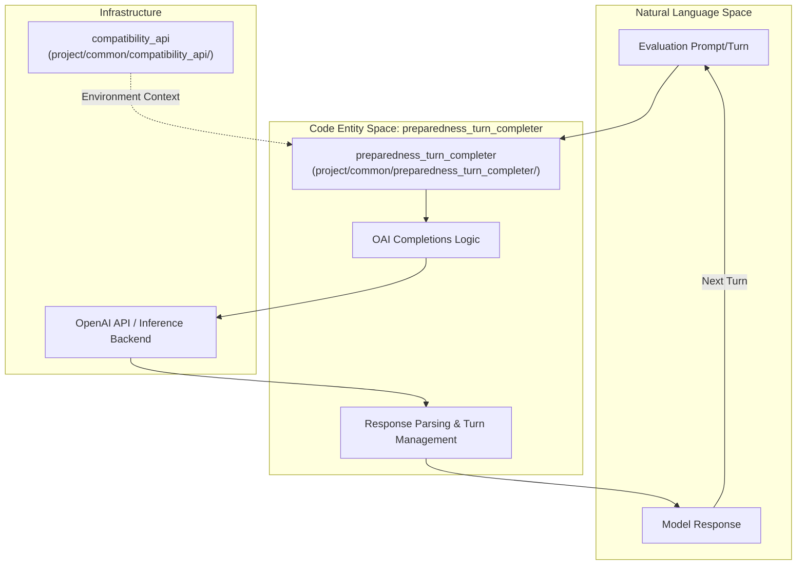
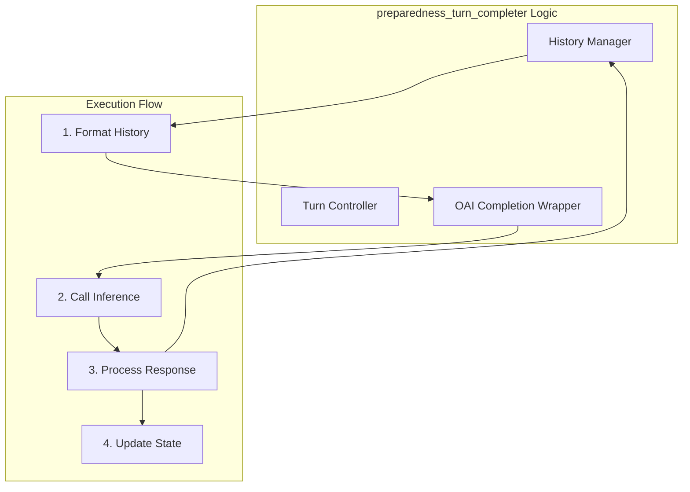

<!-- source: DeepWiki mcp.deepwiki.com · repo openai/frontier-evals · page 6.3 Preparedness Turn Completer · fetched 2026-10-26 -->

# Preparedness Turn Completer

Relevant source files

The following files were used as context for generating this wiki page:

- [.github/workflows/preparedness_turncompleter_lint.yml](.github/workflows/preparedness_turncompleter_lint.yml)
- [.github/workflows/preparedness_turncompleter_tests.yml](.github/workflows/preparedness_turncompleter_tests.yml)

The `preparedness_turn_completer` component provides turn-based completion logic for preparedness evaluations within the frontier-evals repository. Located at [project/common/preparedness_turn_completer/](), this component implements the core evaluation framework for turn-by-turn interaction scenarios used in preparedness assessments. It handles the orchestration of model completions and the management of conversation history between the model and the evaluation environment.

For information about the compatibility API that this component depends on, see [Compatibility API](4.1) and [Compatibility API Preparedness](4.2).

## Architecture Overview

The `preparedness_turn_completer` implements turn-based evaluation logic as a common infrastructure component. It provides abstractions for turn-by-turn completion scenarios where models interact iteratively with tasks, maintaining state across multiple calls to the inference backend.

### Component Dependencies and Data Flow

The turn completer serves as a reusable library component that abstracts turn-based completion patterns. It depends on the `compatibility_api` for environment-agnostic access to task definitions and blob storage.

**Sources:** [.github/workflows/preparedness_turncompleter_lint.yml:6](), [.github/workflows/preparedness_turncompleter_tests.yml:6]()

## Component Structure

The `preparedness_turn_completer` package is located at [project/common/preparedness_turn_completer/]() and follows the standard Python project structure with uv-based dependency management.

### Directory Layout

| Path | Purpose |
|------|---------|
| `project/common/preparedness_turn_completer/` | Root directory containing project configuration and metadata. |
| `project/common/preparedness_turn_completer/preparedness_turn_completer/` | Main Python package containing the turn-based logic and OAI implementations. |
| `project/common/preparedness_turn_completer/tests/` | Test suite for validating turn logic and API interactions. |
| `project/common/preparedness_turn_completer/pyproject.toml` | Project configuration including dependencies and tool settings. |
| `project/common/preparedness_turn_completer/uv.lock` | Locked dependencies for reproducible environments. |

**Sources:** [.github/workflows/preparedness_turncompleter_lint.yml:37](), [.github/workflows/preparedness_turncompleter_tests.yml:33](), [.github/workflows/preparedness_turncompleter_tests.yml:40-42]()

### Implementation Details

The component integrates with the OpenAI API for model inference, as indicated by the `OPENAI_API_KEY` requirement in both linting and testing workflows. The implementation focuses on managing the sequence of `messages` (turns) and ensuring that responses from the model are correctly integrated back into the conversation history for subsequent turns.

**Sources:** [.github/workflows/preparedness_turncompleter_lint.yml:25](), [.github/workflows/preparedness_turncompleter_tests.yml:21]()

## Development Workflow

### Continuous Integration

The `preparedness_turn_completer` has two dedicated GitHub Actions workflows for quality assurance, ensuring that changes to the turn-based logic do not break downstream evaluations like PaperBench.

| Workflow | File | Triggers | Quality Checks |
|----------|------|----------|----------------|
| Linting | `preparedness_turncompleter_lint.yml` | PR to `project/common/preparedness_turn_completer/**` | mypy type checking, ruff linting |
| Testing | `preparedness_turncompleter_tests.yml` | PR to `project/common/preparedness_turn_completer/**` | pytest with parallel execution |

Both workflows activate on pull request events and support manual triggering via `workflow_dispatch`. The workflows use `uv` for dependency management and require `OPENAI_API_KEY` as a secret for integration tests that verify API connectivity.

**Sources:** [.github/workflows/preparedness_turncompleter_lint.yml:3-14](), [.github/workflows/preparedness_turncompleter_tests.yml:3-16](), [.github/workflows/preparedness_turncompleter_lint.yml:25](), [.github/workflows/preparedness_turncompleter_tests.yml:21]()

### Linting Workflow

The linting workflow [.github/workflows/preparedness_turncompleter_lint.yml]() performs static analysis to maintain code quality.

**Workflow steps:**
1. **Checkout**: Code is checked out with Git LFS enabled to ensure any large model-related artifacts or data are available [.github/workflows/preparedness_turncompleter_lint.yml:28-31]().
2. **Environment Setup**: Installs the `uv` package manager [.github/workflows/preparedness_turncompleter_lint.yml:33-34]().
3. **Dependency Sync**: Runs `uv sync` with `UV_GIT_LFS=1` to prepare the virtual environment [.github/workflows/preparedness_turncompleter_lint.yml:36-41]().
4. **Type Checking**: Executes `uv run mypy preparedness_turn_completer` to verify type safety [.github/workflows/preparedness_turncompleter_lint.yml:43-46]().
5. **Linting**: Executes `uv run ruff check --output-format=github --no-fix` for strict linting enforcement [.github/workflows/preparedness_turncompleter_lint.yml:48-51]().

**Sources:** [.github/workflows/preparedness_turncompleter_lint.yml:28-51]()

### Testing Workflow

The testing workflow [.github/workflows/preparedness_turncompleter_tests.yml]() executes the test suite, focusing on the correctness of turn management and response handling.

**Workflow configuration:**
- **Checkout**: Shallow checkout (fetch-depth: 1) without Git LFS to optimize for speed in the test environment [.github/workflows/preparedness_turncompleter_tests.yml:24-27]().
- **Execution**: Tests run with `pytest -n auto` for automatic parallelization across CPU cores [.github/workflows/preparedness_turncompleter_tests.yml:39-42]().
- **Output**: Uses verbose output (`-v`) and short tracebacks (`--tb=short`) for better debugging of failed turns.
- **Inference Integration**: The `OPENAI_API_KEY` is injected as an environment variable, allowing the tests to exercise actual model inference paths and turn-based logic against live or mocked endpoints [.github/workflows/preparedness_turncompleter_tests.yml:21]().

**Sources:** [.github/workflows/preparedness_turncompleter_tests.yml:24-42](), [.github/workflows/preparedness_turncompleter_tests.yml:21]()

## Integration with Core Framework

The preparedness evaluation components integrate with the core frontier-evals infrastructure through established patterns:

- **Compatibility API Extension**: The `preparedness_turn_completer` relies on the base compatibility API to provide preparedness-specific environment abstractions.
- **Dependency Management**: Uses `uv` for consistent dependency management across the monorepo, ensuring that `preparedness_turn_completer` versions are pinned and reproducible.
- **Evaluation Projects**: Projects like PaperBench [project/paperbench/]() utilize this component to handle complex, multi-turn interactions required for replicating scientific papers or performing safety assessments.

**Sources:** [.github/workflows/preparedness_turncompleter_lint.yml:6](), [.github/workflows/preparedness_turncompleter_tests.yml:6]()

---

