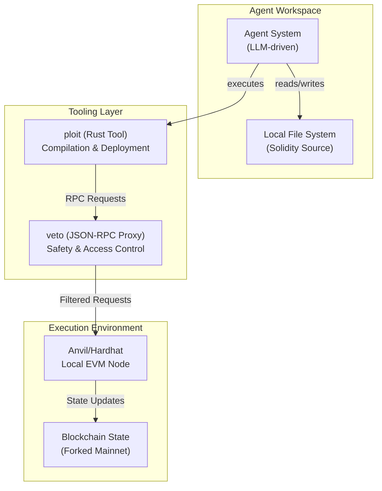
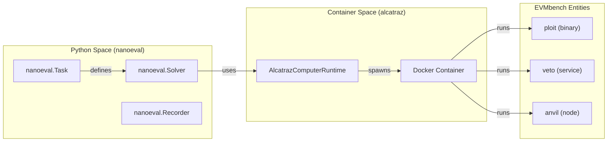

<!-- source: DeepWiki mcp.deepwiki.com · repo openai/frontier-evals · page 6.4 EVMbench · fetched 2026-10-26 -->

# EVMbench

<details>
<summary>Relevant source files</summary>

The following files were used as context for generating this wiki page:

- [README.md](README.md)

</details>


## Purpose and Scope

This document provides a technical overview of the **EVMbench** evaluation project, which assesses frontier AI model capabilities in smart contract security. EVMbench is one of three primary evaluation projects in the `frontier-evals` repository, alongside PaperBench ([6.1]()) and SWE-Lancer ([6.2]()).

EVMbench evaluates models across three distinct security modalities: **Detect**, **Patch**, and **Exploit**. It leverages a custom Rust-based toolchain, a specialized JSON-RPC proxy for transaction filtering, and an agentic system designed to simulate professional security auditing workflows.

**Sources**: [README.md:1-7](), [README.md:32-35]()

## Evaluation Modes

EVMbench categorizes smart contract security tasks into three modes to measure different aspects of model reasoning:

| Mode | Objective | Success Metric |
| :--- | :--- | :--- |
| **Detect** | Identify vulnerabilities within a provided codebase. | Precision/Recall of vulnerability labels. |
| **Patch** | Generate code fixes for identified vulnerabilities. | Verification via unit tests and security scanners. |
| **Exploit** | Construct a functional proof-of-concept (PoC) exploit. | Successful execution of the exploit against a local fork. |

**Sources**: [README.md:7]()

## Architecture and Components

The EVMbench architecture bridges high-level agent reasoning with low-level Ethereum Virtual Machine (EVM) execution.

### System Data Flow



**Diagram**: The flow of operations from the Agent's reasoning through the security-hardened toolchain to the EVM execution environment.

**Sources**: [README.md:7](), [README.md:32-35]()

### Key Components

1.  **Agent System**: A multi-turn agent capable of using tools, reading complex Solidity codebases, and iterating on exploit scripts.
2.  **`ploit` Rust Tool**: A high-performance utility used for compiling Solidity contracts, managing deployments, and interacting with the local blockchain. It abstracts complex `forge` or `hardhat` commands into a simplified interface for the model.
3.  **`veto` JSON-RPC Proxy**: A security middleware that sits between the agent's tools and the EVM node. It enforces constraints on transaction types, prevents "jailbreaking" the underlying node, and logs all RPC interactions for evaluation analysis.
4.  **Audit Dataset**: A curated collection of real-world smart contract audits, including source code, vulnerability descriptions, and functional test suites.

**Sources**: [README.md:7](), [README.md:31-34]()

## Repository Structure

EVMbench is organized as an isolated project within the `project/` directory.

```
project/
├── common/                # Shared nanoeval and alcatraz libraries
└── evmbench/              # EVMbench implementation
    ├── audit_dataset/     # Curated security vulnerabilities
    ├── ploit/             # Rust source for the ploit tool
    ├── veto/              # JSON-RPC proxy implementation
    ├── agents/            # Agent logic and prompt templates
    ├── pyproject.toml     # Python dependencies
    └── uv.lock            # Locked dependencies
```

**Sources**: [README.md:27-35]()

## Infrastructure Integration

EVMbench utilizes the shared infrastructure of the `frontier-evals` repository to ensure reproducible and isolated execution.

### Code-to-Infrastructure Mapping



**Diagram**: Mapping of `nanoeval` abstractions to the physical processes managed by `alcatraz` within the EVMbench environment.

**Sources**: [README.md:31-35]()

### Alcatraz & Nanoeval
EVMbench leverages `alcatraz` ([5.1]()) to spin up Docker containers containing the necessary Ethereum development environment (e.g., Foundry, Hardhat). The `nanoeval` framework ([4.3]()) is used to manage the lifecycle of the evaluation, including:
*   **State Tracking**: Recording the agent's actions and the blockchain's state transitions.
*   **Scoring**: Running the `ploit` verification suite to determine if an exploit was successful or if a patch introduced regressions.

**Sources**: [README.md:31-34]()

## Setup and Usage

EVMbench uses `uv` for dependency management.

### Installation
```bash
# Navigate to the project
cd project/evmbench

# Sync dependencies and build Rust tools (requires Rust toolchain)
uv sync
```

### Execution
Evaluation runs are typically orchestrated via scripts that define the task parameters and model configurations.
1.  **Select Task**: Choose a vulnerability from the `audit_dataset`.
2.  **Initialize Environment**: `alcatraz` creates a container and starts the `veto` proxy and `anvil` node.
3.  **Rollout**: The agent interacts with the codebase until a solution is proposed or the turn limit is reached.
4.  **Verification**: The system executes the `ploit` test suite to grade the output.

**Sources**: [README.md:13-21]()

## Development Standards

EVMbench adheres to the monorepo's quality standards:
*   **Linting**: Ruff is used for Python linting [pyproject.toml:29-30]().
*   **Rust Quality**: The `ploit` tool follows standard `cargo clippy` and `cargo fmt` conventions.
*   **Shared Logic**: Utilities for interacting with `alcatraz` are imported from `project/common/` [README.md:46]().

**Sources**: [README.md:29-30](), [README.md:45-46]()

---

