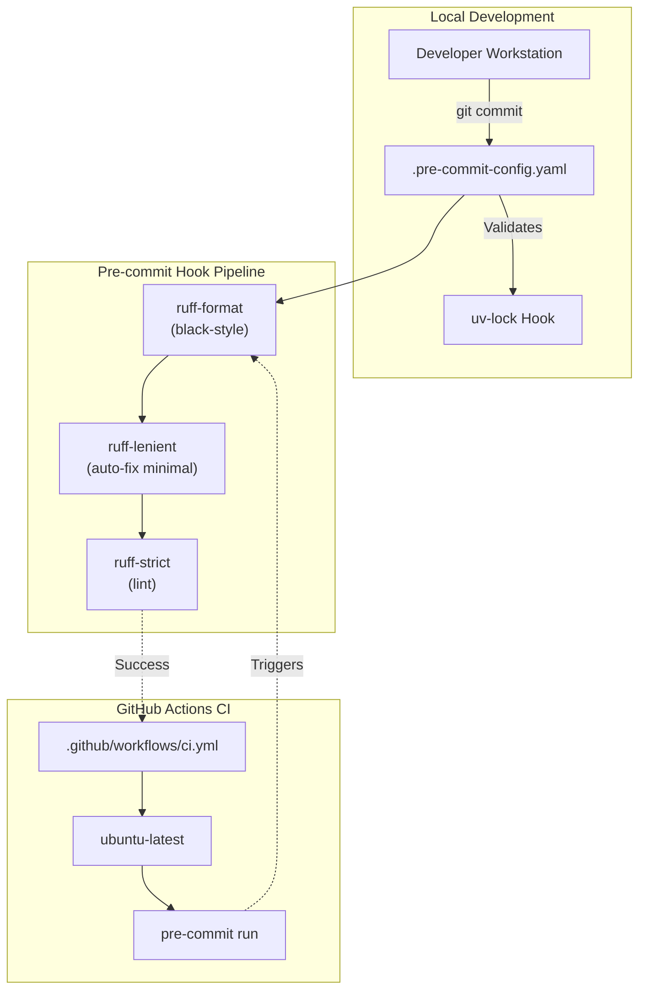
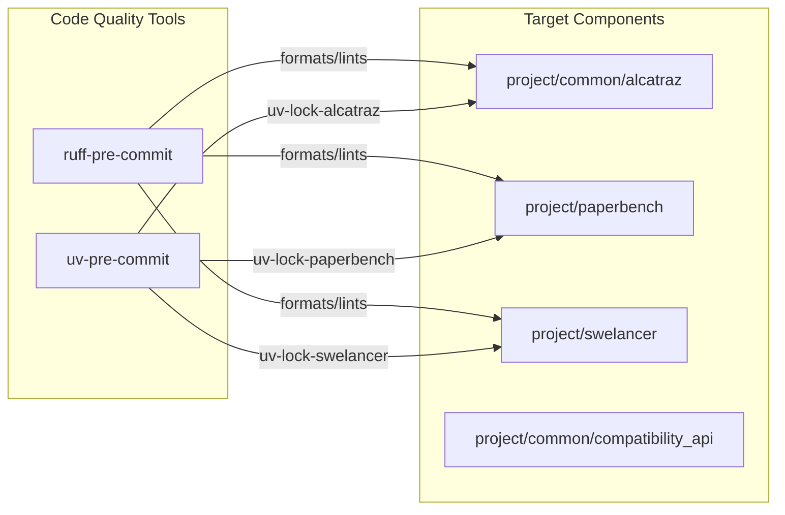

<!-- source: DeepWiki mcp.deepwiki.com · repo openai/frontier-evals · page 7 Development and Maintenance · fetched 2026-10-26 -->

# Development and Maintenance

<details>
<summary>Relevant source files</summary>

The following files were used as context for generating this wiki page:

- [.github/workflows/ci.yml](.github/workflows/ci.yml)
- [.gitignore](.gitignore)
- [.pre-commit-config.yaml](.pre-commit-config.yaml)

</details>


This page provides an overview of the development workflows, CI/CD infrastructure, and quality assurance processes in the `frontier-evals` repository. The system employs automated quality gates, modern Python tooling, and component-specific workflows to maintain code quality across the monorepo.

The development infrastructure consists of several integrated systems:
- **Pre-commit hooks** enforce local quality standards before code is committed.
- **GitHub Actions workflows** validate changes through path-based triggering.
- **Modern Python tooling** including `uv`, `ruff`, and `mypy` ensure consistency.
- **Component-specific configurations** allow tailored quality enforcement for projects like `alcatraz` and `paperbench`.

For detailed information, see:
- [CI/CD Pipeline Architecture](#7.1) — Overall CI/CD strategy and workflow triggering.
- [Component-Specific Workflows](#7.2) — Individual linting and testing workflows.
- [Code Quality and Tooling](#7.3) — Pre-commit hooks and tool configurations.
- [Dependency Management](#7.4) — `uv`-based dependency management.
- [Version Control Configuration](#7.5) — Git and Git LFS setup.

## Quality Assurance Architecture

The repository implements a multi-layered quality assurance system that operates both locally and in CI/CD pipelines.

### QA Workflow: From Local Dev to CI

Sources: [.github/workflows/ci.yml:1-25](), [.pre-commit-config.yaml:1-52]()

The system enforces quality at two levels:
1. **Local pre-commit hooks**: Provide immediate feedback during development and prevent malformed code from being committed.
2. **CI/CD workflows**: Validate all changes in a clean environment (`ubuntu-latest`) before merging into `main` [.github/workflows/ci.yml:9-25]().

## Tool Ecosystem and Configuration Files

The development environment relies on a coordinated set of tools and configuration files.

### Tool Association Diagram

Sources: [.pre-commit-config.yaml:4-51]()

### Key Configuration Files

| File | Purpose | Scope |
|------|---------|-------|
| `pyproject.toml` (root) | Shared tool configuration for `ruff` and `mypy`. | Repository-wide |
| `.pre-commit-config.yaml` | Pre-commit hook definitions and sequencing [.pre-commit-config.yaml:1-52](). | Repository-wide |
| `project/common/tooling/ruff_autofix_minimal.toml` | Lenient auto-fix configuration used by `ruff-lenient` [.pre-commit-config.yaml:17-17](). | Shared Tooling |
| `project/{project}/pyproject.toml` | Project-specific dependencies and overrides. | Per-project |
| `.gitignore` | Python artifacts, build outputs, and IDE files [.gitignore:1-168](). | Repository-wide |

### Tool Roles

| Tool | Purpose | Invoked By |
|------|---------|------------|
| `uv` | Modern package manager; handles lockfile generation (`uv-lock`) [.pre-commit-config.yaml:34-51](). | Developer, Pre-commit |
| `ruff` | Fast Python linter and formatter; replaces Black/Flake8 [.pre-commit-config.yaml:4-29](). | Pre-commit, CI/CD |
| `pre-commit` | Orchestrator for local quality gates [.github/workflows/ci.yml:22-25](). | Git Hooks, CI/CD |

## Development Environment Setup

### Prerequisites
1. **Python 3.11**: The standardized version across the repository [.github/workflows/ci.yml:17-17]().
2. **uv**: Required for dependency management and lockfile synchronization.
3. **Docker**: Required for `alcatraz` container execution and `swelancer` environments.

### Setup Process
```bash
# Clone repository
git clone https://github.com/openai/frontier-evals

# Install pre-commit (typically via pip or uv)
pip install pre-commit

# Install hooks defined in .pre-commit-config.yaml
pre-commit install

# Run checks manually across all files
pre-commit run --all-files
```
Sources: [.github/workflows/ci.yml:21-25](), [.pre-commit-config.yaml:1-2]()

## Maintenance Practices

### Quality Gate Strategy
The repository uses a three-tier `ruff` enforcement strategy in pre-commit:
1. **ruff-format**: Ensures Black-style formatting across components [.pre-commit-config.yaml:9-11]().
2. **ruff-lenient**: Applies unsafe fixes using a minimal configuration for rapid development [.pre-commit-config.yaml:14-19]().
3. **ruff-strict**: Enforces full linting rules on opted-in projects [.pre-commit-config.yaml:22-28]().

### Dependency Maintenance
Lock files are maintained per-project using `uv`. Pre-commit hooks ensure that `uv.lock` files are updated whenever a project's dependencies change:
- `uv-lock-paperbench` for `project/paperbench/` [.pre-commit-config.yaml:35-37]()
- `uv-lock-alcatraz` for `project/common/alcatraz/` [.pre-commit-config.yaml:47-51]()
- `uv-lock-swelancer` for `project/swelancer/` [.pre-commit-config.yaml:43-45]()

### Version Control Hygiene
The `.gitignore` file is configured to exclude common Python artifacts (`__pycache__`, `.venv`), build directories (`dist/`, `build/`), and IDE-specific metadata (`.idea/`, `.vscode/`) [.gitignore:7-168](). Large datasets or sensitive audit files should be handled via Git LFS or external blob storage as referenced in the `compatibility_api`.

Sources: [.pre-commit-config.yaml:1-52](), [.gitignore:1-168](), [.github/workflows/ci.yml:1-25]()

---

