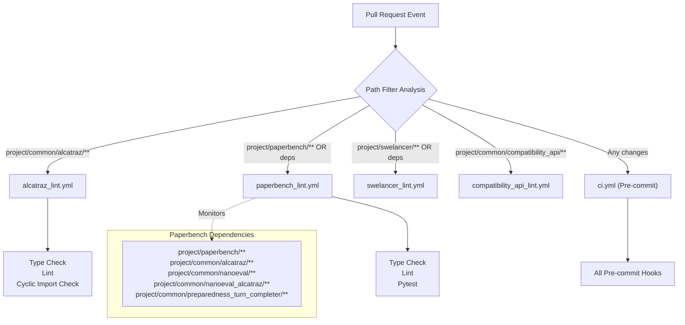
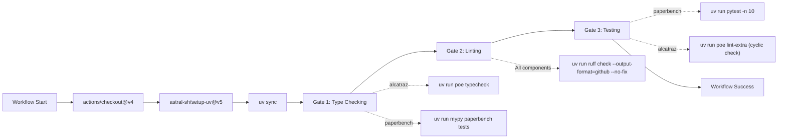

<!-- source: DeepWiki mcp.deepwiki.com · repo openai/frontier-evals · page 7.1 CI/CD Pipeline Architecture · fetched 2026-10-26 -->

# CI/CD Pipeline Architecture

<details>
<summary>Relevant source files</summary>

The following files were used as context for generating this wiki page:

- [.github/workflows/alcatraz_lint.yml](.github/workflows/alcatraz_lint.yml)
- [.github/workflows/ci.yml](.github/workflows/ci.yml)
- [.github/workflows/compatibility_api_lint.yml](.github/workflows/compatibility_api_lint.yml)
- [.github/workflows/compatibility_api_preparedness_lint.yml](.github/workflows/compatibility_api_preparedness_lint.yml)
- [.github/workflows/paperbench_lint.yml](.github/workflows/paperbench_lint.yml)
- [.github/workflows/paperbench_tests.yml](.github/workflows/paperbench_tests.yml)
- [.github/workflows/preparedness_turncompleter_lint.yml](.github/workflows/preparedness_turncompleter_lint.yml)
- [.github/workflows/preparedness_turncompleter_tests.yml](.github/workflows/preparedness_turncompleter_tests.yml)
- [.github/workflows/swelancer_lint.yml](.github/workflows/swelancer_lint.yml)

</details>


## Purpose and Scope

This document describes the overall CI/CD pipeline architecture for the frontier-evals repository. It covers the workflow triggering strategy, quality gate architecture, and common patterns used across all workflows. For details on individual component workflows (alcatraz, compatibility_api, paperbench, swelancer, preparedness), see [Component-Specific Workflows](#7.2). For information about pre-commit hooks and local development tooling, see [Code Quality and Tooling](#7.3).

## Overview

The CI/CD pipeline implements a path-based, component-specific workflow architecture. Each component in the repository has dedicated workflows that activate only when relevant files change. This approach optimizes CI resource usage while maintaining comprehensive quality checks. All workflows are triggered by pull request events and enforce a consistent quality gate strategy including type checking, linting, and in some cases, containerized integration testing.

**Sources:** [.github/workflows/alcatraz_lint.yml:1-14](), [.github/workflows/paperbench_lint.yml:1-17](), [.github/workflows/ci.yml:1-6]()

## Workflow Triggering Architecture

### Pull Request Triggers

All component workflows activate on the following pull request events:
- `opened` - When a PR is first created.
- `synchronize` - When new commits are pushed to an existing PR.
- `reopened` - When a closed PR is reopened.
- `ready_for_review` - When a draft PR is marked ready for review.

Additionally, workflows support `workflow_dispatch` for manual execution with an optional `test_branch` parameter.

**Sources:** [.github/workflows/alcatraz_lint.yml:3-19](), [.github/workflows/paperbench_lint.yml:3-23](), [.github/workflows/preparedness_turncompleter_tests.yml:3-15]()

### Path-Based Activation

Each workflow defines specific path filters that determine when it should run. This ensures that only relevant checks execute for a given change:



**Diagram: Workflow Triggering and Path Filter Architecture**

The dependency tracking strategy ensures that changes to common infrastructure trigger checks in downstream evaluation projects. For example, `paperbench_lint.yml` and `paperbench_tests.yml` trigger if `project/common/alcatraz/**` or `project/common/nanoeval/**` are modified.

**Sources:** [.github/workflows/paperbench_lint.yml:5-10](), [.github/workflows/paperbench_tests.yml:5-10](), [.github/workflows/swelancer_lint.yml:5-9]()

## Quality Gate Architecture

### Quality Enforcement Flow

Each component workflow implements a consistent quality gate:



**Diagram: Quality Gate Execution Flow**

### Gate 1: Type Checking with mypy

Type checking is performed using `mypy`. Components use different invocation patterns based on their local configuration:

- **Alcatraz / SWELancer:** Use a `poe` task for abstraction.
  ```bash
  uv run poe typecheck
  ```
  [.github/workflows/alcatraz_lint.yml:44](), [.github/workflows/swelancer_lint.yml:49]()

- **PaperBench / Compatibility API:** Direct mypy invocation with explicit targets.
  ```bash
  uv run mypy paperbench tests
  ```
  [.github/workflows/paperbench_lint.yml:50](), [.github/workflows/compatibility_api_lint.yml:45]()

**Sources:** [.github/workflows/alcatraz_lint.yml:41-44](), [.github/workflows/paperbench_lint.yml:47-50]()

### Gate 2: Linting with ruff

All components use `ruff` for linting with a strict configuration. The `--output-format=github` flag formats violations as GitHub annotations for better visibility in PRs:

```bash
uv run ruff check --output-format=github --no-fix
```

**Sources:** [.github/workflows/alcatraz_lint.yml:46-49](), [.github/workflows/compatibility_api_preparedness_lint.yml:47-50]()

### Gate 3: Testing and Specialized Analysis

Testing workflows (e.g., `paperbench_tests.yml`) include complex setup steps such as Docker image builds and Git LFS hydration.

- **Docker Integration:** `paperbench_tests.yml` builds a base image `pb-env` using `Dockerfile.base` before running `pytest`.
  [.github/workflows/paperbench_tests.yml:54-62]()
- **LFS Hydration:** Specific data directories are fetched via `git lfs fetch` before execution.
  [.github/workflows/paperbench_tests.yml:34-37]()
- **Cyclic Import Checks:** The `alcatraz` workflow includes `pylint` specifically for cyclic import detection.
  [.github/workflows/alcatraz_lint.yml:51-54]()

**Sources:** [.github/workflows/paperbench_tests.yml:64-67](), [.github/workflows/preparedness_turncompleter_tests.yml:39-42]()

## Workflow Structure and Common Patterns

### Standard Workflow Structure

All linting workflows follow a consistent structure to ensure environment reproducibility:

1.  **Checkout:** Uses `actions/checkout@v4` with `fetch-depth: 1` (shallow clone) to optimize speed.
2.  **UV Setup:** Uses `astral-sh/setup-uv@v5` to manage the Python toolchain.
3.  **Dependency Sync:** Executes `uv sync` within the specific component's `working-directory`. The `UV_GIT_LFS: 1` environment variable is set to ensure LFS-backed dependencies are available.

**Sources:** [.github/workflows/alcatraz_lint.yml:26-39](), [.github/workflows/compatibility_api_lint.yml:27-40]()

### Pre-commit Workflow

The `ci.yml` workflow serves as a repository-wide safety net, running all pre-commit hooks on every pull request to `main`:

```yaml
- name: Run pre-commit hooks
  run: pre-commit run --verbose --all-files
```

Unlike component-specific workflows, this uses a standard `setup-python` action and `pip` to install `pre-commit`.

**Sources:** [.github/workflows/ci.yml:14-25]()

## Dependency Management in CI

### UV Package Manager

The repository standardizes on `uv` for CI. This provides faster installation times and reliable lockfile synchronization across the monorepo's various sub-projects.

```yaml
- name: Install dependencies
  working-directory: ./project/common/alcatraz
  env:
    UV_GIT_LFS: 1
  run: |
    uv sync
```

**Sources:** [.github/workflows/alcatraz_lint.yml:31-39](), [.github/workflows/paperbench_lint.yml:37-45]()

### Secrets Management

Workflows requiring LLM evaluation or external API access define the `OPENAI_API_KEY` at the job or step level using GitHub Secrets.

**Sources:** [.github/workflows/paperbench_lint.yml:27-29](), [.github/workflows/preparedness_turncompleter_tests.yml:20-22]()

---

