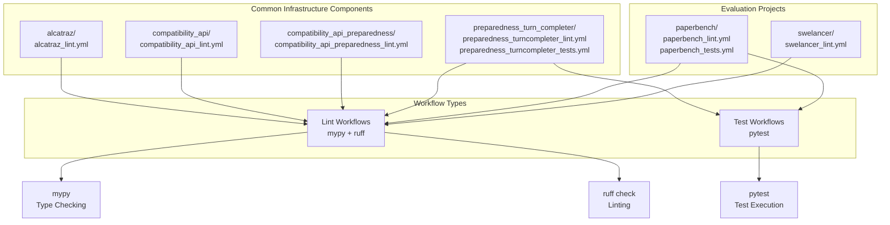
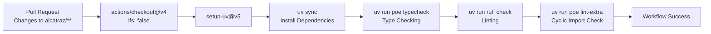
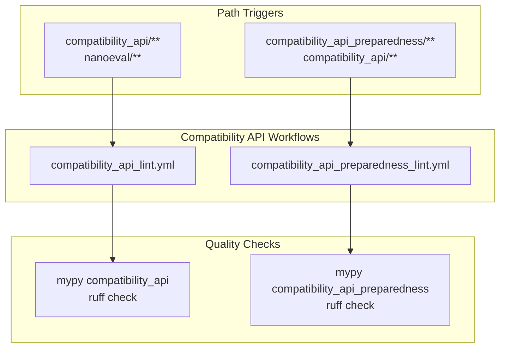
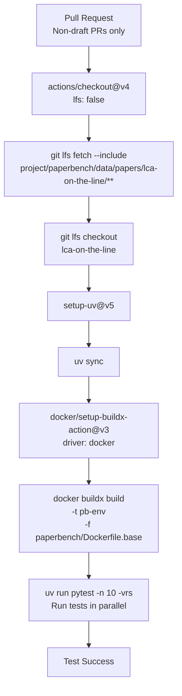
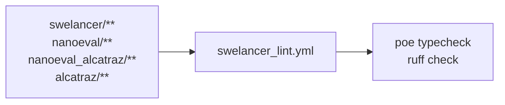
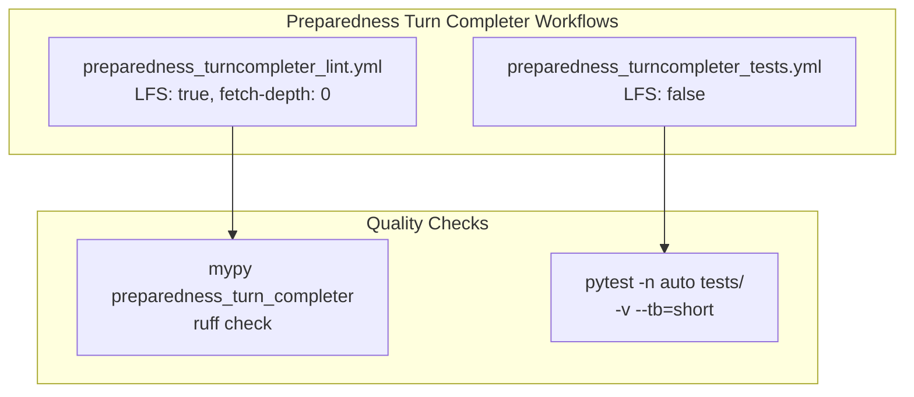
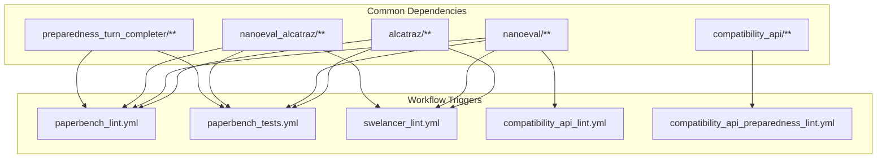

<!-- source: DeepWiki mcp.deepwiki.com · repo openai/frontier-evals · page 7.2 Component-Specific Workflows · fetched 2026-10-26 -->

# Component-Specific Workflows

<details>
<summary>Relevant source files</summary>

The following files were used as context for generating this wiki page:

- [.github/workflows/alcatraz_lint.yml](.github/workflows/alcatraz_lint.yml)
- [.github/workflows/compatibility_api_lint.yml](.github/workflows/compatibility_api_lint.yml)
- [.github/workflows/compatibility_api_preparedness_lint.yml](.github/workflows/compatibility_api_preparedness_lint.yml)
- [.github/workflows/paperbench_lint.yml](.github/workflows/paperbench_lint.yml)
- [.github/workflows/paperbench_tests.yml](.github/workflows/paperbench_tests.yml)
- [.github/workflows/preparedness_turncompleter_lint.yml](.github/workflows/preparedness_turncompleter_lint.yml)
- [.github/workflows/preparedness_turncompleter_tests.yml](.github/workflows/preparedness_turncompleter_tests.yml)
- [.github/workflows/swelancer_lint.yml](.github/workflows/swelancer_lint.yml)

</details>


## Purpose and Scope

This page documents the individual CI/CD workflows for each component in the frontier-evals repository. Each component has dedicated lint workflows that run type checking, linting, and formatting validation. Some components also have test workflows that execute their test suites. These workflows implement path-based triggering to optimize CI resource usage by running only when relevant files change.

For the overall CI/CD architecture and quality gate strategy, see [CI/CD Pipeline Architecture](#7.1). For tool configuration details, see [Code Quality and Tooling](#7.3).

## Workflow Architecture Overview

The repository implements eight component-specific workflows divided into two categories:

**Linting Workflows**: Run type checking (mypy) and code quality checks (ruff) to enforce code standards.

**Testing Workflows**: Execute test suites with component-specific infrastructure requirements (Docker, Git LFS).



**Sources**: [.github/workflows/alcatraz_lint.yml](), [.github/workflows/compatibility_api_lint.yml](), [.github/workflows/compatibility_api_preparedness_lint.yml](), [.github/workflows/paperbench_lint.yml](), [.github/workflows/paperbench_tests.yml](), [.github/workflows/preparedness_turncompleter_lint.yml](), [.github/workflows/preparedness_turncompleter_tests.yml](), [.github/workflows/swelancer_lint.yml]()

## Alcatraz Linting Workflow

The alcatraz linting workflow (`alcatraz_lint.yml`) runs type checking, linting, and advanced cyclic import detection for the Alcatraz container orchestration system.

### Workflow Configuration

| Property | Value |
|----------|-------|
| **File** | `.github/workflows/alcatraz_lint.yml` |
| **Trigger Paths** | `project/common/alcatraz/**` |
| **Working Directory** | `./project/common/alcatraz` |
| **Runner** | `ubuntu-latest` |
| **LFS Required** | No |

### Quality Checks

The workflow executes three quality checks in sequence:

1. **Type Checking**: `uv run poe typecheck` - Runs mypy type checking [.github/workflows/alcatraz_lint.yml:41-44]()
2. **Linting**: `uv run ruff check --output-format=github --no-fix` - Runs strict ruff linting with GitHub-formatted output [.github/workflows/alcatraz_lint.yml:46-49]()
3. **Cyclic Import Detection**: `uv run poe lint-extra` - Uses pylint to detect circular import dependencies [.github/workflows/alcatraz_lint.yml:51-54]()



### Unique Features

Alcatraz is the only component that runs `pylint` for cyclic import detection via `poe lint-extra`. This additional check prevents circular dependencies that can cause import issues in the container orchestration logic [.github/workflows/alcatraz_lint.yml:51-54]().

**Sources**: [.github/workflows/alcatraz_lint.yml:1-55]()

## Compatibility API Linting Workflows

Two separate workflows lint the compatibility API implementations: one for the base API and one for the preparedness-specific implementation.

### Base Compatibility API Workflow

The base compatibility API workflow (`compatibility_api_lint.yml`) validates the abstract environment interface.

| Property | Value |
|----------|-------|
| **File** | `.github/workflows/compatibility_api_lint.yml` |
| **Trigger Paths** | `project/common/compatibility_api/**`<br/>`project/common/nanoeval/**` |
| **Working Directory** | `./project/common/compatibility_api` |
| **Type Check Command** | `uv run mypy compatibility_api` |

The workflow triggers on changes to both `compatibility_api/**` and `nanoeval/**` because nanoeval depends on the compatibility API interface [.github/workflows/compatibility_api_lint.yml:5-7]().

### Preparedness Compatibility API Workflow

The preparedness-specific implementation workflow (`compatibility_api_preparedness_lint.yml`) validates the concrete preparedness environment implementation.

| Property | Value |
|----------|-------|
| **File** | `.github/workflows/compatibility_api_preparedness_lint.yml` |
| **Trigger Paths** | `project/common/compatibility_api_preparedness/**`<br/>`project/common/compatibility_api/**` |
| **Working Directory** | `./project/common/compatibility_api_preparedness` |
| **Type Check Command** | `uv run mypy compatibility_api_preparedness` |

This workflow monitors both the preparedness implementation and the base API because changes to the base interface require validation of the concrete implementation [.github/workflows/compatibility_api_preparedness_lint.yml:5-8]().



**Sources**: [.github/workflows/compatibility_api_lint.yml:1-51](), [.github/workflows/compatibility_api_preparedness_lint.yml:1-51]()

## PaperBench Workflows

PaperBench has both linting and testing workflows due to its complex integration requirements with Docker and Git LFS data.

### PaperBench Linting Workflow

| Property | Value |
|----------|-------|
| **File** | `.github/workflows/paperbench_lint.yml` |
| **Trigger Paths** | `project/paperbench/**`<br/>`project/common/alcatraz/**`<br/>`project/common/nanoeval/**`<br/>`project/common/nanoeval_alcatraz/**`<br/>`project/common/preparedness_turn_completer/**` |
| **Environment Variables** | `OPENAI_API_KEY` (from secrets) |
| **Type Check Command** | `uv run mypy paperbench tests` |

The workflow monitors all PaperBench dependencies, triggering when any common infrastructure component changes [.github/workflows/paperbench_lint.yml:5-10]().

### PaperBench Testing Workflow

The PaperBench testing workflow (`paperbench_tests.yml`) is the most complex workflow, requiring Docker infrastructure and selective Git LFS data hydration.

| Property | Value |
|----------|-------|
| **File** | `.github/workflows/paperbench_tests.yml` |
| **Skip Condition** | `github.event.pull_request.draft == false` |
| **Docker Required** | Yes - builds `pb-env` image |
| **LFS Data** | Selective fetch: `lca-on-the-line` paper only |
| **Test Command** | `uv run pytest -n 10 -vrs` |

#### Test Workflow Steps



#### Selective LFS Hydration

The workflow uses a selective Git LFS fetch strategy to minimize CI time and bandwidth:

```bash
git lfs fetch --include "project/paperbench/data/papers/lca-on-the-line/**" --exclude ""
git lfs checkout project/paperbench/data/papers/lca-on-the-line
```

This fetches only the `lca-on-the-line` paper data required for tests [.github/workflows/paperbench_tests.yml:34-37]().

#### Docker Image Build

The workflow builds the `pb-env` Docker image using Docker Buildx:

```bash
docker buildx build \
  --builder default \
  --platform=linux/amd64 \
  --load \
  -t pb-env \
  -f paperbench/Dockerfile.base .
```

This image provides the execution environment for PaperBench evaluations [.github/workflows/paperbench_tests.yml:54-62]().

#### Parallel Test Execution

Tests run with parallel execution using pytest-xdist: `pytest -n 10 -vrs` runs up to 10 tests concurrently [.github/workflows/paperbench_tests.yml:67]().

**Sources**: [.github/workflows/paperbench_lint.yml:1-56](), [.github/workflows/paperbench_tests.yml:1-68]()

## SWE-Lancer Linting Workflow

The SWE-Lancer workflow (`swelancer_lint.yml`) lints the software engineering evaluation project.

| Property | Value |
|----------|-------|
| **File** | `.github/workflows/swelancer_lint.yml` |
| **Trigger Paths** | `project/swelancer/**`<br/>`project/common/nanoeval/**`<br/>`project/common/nanoeval_alcatraz/**`<br/>`project/common/alcatraz/**` |
| **Environment Variables** | `OPENAI_API_KEY` (from secrets) |
| **Type Check Command** | `uv run poe typecheck` |

### Dependency Monitoring

The workflow monitors all infrastructure dependencies used by SWE-Lancer, including alcatraz, nanoeval, and their integration layer [.github/workflows/swelancer_lint.yml:5-9]().



**Sources**: [.github/workflows/swelancer_lint.yml:1-55]()

## Preparedness Turn Completer Workflows

The preparedness turn completer has both linting and testing workflows for its turn-based completion logic.

### Preparedness Turn Completer Linting Workflow

| Property | Value |
|----------|-------|
| **File** | `.github/workflows/preparedness_turncompleter_lint.yml` |
| **Trigger Paths** | `project/common/preparedness_turn_completer/**` |
| **LFS Required** | Yes (`lfs: true`, `fetch-depth: 0`) |
| **Environment Variables** | `OPENAI_API_KEY` (from secrets) |
| **Type Check Command** | `uv run mypy preparedness_turn_completer` |

This workflow requires full LFS checkout and Git history, unlike most other linting workflows [.github/workflows/preparedness_turncompleter_lint.yml:30-31]().

### Preparedness Turn Completer Testing Workflow

| Property | Value |
|----------|-------|
| **File** | `.github/workflows/preparedness_turncompleter_tests.yml` |
| **Trigger Paths** | `project/common/preparedness_turn_completer/**` |
| **LFS Required** | No |
| **Test Command** | `uv run pytest -n auto tests/ -v --tb=short` |

The test workflow uses `pytest -n auto` for automatic parallel test execution based on available CPU cores [.github/workflows/preparedness_turncompleter_tests.yml:42]().



**Sources**: [.github/workflows/preparedness_turncompleter_lint.yml:1-52](), [.github/workflows/preparedness_turncompleter_tests.yml:1-43]()

## Workflow Comparison Matrix

The following table summarizes the configuration differences across all component workflows:

| Component | Workflow File | Type Check Command | Linting | Testing | Docker | LFS | OPENAI_API_KEY |
|-----------|--------------|-------------------|---------|---------|--------|-----|----------------|
| **alcatraz** | `alcatraz_lint.yml` | `poe typecheck` | ✓ (+ pylint) | ✗ | ✗ | ✗ | ✗ |
| **compatibility_api** | `compatibility_api_lint.yml` | `mypy compatibility_api` | ✓ | ✗ | ✗ | ✗ | ✗ |
| **compatibility_api_preparedness** | `compatibility_api_preparedness_lint.yml` | `mypy compatibility_api_preparedness` | ✓ | ✗ | ✗ | ✗ | ✗ |
| **paperbench** (lint) | `paperbench_lint.yml` | `mypy paperbench tests` | ✓ | ✗ | ✗ | ✗ | ✓ |
| **paperbench** (test) | `paperbench_tests.yml` | N/A | ✗ | ✓ (n=10) | ✓ | ✓ (selective) | ✓ |
| **swelancer** | `swelancer_lint.yml` | `poe typecheck` | ✓ | ✗ | ✗ | ✗ | ✓ |
| **preparedness_turn_completer** (lint) | `preparedness_turncompleter_lint.yml` | `mypy preparedness_turn_completer` | ✓ | ✗ | ✗ | ✓ (full) | ✓ |
| **preparedness_turn_completer** (test) | `preparedness_turncompleter_tests.yml` | N/A | ✗ | ✓ (n=auto) | ✗ | ✗ | ✓ |

**Key Observations**:
- Only **alcatraz** runs pylint for cyclic import detection [.github/workflows/alcatraz_lint.yml:51-54]()
- Only **paperbench** requires Docker infrastructure [.github/workflows/paperbench_tests.yml:49-62]()
- Only **paperbench** (test) and **preparedness_turn_completer** (lint) use Git LFS [.github/workflows/paperbench_tests.yml:34-37](), [.github/workflows/preparedness_turncompleter_lint.yml:30-31]()
- All evaluation projects and preparedness components require `OPENAI_API_KEY`
- Common infrastructure components (alcatraz, compatibility_api) do not need API keys

**Sources**: All workflow files listed above

## Path-Based Triggering Patterns

Each workflow uses path filters to trigger only when relevant files change. This section documents the triggering patterns and dependency relationships.

### Direct Component Triggers

| Workflow | Primary Path |
|----------|-------------|
| `alcatraz_lint.yml` | `project/common/alcatraz/**` |
| `compatibility_api_lint.yml` | `project/common/compatibility_api/**` |
| `compatibility_api_preparedness_lint.yml` | `project/common/compatibility_api_preparedness/**` |
| `preparedness_turncompleter_lint.yml` | `project/common/preparedness_turn_completer/**` |
| `preparedness_turncompleter_tests.yml` | `project/common/preparedness_turn_completer/**` |
| `swelancer_lint.yml` | `project/swelancer/**` |

### Cross-Component Dependency Triggers

Several workflows trigger on changes to their dependencies:



**PaperBench Dependency Triggers** [.github/workflows/paperbench_lint.yml:5-10]():
- `project/paperbench/**`
- `project/common/alcatraz/**`
- `project/common/nanoeval/**`
- `project/common/nanoeval_alcatraz/**`
- `project/common/preparedness_turn_completer/**`

**SWE-Lancer Dependency Triggers** [.github/workflows/swelancer_lint.yml:5-9]():
- `project/swelancer/**`
- `project/common/nanoeval/**`
- `project/common/nanoeval_alcatraz/**`
- `project/common/alcatraz/**`

**Compatibility API Cross-Triggers**:
- `compatibility_api_lint.yml` monitors `nanoeval/**` because nanoeval uses the compatibility API [.github/workflows/compatibility_api_lint.yml:7]()
- `compatibility_api_preparedness_lint.yml` monitors `compatibility_api/**` to validate the implementation when the interface changes [.github/workflows/compatibility_api_preparedness_lint.yml:7]()

**Sources**: [.github/workflows/paperbench_lint.yml:5-10](), [.github/workflows/swelancer_lint.yml:5-9](), [.github/workflows/compatibility_api_lint.yml:5-7](), [.github/workflows/compatibility_api_preparedness_lint.yml:5-8]()

## Common Workflow Patterns

All workflows share these common implementation patterns:

### Standard Checkout Configuration

Most workflows use shallow checkout without LFS:
```yaml
- uses: actions/checkout@v4
  with:
    lfs: false
    fetch-depth: 1
```

**Exception**: `preparedness_turncompleter_lint.yml` uses full LFS and history [.github/workflows/preparedness_turncompleter_lint.yml:30-31]().

### UV Package Manager Setup

All workflows use the `uv` package manager for dependency installation:
```yaml
- name: Install uv
  uses: astral-sh/setup-uv@v5

- name: Install dependencies
  env:
    UV_GIT_LFS: 1
  run: |
    uv sync
```

The `UV_GIT_LFS=1` environment variable enables Git LFS support during dependency resolution across all workflows [.github/workflows/alcatraz_lint.yml:37]().

### GitHub-Formatted Output

All workflows use GitHub's annotation format for linting errors:
```bash
uv run ruff check --output-format=github --no-fix
```

This format creates inline PR annotations for linting violations [.github/workflows/alcatraz_lint.yml:49]().

### Pull Request Trigger Configuration

All workflows use consistent PR trigger configuration:
```yaml
on:
  pull_request:
    paths: [...]
    branches:
      - '**'
    types:
      - opened
      - synchronize
      - reopened
      - ready_for_review
```

This ensures workflows run on all PR events, including when draft PRs are marked ready for review.

**Sources**: All workflow files

## Workflow Execution Commands

This section documents the exact commands executed by each workflow for reference:

### Type Checking Commands

| Component | Command |
|-----------|---------|
| **alcatraz** | `uv run poe typecheck` |
| **compatibility_api** | `uv run mypy compatibility_api` |
| **compatibility_api_preparedness** | `uv run mypy compatibility_api_preparedness` |
| **paperbench** | `uv run mypy paperbench tests` |
| **swelancer** | `uv run poe typecheck` |
| **preparedness_turn_completer** | `uv run mypy preparedness_turn_completer` |

### Linting Commands

All components use the same ruff command:
```bash
uv run ruff check --output-format=github --no-fix
```

### Additional Quality Checks

**Alcatraz Cyclic Import Detection**:
```bash
uv run poe lint-extra
```
This runs pylint configured to detect circular imports [.github/workflows/alcatraz_lint.yml:51-54]().

### Testing Commands

**PaperBench**:
```bash
uv run pytest -n 10 -vrs
```
Runs tests with 10 parallel workers [.github/workflows/paperbench_tests.yml:67]().

**Preparedness Turn Completer**:
```bash
uv run pytest -n auto tests/ -v --tb=short
```
Automatically determines parallelism and uses short traceback format [.github/workflows/preparedness_turncompleter_tests.yml:42]().

**Sources**: All workflow files

## Special Requirements by Component

### Docker Requirements

**Component**: PaperBench (tests only)

**Setup Steps**:
1. Docker Buildx action with default driver [.github/workflows/paperbench_tests.yml:49-52]()
2. Build `pb-env` image from `paperbench/Dockerfile.base` [.github/workflows/paperbench_tests.yml:54-62]()
3. Image tagged as `pb-env` for use by tests

### Git LFS Requirements

**PaperBench Tests** (Selective):
- Fetches only `lca-on-the-line` paper data
- Uses `--include` and `--exclude` flags for selective fetch
- Checkouts specific path after fetch [.github/workflows/paperbench_tests.yml:34-37]()

**Preparedness Turn Completer Lint** (Full):
- Enables full LFS checkout: `lfs: true`
- Requires full history: `fetch-depth: 0` [.github/workflows/preparedness_turncompleter_lint.yml:30-31]()

### Environment Secret Requirements

The following components require the `OPENAI_API_KEY` secret:

- `paperbench_lint.yml` [.github/workflows/paperbench_lint.yml:29]()
- `paperbench_tests.yml` [.github/workflows/paperbench_tests.yml:26]()
- `swelancer_lint.yml` [.github/workflows/swelancer_lint.yml:28]()
- `preparedness_turncompleter_lint.yml` [.github/workflows/preparedness_turncompleter_lint.yml:25]()
- `preparedness_turncompleter_tests.yml` [.github/workflows/preparedness_turncompleter_tests.yml:21]()

**Sources**: [.github/workflows/paperbench_tests.yml:34-62](), [.github/workflows/preparedness_turncompleter_lint.yml:30-31](), all workflow files with environment variables

---

