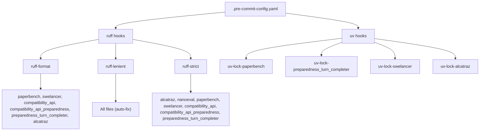
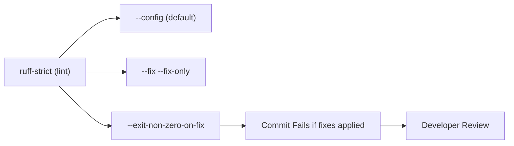
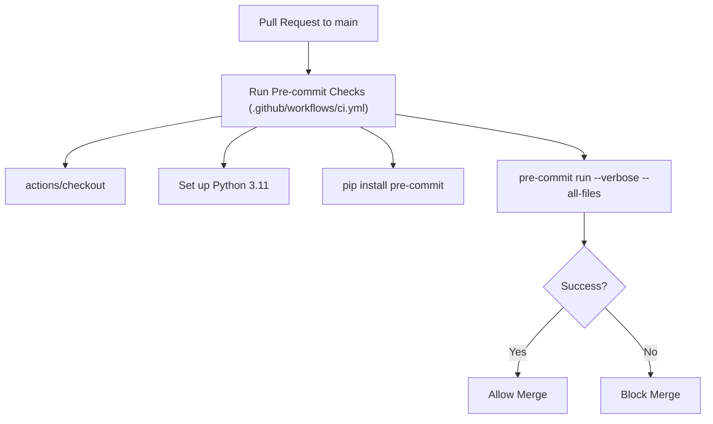

<!-- source: DeepWiki mcp.deepwiki.com · repo openai/frontier-evals · page 7.3 Code Quality and Tooling · fetched 2026-10-26 -->

# Code Quality and Tooling

Relevant source files

The following files were used as context for generating this wiki page:

- [.github/workflows/ci.yml](.github/workflows/ci.yml)
- [.pre-commit-config.yaml](.pre-commit-config.yaml)

This document covers the automated code quality tools and development workflows used across the frontier-evals repository. It details the pre-commit hook system, code formatting with `ruff`, type checking with `mypy`, and dependency management with `uv`.

## Pre-commit Hook System

The repository uses a comprehensive pre-commit hook system to enforce code quality standards before commits are made. The configuration is centralized in [.pre-commit-config.yaml:1-51]() and applies different levels of strictness to different projects within the monorepo. The hooks are also executed in CI to ensure compliance [.github/workflows/ci.yml:24-25]().

### Hook Configuration Overview

**Pre-commit Hook Flow**  
Sources: [.pre-commit-config.yaml:1-51]()

The system implements a multi-tier approach where formatting runs first [.pre-commit-config.yaml:7-11](), followed by lenient auto-fixing [.pre-commit-config.yaml:13-19](), and finally strict linting [.pre-commit-config.yaml:21-28]() for opted-in projects.

### Hook Types and Targets

| Hook Type | Target Projects | Configuration | Purpose |
|-----------|----------------|---------------|---------|
| `ruff-format` | alcatraz, paperbench, swelancer, compatibility_api, compatibility_api_preparedness, preparedness_turn_completer | Default ruff config | Black-compatible code formatting [.pre-commit-config.yaml:9-11]() |
| `ruff-lenient` | All files | `ruff_autofix_minimal.toml` | Auto-fix basic issues with minimal config [.pre-commit-config.yaml:14-19]() |
| `ruff-strict` | alcatraz, nanoeval, paperbench, swelancer, compatibility_api, compatibility_api_preparedness, preparedness_turn_completer | `pyproject.toml` config | Strict linting with project-specific rules [.pre-commit-config.yaml:22-28]() |
| `uv-lock` | paperbench, preparedness_turn_completer, swelancer, alcatraz | Per-project | Dependency lock file management [.pre-commit-config.yaml:30-51]() |

Sources: [.pre-commit-config.yaml:1-51]()

## Code Formatting and Linting Strategy

The repository utilizes a three-tier quality enforcement strategy using `ruff`.

### 1. Formatting
`ruff-format` is used as the primary code formatter, configured to be black-compatible. It runs first in the pre-commit pipeline [.pre-commit-config.yaml:7-11]() to ensure subsequent linting steps see consistently formatted code.

### 2. Lenient Auto-Fixing
The `ruff-lenient` hook [.pre-commit-config.yaml:14-19]() uses a minimal configuration file (`ruff_autofix_minimal.toml`) and applies unsafe fixes with the `--exit-non-zero-on-fix` flag. This ensures the commit fails if auto-fixes are applied, requiring developer review of the changes.

### 3. Strict Linting
The `ruff-strict` hook [.pre-commit-config.yaml:22-28]() targets specific projects and uses their individual `pyproject.toml` configurations. It uses `--fix` and `--fix-only` flags combined with `--exit-non-zero-on-fix` to enforce strict standards while allowing safe automated corrections.

**Strict Linting Enforcement Logic**  
Sources: [.pre-commit-config.yaml:22-28]()

## Dependency Management with uv

The repository uses `uv` for modern Python dependency management. Pre-commit hooks ensure lock files stay synchronized with dependency changes across the monorepo.

### uv Lock File Management

Each major component has a dedicated `uv-lock` hook that triggers when files within its specific project directory are modified [.pre-commit-config.yaml:30-51]().

| Project | Hook Name | Arguments | File Pattern |
|---------|-----------|-----------|--------------|
| paperbench | `uv-lock-paperbench` | `[--project, project/paperbench]` | `^project/paperbench/` [.pre-commit-config.yaml:35-37]() |
| preparedness_turn_completer | `uv-lock-preparedness_turn_completer` | `[--project, project/common/preparedness_turn_completer]` | `^project/common/preparedness_turn_completer/` [.pre-commit-config.yaml:39-41]() |
| swelancer | `uv-lock-swelancer` | `[--project, project/swelancer]` | `^project/swelancer/` [.pre-commit-config.yaml:43-45]() |
| alcatraz | `uv-lock-alcatraz` | `[--project, project/common/alcatraz]` | `^project/common/alcatraz/` [.pre-commit-config.yaml:47-51]() |

## Continuous Integration (CI)

The code quality checks are mirrored in GitHub Actions to prevent regressions from entering the `main` branch.

**CI Quality Gate Architecture**  
Sources: [.github/workflows/ci.yml:1-25]()

The CI environment specifically uses Python 3.11 [.github/workflows/ci.yml:17]() and runs all hooks against all files in the repository [.github/workflows/ci.yml:25]().

## File Exclusions

Specific paths are excluded from the pre-commit quality checks, typically because they contain external code or large datasets [.pre-commit-config.yaml:52]():

*   `project/paperbench/paperbench/agents/aisi-basic-agent/inspect_ai`: External agent integration code.
*   `project/swelancer/issues/`: Data files related to software engineering issues.

Sources: [.pre-commit-config.yaml:52]()

---

