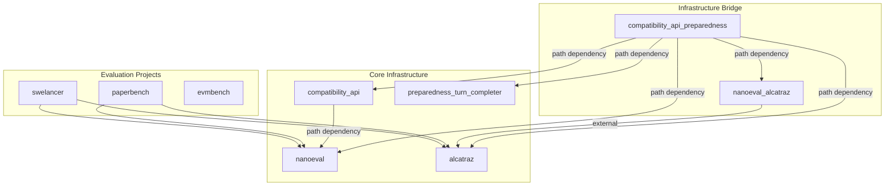
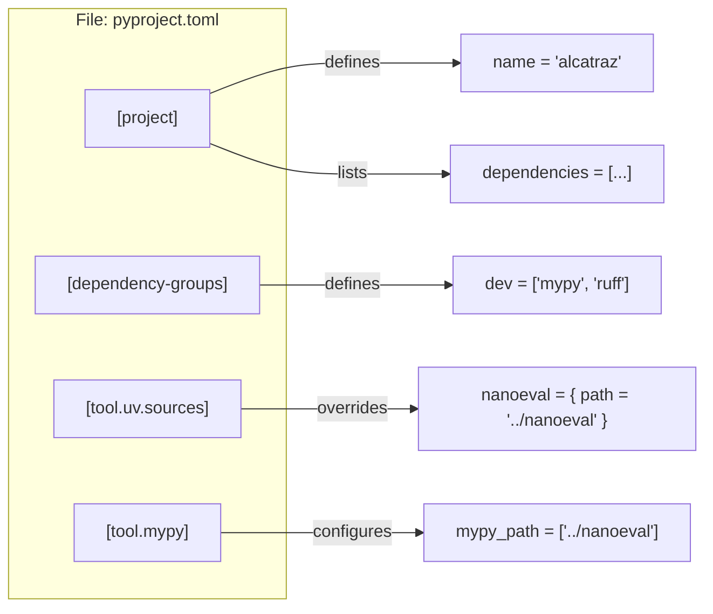
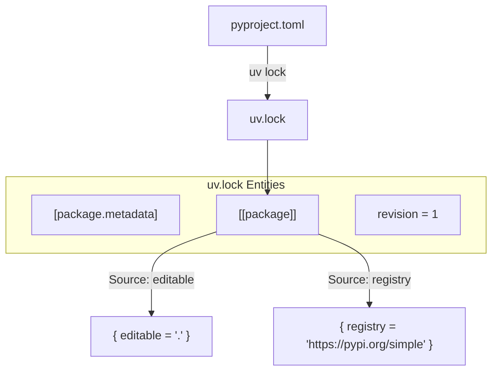

<!-- source: DeepWiki mcp.deepwiki.com · repo openai/frontier-evals · page 7.4 Dependency Management · fetched 2026-10-26 -->

# Dependency Management

<details>
<summary>Relevant source files</summary>

The following files were used as context for generating this wiki page:

- [project/common/alcatraz/pyproject.toml](project/common/alcatraz/pyproject.toml)
- [project/common/alcatraz/uv.lock](project/common/alcatraz/uv.lock)
- [project/common/compatibility_api/pyproject.toml](project/common/compatibility_api/pyproject.toml)
- [project/common/compatibility_api_preparedness/pyproject.toml](project/common/compatibility_api_preparedness/pyproject.toml)
- [project/common/nanoeval/pyproject.toml](project/common/nanoeval/pyproject.toml)
- [project/common/nanoeval_alcatraz/pyproject.toml](project/common/nanoeval_alcatraz/pyproject.toml)

</details>


This page documents the dependency management strategy used across the frontier-evals repository. It covers the `uv` package manager, project-level dependency isolation, lock files, and inter-project dependency patterns.

---

## Overview

The repository uses **uv** as the unified package manager for all projects. Each evaluation project and common infrastructure component maintains its own isolated environment with dedicated `pyproject.toml` and `uv.lock` files. A root-level `pyproject.toml` provides shared tooling configuration without creating a workspace-level environment.

**Key Principles:**
- **Per-project isolation**: Each project in `project/` has independent dependencies [project/common/alcatraz/pyproject.toml:1-6]().
- **Reproducible builds**: Lock files pin exact versions for all transitive dependencies [project/common/alcatraz/uv.lock:1-10]().
- **Editable local dependencies**: Projects reference each other as editable path dependencies [project/common/compatibility_api/pyproject.toml:14-19]().
- **Separate dev dependencies**: Development tools are isolated from runtime requirements [project/common/alcatraz/pyproject.toml:42-52]().

**Sources:** [project/common/alcatraz/pyproject.toml:1-52](), [project/common/alcatraz/uv.lock:1-10](), [project/common/compatibility_api/pyproject.toml:14-19]()

---

## UV Package Manager

### Installation and Basic Usage

`uv` is the primary tool for environment synchronization. Each project uses `uv sync` to create its virtual environment from the checked-in lock file.

```bash
# Create/sync environment for a project
cd project/common/alcatraz
uv sync

# Run commands in the environment
uv run pytest
```

### Why UV

UV provides:
- **Fast dependency resolution**: Rust-based resolver significantly faster than pip.
- **Deterministic lock files**: Ensures consistent environments across machines and CI [project/common/alcatraz/uv.lock:1-10]().
- **Native editable installs**: Seamless local development with path dependencies [project/common/compatibility_api/pyproject.toml:16-18]().
- **Development groups**: Separate runtime from development dependencies [project/common/alcatraz/pyproject.toml:42-43]().

**Sources:** [project/common/alcatraz/uv.lock:1-10](), [project/common/alcatraz/pyproject.toml:42-43](), [project/common/compatibility_api/pyproject.toml:16-18]()

---

## Project Structure and Dependency Hierarchy

The following diagram maps the relationships between various components in the monorepo, showing how evaluation projects consume shared infrastructure.

**Diagram: Monorepo Dependency Flow**



**Sources:** [project/common/compatibility_api/pyproject.toml:14-19](), [project/common/compatibility_api_preparedness/pyproject.toml:14-20](), [project/common/nanoeval_alcatraz/pyproject.toml:1-4]()

---

## Pyproject.toml Structure

### Core Sections

The `pyproject.toml` file is organized into sections that define the project metadata, dependencies, and local source overrides.

**Diagram: Code Entity Mapping (pyproject.toml)**



**Sources:** [project/common/alcatraz/pyproject.toml:1-70](), [project/common/compatibility_api/pyproject.toml:1-30]()

---

## Dependency Types

### Runtime Dependencies

Declared in the `[project]` dependencies array. These are required for the code to execute.

| Project | Key Runtime Dependencies |
|---------|-------------------------|
| `alcatraz` | `docker`, `jupyter_client`, `pydantic`, `fastapi`, `openai` [project/common/alcatraz/pyproject.toml:6-30]() |
| `nanoeval` | `pydantic`, `openai`, `jinja2`, `pandas`, `blobfile` [project/common/nanoeval/pyproject.toml:4-30]() |
| `compatibility_api` | `chz`, `pydantic`, `nanoeval` [project/common/compatibility_api/pyproject.toml:4-6]() |
| `nanoeval_alcatraz` | `async-lru`, `structlog`, `typing-extensions` [project/common/nanoeval_alcatraz/pyproject.toml:4]() |

### Development Dependencies

Declared in `[dependency-groups] dev`. These include linters, type checkers, and task runners.

**Common dev tools:**
- `mypy`: Pinned to `1.18.2` in Alcatraz for strict type checking [project/common/alcatraz/pyproject.toml:44]().
- `ruff`: Minimum version `0.12.1` for linting [project/common/alcatraz/pyproject.toml:47]().
- `poethepoet`: Used for task automation (e.g., `lint`, `typecheck`) [project/common/alcatraz/pyproject.toml:45,76-80]().

---

## Local Path and Git Dependencies

### Editable Installations

Projects reference local components via `[tool.uv.sources]`. This enables the "Monorepo" feel where changes in `common/` are instantly available in `projects/`.

```toml
[tool.uv.sources]
chz = { git = "https://github.com/openai/chz.git" }
compatibility_api = { path = "../compatibility_api", editable = true }
nanoeval = { path = "../nanoeval", editable = true }
```

**Sources:** [project/common/compatibility_api_preparedness/pyproject.toml:14-17]()

---

## Lock Files

The `uv.lock` file is a machine-generated file that ensures every developer and CI runner uses the exact same version of every library.

**Diagram: Lock File Resolution Logic**



**Sources:** [project/common/alcatraz/uv.lock:1-12](), [project/common/alcatraz/uv.lock:90-94]()

---

## Mypy Configuration for Monorepo

Since projects depend on each other via relative paths, `mypy` must be configured to look outside the current directory for type stubs.

- `mypy_path`: Points to the source of local dependencies [project/common/compatibility_api/pyproject.toml:30]().
- `ignore_errors`: Often set to `true` for external modules to prevent dependency issues from blocking local checks [project/common/compatibility_api/pyproject.toml:34]().
- `disable_error_code`: Used to handle untyped libraries (e.g., `import-untyped`) [project/common/alcatraz/pyproject.toml:61]().

**Sources:** [project/common/compatibility_api/pyproject.toml:29-36](), [project/common/alcatraz/pyproject.toml:54-61]()

---

## Build System

The codebase uses `setuptools` as the build backend.

```toml
[build-system]
requires = ["setuptools<78.0.0", "wheel"]
build-backend = "setuptools.build_meta"
```

**Sources:** [project/common/alcatraz/pyproject.toml:35-37](), [project/common/nanoeval/pyproject.toml:35-37]()

---

