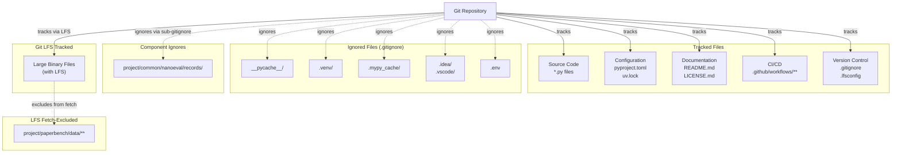
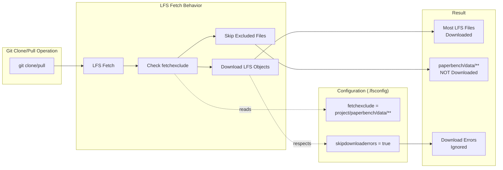
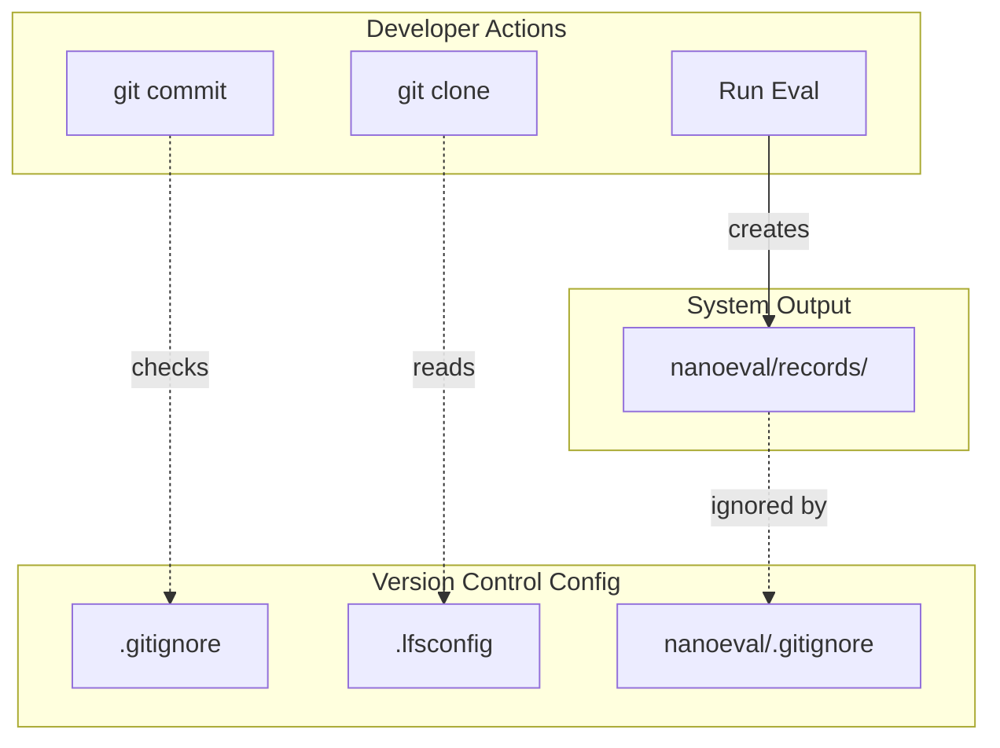

<!-- source: DeepWiki mcp.deepwiki.com · repo openai/frontier-evals · page 7.5 Version Control Configuration · fetched 2026-10-26 -->

# Version Control Configuration

<details>
<summary>Relevant source files</summary>

The following files were used as context for generating this wiki page:

- [.gitignore](.gitignore)
- [.lfsconfig](.lfsconfig)
- [project/common/nanoeval/.gitignore](project/common/nanoeval/.gitignore)

</details>


## Purpose and Scope

This page documents the version control configuration for the frontier-evals repository, specifically the `.gitignore` and `.lfsconfig` files that control which files are tracked by Git and how Git Large File Storage (LFS) handles large binary files. This configuration is essential for maintaining a clean repository and managing large evaluation datasets efficiently.

For information about dependency management and lock files, see [Dependency Management](#7.4). For details about PaperBench's large data files, see [PaperBench](#6.1).

## Git Ignore Configuration

The repository uses a comprehensive `.gitignore` file at the root to exclude common Python artifacts, build outputs, and development tool configurations from version control. Additionally, component-specific ignores are used to manage evaluation artifacts.

### Ignored File Categories

The `.gitignore` file excludes the following categories:

| Category | Patterns | Purpose |
|----------|----------|---------|
| **Python Build** | `__pycache__/`, `*.py[cod]`, `*.egg-info/`, `build/`, `dist/` | Compiled bytecode and distribution packages |
| **Testing** | `.pytest_cache/`, `.coverage`, `.hypothesis/`, `htmlcov/` | Test execution artifacts and coverage reports |
| **Virtual Environments** | `.venv`, `venv/`, `ENV/`, `env.bak/` | Python virtual environment directories |
| **Type Checking** | `.mypy_cache/`, `.pytype/`, `.dmypy.json` | Type checker caches |
| **IDEs** | `.idea/`, `.vscode/`, `.spyderproject` | IDE-specific configuration files |
| **Jupyter** | `.ipynb_checkpoints` | Jupyter notebook checkpoints |
| **Environment** | `.env`, `.envrc` | Local environment variable files |
| **Evaluation Records** | `project/common/nanoeval/records/` | Nanoeval execution history and SQLite state |

**Sources:** [.gitignore:1-168](), [project/common/nanoeval/.gitignore:1]()

### Version Control Structure



**Sources:** [.gitignore:1-168](), [.lfsconfig:1-4](), [project/common/nanoeval/.gitignore:1]()

### Python and Component-Specific Ignores

The configuration follows Python best practices by excluding all build and runtime artifacts:

- **Compiled Python**: Lines [6-9]() exclude `__pycache__/`, `*.py[cod]`, and `*$py.class`.
- **Distribution artifacts**: Lines [14-32]() exclude packaging outputs like `build/`, `dist/`, `*.egg-info/`.
- **Test artifacts**: Lines [44-57]() exclude `.pytest_cache/`, `.coverage`, `.hypothesis/`.
- **Evaluation Records**: The `nanoeval` library creates a `records/` directory to store SQLite state and execution traces. This is ignored at the component level to prevent large, local execution databases from being committed. [project/common/nanoeval/.gitignore:1]()

**Sources:** [.gitignore:6-57](), [project/common/nanoeval/.gitignore:1]()

### Development Environment Ignores

The repository excludes all virtual environment directories and local configuration files to prevent machine-specific settings from being committed:

- **Virtual environments**: Lines [127-133]() exclude `.env`, `.venv`, `venv/`, `ENV/`, and related directories.
- **Environment variables**: Line [4]() excludes `.envrc` (direnv configuration).
- **IDE configurations**: Lines [159-167]() exclude `.idea/` (JetBrains IDEs) and `.vscode/` (Visual Studio Code).

**Sources:** [.gitignore:4](), [.gitignore:127-133](), [.gitignore:159-167]()

## Git LFS Configuration

The repository uses Git Large File Storage (LFS) to manage large binary files, such as datasets for PaperBench and EVMbench. The `.lfsconfig` file at the repository root provides specialized configuration for LFS behavior.

### LFS Settings



**Sources:** [.lfsconfig:1-4]()

### Fetch Exclusion for PaperBench Data

The most significant LFS configuration is the fetch exclusion for PaperBench data:

```
[lfs]
	fetchexclude = project/paperbench/data/**
```

This setting ([.lfsconfig:2]()) prevents Git LFS from automatically downloading files under `project/paperbench/data/**` during clone or fetch operations. This is critical because the PaperBench dataset contains massive evaluation data files that are not required for every developer's workflow.

Developers who need the PaperBench data can explicitly fetch it using:
```bash
git lfs pull --include="project/paperbench/data/**"
```

**Sources:** [.lfsconfig:2]()

### Error Handling Strategy

The configuration enables error tolerance during LFS downloads:

```
[lfs]
	skipdownloaderrors = true
```

This setting ([.lfsconfig:3]()) instructs Git LFS to continue operation even if some LFS objects fail to download. This is particularly useful for handling intermittent network issues or when some archived LFS objects might be temporarily unavailable.

**Sources:** [.lfsconfig:3]()

## Integration with Development Workflow

The version control configuration integrates with other development tools to create a cohesive workflow:



**Sources:** [.gitignore:1-168](), [.lfsconfig:1-4](), [project/common/nanoeval/.gitignore:1]()

### Interaction with CI/CD

The version control configuration supports the CI/CD pipeline:

- Clean repository state ensures consistent CI builds.
- LFS fetch exclusions reduce CI job setup time when PaperBench data is not needed.
- Ignored artifacts like `nanoeval/records/` ensure that transient test execution data does not pollute the repository state during automated runs.

**Sources:** [.gitignore:1-168](), [.lfsconfig:1-4](), [project/common/nanoeval/.gitignore:1]()

## Best Practices

1. **Respect LFS exclusions**: Only fetch PaperBench data if you're actively working on PaperBench evaluations.
2. **Component-level Ignores**: When adding new evaluation frameworks, ensure transient local state (like SQLite databases) is added to a local `.gitignore` similar to `project/common/nanoeval/.gitignore`.
3. **Commit lock files**: While virtual environments are ignored, `uv.lock` files must be committed to ensure reproducible environments.
4. **Use pre-commit hooks**: Ensure pre-commit is installed to validate the repository state against these configurations before pushing.

**Sources:** [.gitignore:1-168](), [.lfsconfig:1-4](), [project/common/nanoeval/.gitignore:1]()

---

