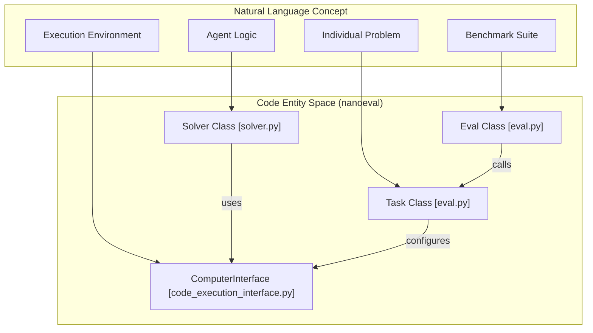
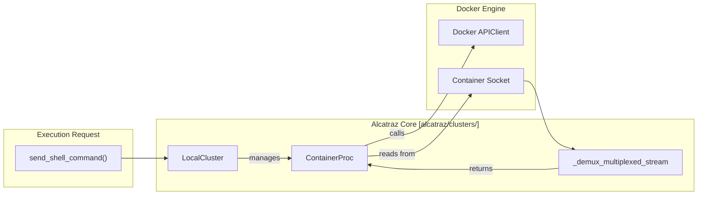

<!-- source: DeepWiki mcp.deepwiki.com · repo openai/frontier-evals · page 8 Glossary · fetched 2026-10-26 -->

# Glossary

Relevant source files

The following files were used as context for generating this wiki page:

- [README.md](README.md)
- [project/common/alcatraz/alcatraz/clusters/_container_proc.py](project/common/alcatraz/alcatraz/clusters/_container_proc.py)
- [project/common/alcatraz/alcatraz/clusters/interface.py](project/common/alcatraz/alcatraz/clusters/interface.py)
- [project/common/alcatraz/alcatraz/clusters/local.py](project/common/alcatraz/alcatraz/clusters/local.py)
- [project/common/compatibility_api/compatibility_api/api.py](project/common/compatibility_api/compatibility_api/api.py)
- [project/common/compatibility_api/compatibility_api/task.py](project/common/compatibility_api/compatibility_api/task.py)
- [project/common/nanoeval/nanoeval/eval.py](project/common/nanoeval/nanoeval/eval.py)
- [project/common/nanoeval/nanoeval/evaluation.py](project/common/nanoeval/nanoeval/evaluation.py)
- [project/common/nanoeval/nanoeval/recorder.py](project/common/nanoeval/nanoeval/recorder.py)
- [project/common/nanoeval/nanoeval/solvers/computer_tasks/code_execution_interface.py](project/common/nanoeval/nanoeval/solvers/computer_tasks/code_execution_interface.py)
- [project/common/nanoeval/nanoeval/solvers/computer_tasks/solver.py](project/common/nanoeval/nanoeval/solvers/computer_tasks/solver.py)
- [project/common/nanoeval/nanoeval/solvers/computer_tasks/task.py](project/common/nanoeval/nanoeval/solvers/computer_tasks/task.py)
- [project/common/nanoeval_alcatraz/nanoeval_alcatraz/alcatraz_computer_interface.py](project/common/nanoeval_alcatraz/nanoeval_alcatraz/alcatraz_computer_interface.py)

This glossary defines technical terms, domain concepts, and architectural primitives used across the `frontier-evals` repository.

## Core Evaluation Concepts

### Eval
The high-level abstraction representing a benchmark or a specific suite of tests. An `Eval` is responsible for defining how to retrieve tasks, how to execute them, and how to aggregate results into metrics.
*   **Implementation:** `Eval` is a generic class defined in [project/common/nanoeval/nanoeval/eval.py:112-120]().
*   **Key Methods:**
    *   `get_tasks()`: Returns a sequence of task instances [project/common/nanoeval/nanoeval/eval.py:116-117]().
    *   `evaluate(task)`: The core logic for running a single task [project/common/nanoeval/nanoeval/eval.py:119-120]().
    *   `get_summary(results)`: Computes final metrics (e.g., accuracy, pass@k) [project/common/nanoeval/nanoeval/eval.py:122-140]().

### Task
A single unit of work within an evaluation. It contains all the necessary data to initialize an environment and prompt a model.
*   **Implementation:** [project/common/nanoeval/nanoeval/eval.py:29-63]().
*   **Key Attributes:** `question_id`, `attempt_id`, and `retry_idx` [project/common/nanoeval/nanoeval/eval.py:34-36]().

### Solver
An agent or logic block that attempts to solve a `Task`. Solvers interact with the environment (e.g., a computer shell or Jupyter kernel) to produce a result.
*   **Implementation:** `PythonCodingSolver` [project/common/nanoeval/nanoeval/solvers/computer_tasks/solver.py:35-53]().

---

## Infrastructure & Runtime

### Alcatraz
The container orchestration system used to provide isolated environments for code execution. It manages Docker containers, Jupyter kernels, and process I/O.
*   **Local Cluster:** `LocalCluster` manages the lifecycle of local Docker containers [project/common/alcatraz/alcatraz/clusters/local.py:149-166]().
*   **ContainerProc:** A utility for managing process streams (stdin/stdout/stderr) within an Alcatraz container [project/common/alcatraz/alcatraz/clusters/_container_proc.py:9-39]().

### ComputerInterface
An abstraction that allows a `Solver` to interact with a computer (container) without knowing the underlying backend (e.g., Local Docker vs. Cloud).
*   **Implementation:** [project/common/nanoeval/nanoeval/solvers/computer_tasks/code_execution_interface.py:71-130]().
*   **Key Capabilities:** `upload`, `download`, and `send_shell_command` [project/common/nanoeval/nanoeval/solvers/computer_tasks/code_execution_interface.py:91-113]().

### Compatibility API
A set of abstract interfaces designed to ensure evaluations remain portable across different internal and external storage/execution environments.
*   **Implementation:** [project/common/compatibility_api/compatibility_api/api.py:7-33]().
*   **Blobstore Access:** Provides `blobstore_root_write` and `blobstore_root_read` to abstract away physical storage paths [project/common/compatibility_api/compatibility_api/api.py:14-32]().

---

## Technical Mapping Diagrams

### From Natural Language to Nanoeval Entities
This diagram maps common evaluation concepts to their specific class implementations within the `nanoeval` framework.

**Nanoeval Entity Mapping**

**Sources:** [project/common/nanoeval/nanoeval/eval.py:29-120](), [project/common/nanoeval/nanoeval/solvers/computer_tasks/solver.py:35-49](), [project/common/nanoeval/nanoeval/solvers/computer_tasks/code_execution_interface.py:71-80]().

### Alcatraz Execution Flow
This diagram maps the system-level components involved when a command is executed within an isolated Alcatraz container.

**Alcatraz System Mapping**

**Sources:** [project/common/alcatraz/alcatraz/clusters/local.py:1-53](), [project/common/alcatraz/alcatraz/clusters/_container_proc.py:9-65](), [project/common/nanoeval/nanoeval/solvers/computer_tasks/code_execution_interface.py:99-113]().

---

## Detailed Terminology Table

| Term | Definition | Code Pointer |
| :--- | :--- | :--- |
| **RolloutSystemError** | An exception blamed on the infrastructure rather than the model. Nanoeval can automatically retry these. | [project/common/nanoeval/nanoeval/eval.py:72-80]() |
| **JupyterComputerInterface** | An extension of `ComputerInterface` that supports executing Python code cells via a Jupyter kernel. | [project/common/nanoeval/nanoeval/solvers/computer_tasks/code_execution_interface.py:132-151]() |
| **Recorder** | A protocol for logging evaluation events, samplings, and results to a database or monitoring service. | [project/common/nanoeval/nanoeval/recorder.py:14-42]() |
| **Demuxing** | The process of separating Docker's multiplexed stream (which combines stdout and stderr) back into distinct buffers. | [project/common/alcatraz/alcatraz/clusters/_container_proc.py:41-65]() |
| **ComputerConfiguration** | A Pydantic model defining the requirements for a task's environment (image, memory, network). | [project/common/nanoeval/nanoeval/solvers/computer_tasks/code_execution_interface.py:180-208]() |
| **CompatibleComputerTask** | A restricted version of `ComputerTask` that enforces portability (e.g., no internet, specific images). | [project/common/compatibility_api/compatibility_api/task.py:10-56]() |
| **ExecutionResult** | A TypedDict or BaseModel containing the `exit_code` and `output` (bytes) of a command execution. | [project/common/alcatraz/alcatraz/clusters/interface.py:4-6]() |

**Sources:** [project/common/nanoeval/nanoeval/eval.py:72-80](), [project/common/nanoeval/nanoeval/solvers/computer_tasks/code_execution_interface.py:132-151](), [project/common/nanoeval/nanoeval/recorder.py:14-42](), [project/common/alcatraz/alcatraz/clusters/_container_proc.py:41-65](), [project/common/compatibility_api/compatibility_api/task.py:10-56](), [project/common/alcatraz/alcatraz/clusters/interface.py:4-6]().