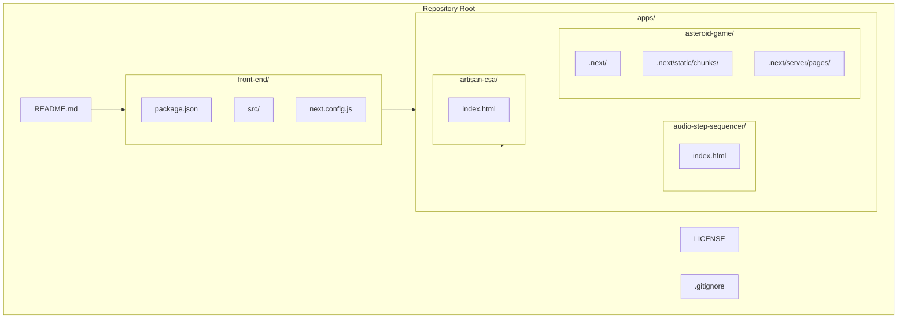
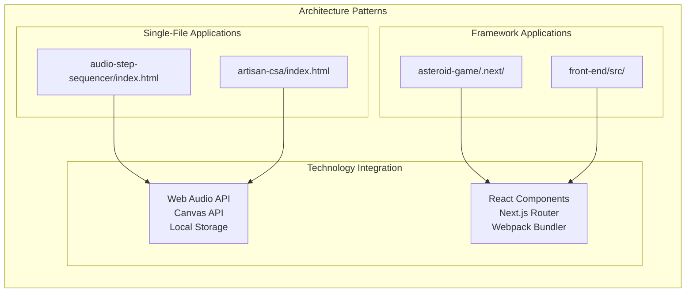
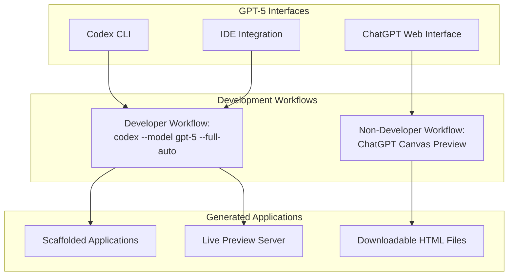

<!-- source: DeepWiki mcp.deepwiki.com · repo openai/gpt-5-coding-examples · page 1 Overview · fetched 2026-10-26 -->

# Overview

Relevant source files

The following files were used as context for generating this wiki page:

- [.gitignore](.gitignore)
- [LICENSE](LICENSE)
- [README.md](README.md)

## Purpose and Scope

This document provides a high-level overview of the GPT-5 Coding Examples repository, which serves as a curated showcase of complete applications generated entirely through single GPT-5 prompts. The repository demonstrates the model's capabilities in scaffolding websites, front-end applications, games, and interactive UIs from natural language descriptions.

The repository contains three main example applications of varying complexity, a Next.js-based exploration front-end for browsing examples, and comprehensive documentation. For detailed information about individual applications, see [Example Applications](#3). For technical implementation details of specific frameworks and build systems, see [Technical Architecture](#4). For understanding the generation workflow and tooling, see [GPT-5 Generation Workflow](#5).

## Repository Structure

The repository follows a clear organizational pattern separating documentation, example applications, and tooling infrastructure:

**Sources:** [README.md:1-62](), [LICENSE:1-19](), [.gitignore:1-150]()

## Application Architecture Patterns

The repository demonstrates two distinct architectural approaches for web application development:

**Sources:** [README.md:3-5](), [README.md:25-46]()

## Example Applications Overview

| Application | Architecture | Technology Stack | Complexity Level |
|-------------|-------------|------------------|------------------|
| **Asteroid Game** | Next.js Framework | React, Canvas API, Web Audio | High - Full production build pipeline |
| **Audio Step Sequencer** | Single HTML File | Vanilla JavaScript, Web Audio API | Medium - Advanced audio programming |
| **Artisan CSA Landing** | Single HTML File | HTML5, CSS3, JavaScript | Low - Interactive business website |

The asteroid game represents the most sophisticated example, featuring a complete Next.js application with production-ready features including:
- App Router implementation in `.next/server/app/`
- Code splitting via webpack chunks in `.next/static/chunks/`
- Error handling through `404.html` and `_error` pages
- Font optimization with Geist font family assets

**Sources:** [README.md:5-6](), [README.md:18-19]()

## GPT-5 Integration Workflows

The repository supports multiple development workflows depending on user technical background:

The `front-end` application serves as an exploration interface, allowing users to:
- Browse example applications at `localhost:3000`
- View zero-shot prompts that generated each application
- Access remix capabilities for adapting existing examples

**Sources:** [README.md:7-19](), [README.md:25-56]()

## Technical Architecture Summary

The repository demonstrates sophisticated build system integration, particularly in the asteroid game example:

- **Build Pipeline**: Webpack runtime (`webpack-272b44dd0cfe77c4.js`) with dynamic chunk loading
- **React Integration**: Framework bundle (`framework-7c95b8e5103c9e90.js`) with App Router (`964-830f77d7ce1c2463.js`)
- **Asset Optimization**: Font subsetting, CSS optimization, and static asset management
- **Error Handling**: Production-ready 404 pages and error boundaries

The single-file applications showcase direct Web API usage without framework overhead, demonstrating that GPT-5 can generate both simple and complex application architectures based on prompt requirements.

**Sources:** [README.md:3-6](), [.gitignore:86-88]()

---

