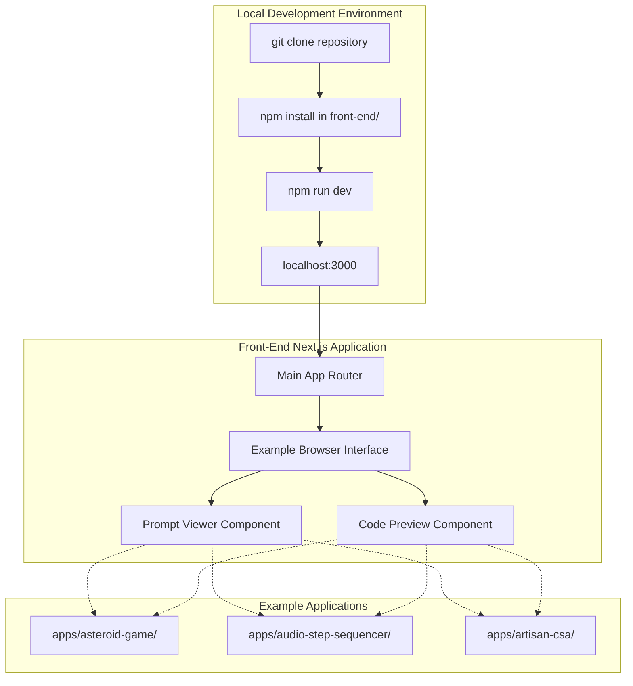
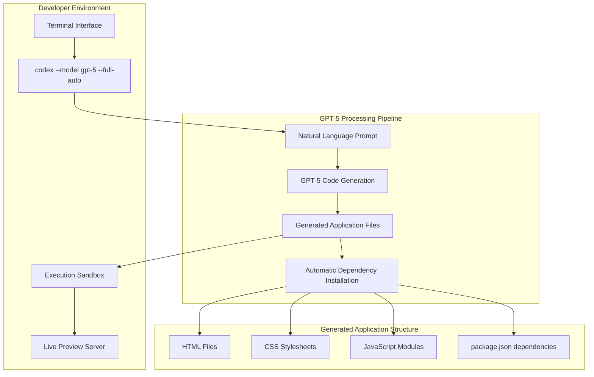
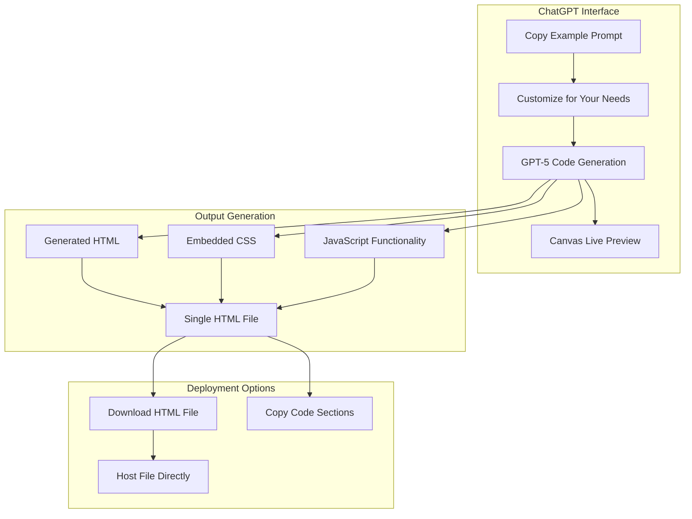
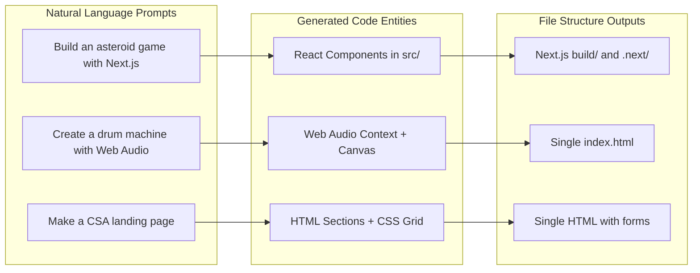

<!-- source: DeepWiki mcp.deepwiki.com · repo openai/gpt-5-coding-examples · page 2 Getting Started · fetched 2026-10-26 -->

# Getting Started

Relevant source files

The following files were used as context for generating this wiki page:

- [README.md](README.md)

This document explains how to explore the GPT-5 generated examples in this repository, set up the local development environment, and understand the different workflows available for creating new applications using GPT-5. It covers both the technical setup process and the conceptual framework for leveraging GPT-5's code generation capabilities.

For detailed analysis of the individual example applications, see [Example Applications](#3). For information about GPT-5 generation workflows and integration patterns, see [GPT-5 Generation Workflow](#5).

## Local Development Setup

The repository includes a Next.js front-end application that serves as an exploration interface for all the example applications. This browser-based interface allows you to view each example, examine the original zero-shot prompts that generated the code, and experiment with modifications.

### Initial Setup Process

The setup process involves cloning the repository and running the front-end exploration application:

| Step | Command | Purpose |
|------|---------|---------|
| 1 | `git clone <repository-url>` | Clone the repository |
| 2 | `cd front-end` | Navigate to front-end directory |
| 3 | `npm install` | Install Next.js dependencies |
| 4 | `npm run dev` | Start development server |
| 5 | Navigate to `localhost:3000` | Access the exploration interface |

### Front-End Exploration Interface

The front-end application provides a unified interface for browsing all examples, viewing their source prompts, and understanding their architectural patterns. This Next.js application serves as both a demonstration of GPT-5's capabilities and a practical tool for exploring the generated code.

**Front-End Application Architecture**

Sources: [README.md:9-19]()

## GPT-5 Generation Workflows

The repository demonstrates two primary workflows for generating applications with GPT-5, each optimized for different user profiles and development environments.

### Developer Workflow: Codex CLI Integration

The Codex CLI provides a terminal-based interface that integrates GPT-5 code generation directly into existing development workflows. This approach offers the most sophisticated development experience with full sandbox execution and live preview capabilities.

**Codex CLI Workflow Architecture**

The Codex CLI workflow supports complex application generation with automatic dependency management and live preview functionality, as demonstrated in the command structure shown in [README.md:40-42]().

Sources: [README.md:32-46]()

### Non-Developer Workflow: ChatGPT Canvas

For users without local development environments, ChatGPT provides a browser-based code generation and preview system. This workflow enables complete application creation without requiring any local software installation.

**ChatGPT Canvas Workflow**

This workflow is particularly effective for generating single-file applications like those found in [apps/audio-step-sequencer/]() and [apps/artisan-csa/](), which demonstrate sophisticated functionality within self-contained HTML files.

Sources: [README.md:48-57]()

## Example Application Categories

The repository contains three distinct categories of applications that showcase different aspects of GPT-5's code generation capabilities and architectural patterns.

### Application Complexity Spectrum

| Application | Architecture | Complexity Level | Primary Technologies |
|-------------|-------------|------------------|---------------------|
| Asteroid Game | Next.js Framework | High | React, Next.js App Router, Webpack |
| Audio Step Sequencer | Single HTML File | Medium | Web Audio API, Canvas, Vanilla JS |
| Artisan CSA Landing | Single HTML File | Low | HTML5, CSS3, Vanilla JS |

### Technology Implementation Patterns

The examples demonstrate two primary architectural approaches:

**Framework-Based Applications**: Complex applications utilizing Next.js with full build pipelines, as seen in [apps/asteroid-game/]() with its complete React component system and server-side rendering capabilities.

**Single-File Applications**: Self-contained HTML applications that leverage modern Web APIs directly, demonstrated in [apps/audio-step-sequencer/]() and [apps/artisan-csa/]().

**Prompt-to-Application Mapping**

Sources: [README.md:1-6](), [README.md:18-19]()

## Exploration and Experimentation Process

The repository serves as both a reference implementation and a starting point for creating new applications. Each example includes the original zero-shot prompt that generated the code, enabling users to understand the relationship between natural language descriptions and the resulting application architecture.

### Prompt Analysis and Adaptation

When exploring the examples, focus on understanding how the natural language prompts translate to specific code structures:

- **Architectural decisions**: How prompt language influences framework selection
- **Feature specifications**: How functional requirements map to API usage
- **Styling preferences**: How design descriptions translate to CSS implementation

### Iterative Development Process

The examples demonstrate that GPT-5 can generate production-ready applications in a single prompt, but the real power lies in iterative refinement:

1. **Start with example prompts** as templates
2. **Modify specific requirements** for your use case  
3. **Generate variations** to explore different approaches
4. **Refine and iterate** based on results

Sources: [README.md:29-31](), [README.md:51-55]()

---

