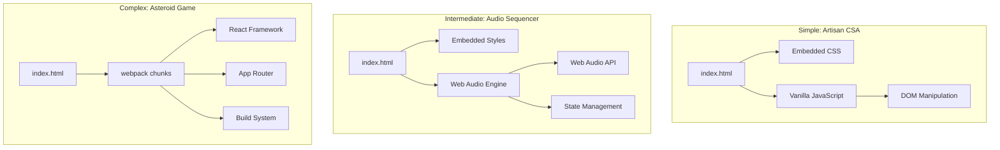
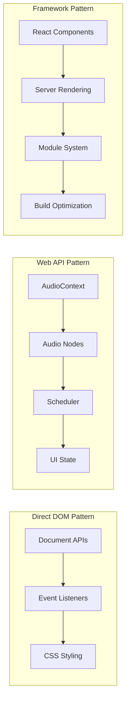
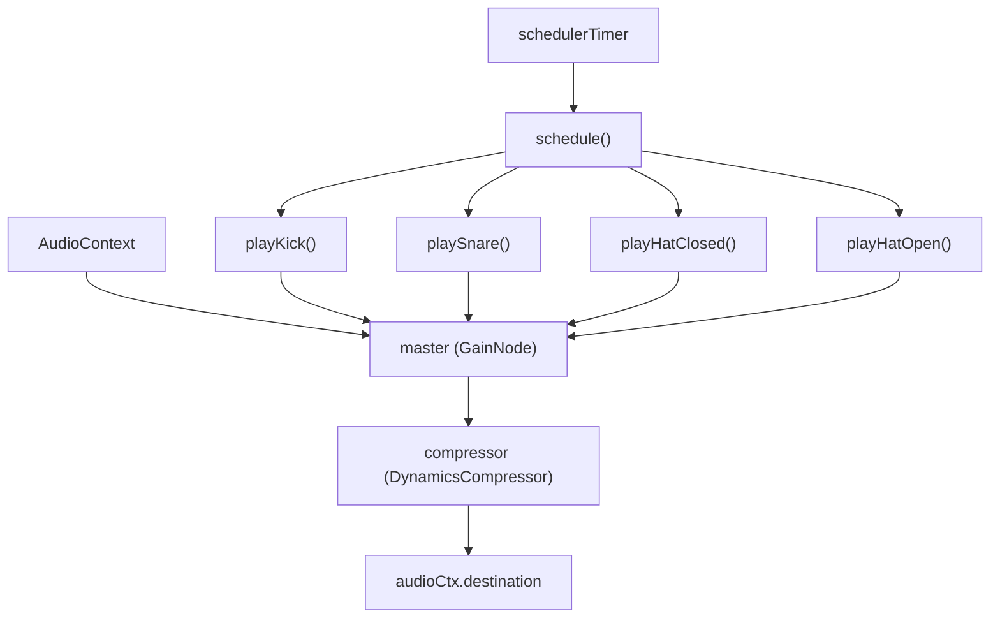
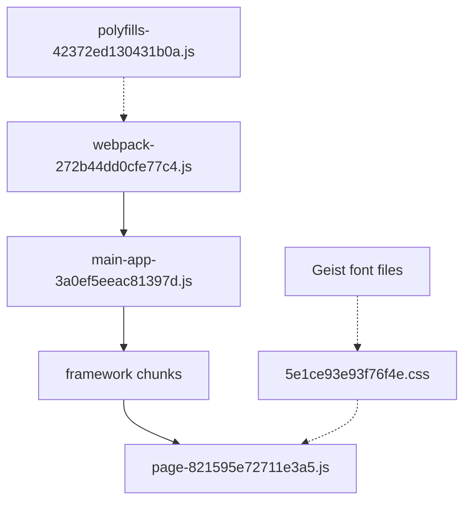
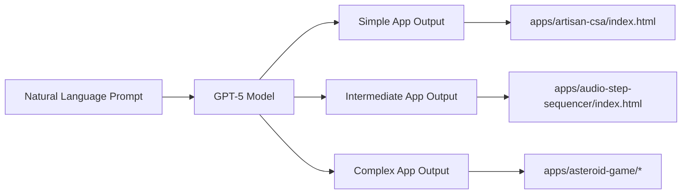

<!-- source: DeepWiki mcp.deepwiki.com · repo openai/gpt-5-coding-examples · page 3 Example Applications · fetched 2026-10-26 -->

# Example Applications

Relevant source files

The following files were used as context for generating this wiki page:

- [README.md](README.md)
- [apps/artisan-csa/index.html](apps/artisan-csa/index.html)
- [apps/asteroid-game/index.html](apps/asteroid-game/index.html)
- [apps/audio-step-sequencer/index.html](apps/audio-step-sequencer/index.html)

This document provides an overview of the three main example applications included in the GPT-5 Coding Examples repository. These applications demonstrate different complexity levels and technology choices, showcasing GPT-5's capability to generate everything from simple single-file websites to complex Next.js applications with full production features.

For detailed technical analysis of frameworks and build tools used across applications, see [Technical Architecture](#4). For information about the GPT-5 generation process that created these applications, see [GPT-5 Generation Workflow](#5).

## Application Portfolio Overview

The repository contains three distinct applications that represent different points on the complexity spectrum of web development:

| Application | Complexity | Technology Stack | File Structure |
|-------------|------------|------------------|----------------|
| Artisan CSA Landing Page | Simple | HTML + CSS + Vanilla JS | Single file |
| Audio Step Sequencer | Intermediate | HTML + Web Audio API | Single file |
| Asteroid Game | Complex | Next.js + React + Webpack | Multi-file framework |

### Application Architecture Comparison

Sources: [apps/artisan-csa/index.html](), [apps/audio-step-sequencer/index.html](), [apps/asteroid-game/index.html]()

## Technology Integration Patterns

Each application demonstrates different approaches to integrating web technologies and handling complexity:

Sources: [apps/artisan-csa/index.html:1174-1348](), [apps/audio-step-sequencer/index.html:345-979](), [apps/asteroid-game/index.html]()

## Application Complexity Spectrum

### Simple: Artisan CSA Landing Page

The CSA landing page represents the simplest application type - a business website built as a single HTML file with embedded CSS and JavaScript. Despite its simplicity, it demonstrates sophisticated design patterns and user interactions.

**Key Features:**
- Watercolor-themed design with CSS gradients and SVG illustrations
- Interactive pricing calculator with range sliders
- ZIP code delivery checker with simple validation
- Testimonials carousel with keyboard navigation
- Local storage pattern integration for user preferences

**Code Structure:**
- Single file: [apps/artisan-csa/index.html]()
- CSS custom properties for theming: [apps/artisan-csa/index.html:12-25]()
- JavaScript module pattern: [apps/artisan-csa/index.html:1174-1348]()

### Intermediate: Audio Step Sequencer

The audio step sequencer demonstrates intermediate complexity through sophisticated real-time audio processing while maintaining a single-file architecture. It showcases advanced Web Audio API usage and complex state management.

**Key Features:**
- Real-time drum synthesis using `AudioContext` and oscillators
- 16-step grid sequencer with swing timing
- Pattern save/load system using `localStorage`
- WAV export functionality via `OfflineAudioContext`
- Responsive touch/pointer event handling

**Audio Engine Architecture:**

Sources: [apps/audio-step-sequencer/index.html:393-408](), [apps/audio-step-sequencer/index.html:514-603](), [apps/audio-step-sequencer/index.html:419-453]()

### Complex: Asteroid Game

The asteroid game represents the most sophisticated example - a full Next.js application with production-grade features including server-side rendering, code splitting, and optimized asset delivery.

**Framework Integration:**
- Next.js App Router with React 18
- Webpack module bundling with code splitting
- TypeScript-style build optimization
- Production error handling and 404 pages

**Build System Structure:**

Sources: [apps/asteroid-game/index.html:1-2]()

## Generation Pattern Analysis

Each application demonstrates different aspects of GPT-5's code generation capabilities:

**Single-Pass Generation:** All three applications were generated in single prompts without iterative refinement, showcasing GPT-5's ability to produce complete, working applications.

**Technology Appropriateness:** Each application uses technology stacks appropriate to its complexity level - vanilla JavaScript for simple interactions, Web Audio API for real-time audio, and Next.js for complex application architecture.

**Production Readiness:** Even the simplest applications include production considerations like accessibility attributes, responsive design, and error handling.

Sources: [README.md:3-5](), [README.md:21-31]()

The applications collectively demonstrate GPT-5's capability to generate appropriate solutions across the full spectrum of web development complexity, from static websites to sophisticated real-time applications.

---

