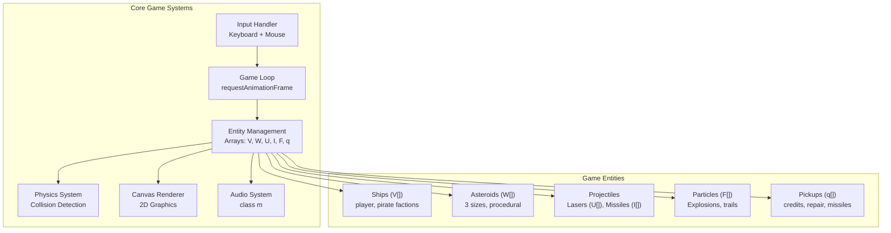
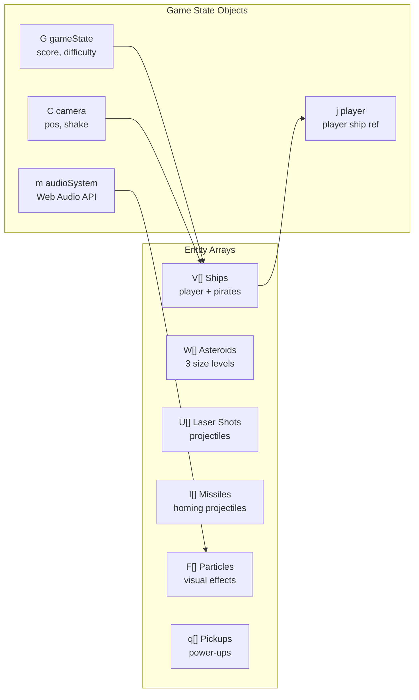
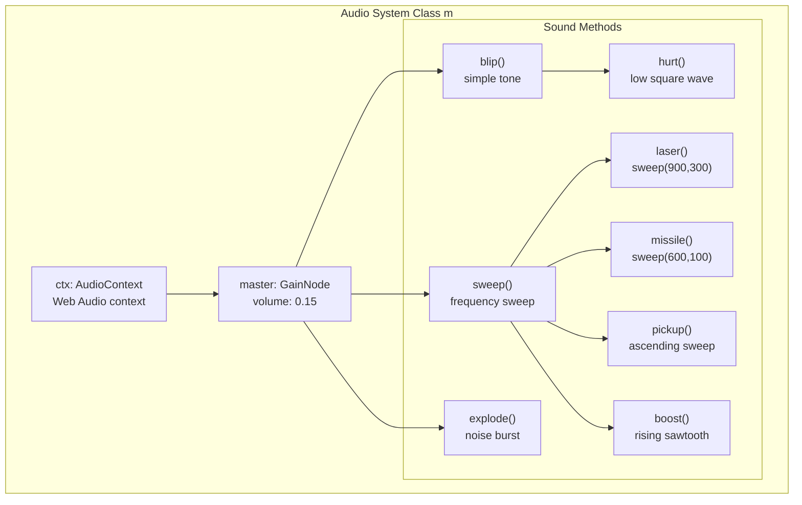
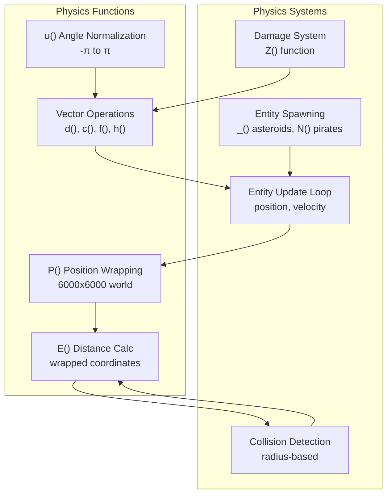
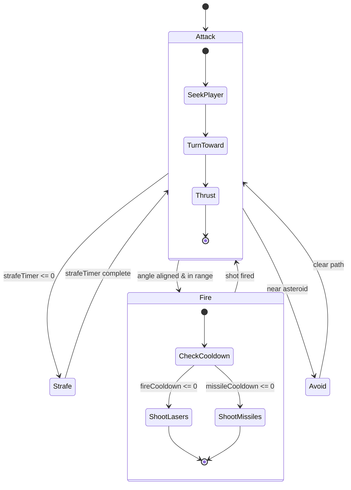
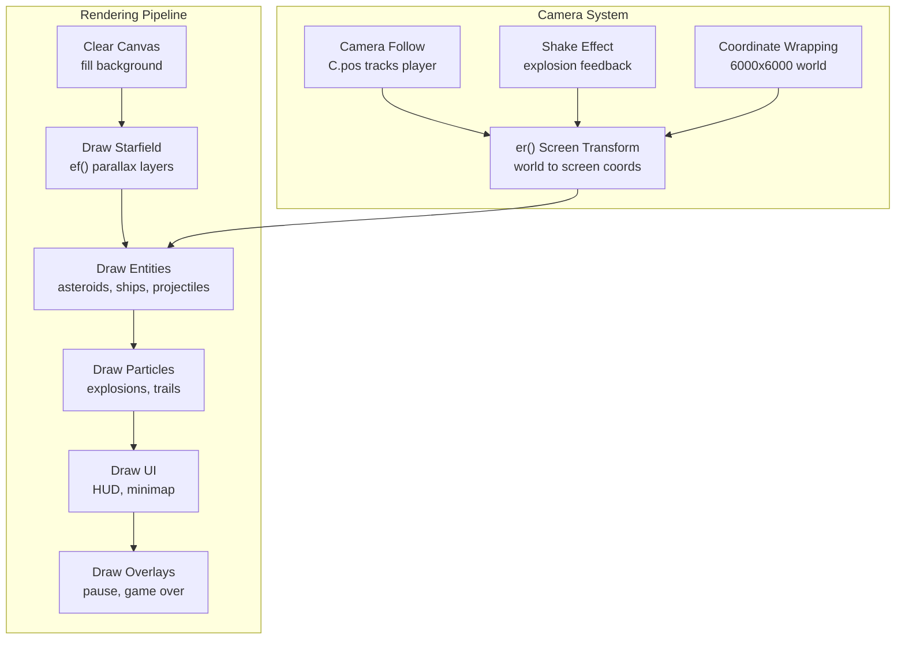

<!-- source: DeepWiki mcp.deepwiki.com · repo openai/gpt-5-coding-examples · page 3.1 Asteroid Game · fetched 2026-10-26 -->

# Asteroid Game

Relevant source files

The following files were used as context for generating this wiki page:

- [apps/asteroid-game/_next/static/chunks/app/page-821595e72711e3a5.js](apps/asteroid-game/_next/static/chunks/app/page-821595e72711e3a5.js)
- [apps/asteroid-game/index.html](apps/asteroid-game/index.html)
- [apps/asteroid-game/index.txt](apps/asteroid-game/index.txt)

This document covers the asteroid game example application, the most complex demonstration of GPT-5's code generation capabilities in this repository. The asteroid game is implemented as a Next.js application featuring real-time space combat with complete audio, physics, AI, and visual systems built entirely in-browser using Canvas API and Web Audio API.

For information about the Next.js framework integration details, see [Next.js Framework Integration](#3.1.2). For build system specifics, see [Build System & Asset Management](#3.1.3).

## System Overview

The asteroid game implements a complete 2D space combat simulator with the following core systems:

- **Real-time game loop** with physics simulation at 60 FPS
- **Multi-entity management** for ships, asteroids, projectiles, and effects
- **Procedural audio synthesis** using Web Audio API
- **Canvas-based rendering** with particle effects and HUD
- **AI behavior system** for enemy ships
- **Input handling** supporting both keyboard and mouse controls

Sources: [apps/asteroid-game/_next/static/chunks/app/page-821595e72711e3a5.js:1-1]()

## Game State Architecture

The game maintains state through several global arrays and objects that manage different entity types and game progression:

| State Container | Purpose | Key Properties |
|---|---|---|
| `V` | Ships array | `faction`, `model`, `pos`, `vel`, `weapons` |
| `W` | Asteroids array | `size`, `shape`, `hp`, `radius` |  
| `U` | Laser shots array | `life`, `dmg`, `ownerId`, `faction` |
| `I` | Missiles array | `targetId`, `turnRate`, `accel`, `trail` |
| `F` | Particles array | `life`, `maxLife`, `color`, `fade` |
| `q` | Pickups array | `type`, `amount`, `life`, `spin` |
| `G` | Game state | `score`, `difficulty`, `killStreak` |
| `C` | Camera state | `pos`, `shake` |

Sources: [apps/asteroid-game/_next/static/chunks/app/page-821595e72711e3a5.js:1-1]()

## Audio System Implementation

The audio system (`class m`) provides procedural sound generation using Web Audio API with several specialized sound methods:

The audio system creates sounds dynamically without external audio files by generating oscillators and applying envelopes:

- **Laser sounds**: `sweep(900, 300, 0.08, "sawtooth")` - descending frequency sweep
- **Explosions**: Generated white noise with lowpass filter and exponential decay
- **Engine sounds**: Called when `boost()` is triggered during ship acceleration

Sources: [apps/asteroid-game/_next/static/chunks/app/page-821595e72711e3a5.js:1-1]()

## Entity Management & Physics

The game implements a comprehensive entity system with collision detection and physics simulation:

Key physics functions:
- `P(e)`: Wraps positions to 6000x6000 world bounds  
- `E(e,t)`: Calculates wrapped distance between entities
- `Z(e,t,l)`: Applies damage with shield/hull mechanics and knockback
- `d(e,t)`: Vector addition for position/velocity updates

Sources: [apps/asteroid-game/_next/static/chunks/app/page-821595e72711e3a5.js:1-1]()

## AI Behavior System

Enemy ships use a state-based AI system with multiple behavior modes and decision-making logic:

AI ships (pirates) implement:
- **Target acquisition**: `ee(e, 900)` finds nearest enemy within range
- **Obstacle avoidance**: Asteroid collision prediction and steering
- **Combat behavior**: Firing decisions based on angle alignment and distance
- **Movement patterns**: Strafing maneuvers with randomized timing

Each pirate ship has an `ai` object with `state`, `patience`, and `strafeTimer` properties controlling behavior transitions.

Sources: [apps/asteroid-game/_next/static/chunks/app/page-821595e72711e3a5.js:1-1]()

## Rendering Pipeline

The game uses HTML5 Canvas with a multi-layer rendering system and camera follow mechanics:

**Key rendering features**:
- **Parallax starfield**: Three layers (`z`, `H`, `O` arrays) with different scroll speeds
- **Entity rendering**: Custom ship models drawn with canvas paths  
- **Screen space conversion**: `er(e)` transforms world coordinates to screen coordinates
- **Visual feedback**: Camera shake on explosions, shield indicators, engine trails

The rendering system handles a wrapped 6000x6000 world space projected onto screen coordinates with smooth camera following.

Sources: [apps/asteroid-game/_next/static/chunks/app/page-821595e72711e3a5.js:1-1]()

---

