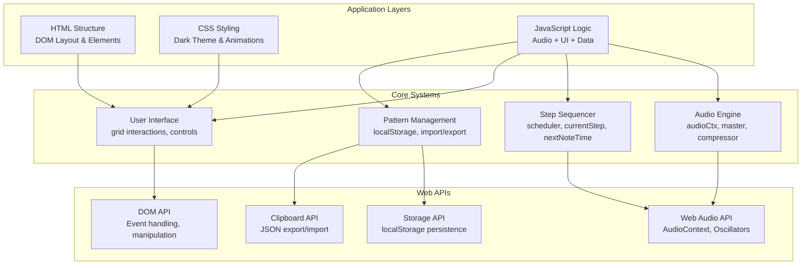
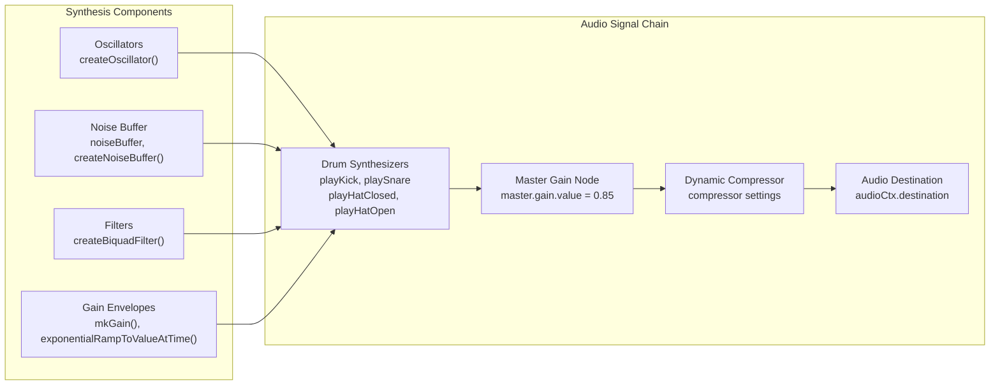
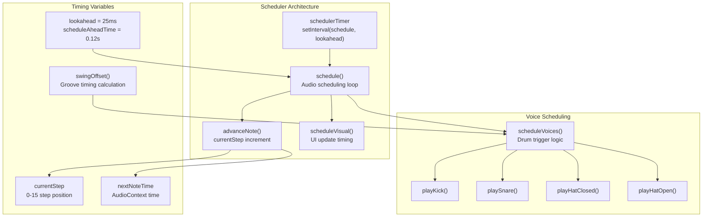
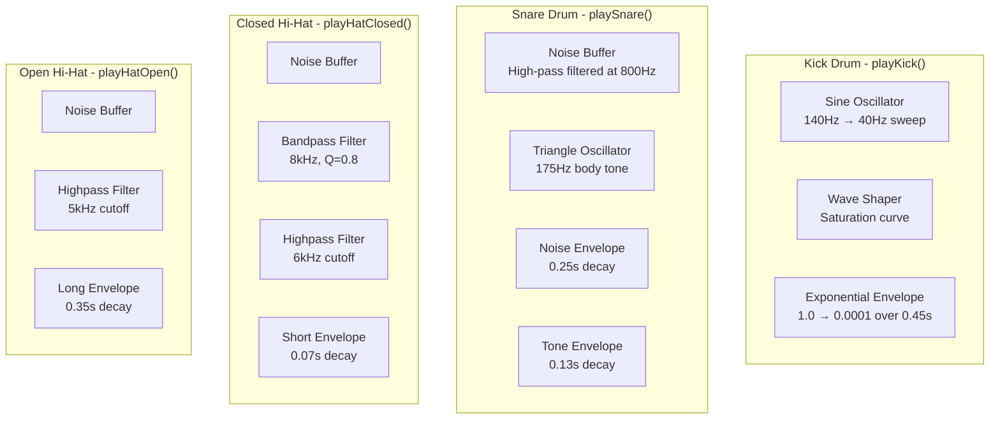
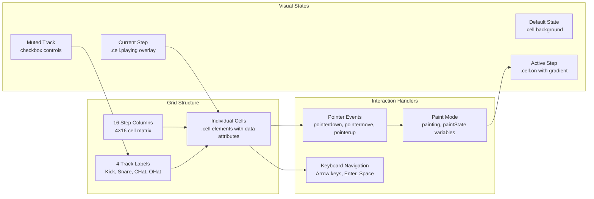
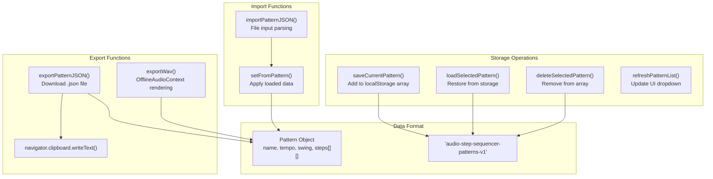
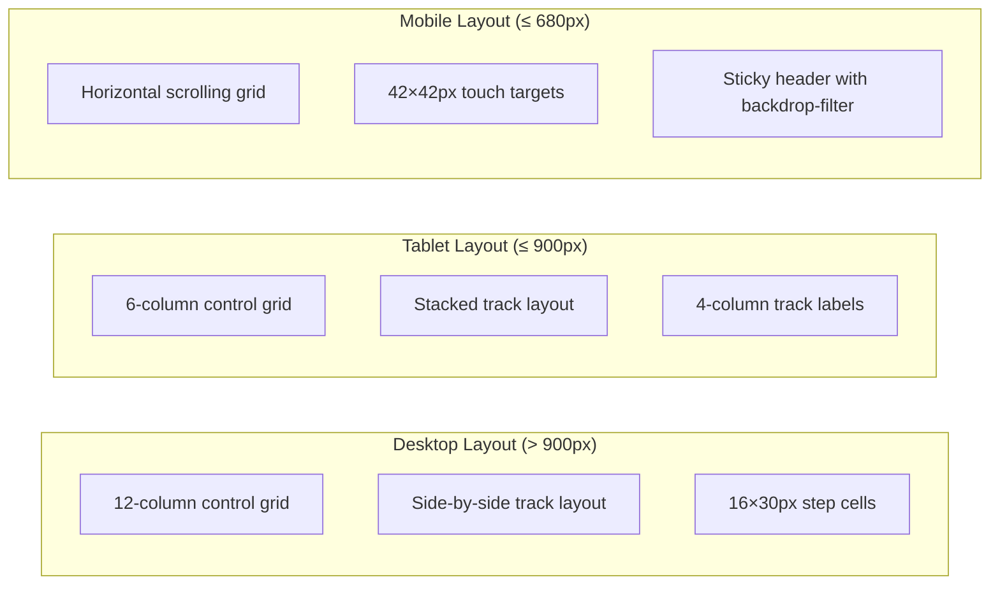

<!-- source: DeepWiki mcp.deepwiki.com · repo openai/gpt-5-coding-examples · page 3.2 Audio Step Sequencer · fetched 2026-10-26 -->

# Audio Step Sequencer

<details>
<summary>Relevant source files</summary>

The following files were used as context for generating this wiki page:

- [apps/audio-step-sequencer/index.html](apps/audio-step-sequencer/index.html)

</details>


This document covers the single-file HTML application that implements a complete drum machine and step sequencer using the Web Audio API. The application demonstrates sophisticated audio programming techniques, real-time audio synthesis, and pattern-based music creation in vanilla JavaScript.

For information about the broader repository structure and other example applications, see [Overview](#1). For details on the Next.js-based applications in this repository, see [Asteroid Game](#3.1).

## Application Architecture

The Audio Step Sequencer is implemented as a self-contained HTML file that combines structure, styling, and behavior into a single document. The application architecture follows a clear separation between audio engine, sequencer logic, user interface, and data management.



**Sources:** [apps/audio-step-sequencer/index.html:1-981]()

## Audio Engine Implementation

The audio engine is built on the Web Audio API and provides real-time drum synthesis with dynamic compression and master volume control. The `ensureAudio` function initializes the audio context and creates the signal chain.



The audio context initialization includes compression settings for professional sound quality:

| Parameter | Value | Purpose |
|-----------|--------|---------|
| `threshold` | -24 dB | Compression threshold |
| `knee` | 24 dB | Soft knee compression |
| `ratio` | 3.5:1 | Compression ratio |
| `attack` | 3ms | Fast attack time |
| `release` | 200ms | Medium release time |

**Sources:** [apps/audio-step-sequencer/index.html:393-408](), [apps/audio-step-sequencer/index.html:498-506]()

## Step Sequencer Logic

The sequencer implements precise timing using a scheduling architecture that separates audio timing from visual updates. The `schedule` function uses lookahead scheduling to maintain tight timing accuracy.



The timing calculations use precise musical mathematics:
- Sixteenth note duration: `60 / bpm / 4`
- Swing offset: `(stepIndex % 2 === 1) ? swing * sixteenthNoteSec : 0`

**Sources:** [apps/audio-step-sequencer/index.html:419-444](), [apps/audio-step-sequencer/index.html:410-417](), [apps/audio-step-sequencer/index.html:591-603]()

## Drum Synthesis Engine

Each drum sound is synthesized using different combinations of oscillators, noise, and filtering. The synthesis functions create realistic drum timbres through careful parameter programming.



Each synthesizer uses the `mkGain` helper function for envelope creation and connects through the master output chain for consistent processing.

**Sources:** [apps/audio-step-sequencer/index.html:514-528](), [apps/audio-step-sequencer/index.html:530-555](), [apps/audio-step-sequencer/index.html:557-574](), [apps/audio-step-sequencer/index.html:576-589]()

## User Interface System

The interface centers around a 4×16 step grid where users can program drum patterns. The grid supports both mouse/touch and keyboard interaction with paint-style editing.



The `state` object maintains the complete sequencer state:

```javascript
const state = {
  tempo: 120,
  swing: 0.0,
  mutes: [false, false, false, false],
  steps: Array.from({ length: Tracks.length }, () => Array(16).fill(false)),
};
```

**Sources:** [apps/audio-step-sequencer/index.html:605-630](), [apps/audio-step-sequencer/index.html:631-690](), [apps/audio-step-sequencer/index.html:366-371]()

## Pattern Management System

The application provides comprehensive pattern management including local storage persistence, JSON import/export, and WAV audio rendering capabilities.



The WAV export system uses `OfflineAudioContext` to render patterns as audio files, scheduling the complete pattern twice (2 bars) with proper swing timing and compression.

**Sources:** [apps/audio-step-sequencer/index.html:750-794](), [apps/audio-step-sequencer/index.html:796-839](), [apps/audio-step-sequencer/index.html:908-938]()

## Control Interface

The control panel provides real-time parameter adjustment and transport controls organized into logical sections using CSS Grid layout.

| Section | Controls | Purpose |
|---------|----------|---------|
| Tempo & Swing | BPM slider (60-200), Swing percentage (0-60%) | Timing control |
| Pattern | Name input, Save/Load/Delete buttons, Pattern dropdown | Pattern management |
| Utilities | Clear, Randomize, Export WAV, Import/Export JSON | Pattern operations |
| Transport | Play/Pause, Stop buttons | Playback control |

The `bindUI` function establishes event listeners for all controls, including keyboard shortcuts like spacebar for play/pause functionality.

**Sources:** [apps/audio-step-sequencer/index.html:278-325](), [apps/audio-step-sequencer/index.html:940-961]()

## Responsive Design Implementation

The application adapts to different screen sizes through CSS media queries, transitioning from desktop grid layout to mobile-optimized touch interfaces.



The mobile layout uses `width: max-content` and specific cell dimensions to create comfortable touch targets while maintaining the complete 16-step grid through horizontal scrolling.

**Sources:** [apps/audio-step-sequencer/index.html:244-265]()

---

