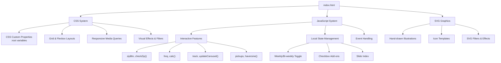
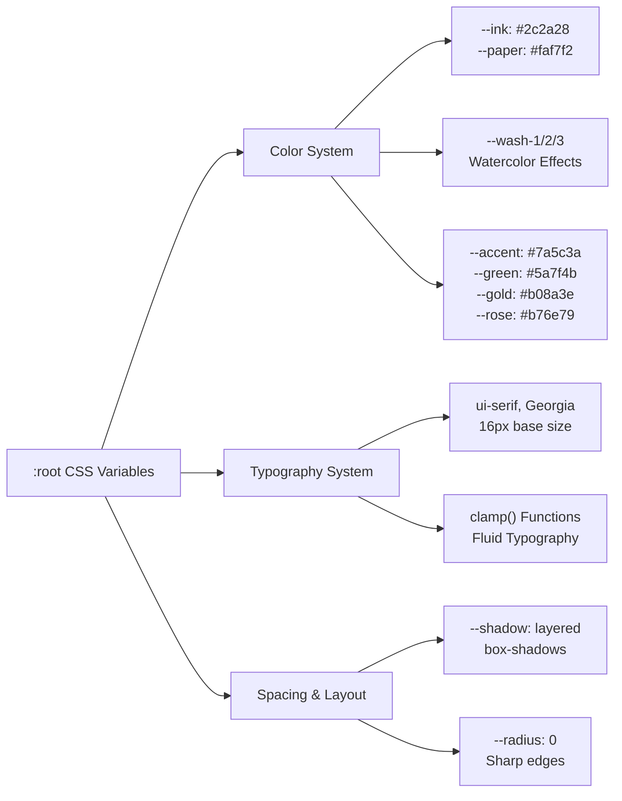
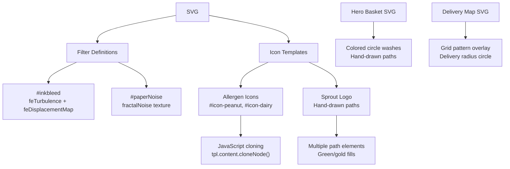
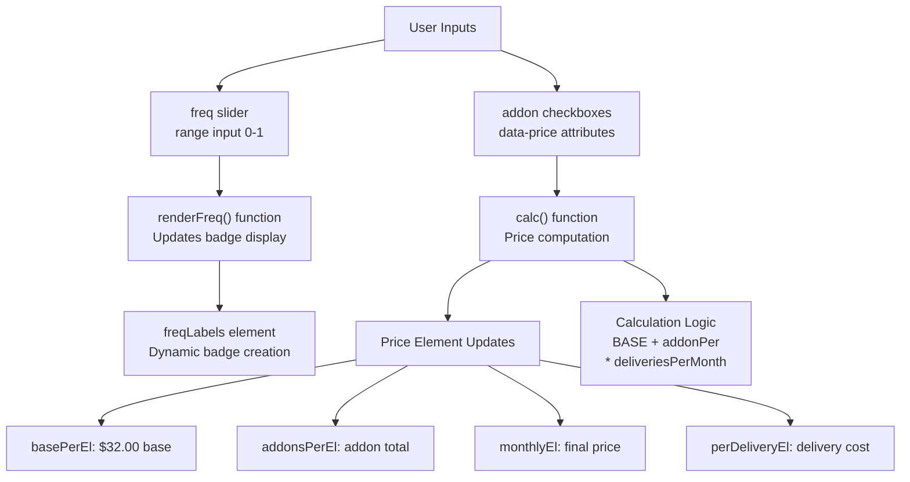
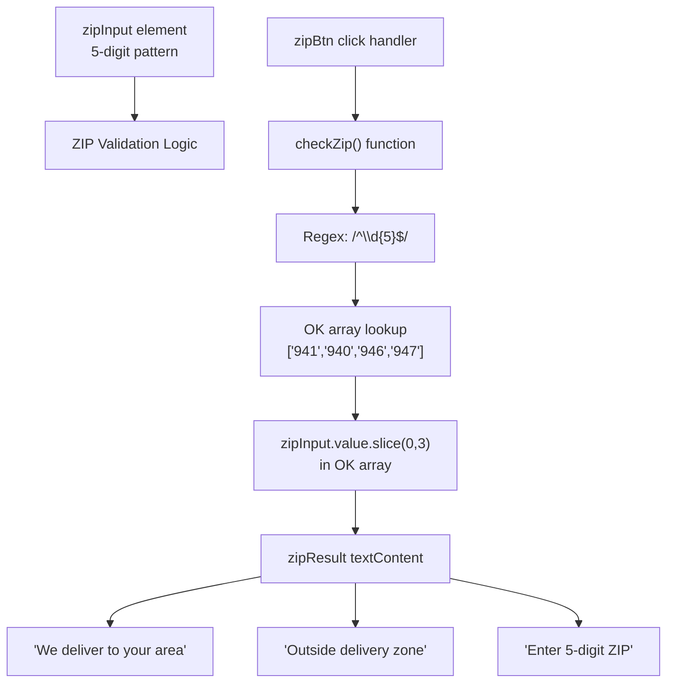
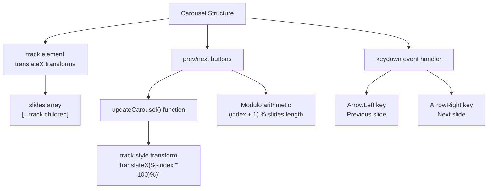
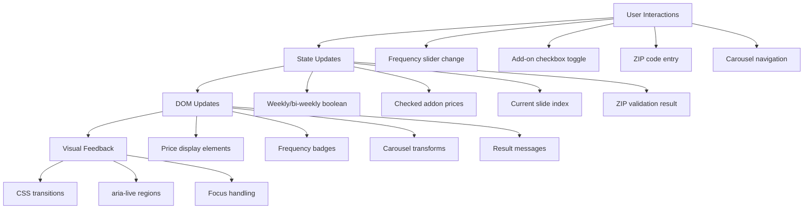
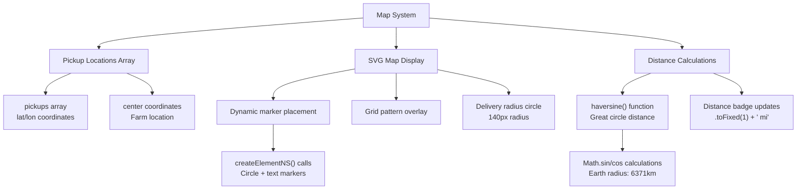
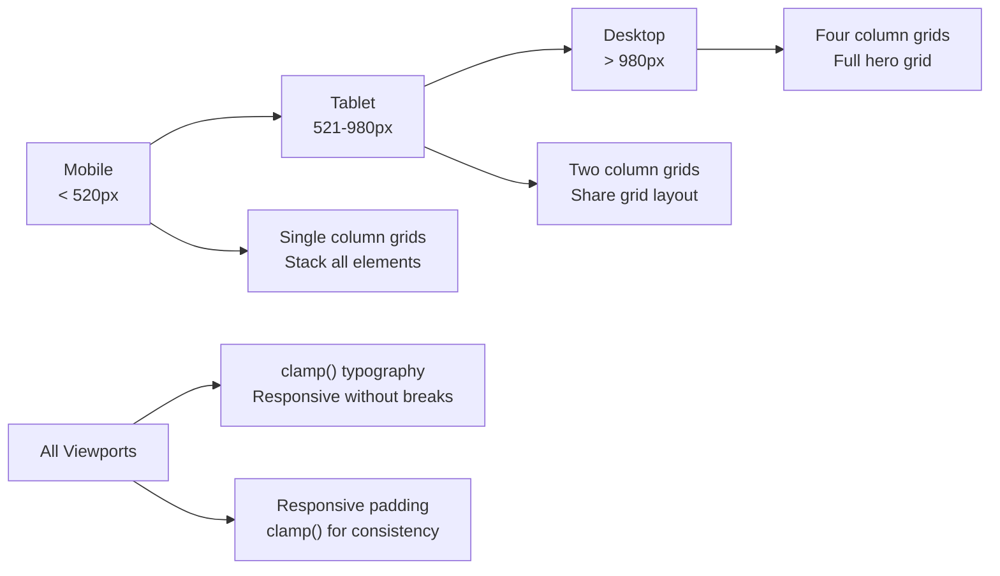

<!-- source: DeepWiki mcp.deepwiki.com · repo openai/gpt-5-coding-examples · page 3.3 Artisan CSA Landing Page · fetched 2026-10-26 -->

# Artisan CSA Landing Page

Relevant source files

The following files were used as context for generating this wiki page:

- [apps/artisan-csa/index.html](apps/artisan-csa/index.html)

This document covers the Artisan CSA landing page example, a single-file HTML application that demonstrates a complete business website for a Community-Supported Agriculture service. The page showcases modern web design patterns, interactive features, and responsive layouts implemented entirely in vanilla HTML, CSS, and JavaScript.

For information about the more complex Next.js-based applications in this repository, see [Asteroid Game](#3.1). For details about other single-file applications using Web APIs, see [Audio Step Sequencer](#3.2).

## Application Architecture

The Artisan CSA landing page represents a sophisticated single-file web application that implements a complete business website without external dependencies or build tools. The application demonstrates how modern web technologies can create rich user experiences while maintaining simplicity.

Sources: [apps/artisan-csa/index.html:1-1350]()

## Visual Design System

The application implements a cohesive design system inspired by watercolor and hand-drawn aesthetics. The design system uses CSS custom properties for consistent theming and SVG filters for visual effects.

### Color Palette and Theme Variables

The design system centers around a carefully curated color palette defined through CSS custom properties:

Sources: [apps/artisan-csa/index.html:12-25]()

### SVG Illustration System

The application uses inline SVG graphics with custom filters to achieve a hand-drawn aesthetic:

Sources: [apps/artisan-csa/index.html:405-430](), [apps/artisan-csa/index.html:444-473](), [apps/artisan-csa/index.html:521-601]()

## Interactive Feature Implementation

The application implements several sophisticated interactive features using vanilla JavaScript, demonstrating complex state management without external libraries.

### Pricing Calculator System

The pricing calculator dynamically updates costs based on delivery frequency and selected add-ons:

Sources: [apps/artisan-csa/index.html:1198-1243]()

### ZIP Code Validation System

The ZIP code checker implements location-based service validation:

Sources: [apps/artisan-csa/index.html:1253-1275]()

### Carousel Navigation System

The testimonials section implements a custom carousel with keyboard support:

Sources: [apps/artisan-csa/index.html:1311-1340]()

## Data Flow and State Management

The application manages multiple pieces of local state through JavaScript variables and DOM manipulation, demonstrating effective state management patterns without external libraries.

Sources: [apps/artisan-csa/index.html:1174-1347]()

## Map and Distance Calculation

The application includes a sophisticated mapping system that calculates distances between pickup locations and displays them on an SVG map:

Sources: [apps/artisan-csa/index.html:1277-1309]()

## Responsive Design and Accessibility

The application implements comprehensive responsive design and accessibility features:

| Feature Category | Implementation | Code References |
|------------------|----------------|-----------------|
| **Responsive Typography** | `clamp()` functions for fluid scaling | [apps/artisan-csa/index.html:105-121]() |
| **Grid Layouts** | CSS Grid with media query breakpoints | [apps/artisan-csa/index.html:210-224]() |
| **Focus Management** | `:focus-visible` pseudo-selector styling | [apps/artisan-csa/index.html:397-400]() |
| **ARIA Labels** | `aria-labelledby`, `aria-live`, `role` attributes | [apps/artisan-csa/index.html:488-945]() |
| **Keyboard Navigation** | Arrow key support for carousel | [apps/artisan-csa/index.html:1331-1340]() |
| **Screen Reader Support** | Semantic HTML structure, hidden decorative elements | [apps/artisan-csa/index.html:405-430]() |

The responsive breakpoints create a mobile-first design that adapts layouts at specific viewport widths:

Sources: [apps/artisan-csa/index.html:212-224](), [apps/artisan-csa/index.html:280-284](), [apps/artisan-csa/index.html:306-310]()

## Performance and Optimization

The single-file architecture provides several performance benefits while implementing sophisticated features:

- **Zero Network Requests**: All assets embedded inline, eliminating HTTP round trips
- **Minimal JavaScript**: ~175 lines of vanilla JavaScript for all interactivity
- **Efficient CSS**: Custom properties enable consistent theming with minimal duplication
- **SVG Graphics**: Vector illustrations scale without quality loss across devices
- **Passive Event Listeners**: Scroll events use `{ passive: true }` for smooth performance

The application demonstrates how complex business websites can be built with zero external dependencies while maintaining professional design standards and full functionality.

Sources: [apps/artisan-csa/index.html:1174-1347]()

---

