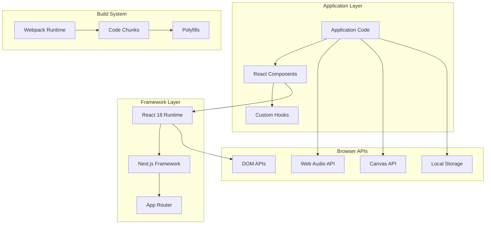
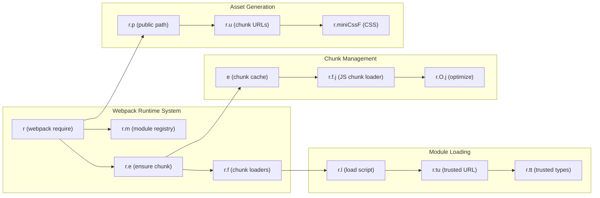
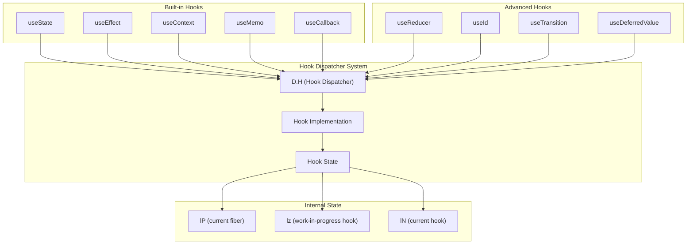
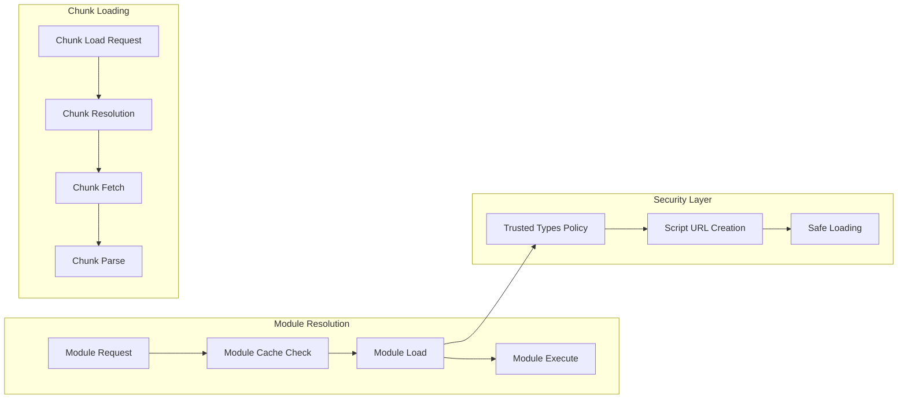
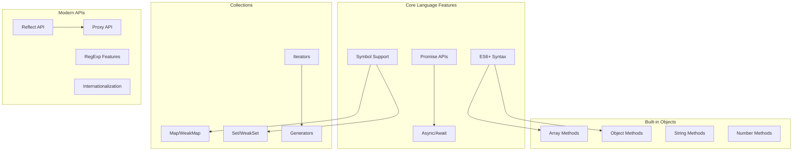

<!-- source: DeepWiki mcp.deepwiki.com · repo openai/gpt-5-coding-examples · page 4 Technical Architecture · fetched 2026-10-26 -->

# Technical Architecture

Relevant source files

The following files were used as context for generating this wiki page:

- [apps/asteroid-game/_next/static/chunks/framework-7c95b8e5103c9e90.js](apps/asteroid-game/_next/static/chunks/framework-7c95b8e5103c9e90.js)
- [apps/asteroid-game/_next/static/chunks/polyfills-42372ed130431b0a.js](apps/asteroid-game/_next/static/chunks/polyfills-42372ed130431b0a.js)
- [apps/asteroid-game/_next/static/chunks/webpack-272b44dd0cfe77c4.js](apps/asteroid-game/_next/static/chunks/webpack-272b44dd0cfe77c4.js)

This document provides a deep technical analysis of the frameworks, build tools, and architectural patterns implemented across the GPT-5 generated example applications. It examines the React/Next.js framework integration, webpack build pipeline, module loading system, and asset optimization strategies that power these applications.

For detailed analysis of individual applications, see [Example Applications](#3). For implementation specifics of the React components and Next.js features, see [React & Next.js Implementation](#4.1).

## Framework Architecture Overview

The technical architecture follows a modern React-based stack with Next.js providing the application framework, webpack handling the build pipeline, and a comprehensive polyfill system ensuring browser compatibility.

### Core Technology Stack

Sources: [apps/asteroid-game/_next/static/chunks/framework-7c95b8e5103c9e90.js:1-50](), [apps/asteroid-game/_next/static/chunks/webpack-272b44dd0cfe77c4.js:1-20]()

### Build Pipeline Architecture 

The build system utilizes webpack's module federation and code splitting capabilities to optimize bundle delivery and loading performance.

Sources: [apps/asteroid-game/_next/static/chunks/webpack-272b44dd0cfe77c4.js:1-50]()

## React Implementation Details

The React framework implementation provides the complete React 18 feature set including concurrent features, hooks, and server components support.

### React Core System

| Component | Function | Location |
|-----------|----------|-----------|
| `React.createElement` | Element creation | `framework-7c95b8e5103c9e90.js` |
| `React.Component` | Class component base | `framework-7c95b8e5103c9e90.js` |
| `React.useState` | State hook | `framework-7c95b8e5103c9e90.js` |
| `React.useEffect` | Effect hook | `framework-7c95b8e5103c9e90.js` |
| `React.useContext` | Context hook | `framework-7c95b8e5103c9e90.js` |
| `React.useMemo` | Memoization hook | `framework-7c95b8e5103c9e90.js` |

### Hook Implementation Architecture

Sources: [apps/asteroid-game/_next/static/chunks/framework-7c95b8e5103c9e90.js:3000-4000]()

## Build System Implementation

The webpack runtime provides a sophisticated module loading and chunk management system optimized for performance and reliability.

### Module Loading System

The webpack runtime implements several key systems:

- **Module Registry (`r.m`)**: Stores all modules by ID
- **Module Cache (`t`)**: Caches loaded modules to prevent re-execution  
- **Chunk Loading (`r.e`)**: Dynamically loads code chunks on demand
- **Trusted Types (`r.tt`)**: Implements CSP-compliant script loading

Sources: [apps/asteroid-game/_next/static/chunks/webpack-272b44dd0cfe77c4.js:10-30]()

### Chunk Management Strategy

The system uses a priority-based chunk loading system with the `r.O` (optimize) function managing chunk priorities and dependencies:

- **Chunk Priority**: Uses numeric priorities to control loading order
- **Dependency Resolution**: Ensures all dependencies load before execution
- **Error Handling**: Provides comprehensive error recovery for failed chunks

Sources: [apps/asteroid-game/_next/static/chunks/webpack-272b44dd0cfe77c4.js:5-15]()

## Polyfill System Architecture

The polyfill system provides comprehensive ES6+ and modern web API support across browsers, implementing over 200 polyfills for maximum compatibility.

### Polyfill Coverage Areas

Sources: [apps/asteroid-game/_next/static/chunks/polyfills-42372ed130431b0a.js:1-100]()

### Key Polyfill Implementations

The polyfill system includes critical implementations:

- **`Array.prototype.at`**: Safe array element access with negative indices
- **`Array.prototype.flat`**: Array flattening with depth control  
- **`Map` and `Set`**: Complete collection implementations with iteration support
- **`Symbol`**: Full symbol primitive support including well-known symbols
- **`Reflect`**: Complete reflection API for metaprogramming

Sources: [apps/asteroid-game/_next/static/chunks/polyfills-42372ed130431b0a.js:500-1000]()

## Asset Optimization Strategy

The build system implements several optimization strategies for efficient asset delivery:

### URL Generation and Caching

- **Public Path (`r.p`)**: Configures base URL for all assets
- **Chunk URLs (`r.u`)**: Generates optimized chunk URLs with hashing
- **Trusted URLs (`r.tu`)**: Implements CSP-compliant URL generation

### Loading Strategy

- **Preload/Prefetch**: Strategic resource loading hints
- **Chunk Splitting**: Optimal code splitting for caching
- **Error Recovery**: Comprehensive fallback mechanisms

Sources: [apps/asteroid-game/_next/static/chunks/webpack-272b44dd0cfe77c4.js:40-50]()

The technical architecture demonstrates sophisticated engineering with modern best practices for performance, security, and browser compatibility across the generated applications.

---

