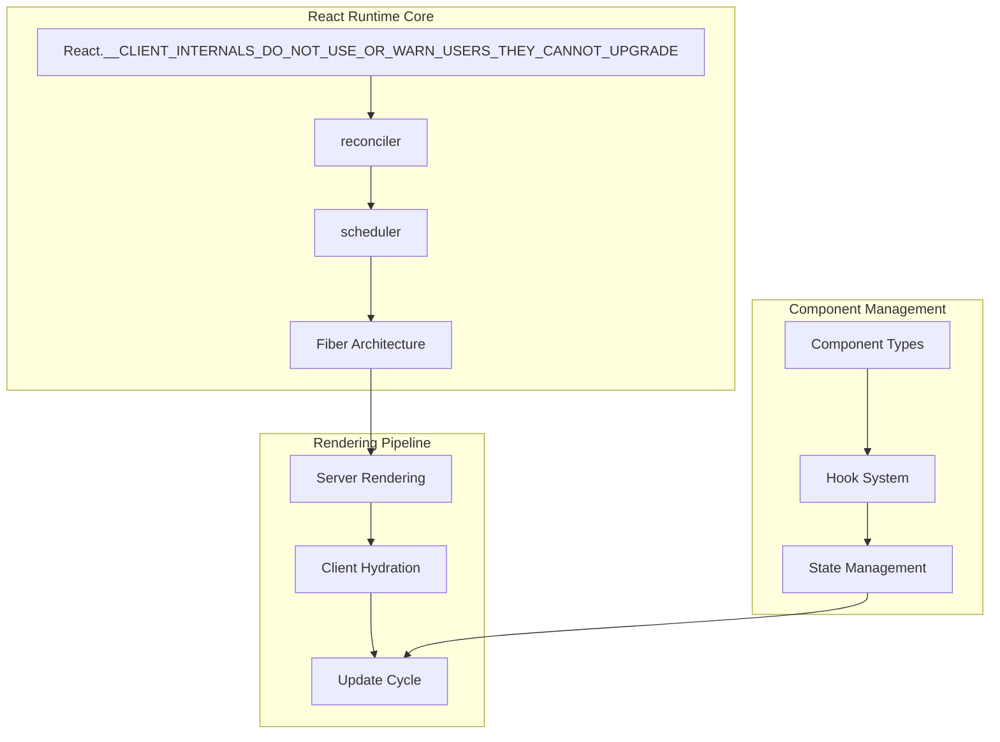
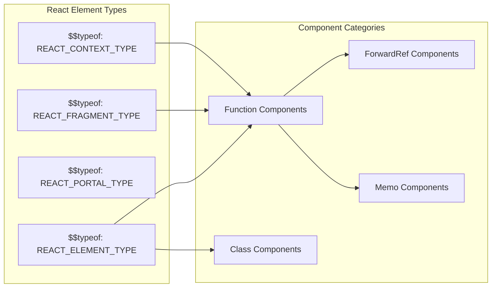
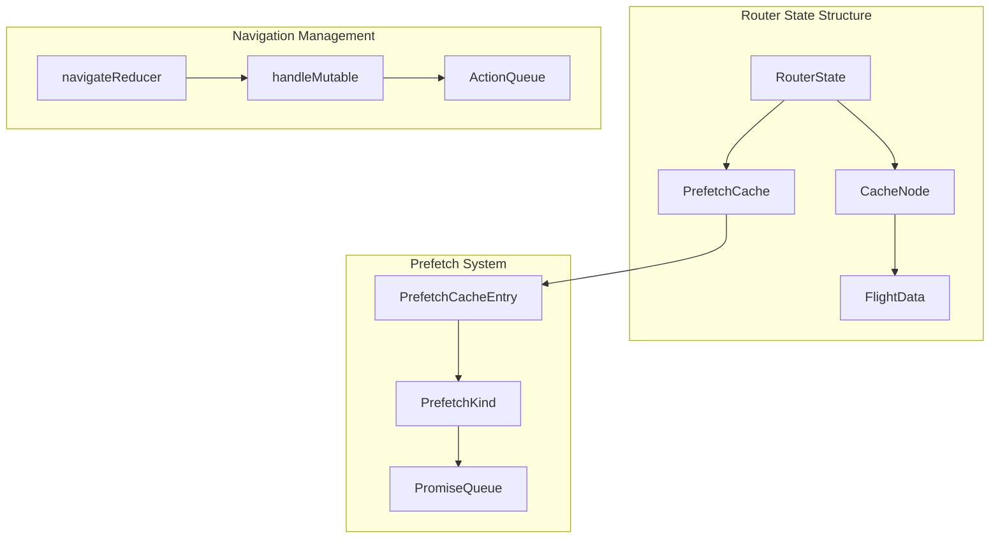
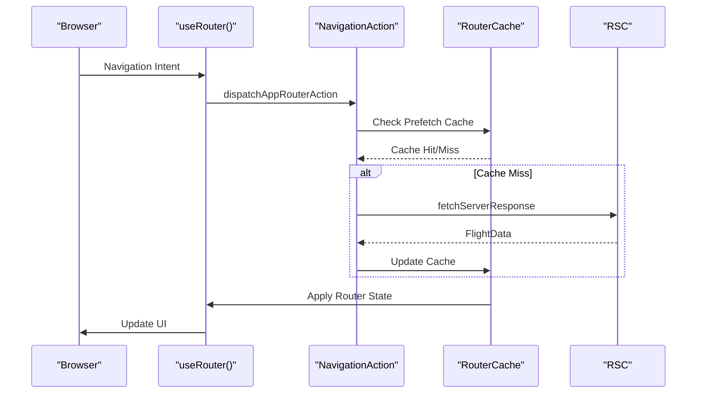
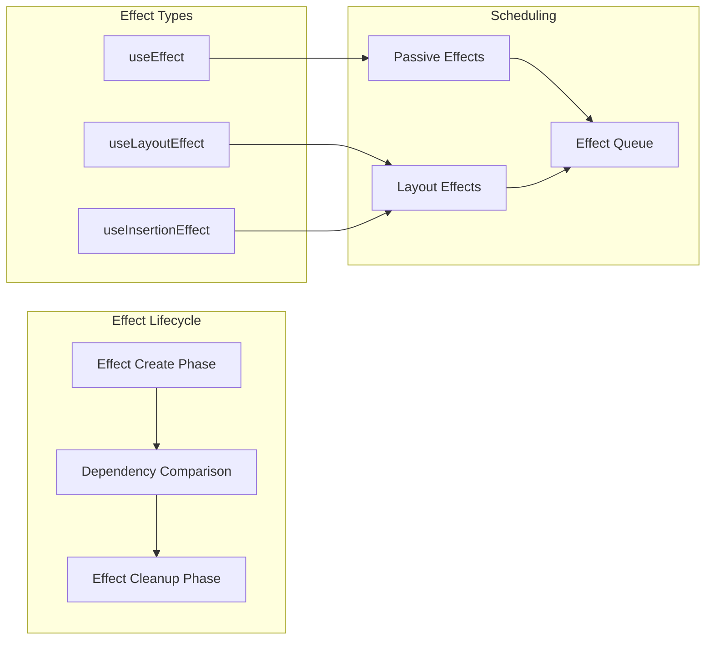
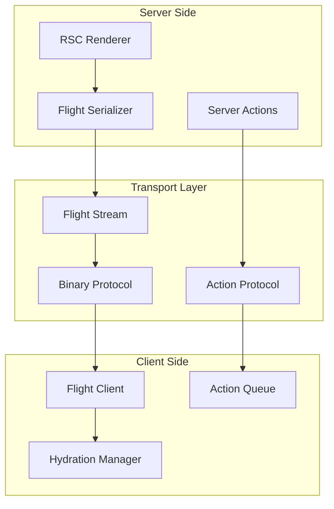
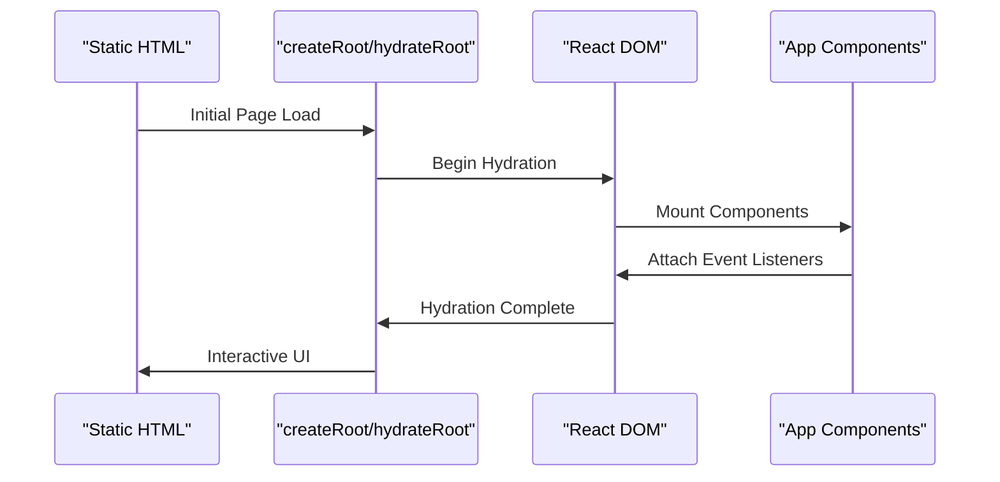
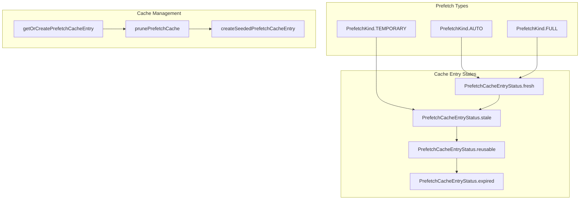
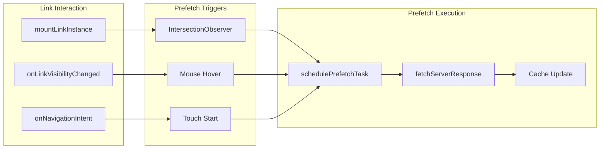
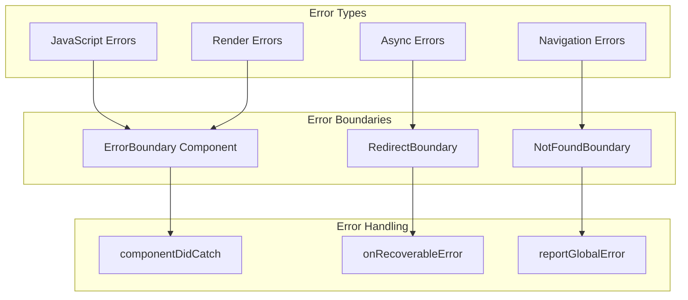

<!-- source: DeepWiki mcp.deepwiki.com · repo openai/gpt-5-coding-examples · page 4.1 React & Next.js Implementation · fetched 2026-10-26 -->

# React & Next.js Implementation

Relevant source files

The following files were used as context for generating this wiki page:

- [apps/asteroid-game/_next/static/chunks/4bd1b696-cf72ae8a39fa05aa.js](apps/asteroid-game/_next/static/chunks/4bd1b696-cf72ae8a39fa05aa.js)
- [apps/asteroid-game/_next/static/chunks/964-830f77d7ce1c2463.js](apps/asteroid-game/_next/static/chunks/964-830f77d7ce1c2463.js)
- [apps/asteroid-game/_next/static/chunks/framework-7c95b8e5103c9e90.js](apps/asteroid-game/_next/static/chunks/framework-7c95b8e5103c9e90.js)

This document covers the React component system, hooks implementation, and Next.js framework integration within the GPT-5 generated applications. It focuses on the technical implementation details of how React's reconciliation system works with Next.js App Router features including server-side rendering, client-side navigation, and component lifecycle management.

For information about the build pipeline and module bundling, see [Build Pipeline & Module System](#4.2). For asset optimization strategies, see [Asset Optimization & Delivery](#4.3).

## React Runtime Architecture

The React implementation in these applications uses React 19.2.0-canary with advanced features including concurrent rendering, suspense, and the new App Router integration.

### Core React Infrastructure

The React runtime manages component lifecycles through a sophisticated fiber architecture that handles both server-side rendering and client-side updates. The `ReactCore` object provides internal APIs that Next.js uses for framework-level integration.

**Sources:** [apps/asteroid-game/_next/static/chunks/4bd1b696-cf72ae8a39fa05aa.js:1-100]()

### Component Type System

React components are classified using Symbol-based type identifiers. The runtime distinguishes between different component types using the `$$typeof` property, enabling proper rendering pipeline routing.

**Sources:** [apps/asteroid-game/_next/static/chunks/4bd1b696-cf72ae8a39fa05aa.js:26-35]()

## Next.js App Router Implementation

The Next.js App Router provides a new paradigm for routing and data fetching, built on top of React Server Components and the updated rendering model.

### Router State Management

The App Router maintains state through a reducer pattern where `navigateReducer` processes navigation actions and updates the router state. Each route segment is cached in `CacheNode` structures that support both server and client-side data.

**Sources:** [apps/asteroid-game/_next/static/chunks/964-830f77d7ce1c2463.js:3894](), [apps/asteroid-game/_next/static/chunks/964-830f77d7ce1c2463.js:3507]()

### Component Integration Pipeline

Navigation flows through the `dispatchAppRouterAction` system, which coordinates prefetch cache lookups, server data fetching, and client-side state updates. The `useRouter` hook provides the primary interface for programmatic navigation.

**Sources:** [apps/asteroid-game/_next/static/chunks/964-830f77d7ce1c2463.js:1027](), [apps/asteroid-game/_next/static/chunks/964-830f77d7ce1c2463.js:3894]()

## Hook System Implementation

React hooks provide the foundation for state management and side effects in the application components.

### Hook State Management

| Hook Category | Core Hooks | Implementation Details |
|---------------|------------|----------------------|
| State | `useState`, `useReducer` | Managed through fiber nodes with update queues |
| Effect | `useEffect`, `useLayoutEffect` | Scheduled through effect list processing |
| Context | `useContext` | Direct context value resolution |
| Performance | `useMemo`, `useCallback` | Dependency-based memoization |
| Ref | `useRef`, `useImperativeHandle` | Mutable ref object management |

The hook system maintains state through linked lists attached to fiber nodes, enabling consistent state updates across re-renders.

**Sources:** [apps/asteroid-game/_next/static/chunks/4bd1b696-cf72ae8a39fa05aa.js:6000-7000]()

### Effect Processing Pipeline

Effects are processed in phases based on their type. `useLayoutEffect` runs synchronously after DOM mutations, while `useEffect` runs asynchronously. The dependency comparison system uses `Object.is` semantics for change detection.

**Sources:** [apps/asteroid-game/_next/static/chunks/4bd1b696-cf72ae8a39fa05aa.js:6500-6800]()

## Server-Side Rendering Integration

The applications leverage React Server Components (RSC) for improved performance and developer experience.

### RSC Communication Protocol

Server Components communicate with the client through the Flight protocol, which serializes React elements and server state into a binary stream. Server Actions provide RPC-like functionality for client-server communication.

**Sources:** [apps/asteroid-game/_next/static/chunks/964-830f77d7ce1c2463.js:8586](), [apps/asteroid-game/_next/static/chunks/964-830f77d7ce1c2463.js:3806]()

### Hydration Process

Hydration attaches React's event system and state management to server-rendered HTML. The process ensures that server-rendered content matches the client-side virtual DOM structure.

**Sources:** [apps/asteroid-game/_next/static/chunks/964-830f77d7ce1c2463.js:4486]()

## Navigation and Prefetching

The App Router implements sophisticated prefetching strategies to optimize navigation performance.

### Prefetch Cache Architecture

The prefetch system maintains a cache of route data with different staleness levels. `PrefetchKind.FULL` loads complete page data while `PrefetchKind.AUTO` loads only loading states and layouts.

**Sources:** [apps/asteroid-game/_next/static/chunks/964-830f77d7ce1c2463.js:1518]()

### Link Component Prefetching

Link components automatically prefetch route data based on visibility and user interaction. The system uses `IntersectionObserver` for viewport detection and intent-based prefetching for immediate interactions.

**Sources:** [apps/asteroid-game/_next/static/chunks/964-830f77d7ce1c2463.js:4930]()

## Error Handling and Boundaries

React's error boundary system provides robust error handling throughout the component tree.

### Error Boundary Implementation

Error boundaries catch errors during rendering, in lifecycle methods, and in constructors. The Next.js App Router includes specialized boundaries for redirect and not-found scenarios.

**Sources:** [apps/asteroid-game/_next/static/chunks/964-830f77d7ce1c2463.js:686](), [apps/asteroid-game/_next/static/chunks/964-830f77d7ce1c2463.js:1646]()

### Error Recovery Mechanisms

| Error Type | Recovery Strategy | Implementation |
|------------|------------------|----------------|
| Component Errors | Error Boundary Fallback | `componentDidCatch` with fallback UI |
| Navigation Errors | Redirect to Error Page | `RedirectErrorBoundary` |
| Data Fetching Errors | Retry with Exponential Backoff | Built into `fetchServerResponse` |
| Hydration Mismatches | Client-side Re-render | Automatic reconciliation |

The error system provides multiple layers of recovery, ensuring that errors are contained and don't crash the entire application.

**Sources:** [apps/asteroid-game/_next/static/chunks/964-830f77d7ce1c2463.js:1799]()

---

