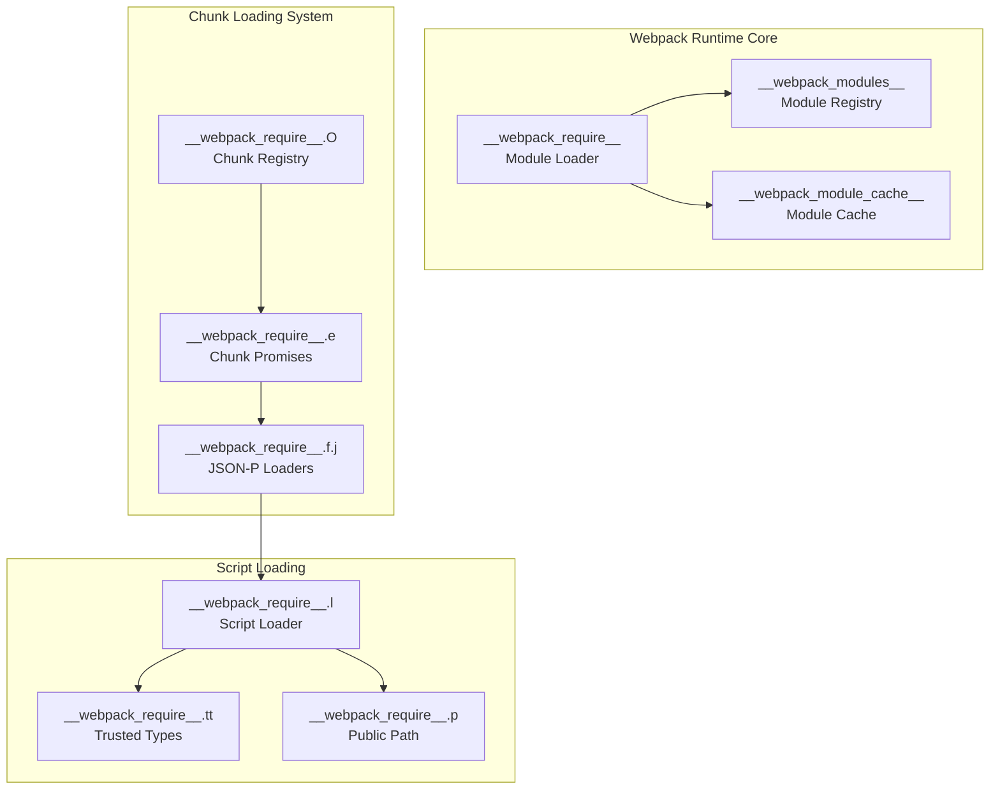
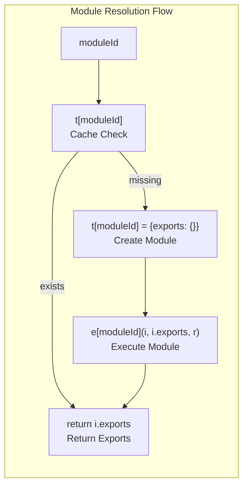
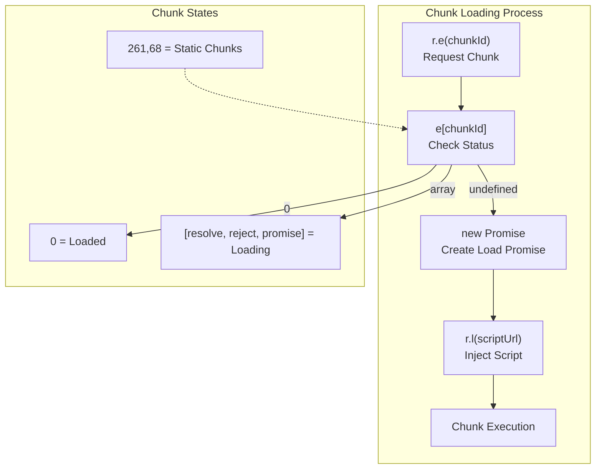
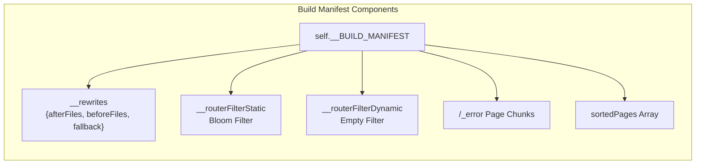
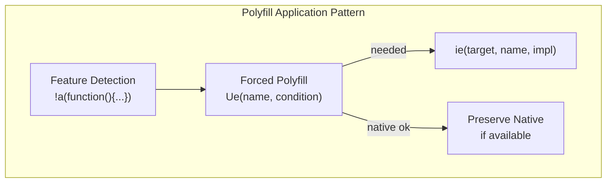
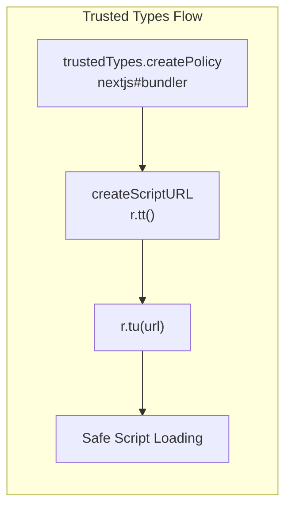
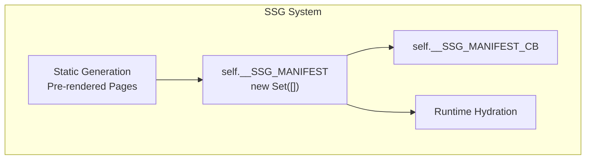
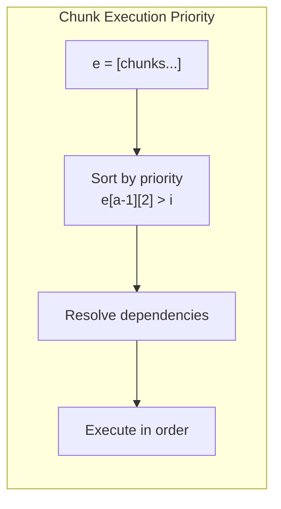

<!-- source: DeepWiki mcp.deepwiki.com · repo openai/gpt-5-coding-examples · page 4.2 Build Pipeline & Module System · fetched 2026-10-26 -->

# Build Pipeline & Module System

Relevant source files

The following files were used as context for generating this wiki page:

- [apps/asteroid-game/_next/static/CBX4_Ds-gHqKToLKyj8w-/_buildManifest.js](apps/asteroid-game/_next/static/CBX4_Ds-gHqKToLKyj8w-/_buildManifest.js)
- [apps/asteroid-game/_next/static/CBX4_Ds-gHqKToLKyj8w-/_ssgManifest.js](apps/asteroid-game/_next/static/CBX4_Ds-gHqKToLKyj8w-/_ssgManifest.js)
- [apps/asteroid-game/_next/static/chunks/polyfills-42372ed130431b0a.js](apps/asteroid-game/_next/static/chunks/polyfills-42372ed130431b0a.js)
- [apps/asteroid-game/_next/static/chunks/webpack-272b44dd0cfe77c4.js](apps/asteroid-game/_next/static/chunks/webpack-272b44dd0cfe77c4.js)

This document covers the Webpack-based build pipeline and module system used in the repository's example applications, with particular focus on the asteroid game's Next.js implementation. It details code splitting strategies, module loading mechanisms, and build optimization techniques. For React and Next.js framework integration details, see [React & Next.js Implementation](#4.1). For asset delivery optimization, see [Asset Optimization & Delivery](#4.3).

## Build System Architecture

The repository uses a sophisticated Webpack-based build system that generates optimized, production-ready applications with advanced code splitting and module loading capabilities.

### Webpack Runtime System

Sources: [apps/asteroid-game/_next/static/chunks/webpack-272b44dd0cfe77c4.js:1-50]()

The Webpack runtime provides a complete module system with dynamic loading capabilities. The core `r` function (Webpack require) manages module resolution and caching through a two-tier system of module registry and cache.

### Module Loading and Caching

Sources: [apps/asteroid-game/_next/static/chunks/webpack-272b44dd0cfe77c4.js:1-10]()

The module system implements efficient caching where each module is executed only once and subsequent imports return the cached `exports` object. Error handling ensures partial module loads are cleaned up via the `finally` block that deletes failed modules from the cache.

## Code Splitting and Chunk Management

### Chunk Loading Strategy

The build system implements sophisticated chunk loading with dependency resolution and parallel loading capabilities.

Sources: [apps/asteroid-game/_next/static/chunks/webpack-272b44dd0cfe77c4.js:20-40]()

The chunk loading system manages three distinct states: loaded chunks (0), loading chunks (promise arrays), and static chunks (261, 68) that are pre-loaded. Dynamic chunks are loaded via script injection with error handling for network failures and timeouts.

### Build Manifest Structure

Sources: [apps/asteroid-game/_next/static/CBX4_Ds-gHqKToLKyj8w-/_buildManifest.js:1]()

The build manifest uses a compact representation with Bloom filters for route filtering optimization. The `__routerFilterStatic` implements a probabilistic data structure with 58 bits and 14 hash functions for efficient static route checking.

## Polyfills and Browser Compatibility

### Core-JS Integration

The build system includes comprehensive polyfills through Core-JS to ensure broad browser compatibility.

| Feature Category | Implementation | Purpose |
|------------------|----------------|---------|
| Object Methods | `Object.defineProperty`, `Object.getOwnPropertyDescriptor` | Property descriptor support |
| Array Methods | `Array.prototype.at`, `Array.prototype.includes`, `Array.prototype.find` | Modern array methods |
| String Methods | `String.prototype.padStart`, `String.prototype.includes` | String manipulation |
| Promise Support | Full Promise implementation with `finally` | Async operation support |
| Symbol Support | Complete Symbol polyfill | Symbol primitive support |
| Map/Set/WeakMap | Full collection implementations | Modern data structures |

Sources: [apps/asteroid-game/_next/static/chunks/polyfills-42372ed130431b0a.js:1-100]()

The polyfill system uses feature detection to conditionally apply polyfills only when needed, minimizing runtime overhead on modern browsers while ensuring compatibility with older environments.

### Feature Detection Pattern

Sources: [apps/asteroid-game/_next/static/chunks/polyfills-42372ed130431b0a.js:50-150]()

## Script Loading and Security

### Trusted Types Integration

The build system implements Content Security Policy (CSP) compliance through Trusted Types integration.

Sources: [apps/asteroid-game/_next/static/chunks/webpack-272b44dd0cfe77c4.js:45-50]()

The Trusted Types implementation creates a `nextjs#bundler` policy that safely transforms script URLs before injection, preventing XSS attacks through script manipulation.

### Script Loading with Error Handling

The script loader implements comprehensive error handling with timeout management and cleanup procedures.

| Error Type | Handler | Action |
|------------|---------|--------|
| Network Error | `onerror` | Reject promise, cleanup |
| Timeout | `setTimeout` | 120s timeout, cleanup |
| Load Success | `onload` | Resolve promise, cleanup |
| Missing Script | Detection | Reuse existing scripts |

Sources: [apps/asteroid-game/_next/static/chunks/webpack-272b44dd0cfe77c4.js:25-45]()

## SSG Manifest Integration

Sources: [apps/asteroid-game/_next/static/CBX4_Ds-gHqKToLKyj8w-/_ssgManifest.js:1]()

The SSG manifest maintains a set of statically generated pages. The empty set indicates this application uses primarily dynamic rendering with selective static generation for specific routes.

## Performance Optimizations

### Module Tree Shaking

The build system implements aggressive tree shaking through the `r.t` function that provides conditional module exports based on flags.

| Flag | Purpose | Implementation |
|------|---------|---------------|
| 1 | Import module | `o = this(o)` |
| 2 | Merge exports | `2 & n && o` |
| 4 | ESM check | `o.__esModule` |
| 8 | Return as-is | Direct return |
| 16 | Thenable check | Promise detection |

Sources: [apps/asteroid-game/_next/static/chunks/webpack-272b44dd0cfe77c4.js:15-25]()

### Chunk Priority System

Sources: [apps/asteroid-game/_next/static/chunks/webpack-272b44dd0cfe77c4.js:10-20]()

The chunk execution system sorts chunks by priority value, ensuring critical chunks load before their dependents while maintaining parallel loading capabilities where possible.

---

