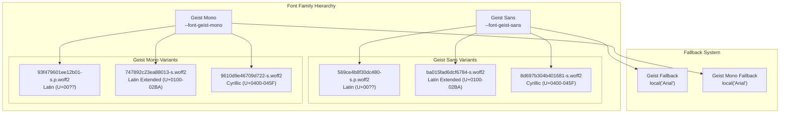
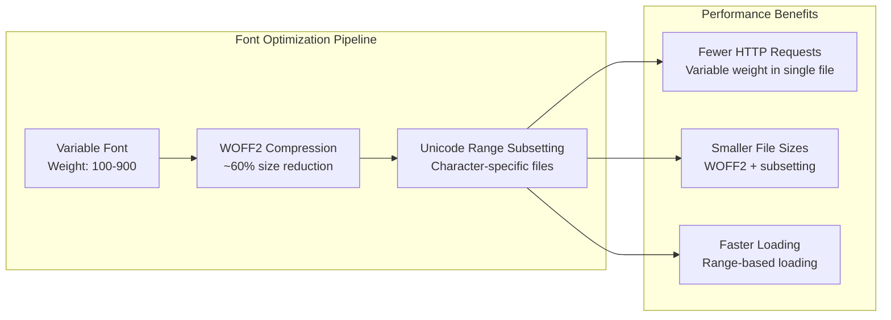
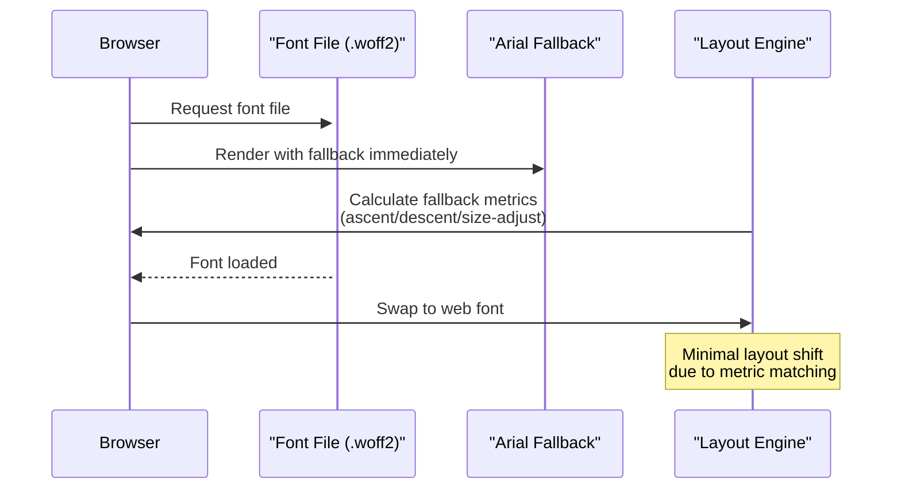
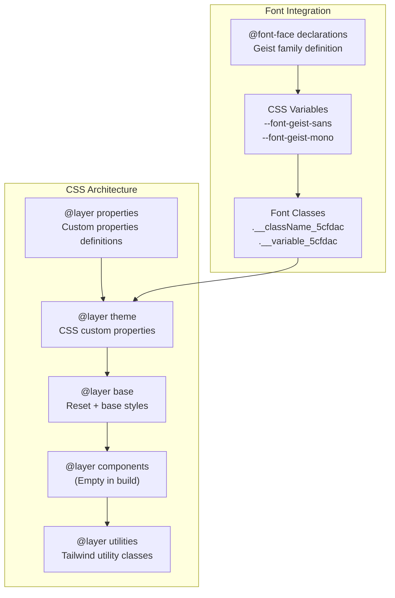
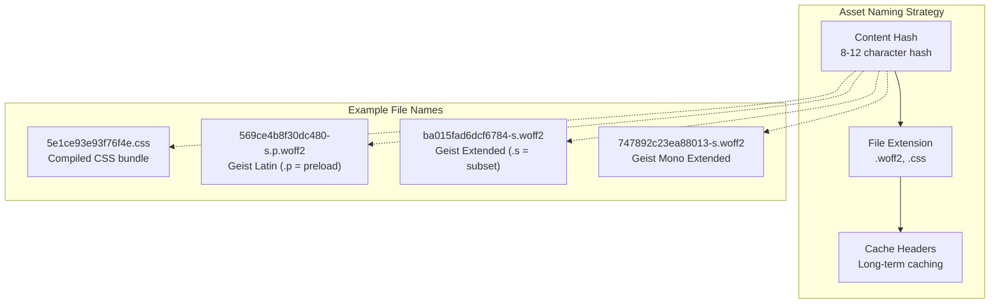
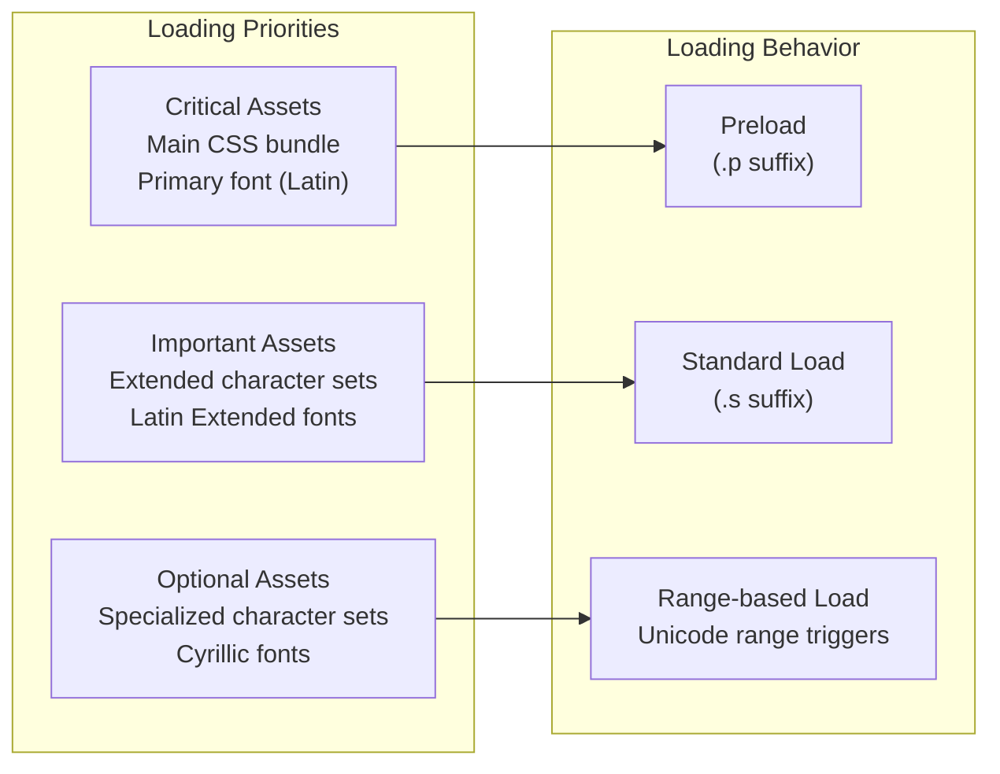
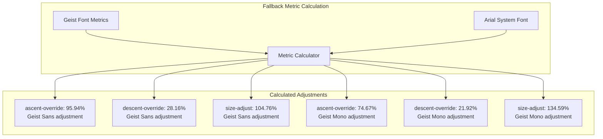
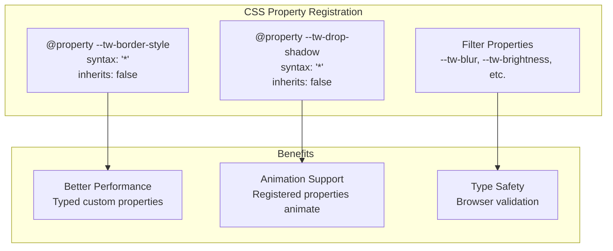

<!-- source: DeepWiki mcp.deepwiki.com · repo openai/gpt-5-coding-examples · page 4.3 Asset Optimization & Delivery · fetched 2026-10-26 -->

# Asset Optimization & Delivery

Relevant source files

The following files were used as context for generating this wiki page:

- [apps/asteroid-game/_next/static/css/5e1ce93e93f76f4e.css](apps/asteroid-game/_next/static/css/5e1ce93e93f76f4e.css)
- [apps/asteroid-game/_next/static/media/747892c23ea88013-s.woff2](apps/asteroid-game/_next/static/media/747892c23ea88013-s.woff2)
- [apps/asteroid-game/_next/static/media/8d697b304b401681-s.woff2](apps/asteroid-game/_next/static/media/8d697b304b401681-s.woff2)
- [apps/asteroid-game/_next/static/media/9610d9e46709d722-s.woff2](apps/asteroid-game/_next/static/media/9610d9e46709d722-s.woff2)
- [apps/asteroid-game/_next/static/media/ba015fad6dcf6784-s.woff2](apps/asteroid-game/_next/static/media/ba015fad6dcf6784-s.woff2)
- [apps/asteroid-game/favicon.ico](apps/asteroid-game/favicon.ico)

This document covers the asset optimization and delivery strategies implemented across the example applications, focusing on font loading, CSS optimization, and static asset management. The techniques demonstrated here show production-ready approaches for web font delivery, CSS bundling, and performance optimization.

For information about the build pipeline that generates these optimized assets, see [Build Pipeline & Module System](#4.2). For details on how these assets integrate with the React and Next.js framework, see [React & Next.js Implementation](#4.1).

## Font Loading Strategy

The applications implement a comprehensive font loading strategy using the Geist font family with multiple optimizations for performance and user experience.

### Font Family Architecture

**Sources:** [apps/asteroid-game/_next/static/css/5e1ce93e93f76f4e.css:1-1]()

### Font Face Declarations

The font loading system uses unicode range subsetting to optimize file sizes and loading performance:

| Font Family | Unicode Range | File Hash | Purpose |
|-------------|---------------|-----------|---------|
| `Geist` | `U+00??` | `569ce4b8f30dc480` | Latin basic characters |
| `Geist` | `U+0100-02BA` | `ba015fad6dcf6784` | Latin extended characters |
| `Geist` | `U+0400-045F` | `8d697b304b401681` | Cyrillic characters |
| `Geist Mono` | `U+00??` | `93f479601ee12b01` | Monospace Latin basic |
| `Geist Mono` | `U+0100-02BA` | `747892c23ea88013` | Monospace Latin extended |
| `Geist Mono` | `U+0400-045F` | `9610d9e46709d722` | Monospace Cyrillic |

**Sources:** [apps/asteroid-game/_next/static/css/5e1ce93e93f76f4e.css:1-1]()

## Font File Optimization

### WOFF2 Compression and Variable Fonts

The font files implement several optimization strategies:

**Sources:** [apps/asteroid-game/_next/static/css/5e1ce93e93f76f4e.css:1-1]()

### Font Display Strategy

The font loading uses `font-display: swap` strategy for optimal perceived performance:

**Sources:** [apps/asteroid-game/_next/static/css/5e1ce93e93f76f4e.css:1-1]()

## CSS Asset Management

### Tailwind CSS Integration

The CSS delivery combines Tailwind CSS utilities with custom font definitions:

**Sources:** [apps/asteroid-game/_next/static/css/5e1ce93e93f76f4e.css:3-3]()

### CSS Custom Properties System

The CSS uses a custom properties system for theming and font management:

| Property | Value | Purpose |
|----------|-------|---------|
| `--default-font-family` | `var(--font-geist-sans)` | Primary font family |
| `--default-mono-font-family` | `var(--font-geist-mono)` | Monospace font family |
| `--font-geist-sans` | `"Geist","Geist Fallback"` | Sans-serif font stack |
| `--font-geist-mono` | `"Geist Mono","Geist Mono Fallback"` | Monospace font stack |
| `--background` | `#fff` / `#0a0a0a` | Theme background |
| `--foreground` | `#171717` / `#ededed` | Theme foreground |

**Sources:** [apps/asteroid-game/_next/static/css/5e1ce93e93f76f4e.css:3-3]()

## Static Asset Delivery

### File Naming and Caching Strategy

The static assets use content-based hashing for optimal caching:

**Sources:** [apps/asteroid-game/_next/static/css/5e1ce93e93f76f4e.css:1-1](), [apps/asteroid-game/_next/static/media/569ce4b8f30dc480-s.p.woff2](), [apps/asteroid-game/_next/static/media/ba015fad6dcf6784-s.woff2]()

### Asset Loading Priorities

The system implements different loading strategies based on asset importance:

**Sources:** [apps/asteroid-game/_next/static/css/5e1ce93e93f76f4e.css:1-1]()

## Performance Optimizations

### Font Fallback Metrics

The system includes calculated fallback metrics to minimize Cumulative Layout Shift (CLS):

**Sources:** [apps/asteroid-game/_next/static/css/5e1ce93e93f76f4e.css:1-1]()

### Dark Mode Implementation

The CSS includes efficient dark mode support using CSS custom properties:

| Theme Property | Light Mode | Dark Mode |
|----------------|------------|-----------|
| `--background` | `#fff` | `#0a0a0a` |
| `--foreground` | `#171717` | `#ededed` |

The dark mode is implemented using `@media (prefers-color-scheme: dark)` queries, allowing automatic theme switching based on system preferences.

**Sources:** [apps/asteroid-game/_next/static/css/5e1ce93e93f76f4e.css:3-3]()

### CSS Property Registration

Modern CSS features are used for enhanced performance and browser compatibility:

**Sources:** [apps/asteroid-game/_next/static/css/5e1ce93e93f76f4e.css:3-3]()

---

