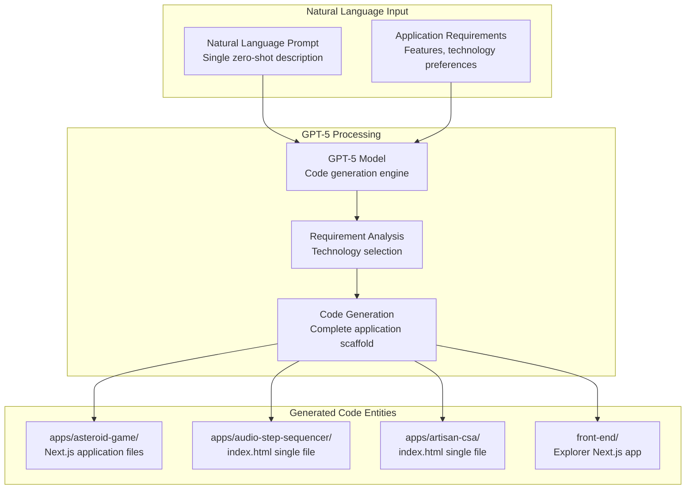
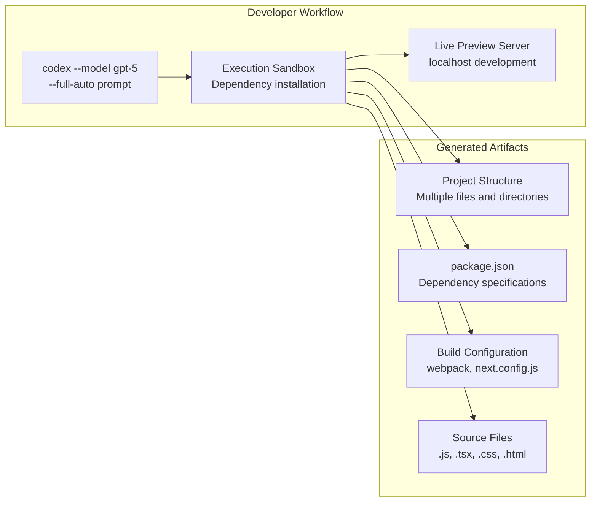
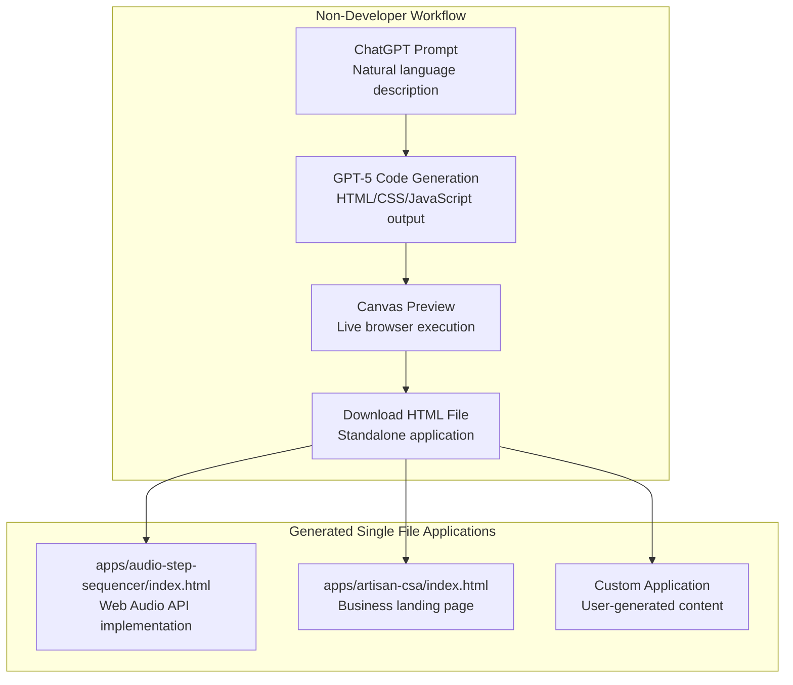
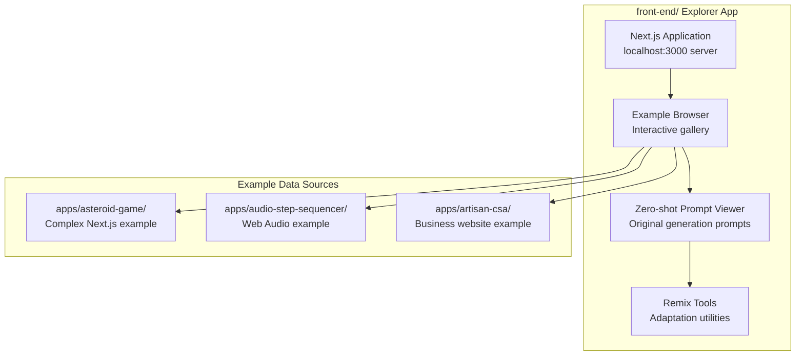
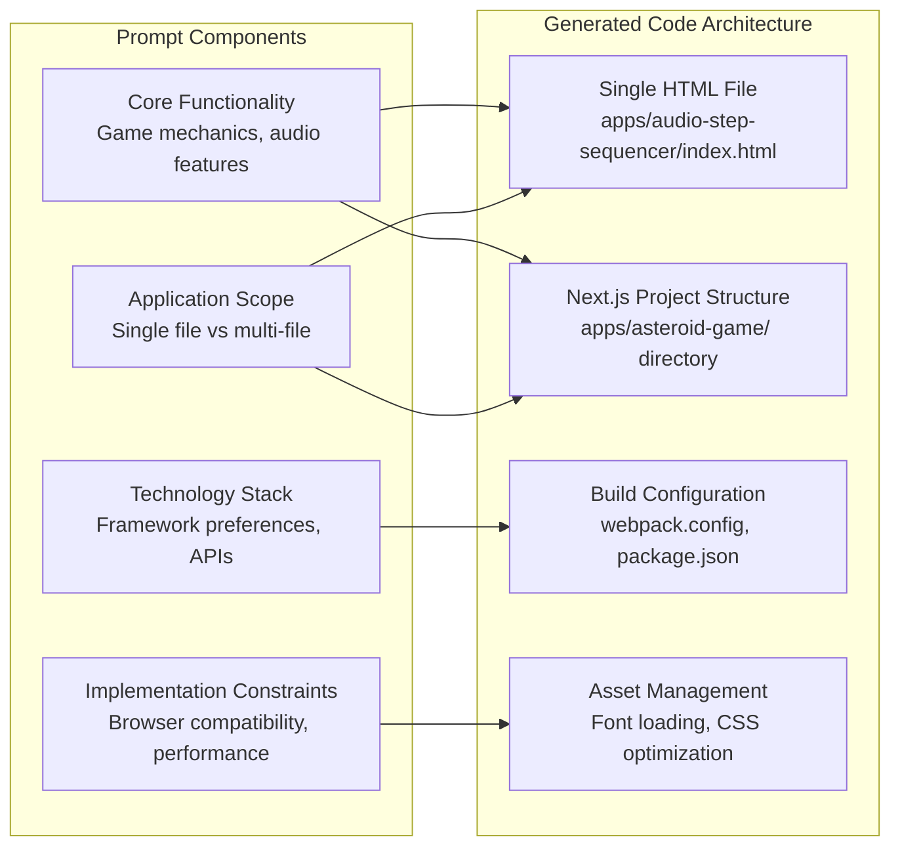
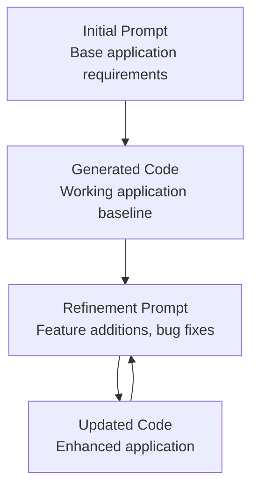
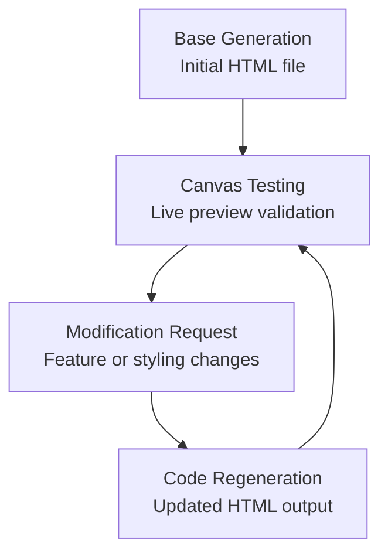

<!-- source: DeepWiki mcp.deepwiki.com · repo openai/gpt-5-coding-examples · page 5 GPT-5 Generation Workflow · fetched 2026-10-26 -->

# GPT-5 Generation Workflow

<details>
<summary>Relevant source files</summary>

The following files were used as context for generating this wiki page:

- [README.md](README.md)

</details>


This document explains how the example applications in this repository were generated using GPT-5, the different interfaces available for code generation, and how to leverage this repository for creating new applications. It covers the complete workflow from natural language prompts to fully functional applications.

For information about the specific example applications generated through this workflow, see [Example Applications](#3). For technical details about the frameworks and build systems used in the generated code, see [Technical Architecture](#4).

## Generation Process Overview

The applications in this repository demonstrate GPT-5's capability to generate complete, functional applications from zero-shot natural language prompts. Each application was created entirely through a single prompt without any hand-written code modifications.



Sources: [README.md:1-62]()

## Interface Options

GPT-5 can be accessed through two primary interfaces, each optimized for different user workflows and technical expertise levels.

| Interface | Target Audience | Execution Environment | Output Format | Live Preview |
|-----------|----------------|----------------------|---------------|--------------|
| Codex CLI | Developers | Terminal + Sandbox | File system structure | Yes |
| ChatGPT | Non-developers | Browser Canvas | Single HTML download | Yes |

### Codex CLI Workflow

The Codex CLI provides a terminal-based development environment that integrates directly with GPT-5 for code generation, execution, and live preview.



The CLI workflow enables complex multi-file applications like the asteroid game found in [apps/asteroid-game/]().

**Example CLI Command:**
```bash
codex --model gpt-5 --full-auto "Build a simple photobooth application with camera access in a single HTML file"
```

Sources: [README.md:32-46]()

### ChatGPT Workflow  

The ChatGPT interface provides browser-based code generation and preview capabilities, optimized for single-file applications.



This workflow produces self-contained HTML files like those found in [apps/audio-step-sequencer/index.html]() and [apps/artisan-csa/index.html]().

Sources: [README.md:48-57]()

## Front-End Explorer Integration

The repository includes a Next.js-based explorer application that enables browsing and analysis of the generated examples.



**Setup Commands:**
```bash
cd front-end
npm install
npm run dev
```

Sources: [README.md:7-19]()

## Prompt Structure Analysis

The zero-shot prompts used to generate these applications follow specific patterns that maximize GPT-5's code generation capabilities.

### Single-File Application Prompts

These prompts target complete functionality within a single HTML file, leveraging modern Web APIs:

**Audio Step Sequencer Pattern:**
- Web Audio API integration
- Canvas-based UI components  
- Real-time audio synthesis
- Touch and mouse interaction support

**Artisan CSA Pattern:**
- Business-focused landing page
- Interactive contact forms
- Responsive design implementation
- Local business feature integration

### Multi-File Framework Prompts  

These prompts request complete application scaffolds with modern framework integration:

**Asteroid Game Pattern:**
- Next.js framework specification
- Game loop and entity management
- Audio system integration
- Production-ready build configuration



Sources: [README.md:1-5](), [README.md:20-31]()

## Iteration and Refinement Process

While the examples in this repository represent single-prompt generations, the workflow supports iterative refinement through both interfaces.

### CLI Iteration Workflow



### ChatGPT Iteration Workflow



Sources: [README.md:29-31]()

## Repository Usage for New Applications

This repository serves as both a reference collection and a starting point for new GPT-5 generated applications.

### Adaptation Workflow

| Step | Action | Result |
|------|--------|---------|
| 1 | Browse examples in [front-end/]() explorer | Identify similar functionality patterns |
| 2 | Copy zero-shot prompt from selected example | Template for adaptation |
| 3 | Customize prompt with new requirements | Personalized application specification |
| 4 | Execute via Codex CLI or ChatGPT | New application generation |
| 5 | Iterate based on results | Refined application output |

### Technology Selection Guidelines

Based on the examples in this repository:

**Choose Single HTML File when:**
- Application scope is self-contained
- Web API integration is primary requirement  
- Deployment simplicity is prioritized
- No server-side functionality needed

**Choose Next.js Framework when:**
- Complex state management required
- Multiple routes or pages needed
- Production optimization important
- Server-side rendering beneficial

Sources: [README.md:19-31](), [README.md:59-61]()