# Page: Overview

# Overview

<details>
<summary>Relevant source files</summary>

The following files were used as context for generating this wiki page:

- [.gitignore](.gitignore)
- [LICENSE](LICENSE)
- [README.md](README.md)

</details>


## Purpose and Scope

This document provides a high-level overview of the GPT-5 Coding Examples repository, which serves as a curated showcase of complete applications generated entirely through single GPT-5 prompts. The repository demonstrates the model's capabilities in scaffolding websites, front-end applications, games, and interactive UIs from natural language descriptions.

The repository contains three main example applications of varying complexity, a Next.js-based exploration front-end for browsing examples, and comprehensive documentation. For detailed information about individual applications, see [Example Applications](#3). For technical implementation details of specific frameworks and build systems, see [Technical Architecture](#4). For understanding the generation workflow and tooling, see [GPT-5 Generation Workflow](#5).

## Repository Structure

The repository follows a clear organizational pattern separating documentation, example applications, and tooling infrastructure:

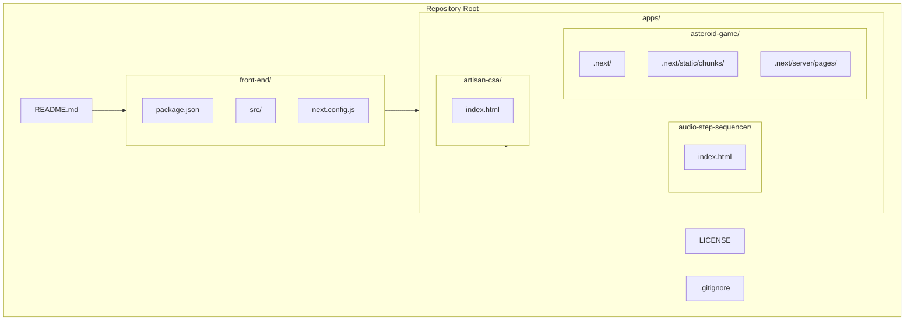

**Sources:** [README.md:1-62](), [LICENSE:1-19](), [.gitignore:1-150]()

## Application Architecture Patterns

The repository demonstrates two distinct architectural approaches for web application development:

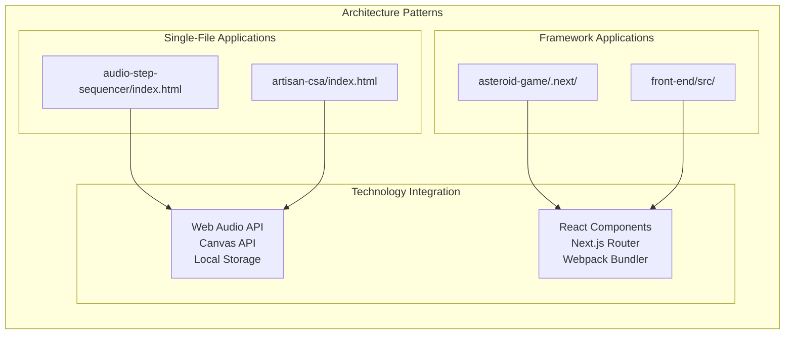

**Sources:** [README.md:3-5](), [README.md:25-46]()

## Example Applications Overview

| Application | Architecture | Technology Stack | Complexity Level |
|-------------|-------------|------------------|------------------|
| **Asteroid Game** | Next.js Framework | React, Canvas API, Web Audio | High - Full production build pipeline |
| **Audio Step Sequencer** | Single HTML File | Vanilla JavaScript, Web Audio API | Medium - Advanced audio programming |
| **Artisan CSA Landing** | Single HTML File | HTML5, CSS3, JavaScript | Low - Interactive business website |

The asteroid game represents the most sophisticated example, featuring a complete Next.js application with production-ready features including:
- App Router implementation in `.next/server/app/`
- Code splitting via webpack chunks in `.next/static/chunks/`
- Error handling through `404.html` and `_error` pages
- Font optimization with Geist font family assets

**Sources:** [README.md:5-6](), [README.md:18-19]()

## GPT-5 Integration Workflows

The repository supports multiple development workflows depending on user technical background:

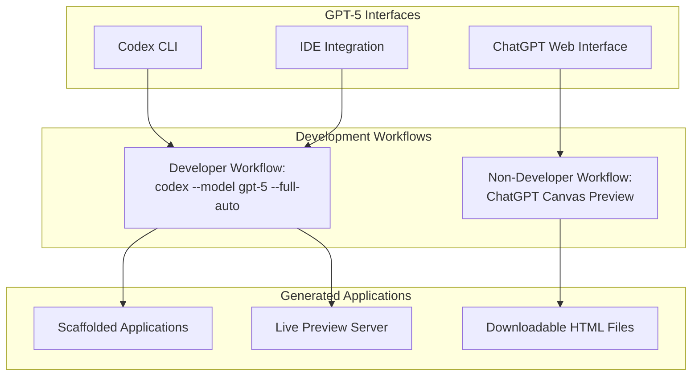

The `front-end` application serves as an exploration interface, allowing users to:
- Browse example applications at `localhost:3000`
- View zero-shot prompts that generated each application
- Access remix capabilities for adapting existing examples

**Sources:** [README.md:7-19](), [README.md:25-56]()

## Technical Architecture Summary

The repository demonstrates sophisticated build system integration, particularly in the asteroid game example:

- **Build Pipeline**: Webpack runtime (`webpack-272b44dd0cfe77c4.js`) with dynamic chunk loading
- **React Integration**: Framework bundle (`framework-7c95b8e5103c9e90.js`) with App Router (`964-830f77d7ce1c2463.js`)
- **Asset Optimization**: Font subsetting, CSS optimization, and static asset management
- **Error Handling**: Production-ready 404 pages and error boundaries

The single-file applications showcase direct Web API usage without framework overhead, demonstrating that GPT-5 can generate both simple and complex application architectures based on prompt requirements.

**Sources:** [README.md:3-6](), [.gitignore:86-88]()

---

# Page: Getting Started

# Getting Started

<details>
<summary>Relevant source files</summary>

The following files were used as context for generating this wiki page:

- [README.md](README.md)

</details>


This document explains how to explore the GPT-5 generated examples in this repository, set up the local development environment, and understand the different workflows available for creating new applications using GPT-5. It covers both the technical setup process and the conceptual framework for leveraging GPT-5's code generation capabilities.

For detailed analysis of the individual example applications, see [Example Applications](#3). For information about GPT-5 generation workflows and integration patterns, see [GPT-5 Generation Workflow](#5).

## Local Development Setup

The repository includes a Next.js front-end application that serves as an exploration interface for all the example applications. This browser-based interface allows you to view each example, examine the original zero-shot prompts that generated the code, and experiment with modifications.

### Initial Setup Process

The setup process involves cloning the repository and running the front-end exploration application:

| Step | Command | Purpose |
|------|---------|---------|
| 1 | `git clone <repository-url>` | Clone the repository |
| 2 | `cd front-end` | Navigate to front-end directory |
| 3 | `npm install` | Install Next.js dependencies |
| 4 | `npm run dev` | Start development server |
| 5 | Navigate to `localhost:3000` | Access the exploration interface |

### Front-End Exploration Interface

The front-end application provides a unified interface for browsing all examples, viewing their source prompts, and understanding their architectural patterns. This Next.js application serves as both a demonstration of GPT-5's capabilities and a practical tool for exploring the generated code.

**Front-End Application Architecture**

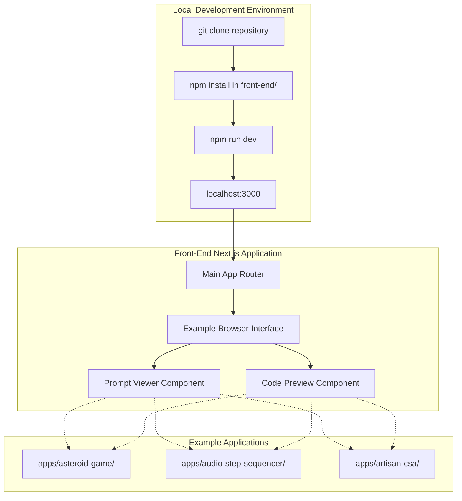

Sources: [README.md:9-19]()

## GPT-5 Generation Workflows

The repository demonstrates two primary workflows for generating applications with GPT-5, each optimized for different user profiles and development environments.

### Developer Workflow: Codex CLI Integration

The Codex CLI provides a terminal-based interface that integrates GPT-5 code generation directly into existing development workflows. This approach offers the most sophisticated development experience with full sandbox execution and live preview capabilities.

**Codex CLI Workflow Architecture**

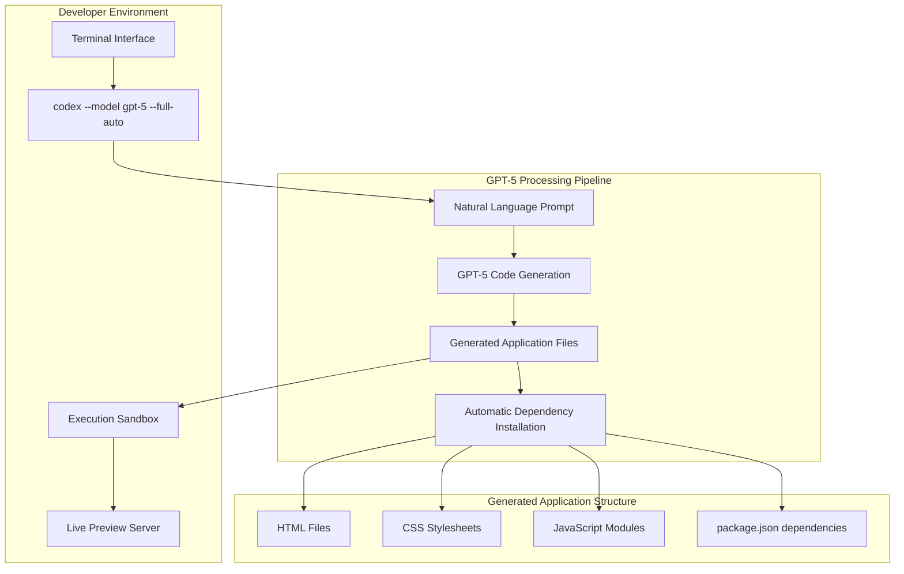

The Codex CLI workflow supports complex application generation with automatic dependency management and live preview functionality, as demonstrated in the command structure shown in [README.md:40-42]().

Sources: [README.md:32-46]()

### Non-Developer Workflow: ChatGPT Canvas

For users without local development environments, ChatGPT provides a browser-based code generation and preview system. This workflow enables complete application creation without requiring any local software installation.

**ChatGPT Canvas Workflow**

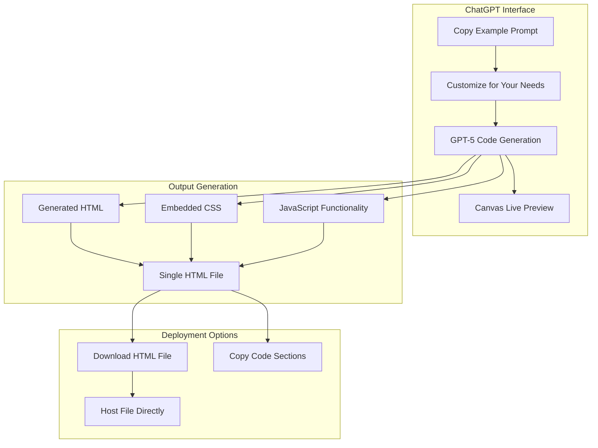

This workflow is particularly effective for generating single-file applications like those found in [apps/audio-step-sequencer/]() and [apps/artisan-csa/](), which demonstrate sophisticated functionality within self-contained HTML files.

Sources: [README.md:48-57]()

## Example Application Categories

The repository contains three distinct categories of applications that showcase different aspects of GPT-5's code generation capabilities and architectural patterns.

### Application Complexity Spectrum

| Application | Architecture | Complexity Level | Primary Technologies |
|-------------|-------------|------------------|---------------------|
| Asteroid Game | Next.js Framework | High | React, Next.js App Router, Webpack |
| Audio Step Sequencer | Single HTML File | Medium | Web Audio API, Canvas, Vanilla JS |
| Artisan CSA Landing | Single HTML File | Low | HTML5, CSS3, Vanilla JS |

### Technology Implementation Patterns

The examples demonstrate two primary architectural approaches:

**Framework-Based Applications**: Complex applications utilizing Next.js with full build pipelines, as seen in [apps/asteroid-game/]() with its complete React component system and server-side rendering capabilities.

**Single-File Applications**: Self-contained HTML applications that leverage modern Web APIs directly, demonstrated in [apps/audio-step-sequencer/]() and [apps/artisan-csa/]().

**Prompt-to-Application Mapping**

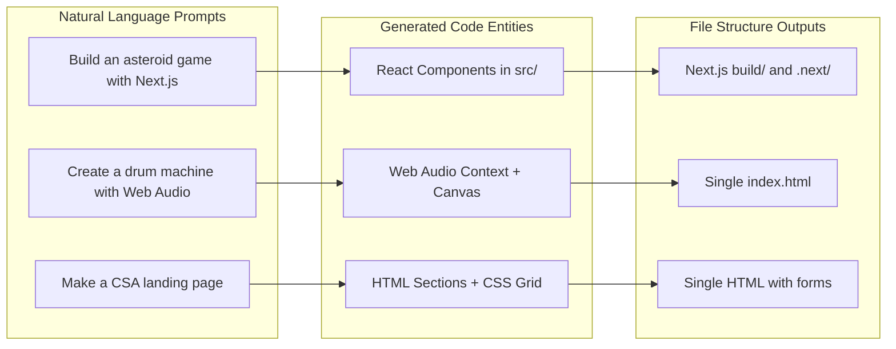

Sources: [README.md:1-6](), [README.md:18-19]()

## Exploration and Experimentation Process

The repository serves as both a reference implementation and a starting point for creating new applications. Each example includes the original zero-shot prompt that generated the code, enabling users to understand the relationship between natural language descriptions and the resulting application architecture.

### Prompt Analysis and Adaptation

When exploring the examples, focus on understanding how the natural language prompts translate to specific code structures:

- **Architectural decisions**: How prompt language influences framework selection
- **Feature specifications**: How functional requirements map to API usage
- **Styling preferences**: How design descriptions translate to CSS implementation

### Iterative Development Process

The examples demonstrate that GPT-5 can generate production-ready applications in a single prompt, but the real power lies in iterative refinement:

1. **Start with example prompts** as templates
2. **Modify specific requirements** for your use case  
3. **Generate variations** to explore different approaches
4. **Refine and iterate** based on results

Sources: [README.md:29-31](), [README.md:51-55]()

---

# Page: Example Applications

# Example Applications

<details>
<summary>Relevant source files</summary>

The following files were used as context for generating this wiki page:

- [README.md](README.md)
- [apps/artisan-csa/index.html](apps/artisan-csa/index.html)
- [apps/asteroid-game/index.html](apps/asteroid-game/index.html)
- [apps/audio-step-sequencer/index.html](apps/audio-step-sequencer/index.html)

</details>


This document provides an overview of the three main example applications included in the GPT-5 Coding Examples repository. These applications demonstrate different complexity levels and technology choices, showcasing GPT-5's capability to generate everything from simple single-file websites to complex Next.js applications with full production features.

For detailed technical analysis of frameworks and build tools used across applications, see [Technical Architecture](#4). For information about the GPT-5 generation process that created these applications, see [GPT-5 Generation Workflow](#5).

## Application Portfolio Overview

The repository contains three distinct applications that represent different points on the complexity spectrum of web development:

| Application | Complexity | Technology Stack | File Structure |
|-------------|------------|------------------|----------------|
| Artisan CSA Landing Page | Simple | HTML + CSS + Vanilla JS | Single file |
| Audio Step Sequencer | Intermediate | HTML + Web Audio API | Single file |
| Asteroid Game | Complex | Next.js + React + Webpack | Multi-file framework |

### Application Architecture Comparison

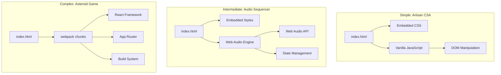

Sources: [apps/artisan-csa/index.html](), [apps/audio-step-sequencer/index.html](), [apps/asteroid-game/index.html]()

## Technology Integration Patterns

Each application demonstrates different approaches to integrating web technologies and handling complexity:

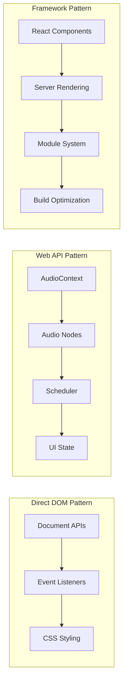

Sources: [apps/artisan-csa/index.html:1174-1348](), [apps/audio-step-sequencer/index.html:345-979](), [apps/asteroid-game/index.html]()

## Application Complexity Spectrum

### Simple: Artisan CSA Landing Page

The CSA landing page represents the simplest application type - a business website built as a single HTML file with embedded CSS and JavaScript. Despite its simplicity, it demonstrates sophisticated design patterns and user interactions.

**Key Features:**
- Watercolor-themed design with CSS gradients and SVG illustrations
- Interactive pricing calculator with range sliders
- ZIP code delivery checker with simple validation
- Testimonials carousel with keyboard navigation
- Local storage pattern integration for user preferences

**Code Structure:**
- Single file: [apps/artisan-csa/index.html]()
- CSS custom properties for theming: [apps/artisan-csa/index.html:12-25]()
- JavaScript module pattern: [apps/artisan-csa/index.html:1174-1348]()

### Intermediate: Audio Step Sequencer

The audio step sequencer demonstrates intermediate complexity through sophisticated real-time audio processing while maintaining a single-file architecture. It showcases advanced Web Audio API usage and complex state management.

**Key Features:**
- Real-time drum synthesis using `AudioContext` and oscillators
- 16-step grid sequencer with swing timing
- Pattern save/load system using `localStorage`
- WAV export functionality via `OfflineAudioContext`
- Responsive touch/pointer event handling

**Audio Engine Architecture:**

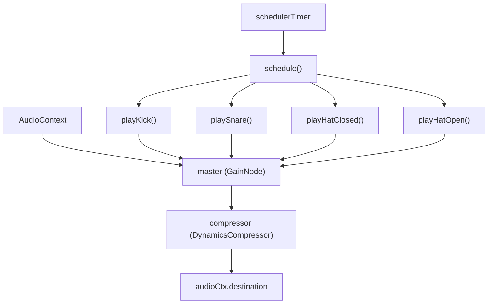

Sources: [apps/audio-step-sequencer/index.html:393-408](), [apps/audio-step-sequencer/index.html:514-603](), [apps/audio-step-sequencer/index.html:419-453]()

### Complex: Asteroid Game

The asteroid game represents the most sophisticated example - a full Next.js application with production-grade features including server-side rendering, code splitting, and optimized asset delivery.

**Framework Integration:**
- Next.js App Router with React 18
- Webpack module bundling with code splitting
- TypeScript-style build optimization
- Production error handling and 404 pages

**Build System Structure:**

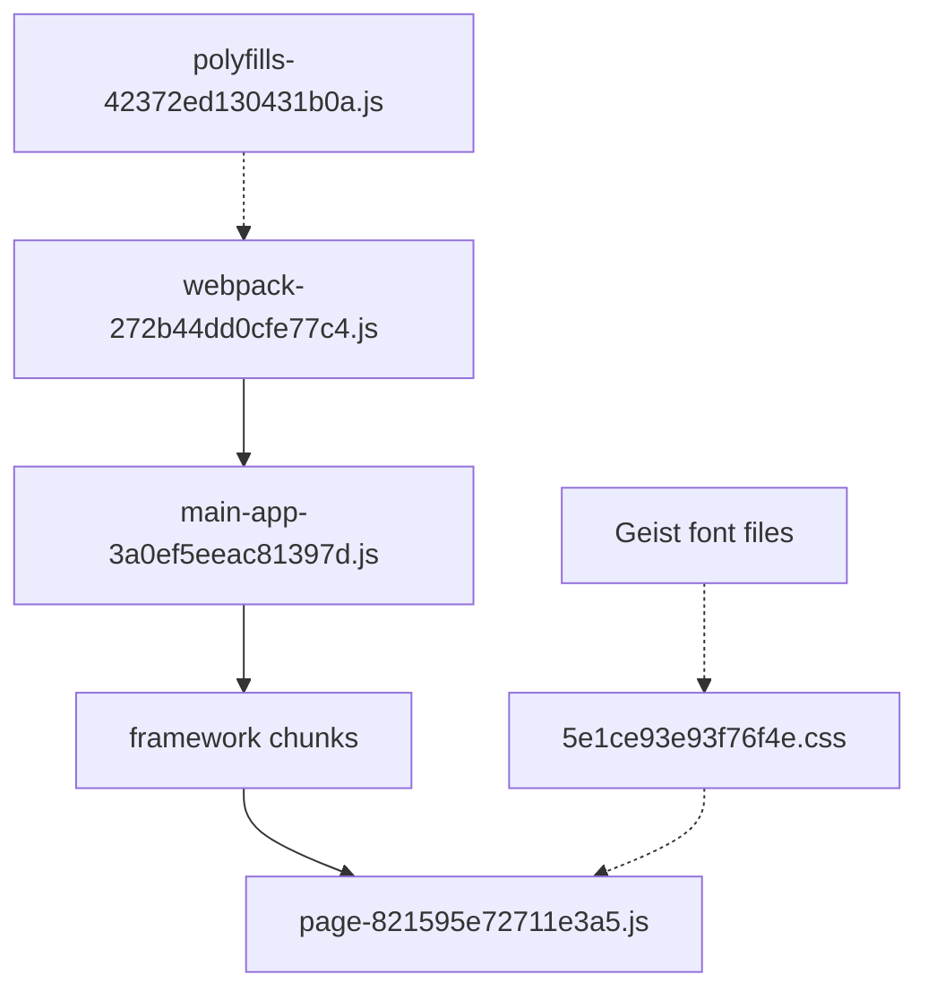

Sources: [apps/asteroid-game/index.html:1-2]()

## Generation Pattern Analysis

Each application demonstrates different aspects of GPT-5's code generation capabilities:

**Single-Pass Generation:** All three applications were generated in single prompts without iterative refinement, showcasing GPT-5's ability to produce complete, working applications.

**Technology Appropriateness:** Each application uses technology stacks appropriate to its complexity level - vanilla JavaScript for simple interactions, Web Audio API for real-time audio, and Next.js for complex application architecture.

**Production Readiness:** Even the simplest applications include production considerations like accessibility attributes, responsive design, and error handling.

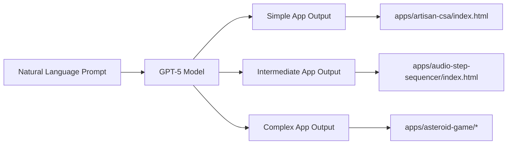

Sources: [README.md:3-5](), [README.md:21-31]()

The applications collectively demonstrate GPT-5's capability to generate appropriate solutions across the full spectrum of web development complexity, from static websites to sophisticated real-time applications.

---

# Page: Asteroid Game

# Asteroid Game

<details>
<summary>Relevant source files</summary>

The following files were used as context for generating this wiki page:

- [apps/asteroid-game/_next/static/chunks/app/page-821595e72711e3a5.js](apps/asteroid-game/_next/static/chunks/app/page-821595e72711e3a5.js)
- [apps/asteroid-game/index.html](apps/asteroid-game/index.html)
- [apps/asteroid-game/index.txt](apps/asteroid-game/index.txt)

</details>


This document covers the asteroid game example application, the most complex demonstration of GPT-5's code generation capabilities in this repository. The asteroid game is implemented as a Next.js application featuring real-time space combat with complete audio, physics, AI, and visual systems built entirely in-browser using Canvas API and Web Audio API.

For information about the Next.js framework integration details, see [Next.js Framework Integration](#3.1.2). For build system specifics, see [Build System & Asset Management](#3.1.3).

## System Overview

The asteroid game implements a complete 2D space combat simulator with the following core systems:

- **Real-time game loop** with physics simulation at 60 FPS
- **Multi-entity management** for ships, asteroids, projectiles, and effects
- **Procedural audio synthesis** using Web Audio API
- **Canvas-based rendering** with particle effects and HUD
- **AI behavior system** for enemy ships
- **Input handling** supporting both keyboard and mouse controls

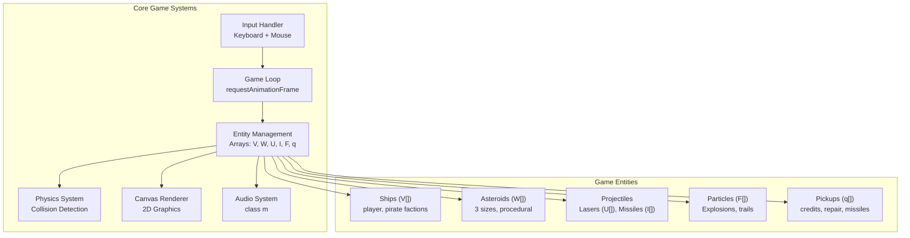

Sources: [apps/asteroid-game/_next/static/chunks/app/page-821595e72711e3a5.js:1-1]()

## Game State Architecture

The game maintains state through several global arrays and objects that manage different entity types and game progression:

| State Container | Purpose | Key Properties |
|---|---|---|
| `V` | Ships array | `faction`, `model`, `pos`, `vel`, `weapons` |
| `W` | Asteroids array | `size`, `shape`, `hp`, `radius` |  
| `U` | Laser shots array | `life`, `dmg`, `ownerId`, `faction` |
| `I` | Missiles array | `targetId`, `turnRate`, `accel`, `trail` |
| `F` | Particles array | `life`, `maxLife`, `color`, `fade` |
| `q` | Pickups array | `type`, `amount`, `life`, `spin` |
| `G` | Game state | `score`, `difficulty`, `killStreak` |
| `C` | Camera state | `pos`, `shake` |

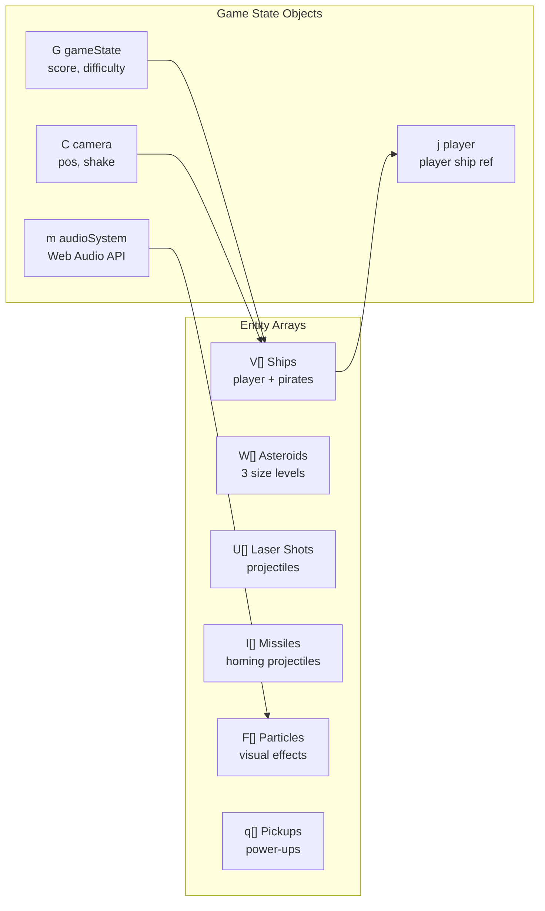

Sources: [apps/asteroid-game/_next/static/chunks/app/page-821595e72711e3a5.js:1-1]()

## Audio System Implementation

The audio system (`class m`) provides procedural sound generation using Web Audio API with several specialized sound methods:

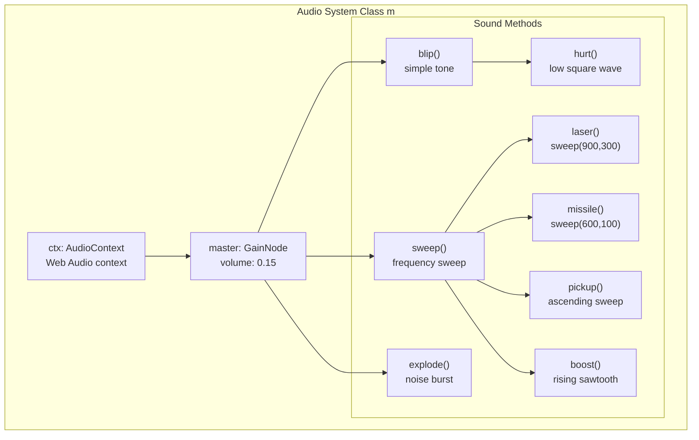

The audio system creates sounds dynamically without external audio files by generating oscillators and applying envelopes:

- **Laser sounds**: `sweep(900, 300, 0.08, "sawtooth")` - descending frequency sweep
- **Explosions**: Generated white noise with lowpass filter and exponential decay
- **Engine sounds**: Called when `boost()` is triggered during ship acceleration

Sources: [apps/asteroid-game/_next/static/chunks/app/page-821595e72711e3a5.js:1-1]()

## Entity Management & Physics

The game implements a comprehensive entity system with collision detection and physics simulation:

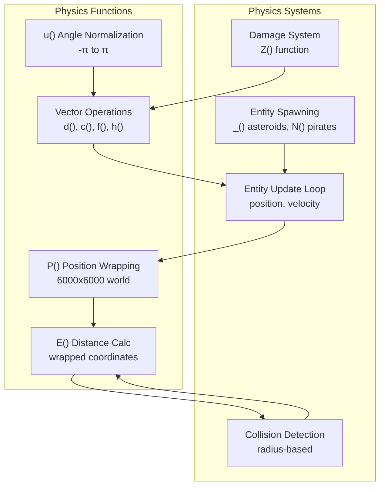

Key physics functions:
- `P(e)`: Wraps positions to 6000x6000 world bounds  
- `E(e,t)`: Calculates wrapped distance between entities
- `Z(e,t,l)`: Applies damage with shield/hull mechanics and knockback
- `d(e,t)`: Vector addition for position/velocity updates

Sources: [apps/asteroid-game/_next/static/chunks/app/page-821595e72711e3a5.js:1-1]()

## AI Behavior System

Enemy ships use a state-based AI system with multiple behavior modes and decision-making logic:

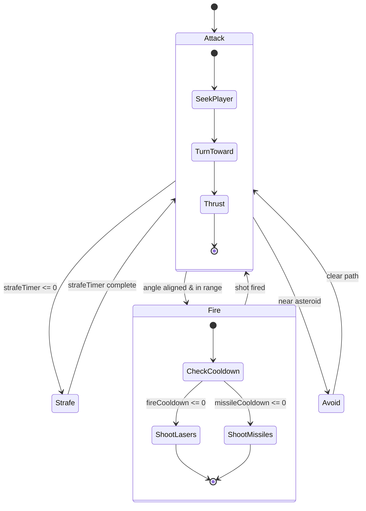

AI ships (pirates) implement:
- **Target acquisition**: `ee(e, 900)` finds nearest enemy within range
- **Obstacle avoidance**: Asteroid collision prediction and steering
- **Combat behavior**: Firing decisions based on angle alignment and distance
- **Movement patterns**: Strafing maneuvers with randomized timing

Each pirate ship has an `ai` object with `state`, `patience`, and `strafeTimer` properties controlling behavior transitions.

Sources: [apps/asteroid-game/_next/static/chunks/app/page-821595e72711e3a5.js:1-1]()

## Rendering Pipeline

The game uses HTML5 Canvas with a multi-layer rendering system and camera follow mechanics:

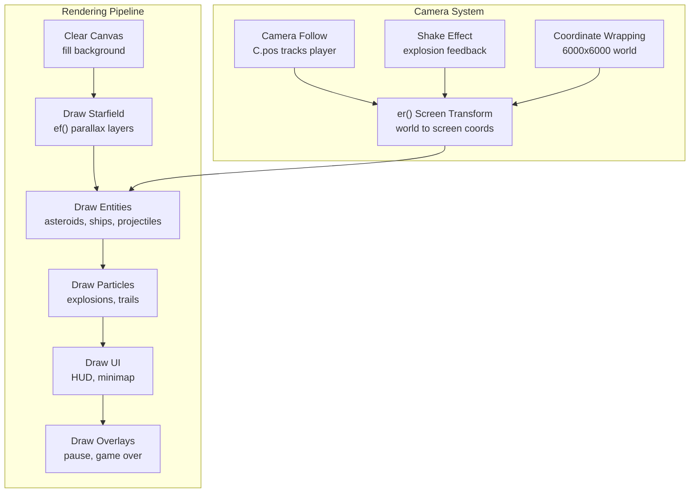

**Key rendering features**:
- **Parallax starfield**: Three layers (`z`, `H`, `O` arrays) with different scroll speeds
- **Entity rendering**: Custom ship models drawn with canvas paths  
- **Screen space conversion**: `er(e)` transforms world coordinates to screen coordinates
- **Visual feedback**: Camera shake on explosions, shield indicators, engine trails

The rendering system handles a wrapped 6000x6000 world space projected onto screen coordinates with smooth camera following.

Sources: [apps/asteroid-game/_next/static/chunks/app/page-821595e72711e3a5.js:1-1]()

---

# Page: Game Architecture & Logic

# Game Architecture & Logic

<details>
<summary>Relevant source files</summary>

The following files were used as context for generating this wiki page:

- [apps/asteroid-game/_next/static/chunks/app/page-821595e72711e3a5.js](apps/asteroid-game/_next/static/chunks/app/page-821595e72711e3a5.js)

</details>


This document covers the core game systems, entity management, physics engine, and gameplay logic for the asteroid game. It focuses on the runtime architecture and game loop implementation found in the compiled game code.

For information about Next.js integration and React components, see [Next.js Framework Integration](#3.1.2). For build system and asset optimization details, see [Build System & Asset Management](#3.1.3).

## Core Architecture Overview

The asteroid game implements a traditional game loop architecture with entity-component-system patterns. The game runs entirely in the browser using Canvas 2D rendering and Web Audio API for sound.

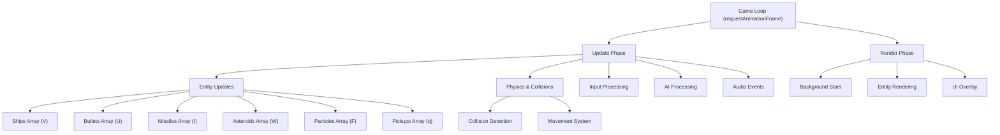

**Sources:** [apps/asteroid-game/_next/static/chunks/app/page-821595e72711e3a5.js:1-1000]()

## Entity Management System

The game manages different entity types using separate arrays, each containing objects with position, velocity, and type-specific properties.

| Entity Type | Array Variable | Key Properties | Purpose |
|-------------|----------------|----------------|---------|
| Ships | `V` | `pos`, `vel`, `faction`, `model`, `hull`, `shield` | Player and enemy ships |
| Bullets | `U` | `pos`, `vel`, `life`, `dmg`, `faction` | Laser projectiles |
| Missiles | `I` | `pos`, `vel`, `targetId`, `turnRate`, `accel` | Homing missiles |
| Asteroids | `W` | `pos`, `vel`, `radius`, `hp`, `size`, `shape` | Destructible obstacles |
| Particles | `F` | `pos`, `vel`, `life`, `color`, `size` | Visual effects |
| Pickups | `q` | `pos`, `type`, `amount`, `life` | Collectible items |

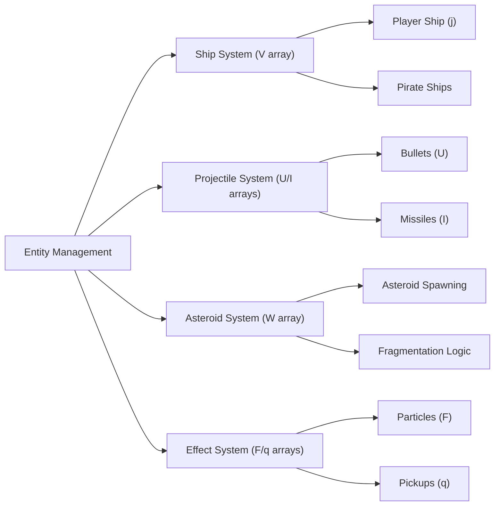

**Sources:** [apps/asteroid-game/_next/static/chunks/app/page-821595e72711e3a5.js:1-1000]()

## Physics Engine

The physics system handles vector mathematics, collision detection, and movement for all game entities using 2D physics with wrapping coordinates.

### Vector Operations

The game implements core vector math functions for position and velocity calculations:

- `r(e)` - Calculate vector magnitude using `Math.hypot`
- `f(e)` - Normalize vector to unit length
- `d(e,t)` - Vector addition
- `c(e,t)` - Vector scalar multiplication
- `h(e,t)` - Vector rotation by angle
- `u(e)` - Angle normalization to [-π, π] range

### Collision Detection

```mermaid
graph TB
    CollisionSystem["Collision Detection"] --> ShipAsteroid["Ship-Asteroid Collisions"]
    CollisionSystem --> ProjectileShip["Projectile-Ship Collisions"]
    CollisionSystem --> ProjectileAsteroid["Projectile-Asteroid Collisions"]
    CollisionSystem --> MissileCollisions["Missile Collisions"]
    CollisionSystem --> PickupCollisions["Pickup Collections"]
    
    ShipAsteroid --> DamageCalculation["Damage Calculation (Z function)"]
    ShipAsteroid --> PhysicsResponse["Physics Response"]
    
    ProjectileShip --> ShieldDamage["Shield/Hull Damage"]
    ProjectileShip --> ParticleEffects["Particle Effects (Q function)"]
    
    ProjectileAsteroid --> AsteroidDestruction["Asteroid Destruction ($)"]
    ProjectileAsteroid --> ScoreUpdate["Score Update"]
```

The collision system uses distance-based detection with radius checking: `E(e,t)` function calculates wrapped distance between entities, accounting for the 6000x6000 world wrapping.

**Sources:** [apps/asteroid-game/_next/static/chunks/app/page-821595e72711e3a5.js:1-1000]()

## Audio System Architecture

The game implements a custom Web Audio API wrapper for procedural sound generation.

```mermaid
graph LR
    AudioSystem["Audio System (class m)"] --> AudioContext["WebAudioContext (ctx)"]
    AudioSystem --> MasterGain["Master Gain (master)"]
    
    AudioContext --> Oscillators["Oscillator Nodes"]
    AudioContext --> Filters["Filter Nodes"] 
    AudioContext --> GainNodes["Gain Nodes"]
    AudioContext --> NoiseBuffers["Noise Buffers"]
    
    SoundEvents["Sound Events"] --> laser["laser()"]
    SoundEvents --> missile["missile()"]
    SoundEvents --> explode["explode()"]
    SoundEvents --> pickup["pickup()"]
    SoundEvents --> hurt["hurt()"]
    SoundEvents --> boost["boost()"]
    
    laser --> sweep["sweep(900,300,0.08)"]
    missile --> sweep2["sweep(600,100,0.2)"]
    explode --> NoiseBuffer["White Noise + Filter"]
    pickup --> sweep3["sweep(400,800,0.12)"]
```

The audio system (`class m`) provides:
- `blip()` - Simple oscillator tones
- `sweep()` - Frequency sweeping sounds
- `explode()` - Filtered white noise
- Preset functions for game events (laser, missile, pickup, etc.)

**Sources:** [apps/asteroid-game/_next/static/chunks/app/page-821595e72711e3a5.js:1-1000]()

## Game State Management

The game state is managed through several key objects:

```mermaid
graph TB
    GameState["Game State"] --> PlayerState["Player State (j)"]
    GameState --> GlobalState["Global State (G)"]
    GameState --> CameraState["Camera State (C)"]
    GameState --> InputState["Input State (m, S)"]
    
    PlayerState --> Position["pos, vel, angle"]
    PlayerState --> Combat["shield, hull, missileAmmo"]
    PlayerState --> Ship["faction, model, turnRate"]
    
    GlobalState --> Scoring["score, killStreak, bestStreak"]
    GlobalState --> Progression["time, difficulty, credits"]
    GlobalState --> Spawning["pirateSpawnTimer, asteroidSpawnTimer"]
    GlobalState --> GameFlow["gameOver, mouseAim"]
    
    CameraState --> ViewPosition["Camera Position"]
    CameraState --> ScreenShake["Screen Shake Effect"]
    
    InputState --> Keyboard["Keyboard State (m object)"]
    InputState --> Mouse["Mouse State (S object)"]
```

### Player Ship Object (`j`)

The player ship object contains:
- Physics: `pos`, `vel`, `angle`, `turnRate`, `accel`, `maxSpeed`
- Combat: `shield`, `hull`, `fireCooldown`, `missileCooldown`, `missileAmmo`
- Meta: `faction`, `model`, `name`, `color`, `scoreValue`

### Game State Object (`G`)

Global game state tracking:
- `score`, `time`, `difficulty` - Core progression metrics
- `killStreak`, `bestStreak` - Combat performance tracking
- `pirateSpawnTimer`, `asteroidSpawnTimer` - Enemy spawning logic
- `gameOver`, `mouseAim` - Game flow state

**Sources:** [apps/asteroid-game/_next/static/chunks/app/page-821595e72711e3a5.js:1-1000]()

## AI System

The enemy AI system controls pirate ships using a simple state machine with basic behaviors.

```mermaid
graph TB
    AISystem["AI System"] --> PirateAI["Pirate AI (ai object)"]
    PirateAI --> StateManager["AI State Manager"]
    PirateAI --> BehaviorTree["Behavior Logic"]
    
    StateManager --> AttackState["Attack State"]
    StateManager --> PatrolState["Patrol State"]
    StateManager --> FleeState["Flee State"]
    
    BehaviorTree --> TargetSelection["Target Selection (ee function)"]
    BehaviorTree --> PathPlanning["Obstacle Avoidance"]
    BehaviorTree --> CombatBehavior["Combat Behavior"]
    BehaviorTree --> MovementControl["Movement Control"]
    
    TargetSelection --> PlayerTracking["Player Tracking"]
    PathPlanning --> AsteroidAvoidance["Asteroid Avoidance"]
    CombatBehavior --> WeaponFiring["Weapon Firing Logic"]
    CombatBehavior --> StrafingPattern["Strafing Patterns"]
```

### AI Behavior Implementation

Each pirate ship has an `ai` object containing:
- `state` - Current AI state ("attack", "patrol", etc.)
- `patience` - Timer for state transitions
- `strafeTimer` - Strafing movement timing

The AI update logic:
1. **Target Selection**: `ee()` function finds nearest enemy within range
2. **Obstacle Avoidance**: Calculates repulsion forces from nearby asteroids
3. **Combat Logic**: Firing decisions based on angle to target and distance
4. **Movement**: Combines attack vector, avoidance, and strafing behaviors

**Sources:** [apps/asteroid-game/_next/static/chunks/app/page-821595e72711e3a5.js:1-1000]()

## Rendering Pipeline

The rendering system draws all game elements in layers using Canvas 2D API.

```mermaid
graph TB
    RenderPipeline["Render Pipeline"] --> BackgroundLayer["Background Layer"]
    RenderPipeline --> EntityLayer["Entity Layer"]  
    RenderPipeline --> EffectsLayer["Effects Layer"]
    RenderPipeline --> UILayer["UI Layer"]
    
    BackgroundLayer --> StarField["Star Field Rendering (ef function)"]
    StarField --> DistantStars["Distant Stars (z array)"]
    StarField --> MidStars["Mid Stars (H array)"] 
    StarField --> NearStars["Near Stars (O array)"]
    
    EntityLayer --> AsteroidRender["Asteroid Rendering"]
    EntityLayer --> ShipRender["Ship Rendering"]
    EntityLayer --> ProjectileRender["Projectile Rendering"]
    
    EffectsLayer --> ParticleRender["Particle Effects"]
    EffectsLayer --> ExplosionEffects["Explosion Effects"]
    
    UILayer --> HUD["HUD Elements"]
    UILayer --> Minimap["Minimap"]
    UILayer --> StatusBars["Status Bars"]
```

### Key Rendering Functions

- **Star Field**: `ef()` function renders parallax star layers with different depths
- **Ship Rendering**: Different ship models (KESTREL, VULTURE, WASP) with distinct shapes
- **Particle Effects**: `Q()` function creates impact particles, `K()` creates explosions
- **Screen Effects**: Camera shake, shield effects, engine trails

The rendering uses coordinate transformation (`er()` function) to convert world coordinates to screen coordinates, handling world wrapping and camera positioning.

**Sources:** [apps/asteroid-game/_next/static/chunks/app/page-821595e72711e3a5.js:1-1000]()

---

# Page: Next.js Framework Integration

# Next.js Framework Integration

<details>
<summary>Relevant source files</summary>

The following files were used as context for generating this wiki page:

- [apps/asteroid-game/_next/static/chunks/4bd1b696-cf72ae8a39fa05aa.js](apps/asteroid-game/_next/static/chunks/4bd1b696-cf72ae8a39fa05aa.js)
- [apps/asteroid-game/_next/static/chunks/964-830f77d7ce1c2463.js](apps/asteroid-game/_next/static/chunks/964-830f77d7ce1c2463.js)
- [apps/asteroid-game/_next/static/chunks/framework-7c95b8e5103c9e90.js](apps/asteroid-game/_next/static/chunks/framework-7c95b8e5103c9e90.js)
- [apps/asteroid-game/_next/static/chunks/main-app-3a0ef5eeac81397d.js](apps/asteroid-game/_next/static/chunks/main-app-3a0ef5eeac81397d.js)

</details>


This document explains how the asteroid game leverages Next.js framework features including the App Router, server-side rendering, client-side hydration, and React component integration. This covers the framework-level integration that enables the game to function as a modern Next.js application.

For details about the game's core logic and gameplay systems, see [Game Architecture & Logic](#3.1.1). For information about the build system and asset optimization, see [Build System & Asset Management](#3.1.3).

## App Router Architecture

The asteroid game uses Next.js 14's App Router to provide a modern routing experience with server-side rendering and client-side navigation. The App Router implementation centers around several key components that manage routing state, navigation, and page rendering.

### Router State Management

The application maintains router state through a sophisticated system that handles both server-rendered and client-side navigation states:

```mermaid
graph TB
    subgraph "Router State Management"
        IRS["createInitialRouterState"] --> RS["RouterState"]
        RS --> |"contains"| Tree["routerTree"]
        RS --> |"contains"| Cache["routerCache"] 
        RS --> |"contains"| PrefetchCache["prefetchCache"]
        
        Tree --> |"defines"| Routes["route segments"]
        Cache --> |"stores"| RSC["RSC payloads"]
        PrefetchCache --> |"optimizes"| Navigation["navigation performance"]
    end
    
    subgraph "Navigation System"
        Navigation --> |"triggers"| NavigateReducer["navigateReducer"]
        NavigateReducer --> |"updates"| RouterState2["RouterState"]
        NavigateReducer --> |"handles"| ExternalURL["handleExternalUrl"]
    end
```

The `createInitialRouterState` function initializes the routing system with the initial flight data, canonical URL parts, and parallel routes. This state management system enables seamless transitions between server-rendered and client-rendered content.

Sources: [apps/asteroid-game/_next/static/chunks/964-830f77d7ce1c2463.js:3567]()

### Client Page Rendering

The `ClientPageRoot` component serves as the bridge between Next.js routing and the game's React components:

```mermaid
graph LR
    subgraph "Client Rendering Pipeline"
        CPR["ClientPageRoot"] --> |"receives"| Props["params, searchParams, promises"]
        Props --> |"processes via"| RSP["createRenderSearchParamsFromClient"]
        Props --> |"processes via"| RP["createRenderParamsFromClient"]
        
        RSP --> |"creates"| SearchParams["searchParams object"]
        RP --> |"creates"| Params["params object"]
        
        SearchParams --> |"passed to"| GameComponent["Game Component"]
        Params --> |"passed to"| GameComponent
    end
```

This component handles the transformation of server-provided parameters into client-side props, ensuring proper hydration and state management for the game.

Sources: [apps/asteroid-game/_next/static/chunks/964-830f77d7ce1c2463.js:894]()

## Navigation and Routing

### Action Queue System

The application implements an action queue system to handle user interactions and navigation events in a controlled manner:

```mermaid
stateDiagram-v2
    [*] --> ActionQueue
    ActionQueue --> ServerAction: ACTION_SERVER_ACTION
    ActionQueue --> RouterAction: router actions
    
    ServerAction --> Promise: callServer()
    Promise --> Resolved: success
    Promise --> Rejected: error
    
    RouterAction --> NavigateReducer: navigation
    NavigateReducer --> StateUpdate: router state change
    StateUpdate --> [*]
```

The `useActionQueue` hook and `dispatchAppRouterAction` function work together to manage asynchronous actions, ensuring proper state transitions and error handling during navigation events.

Sources: [apps/asteroid-game/_next/static/chunks/964-830f77d7ce1c2463.js:1027]()

### Redirect Handling

The framework includes sophisticated redirect boundary management through `RedirectBoundary` and `RedirectErrorBoundary` components:

```mermaid
graph TD
    subgraph "Redirect Management"
        REB["RedirectErrorBoundary"] --> |"catches"| RedirectError["redirect errors"]
        RedirectError --> |"extracts"| RedirectData["redirect URL & type"]
        RedirectData --> |"renders"| RedirectComponent["redirect component"]
        
        RedirectComponent --> |"uses"| Router["useRouter()"]
        Router --> |"performs"| Push["router.push()"]
        Router --> |"performs"| Replace["router.replace()"]
    end
    
    RB["RedirectBoundary"] --> |"wraps"| Children["child components"]
    RB --> |"provides"| REB
```

This system enables clean error boundaries for navigation errors and provides consistent redirect behavior throughout the application.

Sources: [apps/asteroid-game/_next/static/chunks/964-830f77d7ce1c2463.js:686]()

## Server-Side Rendering Integration

### Hydration Process

The asteroid game leverages Next.js SSR capabilities through a carefully orchestrated hydration process:

```mermaid
sequenceDiagram
    participant Server
    participant HTML
    participant Client
    participant React
    participant Game
    
    Server->>HTML: render initial HTML with game state
    HTML->>Client: load with static content
    Client->>React: initialize React runtime
    React->>Client: prepare hydration
    Client->>Game: hydrate game components
    Game->>Game: restore interactive state
    Game->>Client: ready for user interaction
```

The hydration process ensures that the server-rendered HTML matches the client-side React tree, preventing hydration mismatches while maintaining game state continuity.

### Flight Data Processing

The framework processes "flight data" - serialized React Server Component payloads that enable efficient client-server communication:

```mermaid
graph LR
    subgraph "Flight Data Flow"
        FlightData["flightData array"] --> |"parsed by"| GFD["getFlightDataPartsFromPath"]
        GFD --> |"extracts"| SegmentPath["segmentPath"]
        GFD --> |"extracts"| SeedData["seedData"]
        GFD --> |"extracts"| Tree["tree structure"]
        
        SeedData --> |"fills"| Cache["router cache"]
        Tree --> |"updates"| RouterTree["router tree"]
        SegmentPath --> |"defines"| Routes["route segments"]
    end
```

This system enables efficient partial page updates and seamless navigation between different application states.

Sources: [apps/asteroid-game/_next/static/chunks/964-830f77d7ce1c2463.js:2561]()

## Component Integration

### Context Providers

The framework establishes several React contexts to provide routing and path information throughout the component tree:

```mermaid
graph TB
    subgraph "Context Architecture"
        SPC["SearchParamsContext"] --> |"provides"| SP["search params"]
        PC["PathnameContext"] --> |"provides"| PN["pathname"]  
        PPC["PathParamsContext"] --> |"provides"| PP["path params"]
        
        SP --> |"consumed by"| GameComponents["Game Components"]
        PN --> |"consumed by"| GameComponents
        PP --> |"consumed by"| GameComponents
    end
    
    subgraph "Template System"
        TC["TemplateContext"] --> |"provides"| Template["template content"]
        Template --> |"rendered by"| DefaultTemplate["default template component"]
    end
```

These contexts enable components throughout the application to access routing information without prop drilling.

Sources: [apps/asteroid-game/_next/static/chunks/964-830f77d7ce1c2463.js:886](), [apps/asteroid-game/_next/static/chunks/964-830f77d7ce1c2463.js:1295]()

### Error Boundaries

The application implements multiple layers of error boundaries to handle different types of errors gracefully:

```mermaid
graph TB
    subgraph "Error Boundary Hierarchy"
        ISRError["HandleISRError"] --> |"handles"| ISRBoundary["ISR errors"]
        RedirectBoundary --> |"handles"| RedirectErrors["redirect errors"]
        NextRouter["isNextRouterError"] --> |"identifies"| RouterErrors["router-specific errors"]
        
        ISRBoundary --> |"during"| Revalidation["revalidation"]
        ISRBoundary --> |"during"| StaticGen["static generation"]
        
        RedirectErrors --> |"extracts"| RedirectInfo["redirect type & URL"]
        RouterErrors --> |"includes"| HTTPFallback["HTTP access fallback errors"]
    end
```

This error handling strategy ensures that the game continues to function even when encountering navigation or server-side errors.

Sources: [apps/asteroid-game/_next/static/chunks/964-830f77d7ce1c2463.js:1799](), [apps/asteroid-game/_next/static/chunks/964-830f77d7ce1c2463.js:2858]()

## Performance Optimizations

### Prefetch Cache Management

The framework implements an intelligent prefetch cache system to optimize navigation performance:

```mermaid
graph LR
    subgraph "Prefetch System"
        PrefetchEntry["PrefetchCacheEntry"] --> |"tracks"| Status["entry status"]
        PrefetchEntry --> |"stores"| Data["prefetch data"]
        PrefetchEntry --> |"manages"| Staleness["stale time"]
        
        Status --> |"can be"| Fresh["fresh"]
        Status --> |"can be"| Stale["stale"] 
        Status --> |"can be"| Reusable["reusable"]
        Status --> |"can be"| Expired["expired"]
        
        GPC["getOrCreatePrefetchCacheEntry"] --> |"manages"| PrefetchEntry
        PruneCache["prunePrefetchCache"] --> |"removes"| Expired
    end
```

The cache automatically manages prefetch entries based on usage patterns and staleness, ensuring optimal performance while minimizing memory usage.

Sources: [apps/asteroid-game/_next/static/chunks/964-830f77d7ce1c2463.js:1518]()

### Code Splitting Integration

The framework leverages Webpack's code splitting capabilities through dynamic imports and chunk management:

```mermaid
graph TB
    subgraph "Code Splitting Architecture"
        MainApp["main-app chunk"] --> |"loads"| Framework["framework chunk"]
        MainApp --> |"loads"| RouterChunk["964 router chunk"] 
        MainApp --> |"loads"| ReactChunk["4bd1b696 react chunk"]
        
        Framework --> |"provides"| ReactCore["React core"]
        RouterChunk --> |"provides"| AppRouter["App Router functionality"]
        ReactChunk --> |"provides"| ReactInternals["React internals"]
        
        Promise["Promise.resolve().then()"] --> |"lazy loads"| Chunks["various chunks"]
    end
```

This chunking strategy ensures that only necessary code is loaded initially, with additional functionality loaded on demand.

Sources: [apps/asteroid-game/_next/static/chunks/main-app-3a0ef5eeac81397d.js:1-1]()

---

# Page: Build System & Asset Management

# Build System & Asset Management

<details>
<summary>Relevant source files</summary>

The following files were used as context for generating this wiki page:

- [apps/asteroid-game/_next/static/CBX4_Ds-gHqKToLKyj8w-/_buildManifest.js](apps/asteroid-game/_next/static/CBX4_Ds-gHqKToLKyj8w-/_buildManifest.js)
- [apps/asteroid-game/_next/static/CBX4_Ds-gHqKToLKyj8w-/_ssgManifest.js](apps/asteroid-game/_next/static/CBX4_Ds-gHqKToLKyj8w-/_ssgManifest.js)
- [apps/asteroid-game/_next/static/chunks/main-661c9648457bfc1f.js](apps/asteroid-game/_next/static/chunks/main-661c9648457bfc1f.js)
- [apps/asteroid-game/_next/static/chunks/webpack-272b44dd0cfe77c4.js](apps/asteroid-game/_next/static/chunks/webpack-272b44dd0cfe77c4.js)

</details>


This document covers the webpack-based build system, code splitting strategy, and static asset management used in the asteroid game application. The build system handles JavaScript bundling, CSS optimization, font loading, and static asset delivery through Next.js's production build pipeline.

For information about the Next.js framework integration, see [Next.js Framework Integration](#3.1.2). For details about typography and styling implementation, see [Typography & Styling System](#3.1.5).

## Build Architecture Overview

The asteroid game uses Next.js's production build system with webpack as the underlying bundler. The build process generates optimized chunks, manifests, and static assets organized under the `_next/static/` directory structure.

```mermaid
graph TB
    subgraph "Build Process"
        BUILD_CONFIG["next.config.js<br/>Build Configuration"]
        WEBPACK["webpack-272b44dd0cfe77c4.js<br/>Webpack Runtime"]
        CODE_SPLITTING["Code Splitting Engine"]
        ASSET_OPTIMIZATION["Asset Optimization"]
    end
    
    subgraph "Generated Artifacts"
        BUILD_MANIFEST["_buildManifest.js<br/>Route & Page Manifest"]
        SSG_MANIFEST["_ssgManifest.js<br/>Static Generation Manifest"]
        MAIN_CHUNK["main-661c9648457bfc1f.js<br/>Core Framework Code"]
        APP_CHUNKS["Application Chunks<br/>Component Code"]
    end
    
    subgraph "Asset Organization"
        STATIC_DIR["/_next/static/"]
        BUILD_ID["CBX4_Ds-gHqKToLKyj8w-/<br/>Build ID Directory"]
        CHUNKS_DIR["chunks/<br/>JavaScript Modules"]
    end
    
    BUILD_CONFIG --> WEBPACK
    WEBPACK --> CODE_SPLITTING
    CODE_SPLITTING --> ASSET_OPTIMIZATION
    
    ASSET_OPTIMIZATION --> BUILD_MANIFEST
    ASSET_OPTIMIZATION --> SSG_MANIFEST
    ASSET_OPTIMIZATION --> MAIN_CHUNK
    ASSET_OPTIMIZATION --> APP_CHUNKS
    
    BUILD_MANIFEST --> STATIC_DIR
    SSG_MANIFEST --> BUILD_ID
    MAIN_CHUNK --> CHUNKS_DIR
    APP_CHUNKS --> CHUNKS_DIR
```

Sources: [apps/asteroid-game/_next/static/CBX4_Ds-gHqKToLKyj8w-/_buildManifest.js:1-1](), [apps/asteroid-game/_next/static/chunks/webpack-272b44dd0cfe77c4.js:1-1]()

## Webpack Runtime & Module System

The webpack runtime system manages module loading, chunk dependencies, and dynamic imports through a sophisticated promise-based loading mechanism.

### Core Runtime Components

| Component | Purpose | Location |
|-----------|---------|----------|
| `webpackChunk_N_E` | Global chunk registry | webpack runtime |
| `r.O` | Chunk ordering system | webpack runtime |
| `r.e` | Dynamic chunk loader | webpack runtime |
| `r.l` | Script tag injection | webpack runtime |
| `r.f.j` | Chunk load promises | webpack runtime |

The webpack runtime implements several key systems:

```mermaid
graph LR
    subgraph "Module Loading"
        MODULE_CACHE["t[moduleId]<br/>Module Cache"]
        MODULE_FACTORY["e[moduleId]<br/>Module Factory"]
        REQUIRE["r(moduleId)<br/>Require Function"]
    end
    
    subgraph "Chunk Management"
        CHUNK_CACHE["e[chunkId]<br/>Chunk Status Cache"]
        CHUNK_LOADER["r.e(chunkId)<br/>Chunk Loader"]
        SCRIPT_INJECTION["r.l()<br/>Script Tag Injection"]
    end
    
    subgraph "Asset Resolution"
        PUBLIC_PATH["r.p = '/asteroid-game/_next/'<br/>Public Path"]
        TRUSTED_TYPES["r.tt()<br/>Trusted Types Policy"]
        URL_CREATION["r.tu()<br/>Script URL Creation"]
    end
    
    REQUIRE --> MODULE_CACHE
    MODULE_FACTORY --> MODULE_CACHE
    CHUNK_LOADER --> CHUNK_CACHE
    CHUNK_LOADER --> SCRIPT_INJECTION
    SCRIPT_INJECTION --> PUBLIC_PATH
    PUBLIC_PATH --> TRUSTED_TYPES
    TRUSTED_TYPES --> URL_CREATION
```

Sources: [apps/asteroid-game/_next/static/chunks/webpack-272b44dd0cfe77c4.js:1-1]()

## Code Splitting & Chunk Strategy

The build system implements automatic code splitting with route-based and dynamic chunking to optimize bundle sizes and loading performance.

### Chunk Organization

The application is split into multiple chunks based on functionality and loading patterns:

```mermaid
graph TD
    subgraph "Entry Chunks"
        WEBPACK_RUNTIME["webpack-272b44dd0cfe77c4.js<br/>Webpack Runtime (68)"]
        MAIN_APP["main-661c9648457bfc1f.js<br/>Next.js Framework (792)"]
    end
    
    subgraph "Route-Based Chunks"
        ERROR_PAGE["_error-*.js<br/>Error Page Component"]
        APP_PAGE["_app-*.js<br/>App Component"]
    end
    
    subgraph "Dynamic Chunks"
        ASYNC_MODULES["Dynamic Import Chunks<br/>Lazy-loaded Components"]
        VENDOR_CHUNKS["Third-party Libraries<br/>node_modules"]
    end
    
    subgraph "Chunk Loading Strategy"
        PRIORITY_LOAD["High Priority<br/>Critical Path"]
        LAZY_LOAD["Lazy Loading<br/>On-demand"]
        PREFETCH["Prefetch<br/>Anticipated Routes"]
    end
    
    WEBPACK_RUNTIME --> MAIN_APP
    MAIN_APP --> ERROR_PAGE
    MAIN_APP --> APP_PAGE
    
    ASYNC_MODULES --> LAZY_LOAD
    VENDOR_CHUNKS --> PRIORITY_LOAD
    ERROR_PAGE --> PREFETCH
```

### Chunk Loading States

The webpack runtime tracks chunk loading with a state management system:

| State | Value | Description |
|-------|-------|-------------|
| Not loaded | `undefined` | Chunk not requested |
| Loading | `[resolve, reject, promise]` | Async loading in progress |
| Loaded | `0` | Successfully loaded |
| Failed | `undefined` | Load failed, cleared from cache |

Sources: [apps/asteroid-game/_next/static/chunks/webpack-272b44dd0cfe77c4.js:1-1](), [apps/asteroid-game/_next/static/chunks/main-661c9648457bfc1f.js:1-1]()

## Build Manifests & Asset Tracking

The build system generates multiple manifest files to track assets, routes, and build metadata for efficient client-side navigation and caching.

### Build Manifest Structure

The `_buildManifest.js` contains route filtering and page information:

```mermaid
graph LR
    subgraph "Build Manifest Components"
        REWRITES["__rewrites<br/>Route Rewrite Rules"]
        STATIC_FILTER["__routerFilterStatic<br/>Static Route Bloom Filter"]
        DYNAMIC_FILTER["__routerFilterDynamic<br/>Dynamic Route Bloom Filter"]
        SORTED_PAGES["sortedPages<br/>Page Route List"]
    end
    
    subgraph "Route Filtering"
        BLOOM_FILTER_STATIC["numItems: 3<br/>errorRate: 0.0001<br/>Static Routes"]
        BLOOM_FILTER_DYNAMIC["numItems: 0<br/>Dynamic Routes"]
    end
    
    subgraph "Page Registry"
        ERROR_ROUTE["/_error<br/>Error Page Handler"]
        APP_ROUTE["/_app<br/>App Wrapper Component"]
    end
    
    STATIC_FILTER --> BLOOM_FILTER_STATIC
    DYNAMIC_FILTER --> BLOOM_FILTER_DYNAMIC
    SORTED_PAGES --> ERROR_ROUTE
    SORTED_PAGES --> APP_ROUTE
```

### SSG Manifest

The Static Site Generation manifest tracks pre-rendered pages:

```javascript
self.__SSG_MANIFEST = new Set([]);
```

This indicates the application uses client-side rendering rather than static generation for this build.

Sources: [apps/asteroid-game/_next/static/CBX4_Ds-gHqKToLKyj8w-/_buildManifest.js:1-1](), [apps/asteroid-game/_next/static/CBX4_Ds-gHqKToLKyj8w-/_ssgManifest.js:1-1]()

## Static Asset Organization

The build system organizes static assets in a hierarchical directory structure under `_next/static/` with build ID-based versioning for cache busting.

### Asset Directory Structure

```mermaid
graph TD
    subgraph "Static Asset Hierarchy"
        ROOT["/_next/static/"]
        BUILD_ID["CBX4_Ds-gHqKToLKyj8w-/<br/>Build ID Directory"]
        CHUNKS["chunks/<br/>JavaScript Modules"]
        CSS["*.css<br/>Stylesheets"]
        FONTS["fonts/<br/>Font Files"]
    end
    
    subgraph "Asset Types"
        JS_CHUNKS["JavaScript Chunks<br/>.js files"]
        CSS_FILES["CSS Bundles<br/>.css files"]
        FONT_FILES["Font Assets<br/>.woff2 files"]
        SOURCE_MAPS["Source Maps<br/>.map files"]
    end
    
    subgraph "Cache Strategy"
        IMMUTABLE["Immutable Assets<br/>Build ID in path"]
        VERSIONED["Version Headers<br/>Long-term caching"]
        INVALIDATION["Cache Invalidation<br/>New build ID"]
    end
    
    ROOT --> BUILD_ID
    BUILD_ID --> CHUNKS
    BUILD_ID --> CSS
    BUILD_ID --> FONTS
    
    CHUNKS --> JS_CHUNKS
    CSS --> CSS_FILES
    FONTS --> FONT_FILES
    
    JS_CHUNKS --> IMMUTABLE
    CSS_FILES --> VERSIONED
    FONT_FILES --> INVALIDATION
```

### Public Path Configuration

The webpack runtime sets the public path for asset loading:

```javascript
r.p = "/asteroid-game/_next/"
```

This configures all dynamic imports and chunk loading to use the correct base path for the application deployment.

Sources: [apps/asteroid-game/_next/static/chunks/webpack-272b44dd0cfe77c4.js:1-1]()

## Asset Loading & Optimization

The build system implements sophisticated asset loading strategies including script injection, trusted types support, and error handling for robust production deployment.

### Script Loading Pipeline

```mermaid
graph TD
    subgraph "Asset Request Flow"
        CHUNK_REQUEST["r.e(chunkId)<br/>Chunk Load Request"]
        CACHE_CHECK["Cache Status Check"]
        PROMISE_CREATION["Promise Creation"]
        SCRIPT_INJECTION["Script Tag Injection"]
    end
    
    subgraph "Script Tag Management"
        ELEMENT_CREATION["document.createElement('script')"]
        TRUSTED_URL["r.tu() Trusted Types"]
        TIMEOUT_HANDLER["120s Timeout"]
        ERROR_HANDLING["Load Error Recovery"]
    end
    
    subgraph "Load States"
        PENDING["Loading Promise"]
        SUCCESS["Chunk Execution"]
        FAILURE["Error Cleanup"]
    end
    
    CHUNK_REQUEST --> CACHE_CHECK
    CACHE_CHECK --> PROMISE_CREATION
    PROMISE_CREATION --> SCRIPT_INJECTION
    SCRIPT_INJECTION --> ELEMENT_CREATION
    ELEMENT_CREATION --> TRUSTED_URL
    TRUSTED_URL --> TIMEOUT_HANDLER
    TIMEOUT_HANDLER --> ERROR_HANDLING
    
    ERROR_HANDLING --> PENDING
    PENDING --> SUCCESS
    PENDING --> FAILURE
```

### Security Features

The build system includes Content Security Policy support through Trusted Types:

| Feature | Implementation | Purpose |
|---------|---------------|---------|
| Trusted Types | `r.tt()` policy creation | XSS prevention |
| Nonce Support | `r.nc` attribute | CSP compliance |
| Webpack Data Attributes | `data-webpack` markers | Script identification |
| Timeout Protection | 120-second limits | Prevent hanging loads |

Sources: [apps/asteroid-game/_next/static/chunks/webpack-272b44dd0cfe77c4.js:1-1](), [apps/asteroid-game/_next/static/chunks/main-661c9648457bfc1f.js:1-1]()

---

# Page: Error Handling & Routing

# Error Handling & Routing

<details>
<summary>Relevant source files</summary>

The following files were used as context for generating this wiki page:

- [apps/asteroid-game/404.html](apps/asteroid-game/404.html)
- [apps/asteroid-game/_next/static/chunks/app/_not-found/page-aa1af489ce68ac7f.js](apps/asteroid-game/_next/static/chunks/app/_not-found/page-aa1af489ce68ac7f.js)
- [apps/asteroid-game/_next/static/chunks/pages/_app-0a0020ddd67f79cf.js](apps/asteroid-game/_next/static/chunks/pages/_app-0a0020ddd67f79cf.js)
- [apps/asteroid-game/_next/static/chunks/pages/_error-03529f2c21436739.js](apps/asteroid-game/_next/static/chunks/pages/_error-03529f2c21436739.js)

</details>


This document covers the error handling mechanisms and routing infrastructure implemented in the asteroid game application. It details how the Next.js framework handles 404 errors, routing fallbacks, and error boundaries within the build system. For information about the overall Next.js framework integration, see [3.1.2](#3.1.2).

## Next.js App Router Error System

The asteroid game uses Next.js 14's App Router with built-in error handling and routing mechanisms. The application implements a comprehensive error handling system with pre-rendered error pages and client-side error boundaries.

### Error Page Architecture

```mermaid
graph TB
    subgraph "Next.js Error Handling System"
        AppRouter["App Router"] --> ErrorBoundary["Error Boundary System"]
        AppRouter --> NotFoundPage["_not-found Page"]
        AppRouter --> ErrorPage["_error Page"]
    end
    
    subgraph "Pre-rendered Error Pages"
        NotFoundHTML["404.html"]
        NotFoundJS["page-aa1af489ce68ac7f.js"]
        ErrorJS["_error-03529f2c21436739.js"]
        AppJS["_app-0a0020ddd67f79cf.js"]
    end
    
    subgraph "Error Components"
        HTTPAccessErrorFallback["HTTPAccessErrorFallback"]
        StylesModule["styles module"]
        ErrorTemplate["Error Template"]
    end
    
    NotFoundPage --> NotFoundHTML
    NotFoundPage --> NotFoundJS
    ErrorPage --> ErrorJS
    AppRouter --> AppJS
    
    NotFoundJS --> HTTPAccessErrorFallback
    HTTPAccessErrorFallback --> StylesModule
    HTTPAccessErrorFallback --> ErrorTemplate
```

Sources: [apps/asteroid-game/404.html:1-1](), [apps/asteroid-game/_next/static/chunks/app/_not-found/page-aa1af489ce68ac7f.js:1-1](), [apps/asteroid-game/_next/static/chunks/pages/_error-03529f2c21436739.js:1-1]()

## 404 Not Found Implementation

The application provides a fully styled 404 error page with both server-side pre-rendering and client-side functionality.

### Static HTML Generation

The `404.html` file is pre-rendered during build time and includes all necessary assets:

| Asset Type | Purpose | Examples |
|------------|---------|----------|
| CSS Preloads | Font optimization | `569ce4b8f30dc480-s.p.woff2`, `93f479601ee12b01-s.p.woff2` |
| JavaScript Chunks | Runtime and components | `webpack-272b44dd0cfe77c4.js`, `main-app-3a0ef5eeac81397d.js` |
| Stylesheets | Error page styling | `5e1ce93e93f76f4e.css` |

### HTTPAccessErrorFallback Component

The core error component is implemented in the `HTTPAccessErrorFallback` function:

```mermaid
graph LR
    subgraph "HTTPAccessErrorFallback Component"
        Props["Props: {status, message}"] --> Title["Title Generation"]
        Props --> ErrorDiv["Error Container Div"]
        
        ErrorDiv --> StyleTag["Inline Style Tag"]
        ErrorDiv --> H1["Status Code H1"]
        ErrorDiv --> H2["Error Message H2"]
        
        StyleTag --> DarkMode["Dark Mode CSS"]
        H1 --> StatusDisplay["404 Display"]
        H2 --> MessageDisplay["'This page could not be found.'"]
    end
```

Sources: [apps/asteroid-game/_next/static/chunks/app/_not-found/page-aa1af489ce68ac7f.js:1-1]()

## Error Styling System

### Style Object Architecture

The error pages use a modular styling system defined in the `styles` object:

| Style Key | Purpose | CSS Properties |
|-----------|---------|----------------|
| `error` | Main container | `height: 100vh`, `display: flex`, `align-items: center` |
| `desc` | Description wrapper | `display: inline-block` |
| `h1` | Status code heading | `fontSize: 24`, `fontWeight: 500`, `lineHeight: 49px` |
| `h2` | Error message | `fontSize: 14`, `fontWeight: 400`, `margin: 0` |

### Dark Mode Support

The error pages include comprehensive dark mode support through CSS media queries:

```mermaid
graph TB
    subgraph "Error Page Theming"
        LightTheme["Light Theme"] --> LightBody["body: color #000, background #fff"]
        LightTheme --> LightBorder["next-error-h1: border-right rgba(0,0,0,.3)"]
        
        DarkTheme["Dark Theme"] --> DarkBody["body: color #fff, background #000"]
        DarkTheme --> DarkBorder["next-error-h1: border-right rgba(255,255,255,.3)"]
        
        MediaQuery["@media (prefers-color-scheme:dark)"] --> DarkTheme
    end
```

Sources: [apps/asteroid-game/_next/static/chunks/app/_not-found/page-aa1af489ce68ac7f.js:1-1]()

## Routing and Error Boundaries

### App Router Integration

The application uses Next.js App Router with parallel routing and error boundaries:

```mermaid
graph TB
    subgraph "Router Configuration"
        ParallelRouter["parallelRouterKey: 'children'"] --> ErrorState["error: undefined"]
        ParallelRouter --> Template["template: React Component"]
        ParallelRouter --> NotFoundState["notFound: undefined"]
        
        ErrorState --> ErrorBoundary["Error Boundary"]
        Template --> TemplateStyles["templateStyles"]
        Template --> TemplateScripts["templateScripts"]
        
        NotFoundState --> NotFoundPage["_not-found Page"]
    end
```

### Build-time Error Processing

The build system generates multiple error-related chunks:

| Chunk File | Purpose | Webpack Module |
|------------|---------|----------------|
| `page-aa1af489ce68ac7f.js` | Not found page component | `3303` |
| `_error-03529f2c21436739.js` | Generic error page | `9341` |
| `_app-0a0020ddd67f79cf.js` | App wrapper with error handling | `472` |

Sources: [apps/asteroid-game/404.html:1-1](), [apps/asteroid-game/_next/static/chunks/pages/_error-03529f2c21436739.js:1-1](), [apps/asteroid-game/_next/static/chunks/pages/_app-0a0020ddd67f79cf.js:1-1]()

## Webpack Module System Integration

### Module Loading Strategy

The error handling system integrates with Webpack's module loading:

```mermaid
graph LR
    subgraph "Module Resolution"
        WindowNextP["window.__NEXT_P"] --> ModulePush["Module Push Array"]
        ModulePush --> NotFoundModule["/_not-found/page"]
        ModulePush --> ErrorModule["/_error"]
        ModulePush --> AppModule["/_app"]
        
        NotFoundModule --> Component3303["Component 3303"]
        ErrorModule --> Component9341["Component 9341"] 
        AppModule --> Component472["Component 472"]
    end
```

### Chunk Dependencies

The error system maintains proper chunk dependencies for optimal loading:

- `_not-found`: Depends on chunks `[441,964,358]`
- `_error`: Depends on chunks `[636,593,792]` 
- `_app`: Depends on chunks `[593,792]`

Sources: [apps/asteroid-game/_next/static/chunks/app/_not-found/page-aa1af489ce68ac7f.js:1-1](), [apps/asteroid-game/_next/static/chunks/pages/_error-03529f2c21436739.js:1-1](), [apps/asteroid-game/_next/static/chunks/pages/_app-0a0020ddd67f79cf.js:1-1]()

---

# Page: Typography & Styling System

# Typography & Styling System

<details>
<summary>Relevant source files</summary>

The following files were used as context for generating this wiki page:

- [apps/asteroid-game/_next/static/chunks/app/layout-60e610b524aa945b.js](apps/asteroid-game/_next/static/chunks/app/layout-60e610b524aa945b.js)
- [apps/asteroid-game/_next/static/css/5e1ce93e93f76f4e.css](apps/asteroid-game/_next/static/css/5e1ce93e93f76f4e.css)
- [apps/asteroid-game/_next/static/media/569ce4b8f30dc480-s.p.woff2](apps/asteroid-game/_next/static/media/569ce4b8f30dc480-s.p.woff2)
- [apps/asteroid-game/_next/static/media/93f479601ee12b01-s.p.woff2](apps/asteroid-game/_next/static/media/93f479601ee12b01-s.p.woff2)

</details>


This document covers the typography and font management system used in the asteroid game application, including the Geist font family implementation, CSS variable architecture, Tailwind CSS integration, and performance optimizations. For information about the broader build system that processes these assets, see [Build System & Asset Management](#3.1.3).

## Font Family Architecture

The typography system is built around the Geist font family, which provides both sans-serif and monospace variants with comprehensive Unicode support and optimized fallbacks.

### Geist Font Implementation

The system implements two primary font families through JavaScript module exports and CSS declarations:

```mermaid
graph TD
    subgraph "Font Module System"
        GeistSans["`__className_5cfdac`<br/>Geist Sans Font"]
        GeistMono["`__className_9a8899`<br/>Geist Mono Font"]
        GeistSansVar["`__variable_5cfdac`<br/>--font-geist-sans CSS Variable"]
        GeistMonoVar["`__variable_9a8899`<br/>--font-geist-mono CSS Variable"]
    end
    
    subgraph "CSS Font Face Definitions"
        GeistSansFaces["`@font-face` Geist Sans<br/>Unicode Ranges: Cyrillic, Latin-Ext, Latin"]
        GeistMonoFaces["`@font-face` Geist Mono<br/>Unicode Ranges: Cyrillic, Latin-Ext, Latin"]
        FallbackFaces["`Geist Fallback` & `Geist Mono Fallback`<br/>Arial-based with Metric Overrides"]
    end
    
    GeistSans --> GeistSansFaces
    GeistMono --> GeistMonoFaces
    GeistSansVar --> GeistSansFaces
    GeistMonoVar --> GeistMonoFaces
    FallbackFaces --> GeistSansFaces
    FallbackFaces --> GeistMonoFaces
```

Sources: [apps/asteroid-game/_next/static/chunks/app/layout-60e610b524aa945b.js:1-1](), [apps/asteroid-game/_next/static/css/5e1ce93e93f76f4e.css:1-1]()

### Unicode Range Segmentation

The font system uses strategic Unicode range segmentation to optimize loading performance:

| Range Type | Unicode Coverage | Purpose |
|------------|------------------|----------|
| Cyrillic | `U+0301, U+0400-045F, U+0490-0491, U+04B0-04B1, U+2116` | Eastern European language support |
| Latin Extended | `U+0100-02BA, U+02BD-02C5, U+02C7-02CC, U+02CE-02D7...` | Western European diacritics |
| Latin Core | `U+00??, U+0131, U+0152-0153, U+02BB-02BC...` | Basic Latin characters and common symbols |

Sources: [apps/asteroid-game/_next/static/css/5e1ce93e93f76f4e.css:1-1]()

## CSS Variable System

The typography system employs a cascading CSS variable architecture that enables theme-aware font selection and consistent typography across components.

```mermaid
graph LR
    subgraph "JavaScript Module Layer"
        JSGeistSans["`__variable_5cfdac`<br/>Geist Sans Variable"]
        JSGeistMono["`__variable_9a8899`<br/>Geist Mono Variable"]
    end
    
    subgraph "CSS Custom Properties"
        GeistSansVar["`--font-geist-sans`"]
        GeistMonoVar["`--font-geist-mono`"]
        DefaultFont["`--default-font-family`"]
        DefaultMono["`--default-mono-font-family`"]
    end
    
    subgraph "Tailwind Theme Layer"
        TailwindFont["`var(--default-font-family)`"]
        TailwindMono["`var(--default-mono-font-family)`"]
        SystemFallbacks["`ui-sans-serif, system-ui, sans-serif`"]
    end
    
    JSGeistSans --> GeistSansVar
    JSGeistMono --> GeistMonoVar
    GeistSansVar --> DefaultFont
    GeistMonoVar --> DefaultMono
    DefaultFont --> TailwindFont
    DefaultMono --> TailwindMono
    TailwindFont --> SystemFallbacks
```

Sources: [apps/asteroid-game/_next/static/css/5e1ce93e93f76f4e.css:3-3](), [apps/asteroid-game/_next/static/chunks/app/layout-60e610b524aa945b.js:1-1]()

### Font Fallback Strategy

The system implements metric-adjusted fallbacks to minimize layout shift during font loading:

| Font Family | Fallback | Ascent Override | Descent Override | Size Adjust |
|-------------|----------|-----------------|------------------|-------------|
| Geist | Arial | 95.94% | 28.16% | 104.76% |
| Geist Mono | Arial | 74.67% | 21.92% | 134.59% |

Sources: [apps/asteroid-game/_next/static/css/5e1ce93e93f76f4e.css:1-1]()

## Tailwind CSS Integration

The typography system integrates with Tailwind CSS v4.1.11 through CSS custom properties and utility classes.

### Tailwind Theme Configuration

```mermaid
graph TD
    subgraph "CSS Theme Layer"
        RootVars[":root CSS Variables<br/>--default-font-family<br/>--default-mono-font-family"]
    end
    
    subgraph "Tailwind Base Layer"
        HTMLElements["html, :host<br/>Font Family Assignment"]
        CodeElements["code, kbd, pre, samp<br/>Mono Font Assignment"]
        UtilityClasses[".antialiased<br/>.filter<br/>.font-*"]
    end
    
    subgraph "Component Utilities"
        TextSmoothing["-webkit-font-smoothing: antialiased<br/>-moz-osx-font-smoothing: grayscale"]
        FontFeatures["font-feature-settings: var(--default-*-font-feature-settings)"]
        FontVariations["font-variation-settings: var(--default-*-font-variation-settings)"]
    end
    
    RootVars --> HTMLElements
    RootVars --> CodeElements
    HTMLElements --> TextSmoothing
    HTMLElements --> FontFeatures
    HTMLElements --> FontVariations
    UtilityClasses --> TextSmoothing
```

Sources: [apps/asteroid-game/_next/static/css/5e1ce93e93f76f4e.css:3-3]()

## Dark Mode Implementation

The styling system includes CSS custom properties for theme-aware color management:

```mermaid
graph LR
    subgraph "Light Mode (:root)"
        LightBG["`--background: #fff`"]
        LightFG["`--foreground: #171717`"]
    end
    
    subgraph "Dark Mode (@media prefers-color-scheme: dark)"
        DarkBG["`--background: #0a0a0a`"]
        DarkFG["`--foreground: #ededed`"]
    end
    
    subgraph "Body Styles"
        BodyBG["background: var(--background)"]
        BodyColor["color: var(--foreground)"]
        BodyFont["font-family: Arial, Helvetica, sans-serif"]
    end
    
    LightBG --> BodyBG
    LightFG --> BodyColor
    DarkBG --> BodyBG
    DarkFG --> BodyColor
```

Note: The body element uses a fallback font stack (`Arial, Helvetica, sans-serif`) while the CSS custom properties reference the Geist font system through Tailwind's theme layer.

Sources: [apps/asteroid-game/_next/static/css/5e1ce93e93f76f4e.css:3-3]()

## Font Loading Performance

### WOFF2 Font Assets

The system uses optimized WOFF2 font files with strategic subsetting:

| Font File | Purpose | Size Optimization |
|-----------|---------|-------------------|
| `569ce4b8f30dc480-s.p.woff2` | Geist Sans primary subset | Unicode range segmentation |
| `93f479601ee12b01-s.p.woff2` | Geist Mono primary subset | Unicode range segmentation |

### Font Display Strategy

All font faces use `font-display: swap` to prioritize text rendering speed over layout stability:

```css
@font-face {
    font-family: Geist;
    font-display: swap;
    /* ... */
}
```

Sources: [apps/asteroid-game/_next/static/css/5e1ce93e93f76f4e.css:1-1](), [apps/asteroid-game/_next/static/media/569ce4b8f30dc480-s.p.woff2:1-1](), [apps/asteroid-game/_next/static/media/93f479601ee12b01-s.p.woff2:1-1]()

## CSS Property Registration

The system includes `@property` declarations for custom CSS properties to enable CSS transitions and improved browser optimization:

```mermaid
graph TD
    subgraph "Registered CSS Properties"
        BorderStyle["`@property --tw-border-style`<br/>syntax: '*', inherits: false"]
        FilterProps["`@property --tw-blur, --tw-brightness`<br/>Filter effect properties"]
        DropShadow["`@property --tw-drop-shadow-alpha`<br/>syntax: '<percentage>'"]
    end
    
    subgraph "Tailwind Utility Classes"
        FilterClass[".filter<br/>filter: var(--tw-blur) var(--tw-brightness)..."]
        BorderClass[".border<br/>border-style: var(--tw-border-style)"]
    end
    
    BorderStyle --> BorderClass
    FilterProps --> FilterClass
    DropShadow --> FilterClass
```

Sources: [apps/asteroid-game/_next/static/css/5e1ce93e93f76f4e.css:3-3]()

---

# Page: Audio Step Sequencer

# Audio Step Sequencer

<details>
<summary>Relevant source files</summary>

The following files were used as context for generating this wiki page:

- [apps/audio-step-sequencer/index.html](apps/audio-step-sequencer/index.html)

</details>


This document covers the single-file HTML application that implements a complete drum machine and step sequencer using the Web Audio API. The application demonstrates sophisticated audio programming techniques, real-time audio synthesis, and pattern-based music creation in vanilla JavaScript.

For information about the broader repository structure and other example applications, see [Overview](#1). For details on the Next.js-based applications in this repository, see [Asteroid Game](#3.1).

## Application Architecture

The Audio Step Sequencer is implemented as a self-contained HTML file that combines structure, styling, and behavior into a single document. The application architecture follows a clear separation between audio engine, sequencer logic, user interface, and data management.

```mermaid
graph TB
    subgraph "Application Layers"
        HTML["HTML Structure<br/>DOM Layout & Elements"]
        CSS["CSS Styling<br/>Dark Theme & Animations"]
        JS["JavaScript Logic<br/>Audio + UI + Data"]
    end
    
    subgraph "Core Systems"
        AUDIO["Audio Engine<br/>audioCtx, master, compressor"]
        SEQUENCER["Step Sequencer<br/>scheduler, currentStep, nextNoteTime"]
        UI["User Interface<br/>grid interactions, controls"]
        DATA["Pattern Management<br/>localStorage, import/export"]
    end
    
    subgraph "Web APIs"
        WEBAUDIO["Web Audio API<br/>AudioContext, Oscillators"]
        DOM["DOM API<br/>Event handling, manipulation"]
        STORAGE["Storage API<br/>localStorage persistence"]
        CLIPBOARD["Clipboard API<br/>JSON export/import"]
    end
    
    HTML --> UI
    CSS --> UI
    JS --> AUDIO
    JS --> SEQUENCER
    JS --> UI
    JS --> DATA
    
    AUDIO --> WEBAUDIO
    UI --> DOM
    DATA --> STORAGE
    DATA --> CLIPBOARD
    SEQUENCER --> WEBAUDIO
```

**Sources:** [apps/audio-step-sequencer/index.html:1-981]()

## Audio Engine Implementation

The audio engine is built on the Web Audio API and provides real-time drum synthesis with dynamic compression and master volume control. The `ensureAudio` function initializes the audio context and creates the signal chain.

```mermaid
graph LR
    subgraph "Audio Signal Chain"
        SYNTHS["Drum Synthesizers<br/>playKick, playSnare<br/>playHatClosed, playHatOpen"]
        MASTER["Master Gain Node<br/>master.gain.value = 0.85"]
        COMP["Dynamic Compressor<br/>compressor settings"]
        DEST["Audio Destination<br/>audioCtx.destination"]
    end
    
    subgraph "Synthesis Components"
        OSC["Oscillators<br/>createOscillator()"]
        NOISE["Noise Buffer<br/>noiseBuffer, createNoiseBuffer()"]
        FILTERS["Filters<br/>createBiquadFilter()"]
        ENVELOPES["Gain Envelopes<br/>mkGain(), exponentialRampToValueAtTime()"]
    end
    
    SYNTHS --> MASTER
    MASTER --> COMP
    COMP --> DEST
    
    OSC --> SYNTHS
    NOISE --> SYNTHS
    FILTERS --> SYNTHS
    ENVELOPES --> SYNTHS
```

The audio context initialization includes compression settings for professional sound quality:

| Parameter | Value | Purpose |
|-----------|--------|---------|
| `threshold` | -24 dB | Compression threshold |
| `knee` | 24 dB | Soft knee compression |
| `ratio` | 3.5:1 | Compression ratio |
| `attack` | 3ms | Fast attack time |
| `release` | 200ms | Medium release time |

**Sources:** [apps/audio-step-sequencer/index.html:393-408](), [apps/audio-step-sequencer/index.html:498-506]()

## Step Sequencer Logic

The sequencer implements precise timing using a scheduling architecture that separates audio timing from visual updates. The `schedule` function uses lookahead scheduling to maintain tight timing accuracy.

```mermaid
graph TD
    subgraph "Scheduler Architecture"
        TIMER["schedulerTimer<br/>setInterval(schedule, lookahead)"]
        SCHEDULE["schedule()<br/>Audio scheduling loop"]
        ADVANCE["advanceNote()<br/>currentStep increment"]
        VISUAL["scheduleVisual()<br/>UI update timing"]
    end
    
    subgraph "Timing Variables"
        CURRENT["currentStep<br/>0-15 step position"]
        NEXT["nextNoteTime<br/>AudioContext time"]
        LOOKAHEAD["lookahead = 25ms<br/>scheduleAheadTime = 0.12s"]
        SWING["swingOffset()<br/>Groove timing calculation"]
    end
    
    subgraph "Voice Scheduling"
        VOICES["scheduleVoices()<br/>Drum trigger logic"]
        KICK["playKick()"]
        SNARE["playSnare()"]
        CHAT["playHatClosed()"]
        OHAT["playHatOpen()"]
    end
    
    TIMER --> SCHEDULE
    SCHEDULE --> ADVANCE
    SCHEDULE --> VISUAL
    SCHEDULE --> VOICES
    ADVANCE --> CURRENT
    ADVANCE --> NEXT
    VOICES --> KICK
    VOICES --> SNARE
    VOICES --> CHAT
    VOICES --> OHAT
    
    SWING --> VOICES
    LOOKAHEAD --> SCHEDULE
```

The timing calculations use precise musical mathematics:
- Sixteenth note duration: `60 / bpm / 4`
- Swing offset: `(stepIndex % 2 === 1) ? swing * sixteenthNoteSec : 0`

**Sources:** [apps/audio-step-sequencer/index.html:419-444](), [apps/audio-step-sequencer/index.html:410-417](), [apps/audio-step-sequencer/index.html:591-603]()

## Drum Synthesis Engine

Each drum sound is synthesized using different combinations of oscillators, noise, and filtering. The synthesis functions create realistic drum timbres through careful parameter programming.

```mermaid
graph TB
    subgraph "Kick Drum - playKick()"
        KICK_OSC["Sine Oscillator<br/>140Hz → 40Hz sweep"]
        KICK_SHAPE["Wave Shaper<br/>Saturation curve"]
        KICK_ENV["Exponential Envelope<br/>1.0 → 0.0001 over 0.45s"]
    end
    
    subgraph "Snare Drum - playSnare()"
        SNARE_NOISE["Noise Buffer<br/>High-pass filtered at 800Hz"]
        SNARE_TONE["Triangle Oscillator<br/>175Hz body tone"]
        SNARE_ENV1["Noise Envelope<br/>0.25s decay"]
        SNARE_ENV2["Tone Envelope<br/>0.13s decay"]
    end
    
    subgraph "Closed Hi-Hat - playHatClosed()"
        CHAT_NOISE["Noise Buffer"]
        CHAT_BP["Bandpass Filter<br/>8kHz, Q=0.8"]
        CHAT_HP["Highpass Filter<br/>6kHz cutoff"]
        CHAT_ENV["Short Envelope<br/>0.07s decay"]
    end
    
    subgraph "Open Hi-Hat - playHatOpen()"
        OHAT_NOISE["Noise Buffer"]
        OHAT_HP["Highpass Filter<br/>5kHz cutoff"]
        OHAT_ENV["Long Envelope<br/>0.35s decay"]
    end
```

Each synthesizer uses the `mkGain` helper function for envelope creation and connects through the master output chain for consistent processing.

**Sources:** [apps/audio-step-sequencer/index.html:514-528](), [apps/audio-step-sequencer/index.html:530-555](), [apps/audio-step-sequencer/index.html:557-574](), [apps/audio-step-sequencer/index.html:576-589]()

## User Interface System

The interface centers around a 4×16 step grid where users can program drum patterns. The grid supports both mouse/touch and keyboard interaction with paint-style editing.

```mermaid
graph LR
    subgraph "Grid Structure"
        TRACKS["4 Track Labels<br/>Kick, Snare, CHat, OHat"]
        STEPS["16 Step Columns<br/>4×16 cell matrix"]
        CELLS["Individual Cells<br/>.cell elements with data attributes"]
    end
    
    subgraph "Interaction Handlers"
        POINTER["Pointer Events<br/>pointerdown, pointermove, pointerup"]
        KEYBOARD["Keyboard Navigation<br/>Arrow keys, Enter, Space"]
        PAINT["Paint Mode<br/>painting, paintState variables"]
    end
    
    subgraph "Visual States"
        OFF["Default State<br/>.cell background"]
        ON["Active Step<br/>.cell.on with gradient"]
        PLAYING["Current Step<br/>.cell.playing overlay"]
        MUTED["Muted Track<br/>checkbox controls"]
    end
    
    STEPS --> CELLS
    TRACKS --> CELLS
    CELLS --> POINTER
    CELLS --> KEYBOARD
    POINTER --> PAINT
    PAINT --> ON
    PLAYING --> CELLS
    MUTED --> TRACKS
```

The `state` object maintains the complete sequencer state:

```javascript
const state = {
  tempo: 120,
  swing: 0.0,
  mutes: [false, false, false, false],
  steps: Array.from({ length: Tracks.length }, () => Array(16).fill(false)),
};
```

**Sources:** [apps/audio-step-sequencer/index.html:605-630](), [apps/audio-step-sequencer/index.html:631-690](), [apps/audio-step-sequencer/index.html:366-371]()

## Pattern Management System

The application provides comprehensive pattern management including local storage persistence, JSON import/export, and WAV audio rendering capabilities.

```mermaid
graph TD
    subgraph "Storage Operations"
        SAVE["saveCurrentPattern()<br/>Add to localStorage array"]
        LOAD["loadSelectedPattern()<br/>Restore from storage"]
        DELETE["deleteSelectedPattern()<br/>Remove from array"]
        REFRESH["refreshPatternList()<br/>Update UI dropdown"]
    end
    
    subgraph "Export Functions"
        JSON_EXPORT["exportPatternJSON()<br/>Download .json file"]
        WAV_EXPORT["exportWav()<br/>OfflineAudioContext rendering"]
        CLIPBOARD["navigator.clipboard.writeText()"]
    end
    
    subgraph "Import Functions"
        JSON_IMPORT["importPatternJSON()<br/>File input parsing"]
        PATTERN_SET["setFromPattern()<br/>Apply loaded data"]
    end
    
    subgraph "Data Format"
        PATTERN["Pattern Object<br/>name, tempo, swing, steps[][]"]
        STORAGE_KEY["'audio-step-sequencer-patterns-v1'"]
    end
    
    SAVE --> STORAGE_KEY
    LOAD --> STORAGE_KEY
    DELETE --> STORAGE_KEY
    JSON_EXPORT --> PATTERN
    JSON_EXPORT --> CLIPBOARD
    WAV_EXPORT --> PATTERN
    JSON_IMPORT --> PATTERN_SET
    PATTERN_SET --> PATTERN
```

The WAV export system uses `OfflineAudioContext` to render patterns as audio files, scheduling the complete pattern twice (2 bars) with proper swing timing and compression.

**Sources:** [apps/audio-step-sequencer/index.html:750-794](), [apps/audio-step-sequencer/index.html:796-839](), [apps/audio-step-sequencer/index.html:908-938]()

## Control Interface

The control panel provides real-time parameter adjustment and transport controls organized into logical sections using CSS Grid layout.

| Section | Controls | Purpose |
|---------|----------|---------|
| Tempo & Swing | BPM slider (60-200), Swing percentage (0-60%) | Timing control |
| Pattern | Name input, Save/Load/Delete buttons, Pattern dropdown | Pattern management |
| Utilities | Clear, Randomize, Export WAV, Import/Export JSON | Pattern operations |
| Transport | Play/Pause, Stop buttons | Playback control |

The `bindUI` function establishes event listeners for all controls, including keyboard shortcuts like spacebar for play/pause functionality.

**Sources:** [apps/audio-step-sequencer/index.html:278-325](), [apps/audio-step-sequencer/index.html:940-961]()

## Responsive Design Implementation

The application adapts to different screen sizes through CSS media queries, transitioning from desktop grid layout to mobile-optimized touch interfaces.

```mermaid
graph LR
    subgraph "Desktop Layout (> 900px)"
        DESK_GRID["12-column control grid"]
        DESK_TRACKS["Side-by-side track layout"]
        DESK_STEPS["16×30px step cells"]
    end
    
    subgraph "Tablet Layout (≤ 900px)"
        TAB_GRID["6-column control grid"]
        TAB_TRACKS["Stacked track layout"]
        TAB_LABELS["4-column track labels"]
    end
    
    subgraph "Mobile Layout (≤ 680px)"
        MOB_SCROLL["Horizontal scrolling grid"]
        MOB_CELLS["42×42px touch targets"]
        MOB_STICKY["Sticky header with backdrop-filter"]
    end
```

The mobile layout uses `width: max-content` and specific cell dimensions to create comfortable touch targets while maintaining the complete 16-step grid through horizontal scrolling.

**Sources:** [apps/audio-step-sequencer/index.html:244-265]()

---

# Page: Artisan CSA Landing Page

# Artisan CSA Landing Page

<details>
<summary>Relevant source files</summary>

The following files were used as context for generating this wiki page:

- [apps/artisan-csa/index.html](apps/artisan-csa/index.html)

</details>


This document covers the Artisan CSA landing page example, a single-file HTML application that demonstrates a complete business website for a Community-Supported Agriculture service. The page showcases modern web design patterns, interactive features, and responsive layouts implemented entirely in vanilla HTML, CSS, and JavaScript.

For information about the more complex Next.js-based applications in this repository, see [Asteroid Game](#3.1). For details about other single-file applications using Web APIs, see [Audio Step Sequencer](#3.2).

## Application Architecture

The Artisan CSA landing page represents a sophisticated single-file web application that implements a complete business website without external dependencies or build tools. The application demonstrates how modern web technologies can create rich user experiences while maintaining simplicity.

```mermaid
graph TD
    HTML["index.html"] --> CSS_System["CSS System"]
    HTML --> JS_System["JavaScript System"]
    HTML --> SVG_Graphics["SVG Graphics"]
    
    CSS_System --> Theme_Variables["CSS Custom Properties<br/>:root variables"]
    CSS_System --> Layout_Grid["Grid & Flexbox Layouts"]
    CSS_System --> Responsive_Design["Responsive Media Queries"]
    CSS_System --> Visual_Effects["Visual Effects & Filters"]
    
    JS_System --> Interactivity["Interactive Features"]
    JS_System --> State_Management["Local State Management"]
    JS_System --> Event_Handling["Event Handling"]
    
    SVG_Graphics --> Illustrations["Hand-drawn Illustrations"]
    SVG_Graphics --> Icons["Icon Templates"]
    SVG_Graphics --> Filters["SVG Filters & Effects"]
    
    Interactivity --> ZIP_Checker["zipBtn, checkZip()"]
    Interactivity --> Pricing_Calc["freq, calc()"]
    Interactivity --> Carousel["track, updateCarousel()"]
    Interactivity --> Map_System["pickups, haversine()"]
    
    State_Management --> Frequency_State["Weekly/Bi-weekly Toggle"]
    State_Management --> Addon_State["Checkbox Add-ons"]
    State_Management --> Carousel_State["Slide Index"]
```

Sources: [apps/artisan-csa/index.html:1-1350]()

## Visual Design System

The application implements a cohesive design system inspired by watercolor and hand-drawn aesthetics. The design system uses CSS custom properties for consistent theming and SVG filters for visual effects.

### Color Palette and Theme Variables

The design system centers around a carefully curated color palette defined through CSS custom properties:

```mermaid
graph LR
    Root[":root CSS Variables"] --> Colors["Color System"]
    Root --> Typography["Typography System"]
    Root --> Spacing["Spacing & Layout"]
    
    Colors --> Primary["--ink: #2c2a28<br/>--paper: #faf7f2"]
    Colors --> Washes["--wash-1/2/3<br/>Watercolor Effects"]
    Colors --> Accents["--accent: #7a5c3a<br/>--green: #5a7f4b<br/>--gold: #b08a3e<br/>--rose: #b76e79"]
    
    Typography --> Serif_Font["ui-serif, Georgia<br/>16px base size"]
    Typography --> Responsive_Scale["clamp() Functions<br/>Fluid Typography"]
    
    Spacing --> Shadow_System["--shadow: layered<br/>box-shadows"]
    Spacing --> Radius_System["--radius: 0<br/>Sharp edges"]
```

Sources: [apps/artisan-csa/index.html:12-25]()

### SVG Illustration System

The application uses inline SVG graphics with custom filters to achieve a hand-drawn aesthetic:

```mermaid
graph TD
    SVG_Defs["SVG <defs> Section"] --> Filters["Filter Definitions"]
    SVG_Defs --> Templates["Icon Templates"]
    
    Filters --> Ink_Filter["#inkbleed<br/>feTurbulence + feDisplacementMap"]
    Filters --> Paper_Filter["#paperNoise<br/>fractalNoise texture"]
    
    Templates --> Icon_Templates["Allergen Icons<br/>#icon-peanut, #icon-dairy"]
    Templates --> Brand_Logo["Sprout Logo<br/>Hand-drawn paths"]
    
    Brand_Logo --> Logo_Paths["Multiple path elements<br/>Green/gold fills"]
    Icon_Templates --> Template_Clone["JavaScript cloning<br/>tpl.content.cloneNode()"]
    
    Hero_Illustration["Hero Basket SVG"] --> Produce_Elements["Colored circle washes<br/>Hand-drawn paths"]
    Map_SVG["Delivery Map SVG"] --> Grid_Pattern["Grid pattern overlay<br/>Delivery radius circle"]
```

Sources: [apps/artisan-csa/index.html:405-430](), [apps/artisan-csa/index.html:444-473](), [apps/artisan-csa/index.html:521-601]()

## Interactive Feature Implementation

The application implements several sophisticated interactive features using vanilla JavaScript, demonstrating complex state management without external libraries.

### Pricing Calculator System

The pricing calculator dynamically updates costs based on delivery frequency and selected add-ons:

```mermaid
graph TD
    Pricing_Inputs["User Inputs"] --> Frequency_Slider["freq slider<br/>range input 0-1"]
    Pricing_Inputs --> Addon_Checkboxes["addon checkboxes<br/>data-price attributes"]
    
    Frequency_Slider --> Render_Freq["renderFreq() function<br/>Updates badge display"]
    Addon_Checkboxes --> Calc_Function["calc() function<br/>Price computation"]
    
    Render_Freq --> Freq_Labels["freqLabels element<br/>Dynamic badge creation"]
    Calc_Function --> Price_Updates["Price Element Updates"]
    
    Price_Updates --> Base_Per["basePerEl: $32.00 base"]
    Price_Updates --> Addons_Per["addonsPerEl: addon total"]
    Price_Updates --> Monthly_Total["monthlyEl: final price"]
    Price_Updates --> Per_Delivery["perDeliveryEl: delivery cost"]
    
    Calc_Function --> State_Calc["Calculation Logic<br/>BASE + addonPer<br/>* deliveriesPerMonth"]
```

Sources: [apps/artisan-csa/index.html:1198-1243]()

### ZIP Code Validation System

The ZIP code checker implements location-based service validation:

```mermaid
graph TD
    ZIP_Input["zipInput element<br/>5-digit pattern"] --> Validation["ZIP Validation Logic"]
    ZIP_Button["zipBtn click handler"] --> Check_Function["checkZip() function"]
    
    Check_Function --> Regex_Match["Regex: /^\\d{5}$/"]
    Regex_Match --> Prefix_Check["OK array lookup<br/>['941','940','946','947']"]
    
    Prefix_Check --> Service_Area["zipInput.value.slice(0,3)<br/>in OK array"]
    Service_Area --> Result_Display["zipResult textContent"]
    
    Result_Display --> Success_Msg["'We deliver to your area'"]
    Result_Display --> Failure_Msg["'Outside delivery zone'"]
    Result_Display --> Invalid_Msg["'Enter 5-digit ZIP'"]
```

Sources: [apps/artisan-csa/index.html:1253-1275]()

### Carousel Navigation System

The testimonials section implements a custom carousel with keyboard support:

```mermaid
graph TD
    Carousel_Elements["Carousel Structure"] --> Track["track element<br/>translateX transforms"]
    Carousel_Elements --> Navigation["prev/next buttons"]
    Carousel_Elements --> Keyboard["keydown event handler"]
    
    Track --> Slides["slides array<br/>[...track.children]"]
    Navigation --> Update_Function["updateCarousel() function"]
    
    Update_Function --> Transform["track.style.transform<br/>`translateX(${-index * 100}%)`"]
    
    Keyboard --> Arrow_Left["ArrowLeft key<br/>Previous slide"]
    Keyboard --> Arrow_Right["ArrowRight key<br/>Next slide"]
    
    Navigation --> Index_Calc["Modulo arithmetic<br/>(index ± 1) % slides.length"]
```

Sources: [apps/artisan-csa/index.html:1311-1340]()

## Data Flow and State Management

The application manages multiple pieces of local state through JavaScript variables and DOM manipulation, demonstrating effective state management patterns without external libraries.

```mermaid
flowchart TD
    User_Actions["User Interactions"] --> State_Updates["State Updates"]
    State_Updates --> DOM_Updates["DOM Updates"]
    DOM_Updates --> Visual_Feedback["Visual Feedback"]
    
    User_Actions --> Slider_Change["Frequency slider change"]
    User_Actions --> Checkbox_Toggle["Add-on checkbox toggle"]
    User_Actions --> ZIP_Entry["ZIP code entry"]
    User_Actions --> Carousel_Click["Carousel navigation"]
    
    State_Updates --> Freq_State["Weekly/bi-weekly boolean"]
    State_Updates --> Addon_State["Checked addon prices"]
    State_Updates --> Carousel_Index["Current slide index"]
    State_Updates --> ZIP_Valid["ZIP validation result"]
    
    DOM_Updates --> Price_Elements["Price display elements"]
    DOM_Updates --> Badge_Elements["Frequency badges"]
    DOM_Updates --> Transform_CSS["Carousel transforms"]
    DOM_Updates --> Message_Display["Result messages"]
    
    Visual_Feedback --> Smooth_Transitions["CSS transitions"]
    Visual_Feedback --> ARIA_Updates["aria-live regions"]
    Visual_Feedback --> Focus_Management["Focus handling"]
```

Sources: [apps/artisan-csa/index.html:1174-1347]()

## Map and Distance Calculation

The application includes a sophisticated mapping system that calculates distances between pickup locations and displays them on an SVG map:

```mermaid
graph TD
    Map_System["Map System"] --> Static_SVG["SVG Map Display"]
    Map_System --> Location_Data["Pickup Locations Array"]
    Map_System --> Distance_Calc["Distance Calculations"]
    
    Location_Data --> Pickups_Array["pickups array<br/>lat/lon coordinates"]
    Location_Data --> Center_Point["center coordinates<br/>Farm location"]
    
    Distance_Calc --> Haversine["haversine() function<br/>Great circle distance"]
    Haversine --> Distance_Formula["Math.sin/cos calculations<br/>Earth radius: 6371km"]
    
    Static_SVG --> Grid_Pattern["Grid pattern overlay"]
    Static_SVG --> Delivery_Circle["Delivery radius circle<br/>140px radius"]
    Static_SVG --> Marker_Injection["Dynamic marker placement"]
    
    Marker_Injection --> SVG_Elements["createElementNS() calls<br/>Circle + text markers"]
    Distance_Calc --> Badge_Updates["Distance badge updates<br/>.toFixed(1) + ' mi'"]
```

Sources: [apps/artisan-csa/index.html:1277-1309]()

## Responsive Design and Accessibility

The application implements comprehensive responsive design and accessibility features:

| Feature Category | Implementation | Code References |
|------------------|----------------|-----------------|
| **Responsive Typography** | `clamp()` functions for fluid scaling | [apps/artisan-csa/index.html:105-121]() |
| **Grid Layouts** | CSS Grid with media query breakpoints | [apps/artisan-csa/index.html:210-224]() |
| **Focus Management** | `:focus-visible` pseudo-selector styling | [apps/artisan-csa/index.html:397-400]() |
| **ARIA Labels** | `aria-labelledby`, `aria-live`, `role` attributes | [apps/artisan-csa/index.html:488-945]() |
| **Keyboard Navigation** | Arrow key support for carousel | [apps/artisan-csa/index.html:1331-1340]() |
| **Screen Reader Support** | Semantic HTML structure, hidden decorative elements | [apps/artisan-csa/index.html:405-430]() |

The responsive breakpoints create a mobile-first design that adapts layouts at specific viewport widths:

```mermaid
graph LR
    Mobile["Mobile<br/>< 520px"] --> Tablet["Tablet<br/>521-980px"]
    Tablet --> Desktop["Desktop<br/>> 980px"]
    
    Mobile --> Single_Column["Single column grids<br/>Stack all elements"]
    Tablet --> Two_Column["Two column grids<br/>Share grid layout"]
    Desktop --> Four_Column["Four column grids<br/>Full hero grid"]
    
    All_Sizes["All Viewports"] --> Fluid_Typography["clamp() typography<br/>Responsive without breaks"]
    All_Sizes --> Flexible_Spacing["Responsive padding<br/>clamp() for consistency"]
```

Sources: [apps/artisan-csa/index.html:212-224](), [apps/artisan-csa/index.html:280-284](), [apps/artisan-csa/index.html:306-310]()

## Performance and Optimization

The single-file architecture provides several performance benefits while implementing sophisticated features:

- **Zero Network Requests**: All assets embedded inline, eliminating HTTP round trips
- **Minimal JavaScript**: ~175 lines of vanilla JavaScript for all interactivity
- **Efficient CSS**: Custom properties enable consistent theming with minimal duplication
- **SVG Graphics**: Vector illustrations scale without quality loss across devices
- **Passive Event Listeners**: Scroll events use `{ passive: true }` for smooth performance

The application demonstrates how complex business websites can be built with zero external dependencies while maintaining professional design standards and full functionality.

Sources: [apps/artisan-csa/index.html:1174-1347]()

---

# Page: Technical Architecture

# Technical Architecture

<details>
<summary>Relevant source files</summary>

The following files were used as context for generating this wiki page:

- [apps/asteroid-game/_next/static/chunks/framework-7c95b8e5103c9e90.js](apps/asteroid-game/_next/static/chunks/framework-7c95b8e5103c9e90.js)
- [apps/asteroid-game/_next/static/chunks/polyfills-42372ed130431b0a.js](apps/asteroid-game/_next/static/chunks/polyfills-42372ed130431b0a.js)
- [apps/asteroid-game/_next/static/chunks/webpack-272b44dd0cfe77c4.js](apps/asteroid-game/_next/static/chunks/webpack-272b44dd0cfe77c4.js)

</details>


This document provides a deep technical analysis of the frameworks, build tools, and architectural patterns implemented across the GPT-5 generated example applications. It examines the React/Next.js framework integration, webpack build pipeline, module loading system, and asset optimization strategies that power these applications.

For detailed analysis of individual applications, see [Example Applications](#3). For implementation specifics of the React components and Next.js features, see [React & Next.js Implementation](#4.1).

## Framework Architecture Overview

The technical architecture follows a modern React-based stack with Next.js providing the application framework, webpack handling the build pipeline, and a comprehensive polyfill system ensuring browser compatibility.

### Core Technology Stack

```mermaid
graph TB
    subgraph "Application Layer"
        APP["Application Code"]
        COMPONENTS["React Components"]
        HOOKS["Custom Hooks"]
    end
    
    subgraph "Framework Layer"
        REACT["React 18 Runtime"]
        NEXTJS["Next.js Framework"]
        ROUTER["App Router"]
    end
    
    subgraph "Build System"
        WEBPACK["Webpack Runtime"]
        CHUNKS["Code Chunks"]
        POLYFILLS["Polyfills"]
    end
    
    subgraph "Browser APIs"
        DOM["DOM APIs"]
        WEBAUDIO["Web Audio API"] 
        CANVAS["Canvas API"]
        STORAGE["Local Storage"]
    end
    
    APP --> COMPONENTS
    COMPONENTS --> HOOKS
    COMPONENTS --> REACT
    REACT --> NEXTJS
    NEXTJS --> ROUTER
    WEBPACK --> CHUNKS
    CHUNKS --> POLYFILLS
    REACT --> DOM
    APP --> WEBAUDIO
    APP --> CANVAS
    APP --> STORAGE
```

Sources: [apps/asteroid-game/_next/static/chunks/framework-7c95b8e5103c9e90.js:1-50](), [apps/asteroid-game/_next/static/chunks/webpack-272b44dd0cfe77c4.js:1-20]()

### Build Pipeline Architecture 

The build system utilizes webpack's module federation and code splitting capabilities to optimize bundle delivery and loading performance.

```mermaid
graph LR
    subgraph "Webpack Runtime System"
        WR["r (webpack require)"]
        WM["r.m (module registry)"]
        WE["r.e (ensure chunk)"]
        WF["r.f (chunk loaders)"]
    end
    
    subgraph "Module Loading"
        ML["r.l (load script)"]
        TU["r.tu (trusted URL)"]
        TT["r.tt (trusted types)"]
    end
    
    subgraph "Chunk Management"
        CM["e (chunk cache)"]
        FJ["r.f.j (JS chunk loader)"]
        OJ["r.O.j (optimize)"]
    end
    
    subgraph "Asset Generation"
        PU["r.p (public path)"]
        UF["r.u (chunk URLs)"]
        CSS["r.miniCssF (CSS)"]
    end
    
    WR --> WM
    WR --> WE
    WE --> WF
    WF --> ML
    ML --> TU
    TU --> TT
    WE --> CM
    CM --> FJ
    FJ --> OJ
    WR --> PU
    PU --> UF
    UF --> CSS
```

Sources: [apps/asteroid-game/_next/static/chunks/webpack-272b44dd0cfe77c4.js:1-50]()

## React Implementation Details

The React framework implementation provides the complete React 18 feature set including concurrent features, hooks, and server components support.

### React Core System

| Component | Function | Location |
|-----------|----------|-----------|
| `React.createElement` | Element creation | `framework-7c95b8e5103c9e90.js` |
| `React.Component` | Class component base | `framework-7c95b8e5103c9e90.js` |
| `React.useState` | State hook | `framework-7c95b8e5103c9e90.js` |
| `React.useEffect` | Effect hook | `framework-7c95b8e5103c9e90.js` |
| `React.useContext` | Context hook | `framework-7c95b8e5103c9e90.js` |
| `React.useMemo` | Memoization hook | `framework-7c95b8e5103c9e90.js` |

### Hook Implementation Architecture

```mermaid
graph TB
    subgraph "Hook Dispatcher System"
        HD["D.H (Hook Dispatcher)"]
        HI["Hook Implementation"]
        HS["Hook State"]
    end
    
    subgraph "Built-in Hooks"
        US["useState"]
        UE["useEffect"] 
        UC["useContext"]
        UM["useMemo"]
        UCB["useCallback"]
    end
    
    subgraph "Advanced Hooks"
        UR["useReducer"]
        UI["useId"]
        UT["useTransition"]
        UD["useDeferredValue"]
    end
    
    subgraph "Internal State"
        FP["lP (current fiber)"]
        NZ["lz (work-in-progress hook)"] 
        NN["lN (current hook)"]
    end
    
    HD --> HI
    HI --> HS
    US --> HD
    UE --> HD
    UC --> HD
    UM --> HD
    UCB --> HD
    UR --> HD
    UI --> HD
    UT --> HD
    UD --> HD
    HS --> FP
    HS --> NZ  
    HS --> NN
```

Sources: [apps/asteroid-game/_next/static/chunks/framework-7c95b8e5103c9e90.js:3000-4000]()

## Build System Implementation

The webpack runtime provides a sophisticated module loading and chunk management system optimized for performance and reliability.

### Module Loading System

The webpack runtime implements several key systems:

- **Module Registry (`r.m`)**: Stores all modules by ID
- **Module Cache (`t`)**: Caches loaded modules to prevent re-execution  
- **Chunk Loading (`r.e`)**: Dynamically loads code chunks on demand
- **Trusted Types (`r.tt`)**: Implements CSP-compliant script loading

```mermaid
graph LR
    subgraph "Module Resolution"
        MR["Module Request"]
        MC["Module Cache Check"]
        ML["Module Load"]
        ME["Module Execute"]
    end
    
    subgraph "Chunk Loading"
        CL["Chunk Load Request"]
        CR["Chunk Resolution"] 
        CF["Chunk Fetch"]
        CP["Chunk Parse"]
    end
    
    subgraph "Security Layer"
        TT["Trusted Types Policy"]
        SU["Script URL Creation"]
        SL["Safe Loading"]
    end
    
    MR --> MC
    MC --> ML
    ML --> ME
    CL --> CR
    CR --> CF
    CF --> CP
    ML --> TT
    TT --> SU
    SU --> SL
```

Sources: [apps/asteroid-game/_next/static/chunks/webpack-272b44dd0cfe77c4.js:10-30]()

### Chunk Management Strategy

The system uses a priority-based chunk loading system with the `r.O` (optimize) function managing chunk priorities and dependencies:

- **Chunk Priority**: Uses numeric priorities to control loading order
- **Dependency Resolution**: Ensures all dependencies load before execution
- **Error Handling**: Provides comprehensive error recovery for failed chunks

Sources: [apps/asteroid-game/_next/static/chunks/webpack-272b44dd0cfe77c4.js:5-15]()

## Polyfill System Architecture

The polyfill system provides comprehensive ES6+ and modern web API support across browsers, implementing over 200 polyfills for maximum compatibility.

### Polyfill Coverage Areas

```mermaid
graph TB
    subgraph "Core Language Features"
        ES6["ES6+ Syntax"]
        SYM["Symbol Support"]
        PROM["Promise APIs"]
        ASYNC["Async/Await"]
    end
    
    subgraph "Built-in Objects"
        ARR["Array Methods"]
        OBJ["Object Methods"] 
        STR["String Methods"]
        NUM["Number Methods"]
    end
    
    subgraph "Collections"
        MAP["Map/WeakMap"]
        SET["Set/WeakSet"] 
        ITER["Iterators"]
        GEN["Generators"]
    end
    
    subgraph "Modern APIs"
        REFLECT["Reflect API"]
        PROXY["Proxy API"]
        REGEX["RegExp Features"]
        INTL["Internationalization"]
    end
    
    ES6 --> ARR
    ES6 --> OBJ
    SYM --> MAP
    SYM --> SET
    PROM --> ASYNC
    ITER --> GEN
    REFLECT --> PROXY
```

Sources: [apps/asteroid-game/_next/static/chunks/polyfills-42372ed130431b0a.js:1-100]()

### Key Polyfill Implementations

The polyfill system includes critical implementations:

- **`Array.prototype.at`**: Safe array element access with negative indices
- **`Array.prototype.flat`**: Array flattening with depth control  
- **`Map` and `Set`**: Complete collection implementations with iteration support
- **`Symbol`**: Full symbol primitive support including well-known symbols
- **`Reflect`**: Complete reflection API for metaprogramming

Sources: [apps/asteroid-game/_next/static/chunks/polyfills-42372ed130431b0a.js:500-1000]()

## Asset Optimization Strategy

The build system implements several optimization strategies for efficient asset delivery:

### URL Generation and Caching

- **Public Path (`r.p`)**: Configures base URL for all assets
- **Chunk URLs (`r.u`)**: Generates optimized chunk URLs with hashing
- **Trusted URLs (`r.tu`)**: Implements CSP-compliant URL generation

### Loading Strategy

- **Preload/Prefetch**: Strategic resource loading hints
- **Chunk Splitting**: Optimal code splitting for caching
- **Error Recovery**: Comprehensive fallback mechanisms

Sources: [apps/asteroid-game/_next/static/chunks/webpack-272b44dd0cfe77c4.js:40-50]()

The technical architecture demonstrates sophisticated engineering with modern best practices for performance, security, and browser compatibility across the generated applications.

---

# Page: React & Next.js Implementation

# React & Next.js Implementation

<details>
<summary>Relevant source files</summary>

The following files were used as context for generating this wiki page:

- [apps/asteroid-game/_next/static/chunks/4bd1b696-cf72ae8a39fa05aa.js](apps/asteroid-game/_next/static/chunks/4bd1b696-cf72ae8a39fa05aa.js)
- [apps/asteroid-game/_next/static/chunks/964-830f77d7ce1c2463.js](apps/asteroid-game/_next/static/chunks/964-830f77d7ce1c2463.js)
- [apps/asteroid-game/_next/static/chunks/framework-7c95b8e5103c9e90.js](apps/asteroid-game/_next/static/chunks/framework-7c95b8e5103c9e90.js)

</details>


This document covers the React component system, hooks implementation, and Next.js framework integration within the GPT-5 generated applications. It focuses on the technical implementation details of how React's reconciliation system works with Next.js App Router features including server-side rendering, client-side navigation, and component lifecycle management.

For information about the build pipeline and module bundling, see [Build Pipeline & Module System](#4.2). For asset optimization strategies, see [Asset Optimization & Delivery](#4.3).

## React Runtime Architecture

The React implementation in these applications uses React 19.2.0-canary with advanced features including concurrent rendering, suspense, and the new App Router integration.

### Core React Infrastructure

```mermaid
graph TB
    subgraph "React Runtime Core"
        ReactCore["React.__CLIENT_INTERNALS_DO_NOT_USE_OR_WARN_USERS_THEY_CANNOT_UPGRADE"]
        Reconciler["reconciler"]
        Scheduler["scheduler"]
        FiberArchitecture["Fiber Architecture"]
    end
    
    subgraph "Component Management"
        ComponentTypes["Component Types"]
        HookSystem["Hook System"]
        StateManagement["State Management"]
    end
    
    subgraph "Rendering Pipeline"
        ServerRender["Server Rendering"]
        Hydration["Client Hydration"]
        UpdateCycle["Update Cycle"]
    end
    
    ReactCore --> Reconciler
    Reconciler --> Scheduler
    Scheduler --> FiberArchitecture
    
    ComponentTypes --> HookSystem
    HookSystem --> StateManagement
    
    FiberArchitecture --> ServerRender
    ServerRender --> Hydration
    Hydration --> UpdateCycle
    
    StateManagement --> UpdateCycle
```

The React runtime manages component lifecycles through a sophisticated fiber architecture that handles both server-side rendering and client-side updates. The `ReactCore` object provides internal APIs that Next.js uses for framework-level integration.

**Sources:** [apps/asteroid-game/_next/static/chunks/4bd1b696-cf72ae8a39fa05aa.js:1-100]()

### Component Type System

```mermaid
graph LR
    subgraph "React Element Types"
        ReactElement["$$typeof: REACT_ELEMENT_TYPE"]
        ReactFragment["$$typeof: REACT_FRAGMENT_TYPE"]
        ReactPortal["$$typeof: REACT_PORTAL_TYPE"]
        ReactContext["$$typeof: REACT_CONTEXT_TYPE"]
    end
    
    subgraph "Component Categories"
        FunctionComponent["Function Components"]
        ClassComponent["Class Components"]
        ForwardRefComponent["ForwardRef Components"]
        MemoComponent["Memo Components"]
    end
    
    ReactElement --> FunctionComponent
    ReactElement --> ClassComponent
    ReactFragment --> FunctionComponent
    ReactContext --> FunctionComponent
    
    FunctionComponent --> ForwardRefComponent
    FunctionComponent --> MemoComponent
```

React components are classified using Symbol-based type identifiers. The runtime distinguishes between different component types using the `$$typeof` property, enabling proper rendering pipeline routing.

**Sources:** [apps/asteroid-game/_next/static/chunks/4bd1b696-cf72ae8a39fa05aa.js:26-35]()

## Next.js App Router Implementation

The Next.js App Router provides a new paradigm for routing and data fetching, built on top of React Server Components and the updated rendering model.

### Router State Management

```mermaid
graph TB
    subgraph "Router State Structure"
        RouterState["RouterState"]
        CacheNode["CacheNode"]
        PrefetchCache["PrefetchCache"]
        FlightData["FlightData"]
    end
    
    subgraph "Navigation Management"
        NavigateReducer["navigateReducer"]
        HandleMutable["handleMutable"]
        ActionQueue["ActionQueue"]
    end
    
    subgraph "Prefetch System"
        PrefetchEntry["PrefetchCacheEntry"]
        PrefetchKind["PrefetchKind"]
        PrefetchQueue["PromiseQueue"]
    end
    
    RouterState --> CacheNode
    RouterState --> PrefetchCache
    CacheNode --> FlightData
    
    NavigateReducer --> HandleMutable
    HandleMutable --> ActionQueue
    
    PrefetchCache --> PrefetchEntry
    PrefetchEntry --> PrefetchKind
    PrefetchKind --> PrefetchQueue
```

The App Router maintains state through a reducer pattern where `navigateReducer` processes navigation actions and updates the router state. Each route segment is cached in `CacheNode` structures that support both server and client-side data.

**Sources:** [apps/asteroid-game/_next/static/chunks/964-830f77d7ce1c2463.js:3894](), [apps/asteroid-game/_next/static/chunks/964-830f77d7ce1c2463.js:3507]()

### Component Integration Pipeline

```mermaid
sequenceDiagram
    participant Browser as "Browser"
    participant ClientRouter as "useRouter()"
    participant NavigationAction as "NavigationAction"
    participant CacheSystem as "RouterCache"
    participant ServerComponent as "RSC"
    
    Browser->>ClientRouter: Navigation Intent
    ClientRouter->>NavigationAction: dispatchAppRouterAction
    NavigationAction->>CacheSystem: Check Prefetch Cache
    CacheSystem-->>NavigationAction: Cache Hit/Miss
    
    alt Cache Miss
        NavigationAction->>ServerComponent: fetchServerResponse
        ServerComponent-->>NavigationAction: FlightData
        NavigationAction->>CacheSystem: Update Cache
    end
    
    CacheSystem->>ClientRouter: Apply Router State
    ClientRouter->>Browser: Update UI
```

Navigation flows through the `dispatchAppRouterAction` system, which coordinates prefetch cache lookups, server data fetching, and client-side state updates. The `useRouter` hook provides the primary interface for programmatic navigation.

**Sources:** [apps/asteroid-game/_next/static/chunks/964-830f77d7ce1c2463.js:1027](), [apps/asteroid-game/_next/static/chunks/964-830f77d7ce1c2463.js:3894]()

## Hook System Implementation

React hooks provide the foundation for state management and side effects in the application components.

### Hook State Management

| Hook Category | Core Hooks | Implementation Details |
|---------------|------------|----------------------|
| State | `useState`, `useReducer` | Managed through fiber nodes with update queues |
| Effect | `useEffect`, `useLayoutEffect` | Scheduled through effect list processing |
| Context | `useContext` | Direct context value resolution |
| Performance | `useMemo`, `useCallback` | Dependency-based memoization |
| Ref | `useRef`, `useImperativeHandle` | Mutable ref object management |

The hook system maintains state through linked lists attached to fiber nodes, enabling consistent state updates across re-renders.

**Sources:** [apps/asteroid-game/_next/static/chunks/4bd1b696-cf72ae8a39fa05aa.js:6000-7000]()

### Effect Processing Pipeline

```mermaid
graph LR
    subgraph "Effect Lifecycle"
        EffectCreate["Effect Create Phase"]
        EffectCleanup["Effect Cleanup Phase"]
        DependencyCheck["Dependency Comparison"]
    end
    
    subgraph "Effect Types"
        UseEffect["useEffect"]
        UseLayoutEffect["useLayoutEffect"]
        UseInsertionEffect["useInsertionEffect"]
    end
    
    subgraph "Scheduling"
        PassiveEffects["Passive Effects"]
        LayoutEffects["Layout Effects"]
        EffectQueue["Effect Queue"]
    end
    
    EffectCreate --> DependencyCheck
    DependencyCheck --> EffectCleanup
    
    UseEffect --> PassiveEffects
    UseLayoutEffect --> LayoutEffects
    UseInsertionEffect --> LayoutEffects
    
    PassiveEffects --> EffectQueue
    LayoutEffects --> EffectQueue
```

Effects are processed in phases based on their type. `useLayoutEffect` runs synchronously after DOM mutations, while `useEffect` runs asynchronously. The dependency comparison system uses `Object.is` semantics for change detection.

**Sources:** [apps/asteroid-game/_next/static/chunks/4bd1b696-cf72ae8a39fa05aa.js:6500-6800]()

## Server-Side Rendering Integration

The applications leverage React Server Components (RSC) for improved performance and developer experience.

### RSC Communication Protocol

```mermaid
graph TB
    subgraph "Server Side"
        RSCRenderer["RSC Renderer"]
        FlightSerializer["Flight Serializer"]
        ServerActions["Server Actions"]
    end
    
    subgraph "Transport Layer"
        FlightStream["Flight Stream"]
        BinaryProtocol["Binary Protocol"]
        ActionProtocol["Action Protocol"]
    end
    
    subgraph "Client Side"
        FlightClient["Flight Client"]
        HydrationManager["Hydration Manager"]
        ActionQueue["Action Queue"]
    end
    
    RSCRenderer --> FlightSerializer
    FlightSerializer --> FlightStream
    ServerActions --> ActionProtocol
    
    FlightStream --> BinaryProtocol
    BinaryProtocol --> FlightClient
    ActionProtocol --> ActionQueue
    
    FlightClient --> HydrationManager
```

Server Components communicate with the client through the Flight protocol, which serializes React elements and server state into a binary stream. Server Actions provide RPC-like functionality for client-server communication.

**Sources:** [apps/asteroid-game/_next/static/chunks/964-830f77d7ce1c2463.js:8586](), [apps/asteroid-game/_next/static/chunks/964-830f77d7ce1c2463.js:3806]()

### Hydration Process

```mermaid
sequenceDiagram
    participant HTML as "Static HTML"
    participant HydrationRoot as "createRoot/hydrateRoot"
    participant ReactDOM as "React DOM"
    participant AppComponents as "App Components"
    
    HTML->>HydrationRoot: Initial Page Load
    HydrationRoot->>ReactDOM: Begin Hydration
    ReactDOM->>AppComponents: Mount Components
    AppComponents->>ReactDOM: Attach Event Listeners
    ReactDOM->>HydrationRoot: Hydration Complete
    HydrationRoot->>HTML: Interactive UI
```

Hydration attaches React's event system and state management to server-rendered HTML. The process ensures that server-rendered content matches the client-side virtual DOM structure.

**Sources:** [apps/asteroid-game/_next/static/chunks/964-830f77d7ce1c2463.js:4486]()

## Navigation and Prefetching

The App Router implements sophisticated prefetching strategies to optimize navigation performance.

### Prefetch Cache Architecture

```mermaid
graph TB
    subgraph "Prefetch Types"
        PrefetchAuto["PrefetchKind.AUTO"]
        PrefetchFull["PrefetchKind.FULL"]  
        PrefetchTemp["PrefetchKind.TEMPORARY"]
    end
    
    subgraph "Cache Entry States"
        EntryFresh["PrefetchCacheEntryStatus.fresh"]
        EntryStale["PrefetchCacheEntryStatus.stale"]
        EntryReusable["PrefetchCacheEntryStatus.reusable"]
        EntryExpired["PrefetchCacheEntryStatus.expired"]
    end
    
    subgraph "Cache Management"
        GetOrCreate["getOrCreatePrefetchCacheEntry"]
        PruneCache["prunePrefetchCache"]
        CreateSeeded["createSeededPrefetchCacheEntry"]
    end
    
    PrefetchAuto --> EntryFresh
    PrefetchFull --> EntryFresh
    PrefetchTemp --> EntryStale
    
    EntryFresh --> EntryStale
    EntryStale --> EntryReusable
    EntryReusable --> EntryExpired
    
    GetOrCreate --> PruneCache
    PruneCache --> CreateSeeded
```

The prefetch system maintains a cache of route data with different staleness levels. `PrefetchKind.FULL` loads complete page data while `PrefetchKind.AUTO` loads only loading states and layouts.

**Sources:** [apps/asteroid-game/_next/static/chunks/964-830f77d7ce1c2463.js:1518]()

### Link Component Prefetching

```mermaid
graph LR
    subgraph "Link Interaction"
        LinkMount["mountLinkInstance"]
        VisibilityChange["onLinkVisibilityChanged"]
        NavigationIntent["onNavigationIntent"]
    end
    
    subgraph "Prefetch Triggers"
        IntersectionObserver["IntersectionObserver"]
        HoverIntent["Mouse Hover"]
        TouchStart["Touch Start"]
    end
    
    subgraph "Prefetch Execution"
        ScheduleTask["schedulePrefetchTask"]
        FetchResponse["fetchServerResponse"]
        CacheUpdate["Cache Update"]
    end
    
    LinkMount --> IntersectionObserver
    VisibilityChange --> HoverIntent
    NavigationIntent --> TouchStart
    
    IntersectionObserver --> ScheduleTask
    HoverIntent --> ScheduleTask
    TouchStart --> ScheduleTask
    
    ScheduleTask --> FetchResponse
    FetchResponse --> CacheUpdate
```

Link components automatically prefetch route data based on visibility and user interaction. The system uses `IntersectionObserver` for viewport detection and intent-based prefetching for immediate interactions.

**Sources:** [apps/asteroid-game/_next/static/chunks/964-830f77d7ce1c2463.js:4930]()

## Error Handling and Boundaries

React's error boundary system provides robust error handling throughout the component tree.

### Error Boundary Implementation

```mermaid
graph TB
    subgraph "Error Types"
        JSError["JavaScript Errors"]
        RenderError["Render Errors"]
        AsyncError["Async Errors"]
        NavigationError["Navigation Errors"]
    end
    
    subgraph "Error Boundaries"
        ErrorBoundary["ErrorBoundary Component"]
        RedirectBoundary["RedirectBoundary"]
        NotFoundBoundary["NotFoundBoundary"]
    end
    
    subgraph "Error Handling"
        CatchError["componentDidCatch"]
        RecoverableError["onRecoverableError"]
        ReportGlobalError["reportGlobalError"]
    end
    
    JSError --> ErrorBoundary
    RenderError --> ErrorBoundary
    AsyncError --> RedirectBoundary
    NavigationError --> NotFoundBoundary
    
    ErrorBoundary --> CatchError
    RedirectBoundary --> RecoverableError
    NotFoundBoundary --> ReportGlobalError
```

Error boundaries catch errors during rendering, in lifecycle methods, and in constructors. The Next.js App Router includes specialized boundaries for redirect and not-found scenarios.

**Sources:** [apps/asteroid-game/_next/static/chunks/964-830f77d7ce1c2463.js:686](), [apps/asteroid-game/_next/static/chunks/964-830f77d7ce1c2463.js:1646]()

### Error Recovery Mechanisms

| Error Type | Recovery Strategy | Implementation |
|------------|------------------|----------------|
| Component Errors | Error Boundary Fallback | `componentDidCatch` with fallback UI |
| Navigation Errors | Redirect to Error Page | `RedirectErrorBoundary` |
| Data Fetching Errors | Retry with Exponential Backoff | Built into `fetchServerResponse` |
| Hydration Mismatches | Client-side Re-render | Automatic reconciliation |

The error system provides multiple layers of recovery, ensuring that errors are contained and don't crash the entire application.

**Sources:** [apps/asteroid-game/_next/static/chunks/964-830f77d7ce1c2463.js:1799]()

---

# Page: Build Pipeline & Module System

# Build Pipeline & Module System

<details>
<summary>Relevant source files</summary>

The following files were used as context for generating this wiki page:

- [apps/asteroid-game/_next/static/CBX4_Ds-gHqKToLKyj8w-/_buildManifest.js](apps/asteroid-game/_next/static/CBX4_Ds-gHqKToLKyj8w-/_buildManifest.js)
- [apps/asteroid-game/_next/static/CBX4_Ds-gHqKToLKyj8w-/_ssgManifest.js](apps/asteroid-game/_next/static/CBX4_Ds-gHqKToLKyj8w-/_ssgManifest.js)
- [apps/asteroid-game/_next/static/chunks/polyfills-42372ed130431b0a.js](apps/asteroid-game/_next/static/chunks/polyfills-42372ed130431b0a.js)
- [apps/asteroid-game/_next/static/chunks/webpack-272b44dd0cfe77c4.js](apps/asteroid-game/_next/static/chunks/webpack-272b44dd0cfe77c4.js)

</details>


This document covers the Webpack-based build pipeline and module system used in the repository's example applications, with particular focus on the asteroid game's Next.js implementation. It details code splitting strategies, module loading mechanisms, and build optimization techniques. For React and Next.js framework integration details, see [React & Next.js Implementation](#4.1). For asset delivery optimization, see [Asset Optimization & Delivery](#4.3).

## Build System Architecture

The repository uses a sophisticated Webpack-based build system that generates optimized, production-ready applications with advanced code splitting and module loading capabilities.

### Webpack Runtime System

```mermaid
graph TB
    subgraph "Webpack Runtime Core"
        ModuleRegistry["__webpack_modules__<br/>Module Registry"]
        ModuleCache["__webpack_module_cache__<br/>Module Cache"]
        RequireFunction["__webpack_require__<br/>Module Loader"]
    end
    
    subgraph "Chunk Loading System"
        ChunkRegistry["__webpack_require__.O<br/>Chunk Registry"]
        ChunkPromises["__webpack_require__.e<br/>Chunk Promises"]
        ChunkLoaders["__webpack_require__.f.j<br/>JSON-P Loaders"]
    end
    
    subgraph "Script Loading"
        ScriptLoader["__webpack_require__.l<br/>Script Loader"]
        TrustedTypes["__webpack_require__.tt<br/>Trusted Types"]
        PublicPath["__webpack_require__.p<br/>Public Path"]
    end
    
    RequireFunction --> ModuleRegistry
    RequireFunction --> ModuleCache
    ChunkRegistry --> ChunkPromises
    ChunkPromises --> ChunkLoaders
    ChunkLoaders --> ScriptLoader
    ScriptLoader --> TrustedTypes
    ScriptLoader --> PublicPath
```

Sources: [apps/asteroid-game/_next/static/chunks/webpack-272b44dd0cfe77c4.js:1-50]()

The Webpack runtime provides a complete module system with dynamic loading capabilities. The core `r` function (Webpack require) manages module resolution and caching through a two-tier system of module registry and cache.

### Module Loading and Caching

```mermaid
graph LR
    subgraph "Module Resolution Flow"
        ModuleId["moduleId"]
        CacheCheck["t[moduleId]<br/>Cache Check"]
        ModuleCreate["t[moduleId] = {exports: {}}<br/>Create Module"]
        ModuleExecution["e[moduleId](i, i.exports, r)<br/>Execute Module"]
        ReturnExports["return i.exports<br/>Return Exports"]
    end
    
    ModuleId --> CacheCheck
    CacheCheck -->|"exists"| ReturnExports
    CacheCheck -->|"missing"| ModuleCreate
    ModuleCreate --> ModuleExecution
    ModuleExecution --> ReturnExports
```

Sources: [apps/asteroid-game/_next/static/chunks/webpack-272b44dd0cfe77c4.js:1-10]()

The module system implements efficient caching where each module is executed only once and subsequent imports return the cached `exports` object. Error handling ensures partial module loads are cleaned up via the `finally` block that deletes failed modules from the cache.

## Code Splitting and Chunk Management

### Chunk Loading Strategy

The build system implements sophisticated chunk loading with dependency resolution and parallel loading capabilities.

```mermaid
graph TB
    subgraph "Chunk Loading Process"
        ChunkRequest["r.e(chunkId)<br/>Request Chunk"]
        ChunkStatus["e[chunkId]<br/>Check Status"]
        PromiseCreation["new Promise<br/>Create Load Promise"]
        ScriptInjection["r.l(scriptUrl)<br/>Inject Script"]
        ChunkExecution["Chunk Execution"]
    end
    
    subgraph "Chunk States"
        Loaded["0 = Loaded"]
        Loading["[resolve, reject, promise] = Loading"]
        StaticChunks["261,68 = Static Chunks"]
    end
    
    ChunkRequest --> ChunkStatus
    ChunkStatus -->|"0"| Loaded
    ChunkStatus -->|"array"| Loading
    ChunkStatus -->|"undefined"| PromiseCreation
    PromiseCreation --> ScriptInjection
    ScriptInjection --> ChunkExecution
    
    StaticChunks -.-> ChunkStatus
```

Sources: [apps/asteroid-game/_next/static/chunks/webpack-272b44dd0cfe77c4.js:20-40]()

The chunk loading system manages three distinct states: loaded chunks (0), loading chunks (promise arrays), and static chunks (261, 68) that are pre-loaded. Dynamic chunks are loaded via script injection with error handling for network failures and timeouts.

### Build Manifest Structure

```mermaid
graph LR
    subgraph "Build Manifest Components"
        BuildManifest["self.__BUILD_MANIFEST"]
        Rewrites["__rewrites<br/>{afterFiles, beforeFiles, fallback}"]
        StaticFilter["__routerFilterStatic<br/>Bloom Filter"]
        DynamicFilter["__routerFilterDynamic<br/>Empty Filter"]
        ErrorPage["/_error Page Chunks"]
        SortedPages["sortedPages Array"]
    end
    
    BuildManifest --> Rewrites
    BuildManifest --> StaticFilter
    BuildManifest --> DynamicFilter
    BuildManifest --> ErrorPage
    BuildManifest --> SortedPages
```

Sources: [apps/asteroid-game/_next/static/CBX4_Ds-gHqKToLKyj8w-/_buildManifest.js:1]()

The build manifest uses a compact representation with Bloom filters for route filtering optimization. The `__routerFilterStatic` implements a probabilistic data structure with 58 bits and 14 hash functions for efficient static route checking.

## Polyfills and Browser Compatibility

### Core-JS Integration

The build system includes comprehensive polyfills through Core-JS to ensure broad browser compatibility.

| Feature Category | Implementation | Purpose |
|------------------|----------------|---------|
| Object Methods | `Object.defineProperty`, `Object.getOwnPropertyDescriptor` | Property descriptor support |
| Array Methods | `Array.prototype.at`, `Array.prototype.includes`, `Array.prototype.find` | Modern array methods |
| String Methods | `String.prototype.padStart`, `String.prototype.includes` | String manipulation |
| Promise Support | Full Promise implementation with `finally` | Async operation support |
| Symbol Support | Complete Symbol polyfill | Symbol primitive support |
| Map/Set/WeakMap | Full collection implementations | Modern data structures |

Sources: [apps/asteroid-game/_next/static/chunks/polyfills-42372ed130431b0a.js:1-100]()

The polyfill system uses feature detection to conditionally apply polyfills only when needed, minimizing runtime overhead on modern browsers while ensuring compatibility with older environments.

### Feature Detection Pattern

```mermaid
graph TB
    subgraph "Polyfill Application Pattern"
        FeatureTest["Feature Detection<br/>!a(function(){...})"]
        PolyfillCheck["Forced Polyfill<br/>Ue(name, condition)"]
        Implementation["ie(target, name, impl)"]
        NativePreservation["Preserve Native<br/>if available"]
    end
    
    FeatureTest --> PolyfillCheck
    PolyfillCheck -->|"needed"| Implementation
    PolyfillCheck -->|"native ok"| NativePreservation
```

Sources: [apps/asteroid-game/_next/static/chunks/polyfills-42372ed130431b0a.js:50-150]()

## Script Loading and Security

### Trusted Types Integration

The build system implements Content Security Policy (CSP) compliance through Trusted Types integration.

```mermaid
graph LR
    subgraph "Trusted Types Flow"
        PolicyCreation["trustedTypes.createPolicy<br/>nextjs#bundler"]
        ScriptURLCreation["createScriptURL<br/>r.tt()"]
        URLTransformation["r.tu(url)"]
        ScriptInjection["Safe Script Loading"]
    end
    
    PolicyCreation --> ScriptURLCreation
    ScriptURLCreation --> URLTransformation
    URLTransformation --> ScriptInjection
```

Sources: [apps/asteroid-game/_next/static/chunks/webpack-272b44dd0cfe77c4.js:45-50]()

The Trusted Types implementation creates a `nextjs#bundler` policy that safely transforms script URLs before injection, preventing XSS attacks through script manipulation.

### Script Loading with Error Handling

The script loader implements comprehensive error handling with timeout management and cleanup procedures.

| Error Type | Handler | Action |
|------------|---------|--------|
| Network Error | `onerror` | Reject promise, cleanup |
| Timeout | `setTimeout` | 120s timeout, cleanup |
| Load Success | `onload` | Resolve promise, cleanup |
| Missing Script | Detection | Reuse existing scripts |

Sources: [apps/asteroid-game/_next/static/chunks/webpack-272b44dd0cfe77c4.js:25-45]()

## SSG Manifest Integration

```mermaid
graph TB
    subgraph "SSG System"
        SSGManifest["self.__SSG_MANIFEST<br/>new Set([])"]
        SSGCallback["self.__SSG_MANIFEST_CB"]
        StaticGeneration["Static Generation<br/>Pre-rendered Pages"]
        RuntimeHydration["Runtime Hydration"]
    end
    
    SSGManifest --> SSGCallback
    StaticGeneration --> SSGManifest
    SSGManifest --> RuntimeHydration
```

Sources: [apps/asteroid-game/_next/static/CBX4_Ds-gHqKToLKyj8w-/_ssgManifest.js:1]()

The SSG manifest maintains a set of statically generated pages. The empty set indicates this application uses primarily dynamic rendering with selective static generation for specific routes.

## Performance Optimizations

### Module Tree Shaking

The build system implements aggressive tree shaking through the `r.t` function that provides conditional module exports based on flags.

| Flag | Purpose | Implementation |
|------|---------|---------------|
| 1 | Import module | `o = this(o)` |
| 2 | Merge exports | `2 & n && o` |
| 4 | ESM check | `o.__esModule` |
| 8 | Return as-is | Direct return |
| 16 | Thenable check | Promise detection |

Sources: [apps/asteroid-game/_next/static/chunks/webpack-272b44dd0cfe77c4.js:15-25]()

### Chunk Priority System

```mermaid
graph LR
    subgraph "Chunk Execution Priority"
        ChunkArray["e = [chunks...]"]
        PrioritySort["Sort by priority<br/>e[a-1][2] > i"]
        Execution["Execute in order"]
        Dependencies["Resolve dependencies"]
    end
    
    ChunkArray --> PrioritySort
    PrioritySort --> Dependencies
    Dependencies --> Execution
```

Sources: [apps/asteroid-game/_next/static/chunks/webpack-272b44dd0cfe77c4.js:10-20]()

The chunk execution system sorts chunks by priority value, ensuring critical chunks load before their dependents while maintaining parallel loading capabilities where possible.

---

# Page: Asset Optimization & Delivery

# Asset Optimization & Delivery

<details>
<summary>Relevant source files</summary>

The following files were used as context for generating this wiki page:

- [apps/asteroid-game/_next/static/css/5e1ce93e93f76f4e.css](apps/asteroid-game/_next/static/css/5e1ce93e93f76f4e.css)
- [apps/asteroid-game/_next/static/media/747892c23ea88013-s.woff2](apps/asteroid-game/_next/static/media/747892c23ea88013-s.woff2)
- [apps/asteroid-game/_next/static/media/8d697b304b401681-s.woff2](apps/asteroid-game/_next/static/media/8d697b304b401681-s.woff2)
- [apps/asteroid-game/_next/static/media/9610d9e46709d722-s.woff2](apps/asteroid-game/_next/static/media/9610d9e46709d722-s.woff2)
- [apps/asteroid-game/_next/static/media/ba015fad6dcf6784-s.woff2](apps/asteroid-game/_next/static/media/ba015fad6dcf6784-s.woff2)
- [apps/asteroid-game/favicon.ico](apps/asteroid-game/favicon.ico)

</details>


This document covers the asset optimization and delivery strategies implemented across the example applications, focusing on font loading, CSS optimization, and static asset management. The techniques demonstrated here show production-ready approaches for web font delivery, CSS bundling, and performance optimization.

For information about the build pipeline that generates these optimized assets, see [Build Pipeline & Module System](#4.2). For details on how these assets integrate with the React and Next.js framework, see [React & Next.js Implementation](#4.1).

## Font Loading Strategy

The applications implement a comprehensive font loading strategy using the Geist font family with multiple optimizations for performance and user experience.

### Font Family Architecture

```mermaid
graph TB
    subgraph "Font Family Hierarchy"
        GeistSans["Geist Sans<br/>--font-geist-sans"]
        GeistMono["Geist Mono<br/>--font-geist-mono"]
        
        subgraph "Geist Sans Variants"
            GeistLatin["569ce4b8f30dc480-s.p.woff2<br/>Latin (U+00??)"]
            GeistLatinExt["ba015fad6dcf6784-s.woff2<br/>Latin Extended (U+0100-02BA)"]
            GeistCyrillic["8d697b304b401681-s.woff2<br/>Cyrillic (U+0400-045F)"]
        end
        
        subgraph "Geist Mono Variants"
            GeistMonoLatin["93f479601ee12b01-s.p.woff2<br/>Latin (U+00??)"]
            GeistMonoLatinExt["747892c23ea88013-s.woff2<br/>Latin Extended (U+0100-02BA)"]
            GeistMonoCyrillic["9610d9e46709d722-s.woff2<br/>Cyrillic (U+0400-045F)"]
        end
    end
    
    subgraph "Fallback System"
        GeistFallback["Geist Fallback<br/>local('Arial')"]
        GeistMonoFallback["Geist Mono Fallback<br/>local('Arial')"]
    end
    
    GeistSans --> GeistLatin
    GeistSans --> GeistLatinExt
    GeistSans --> GeistCyrillic
    GeistSans --> GeistFallback
    
    GeistMono --> GeistMonoLatin
    GeistMono --> GeistMonoLatinExt
    GeistMono --> GeistMonoCyrillic
    GeistMono --> GeistMonoFallback
```

**Sources:** [apps/asteroid-game/_next/static/css/5e1ce93e93f76f4e.css:1-1]()

### Font Face Declarations

The font loading system uses unicode range subsetting to optimize file sizes and loading performance:

| Font Family | Unicode Range | File Hash | Purpose |
|-------------|---------------|-----------|---------|
| `Geist` | `U+00??` | `569ce4b8f30dc480` | Latin basic characters |
| `Geist` | `U+0100-02BA` | `ba015fad6dcf6784` | Latin extended characters |
| `Geist` | `U+0400-045F` | `8d697b304b401681` | Cyrillic characters |
| `Geist Mono` | `U+00??` | `93f479601ee12b01` | Monospace Latin basic |
| `Geist Mono` | `U+0100-02BA` | `747892c23ea88013` | Monospace Latin extended |
| `Geist Mono` | `U+0400-045F` | `9610d9e46709d722` | Monospace Cyrillic |

**Sources:** [apps/asteroid-game/_next/static/css/5e1ce93e93f76f4e.css:1-1]()

## Font File Optimization

### WOFF2 Compression and Variable Fonts

The font files implement several optimization strategies:

```mermaid
graph LR
    subgraph "Font Optimization Pipeline"
        VariableFont["Variable Font<br/>Weight: 100-900"]
        WOFF2["WOFF2 Compression<br/>~60% size reduction"]
        UnicodeSubset["Unicode Range Subsetting<br/>Character-specific files"]
        
        VariableFont --> WOFF2
        WOFF2 --> UnicodeSubset
    end
    
    subgraph "Performance Benefits"
        FewerRequests["Fewer HTTP Requests<br/>Variable weight in single file"]
        SmallerSize["Smaller File Sizes<br/>WOFF2 + subsetting"]
        FasterLoad["Faster Loading<br/>Range-based loading"]
        
        UnicodeSubset --> FewerRequests
        UnicodeSubset --> SmallerSize  
        UnicodeSubset --> FasterLoad
    end
```

**Sources:** [apps/asteroid-game/_next/static/css/5e1ce93e93f76f4e.css:1-1]()

### Font Display Strategy

The font loading uses `font-display: swap` strategy for optimal perceived performance:

```mermaid
sequenceDiagram
    participant Browser
    participant FontFile as "Font File (.woff2)"
    participant Fallback as "Arial Fallback"
    participant Layout as "Layout Engine"
    
    Browser->>+FontFile: Request font file
    Browser->>Fallback: Render with fallback immediately
    Layout->>Browser: Calculate fallback metrics<br/>(ascent/descent/size-adjust)
    FontFile-->>Browser: Font loaded
    Browser->>Layout: Swap to web font
    Note over Layout: Minimal layout shift<br/>due to metric matching
```

**Sources:** [apps/asteroid-game/_next/static/css/5e1ce93e93f76f4e.css:1-1]()

## CSS Asset Management

### Tailwind CSS Integration

The CSS delivery combines Tailwind CSS utilities with custom font definitions:

```mermaid
graph TB
    subgraph "CSS Architecture"
        Properties["@layer properties<br/>Custom properties definitions"]
        Theme["@layer theme<br/>CSS custom properties"]
        Base["@layer base<br/>Reset + base styles"]
        Components["@layer components<br/>(Empty in build)"]
        Utilities["@layer utilities<br/>Tailwind utility classes"]
    end
    
    subgraph "Font Integration"
        FontFaces["@font-face declarations<br/>Geist family definition"]
        Variables["CSS Variables<br/>--font-geist-sans<br/>--font-geist-mono"]
        Classes["Font Classes<br/>.__className_5cfdac<br/>.__variable_5cfdac"]
    end
    
    Properties --> Theme
    Theme --> Base
    Base --> Components
    Components --> Utilities
    
    FontFaces --> Variables
    Variables --> Classes
    Classes --> Theme
```

**Sources:** [apps/asteroid-game/_next/static/css/5e1ce93e93f76f4e.css:3-3]()

### CSS Custom Properties System

The CSS uses a custom properties system for theming and font management:

| Property | Value | Purpose |
|----------|-------|---------|
| `--default-font-family` | `var(--font-geist-sans)` | Primary font family |
| `--default-mono-font-family` | `var(--font-geist-mono)` | Monospace font family |
| `--font-geist-sans` | `"Geist","Geist Fallback"` | Sans-serif font stack |
| `--font-geist-mono` | `"Geist Mono","Geist Mono Fallback"` | Monospace font stack |
| `--background` | `#fff` / `#0a0a0a` | Theme background |
| `--foreground` | `#171717` / `#ededed` | Theme foreground |

**Sources:** [apps/asteroid-game/_next/static/css/5e1ce93e93f76f4e.css:3-3]()

## Static Asset Delivery

### File Naming and Caching Strategy

The static assets use content-based hashing for optimal caching:

```mermaid
graph TD
    subgraph "Asset Naming Strategy"
        ContentHash["Content Hash<br/>8-12 character hash"]
        FileExtension["File Extension<br/>.woff2, .css"]
        CacheControl["Cache Headers<br/>Long-term caching"]
        
        ContentHash --> FileExtension
        FileExtension --> CacheControl
    end
    
    subgraph "Example File Names"
        CSS["5e1ce93e93f76f4e.css<br/>Compiled CSS bundle"]
        FontLatin["569ce4b8f30dc480-s.p.woff2<br/>Geist Latin (.p = preload)"]
        FontExt["ba015fad6dcf6784-s.woff2<br/>Geist Extended (.s = subset)"]
        FontMono["747892c23ea88013-s.woff2<br/>Geist Mono Extended"]
    end
    
    ContentHash -.-> CSS
    ContentHash -.-> FontLatin
    ContentHash -.-> FontExt  
    ContentHash -.-> FontMono
```

**Sources:** [apps/asteroid-game/_next/static/css/5e1ce93e93f76f4e.css:1-1](), [apps/asteroid-game/_next/static/media/569ce4b8f30dc480-s.p.woff2](), [apps/asteroid-game/_next/static/media/ba015fad6dcf6784-s.woff2]()

### Asset Loading Priorities

The system implements different loading strategies based on asset importance:

```mermaid
graph LR
    subgraph "Loading Priorities"
        Critical["Critical Assets<br/>Main CSS bundle<br/>Primary font (Latin)"]
        Important["Important Assets<br/>Extended character sets<br/>Latin Extended fonts"]
        Optional["Optional Assets<br/>Specialized character sets<br/>Cyrillic fonts"]
    end
    
    subgraph "Loading Behavior"
        Preload["Preload<br/>(.p suffix)"]
        Standard["Standard Load<br/>(.s suffix)"]
        Lazy["Range-based Load<br/>Unicode range triggers"]
    end
    
    Critical --> Preload
    Important --> Standard
    Optional --> Lazy
```

**Sources:** [apps/asteroid-game/_next/static/css/5e1ce93e93f76f4e.css:1-1]()

## Performance Optimizations

### Font Fallback Metrics

The system includes calculated fallback metrics to minimize Cumulative Layout Shift (CLS):

```mermaid
graph TB
    subgraph "Fallback Metric Calculation"
        Geist["Geist Font Metrics"]
        Arial["Arial System Font"]
        Calculator["Metric Calculator"]
        
        Geist --> Calculator
        Arial --> Calculator
    end
    
    subgraph "Calculated Adjustments"
        AscentOverride["ascent-override: 95.94%<br/>Geist Sans adjustment"]
        DescentOverride["descent-override: 28.16%<br/>Geist Sans adjustment"]  
        SizeAdjust["size-adjust: 104.76%<br/>Geist Sans adjustment"]
        
        MonoAscent["ascent-override: 74.67%<br/>Geist Mono adjustment"]
        MonoDescent["descent-override: 21.92%<br/>Geist Mono adjustment"]
        MonoSize["size-adjust: 134.59%<br/>Geist Mono adjustment"]
    end
    
    Calculator --> AscentOverride
    Calculator --> DescentOverride
    Calculator --> SizeAdjust
    Calculator --> MonoAscent
    Calculator --> MonoDescent
    Calculator --> MonoSize
```

**Sources:** [apps/asteroid-game/_next/static/css/5e1ce93e93f76f4e.css:1-1]()

### Dark Mode Implementation

The CSS includes efficient dark mode support using CSS custom properties:

| Theme Property | Light Mode | Dark Mode |
|----------------|------------|-----------|
| `--background` | `#fff` | `#0a0a0a` |
| `--foreground` | `#171717` | `#ededed` |

The dark mode is implemented using `@media (prefers-color-scheme: dark)` queries, allowing automatic theme switching based on system preferences.

**Sources:** [apps/asteroid-game/_next/static/css/5e1ce93e93f76f4e.css:3-3]()

### CSS Property Registration

Modern CSS features are used for enhanced performance and browser compatibility:

```mermaid
graph TB
    subgraph "CSS Property Registration"
        BorderStyle["@property --tw-border-style<br/>syntax: '*'<br/>inherits: false"]
        DropShadow["@property --tw-drop-shadow<br/>syntax: '*'<br/>inherits: false"]
        Filters["Filter Properties<br/>--tw-blur, --tw-brightness, etc."]
    end
    
    subgraph "Benefits"
        Performance["Better Performance<br/>Typed custom properties"]
        Animation["Animation Support<br/>Registered properties animate"]
        Validation["Type Safety<br/>Browser validation"]
    end
    
    BorderStyle --> Performance
    DropShadow --> Animation
    Filters --> Validation
```

**Sources:** [apps/asteroid-game/_next/static/css/5e1ce93e93f76f4e.css:3-3]()

---

# Page: GPT-5 Generation Workflow

# GPT-5 Generation Workflow

<details>
<summary>Relevant source files</summary>

The following files were used as context for generating this wiki page:

- [README.md](README.md)

</details>


This document explains how the example applications in this repository were generated using GPT-5, the different interfaces available for code generation, and how to leverage this repository for creating new applications. It covers the complete workflow from natural language prompts to fully functional applications.

For information about the specific example applications generated through this workflow, see [Example Applications](#3). For technical details about the frameworks and build systems used in the generated code, see [Technical Architecture](#4).

## Generation Process Overview

The applications in this repository demonstrate GPT-5's capability to generate complete, functional applications from zero-shot natural language prompts. Each application was created entirely through a single prompt without any hand-written code modifications.

```mermaid
graph TD
    subgraph "Natural Language Input"
        NL_PROMPT["Natural Language Prompt<br/>Single zero-shot description"]
        REQUIREMENTS["Application Requirements<br/>Features, technology preferences"]
    end
    
    subgraph "GPT-5 Processing"
        MODEL["GPT-5 Model<br/>Code generation engine"]
        ANALYSIS["Requirement Analysis<br/>Technology selection"]
        GENERATION["Code Generation<br/>Complete application scaffold"]
    end
    
    subgraph "Generated Code Entities"
        ASTEROID_FILES["apps/asteroid-game/<br/>Next.js application files"]
        AUDIO_FILE["apps/audio-step-sequencer/<br/>index.html single file"]
        CSA_FILE["apps/artisan-csa/<br/>index.html single file"]
        FRONTEND_APP["front-end/<br/>Explorer Next.js app"]
    end
    
    NL_PROMPT --> MODEL
    REQUIREMENTS --> MODEL
    MODEL --> ANALYSIS
    ANALYSIS --> GENERATION
    GENERATION --> ASTEROID_FILES
    GENERATION --> AUDIO_FILE  
    GENERATION --> CSA_FILE
    GENERATION --> FRONTEND_APP
```

Sources: [README.md:1-62]()

## Interface Options

GPT-5 can be accessed through two primary interfaces, each optimized for different user workflows and technical expertise levels.

| Interface | Target Audience | Execution Environment | Output Format | Live Preview |
|-----------|----------------|----------------------|---------------|--------------|
| Codex CLI | Developers | Terminal + Sandbox | File system structure | Yes |
| ChatGPT | Non-developers | Browser Canvas | Single HTML download | Yes |

### Codex CLI Workflow

The Codex CLI provides a terminal-based development environment that integrates directly with GPT-5 for code generation, execution, and live preview.

```mermaid
graph LR
    subgraph "Developer Workflow"
        CLI_CMD["codex --model gpt-5<br/>--full-auto prompt"]
        SANDBOX["Execution Sandbox<br/>Dependency installation"]
        LIVE_PREVIEW["Live Preview Server<br/>localhost development"]
    end
    
    subgraph "Generated Artifacts"
        PROJECT_STRUCTURE["Project Structure<br/>Multiple files and directories"]
        PACKAGE_JSON["package.json<br/>Dependency specifications"]
        BUILD_CONFIG["Build Configuration<br/>webpack, next.config.js"]
        SOURCE_FILES["Source Files<br/>.js, .tsx, .css, .html"]
    end
    
    CLI_CMD --> SANDBOX
    SANDBOX --> PROJECT_STRUCTURE
    SANDBOX --> PACKAGE_JSON
    SANDBOX --> BUILD_CONFIG
    SANDBOX --> SOURCE_FILES
    SANDBOX --> LIVE_PREVIEW
```

The CLI workflow enables complex multi-file applications like the asteroid game found in [apps/asteroid-game/]().

**Example CLI Command:**
```bash
codex --model gpt-5 --full-auto "Build a simple photobooth application with camera access in a single HTML file"
```

Sources: [README.md:32-46]()

### ChatGPT Workflow  

The ChatGPT interface provides browser-based code generation and preview capabilities, optimized for single-file applications.

```mermaid
graph TD
    subgraph "Non-Developer Workflow"
        CHATGPT_PROMPT["ChatGPT Prompt<br/>Natural language description"]
        CODE_GENERATION["GPT-5 Code Generation<br/>HTML/CSS/JavaScript output"]
        CANVAS_PREVIEW["Canvas Preview<br/>Live browser execution"]
        DOWNLOAD["Download HTML File<br/>Standalone application"]
    end
    
    subgraph "Generated Single File Applications"
        AUDIO_HTML["apps/audio-step-sequencer/index.html<br/>Web Audio API implementation"]
        CSA_HTML["apps/artisan-csa/index.html<br/>Business landing page"]
        CUSTOM_HTML["Custom Application<br/>User-generated content"]
    end
    
    CHATGPT_PROMPT --> CODE_GENERATION
    CODE_GENERATION --> CANVAS_PREVIEW
    CANVAS_PREVIEW --> DOWNLOAD
    DOWNLOAD --> AUDIO_HTML
    DOWNLOAD --> CSA_HTML  
    DOWNLOAD --> CUSTOM_HTML
```

This workflow produces self-contained HTML files like those found in [apps/audio-step-sequencer/index.html]() and [apps/artisan-csa/index.html]().

Sources: [README.md:48-57]()

## Front-End Explorer Integration

The repository includes a Next.js-based explorer application that enables browsing and analysis of the generated examples.

```mermaid
graph TB
    subgraph "front-end/ Explorer App"
        NEXTJS_APP["Next.js Application<br/>localhost:3000 server"]
        EXAMPLE_BROWSER["Example Browser<br/>Interactive gallery"]
        PROMPT_VIEWER["Zero-shot Prompt Viewer<br/>Original generation prompts"]
        REMIX_TOOLS["Remix Tools<br/>Adaptation utilities"]
    end
    
    subgraph "Example Data Sources"
        ASTEROID_DIR["apps/asteroid-game/<br/>Complex Next.js example"]
        AUDIO_DIR["apps/audio-step-sequencer/<br/>Web Audio example"]
        CSA_DIR["apps/artisan-csa/<br/>Business website example"]
    end
    
    NEXTJS_APP --> EXAMPLE_BROWSER
    EXAMPLE_BROWSER --> PROMPT_VIEWER
    PROMPT_VIEWER --> REMIX_TOOLS
    
    EXAMPLE_BROWSER --> ASTEROID_DIR
    EXAMPLE_BROWSER --> AUDIO_DIR  
    EXAMPLE_BROWSER --> CSA_DIR
```

**Setup Commands:**
```bash
cd front-end
npm install
npm run dev
```

Sources: [README.md:7-19]()

## Prompt Structure Analysis

The zero-shot prompts used to generate these applications follow specific patterns that maximize GPT-5's code generation capabilities.

### Single-File Application Prompts

These prompts target complete functionality within a single HTML file, leveraging modern Web APIs:

**Audio Step Sequencer Pattern:**
- Web Audio API integration
- Canvas-based UI components  
- Real-time audio synthesis
- Touch and mouse interaction support

**Artisan CSA Pattern:**
- Business-focused landing page
- Interactive contact forms
- Responsive design implementation
- Local business feature integration

### Multi-File Framework Prompts  

These prompts request complete application scaffolds with modern framework integration:

**Asteroid Game Pattern:**
- Next.js framework specification
- Game loop and entity management
- Audio system integration
- Production-ready build configuration

```mermaid
graph LR
    subgraph "Prompt Components"
        FUNCTIONALITY["Core Functionality<br/>Game mechanics, audio features"]
        TECHNOLOGY["Technology Stack<br/>Framework preferences, APIs"]
        SCOPE["Application Scope<br/>Single file vs multi-file"]
        CONSTRAINTS["Implementation Constraints<br/>Browser compatibility, performance"]
    end
    
    subgraph "Generated Code Architecture" 
        SINGLE_FILE["Single HTML File<br/>apps/audio-step-sequencer/index.html"]
        NEXTJS_STRUCTURE["Next.js Project Structure<br/>apps/asteroid-game/ directory"]
        BUILD_SYSTEM["Build Configuration<br/>webpack.config, package.json"]
        ASSET_OPTIMIZATION["Asset Management<br/>Font loading, CSS optimization"]
    end
    
    FUNCTIONALITY --> SINGLE_FILE
    FUNCTIONALITY --> NEXTJS_STRUCTURE
    TECHNOLOGY --> BUILD_SYSTEM
    SCOPE --> SINGLE_FILE
    SCOPE --> NEXTJS_STRUCTURE
    CONSTRAINTS --> ASSET_OPTIMIZATION
```

Sources: [README.md:1-5](), [README.md:20-31]()

## Iteration and Refinement Process

While the examples in this repository represent single-prompt generations, the workflow supports iterative refinement through both interfaces.

### CLI Iteration Workflow

```mermaid
graph TD
    INITIAL_PROMPT["Initial Prompt<br/>Base application requirements"]
    GENERATED_CODE["Generated Code<br/>Working application baseline"]
    REFINEMENT_PROMPT["Refinement Prompt<br/>Feature additions, bug fixes"]
    UPDATED_CODE["Updated Code<br/>Enhanced application"]
    
    INITIAL_PROMPT --> GENERATED_CODE
    GENERATED_CODE --> REFINEMENT_PROMPT
    REFINEMENT_PROMPT --> UPDATED_CODE
    UPDATED_CODE --> REFINEMENT_PROMPT
```

### ChatGPT Iteration Workflow

```mermaid
graph TD
    BASE_GENERATION["Base Generation<br/>Initial HTML file"]
    CANVAS_TESTING["Canvas Testing<br/>Live preview validation"]
    MODIFICATION_REQUEST["Modification Request<br/>Feature or styling changes"]
    REGENERATION["Code Regeneration<br/>Updated HTML output"]
    
    BASE_GENERATION --> CANVAS_TESTING
    CANVAS_TESTING --> MODIFICATION_REQUEST
    MODIFICATION_REQUEST --> REGENERATION
    REGENERATION --> CANVAS_TESTING
```

Sources: [README.md:29-31]()

## Repository Usage for New Applications

This repository serves as both a reference collection and a starting point for new GPT-5 generated applications.

### Adaptation Workflow

| Step | Action | Result |
|------|--------|---------|
| 1 | Browse examples in [front-end/]() explorer | Identify similar functionality patterns |
| 2 | Copy zero-shot prompt from selected example | Template for adaptation |
| 3 | Customize prompt with new requirements | Personalized application specification |
| 4 | Execute via Codex CLI or ChatGPT | New application generation |
| 5 | Iterate based on results | Refined application output |

### Technology Selection Guidelines

Based on the examples in this repository:

**Choose Single HTML File when:**
- Application scope is self-contained
- Web API integration is primary requirement  
- Deployment simplicity is prioritized
- No server-side functionality needed

**Choose Next.js Framework when:**
- Complex state management required
- Multiple routes or pages needed
- Production optimization important
- Server-side rendering beneficial

Sources: [README.md:19-31](), [README.md:59-61]()