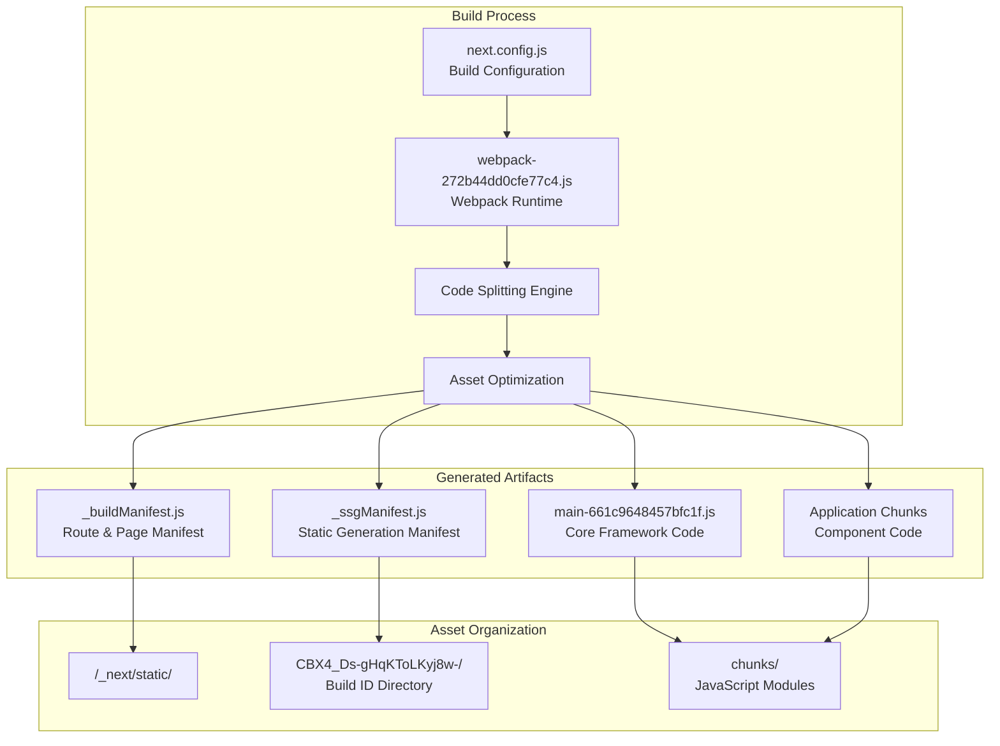
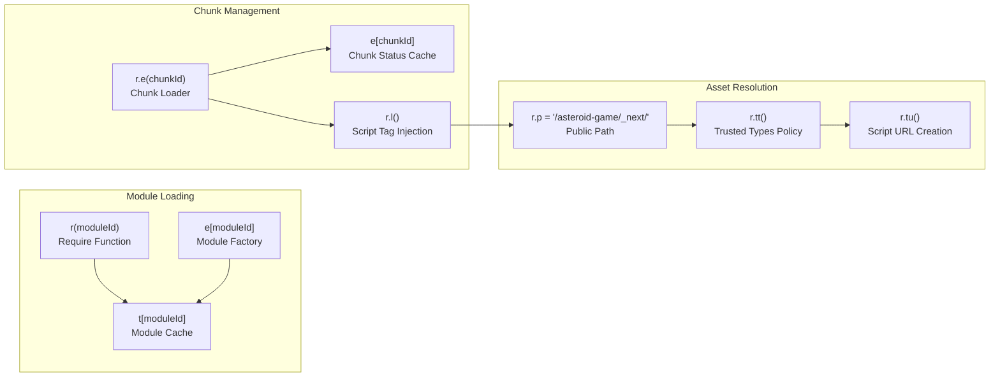
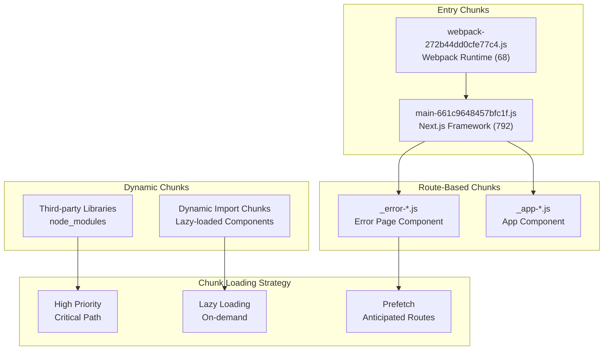
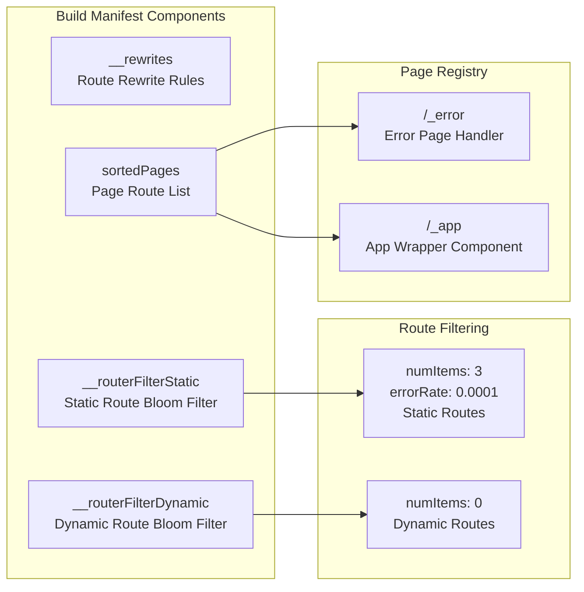
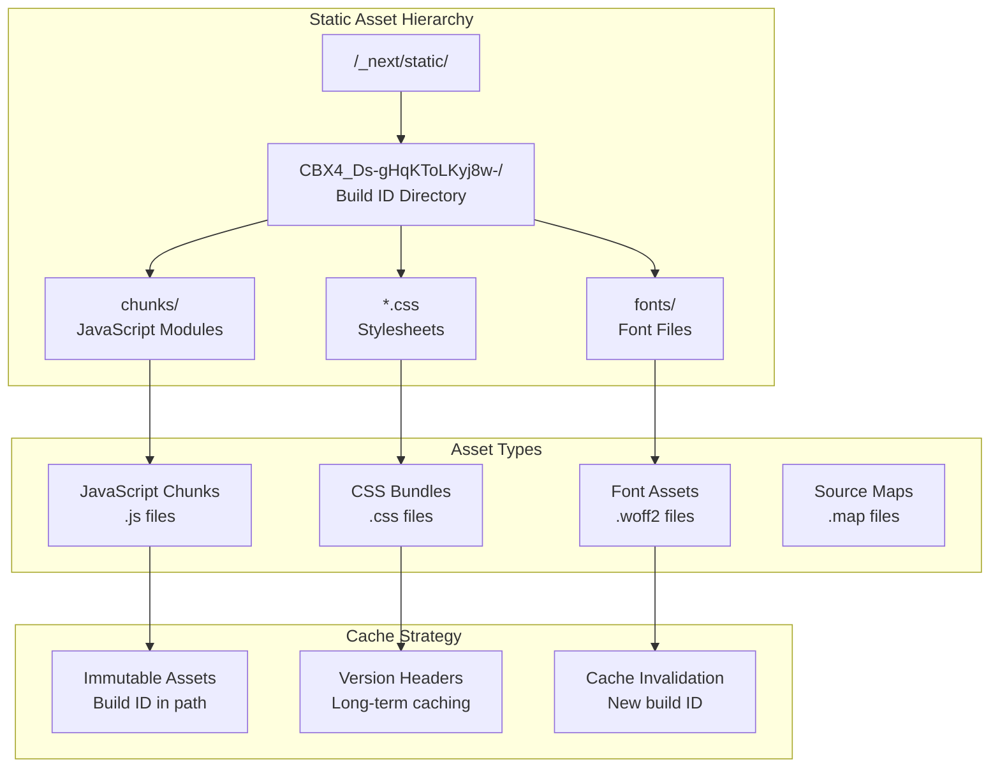
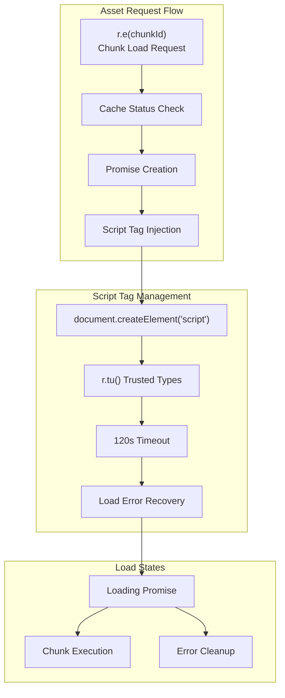

<!-- source: DeepWiki mcp.deepwiki.com · repo openai/gpt-5-coding-examples · extra page Build System & Asset Management · fetched 2026-10-26 -->

# Build System & Asset Management

<details>
<summary>Relevant source files</summary>

The following files were used as context for generating this wiki page:

- [apps/asteroid-game/_next/static/CBX4_Ds-gHqKToLKyj8w-/_buildManifest.js](apps/asteroid-game/_next/static/CBX4_Ds-gHqKToLKyj8w-/_buildManifest.js)
- [apps/asteroid-game/_next/static/CBX4_Ds-gHqKToLKyj8w-/_ssgManifest.js](apps/asteroid-game/_next/static/CBX4_Ds-gHqKToLKyj8w-/_ssgManifest.js)
- [apps/asteroid-game/_next/static/chunks/main-661c9648457bfc1f.js](apps/asteroid-game/_next/static/chunks/main-661c9648457bfc1f.js)
- [apps/asteroid-game/_next/static/chunks/webpack-272b44dd0cfe77c4.js](apps/asteroid-game/_next/static/chunks/webpack-272b44dd0cfe77c4.js)

</details>


This document covers the webpack-based build system, code splitting strategy, and static asset management used in the asteroid game application. The build system handles JavaScript bundling, CSS optimization, font loading, and static asset delivery through Next.js's production build pipeline.

For information about the Next.js framework integration, see [Next.js Framework Integration](#3.1.2). For details about typography and styling implementation, see [Typography & Styling System](#3.1.5).

## Build Architecture Overview

The asteroid game uses Next.js's production build system with webpack as the underlying bundler. The build process generates optimized chunks, manifests, and static assets organized under the `_next/static/` directory structure.



Sources: [apps/asteroid-game/_next/static/CBX4_Ds-gHqKToLKyj8w-/_buildManifest.js:1-1](), [apps/asteroid-game/_next/static/chunks/webpack-272b44dd0cfe77c4.js:1-1]()

## Webpack Runtime & Module System

The webpack runtime system manages module loading, chunk dependencies, and dynamic imports through a sophisticated promise-based loading mechanism.

### Core Runtime Components

| Component | Purpose | Location |
|-----------|---------|----------|
| `webpackChunk_N_E` | Global chunk registry | webpack runtime |
| `r.O` | Chunk ordering system | webpack runtime |
| `r.e` | Dynamic chunk loader | webpack runtime |
| `r.l` | Script tag injection | webpack runtime |
| `r.f.j` | Chunk load promises | webpack runtime |

The webpack runtime implements several key systems:



Sources: [apps/asteroid-game/_next/static/chunks/webpack-272b44dd0cfe77c4.js:1-1]()

## Code Splitting & Chunk Strategy

The build system implements automatic code splitting with route-based and dynamic chunking to optimize bundle sizes and loading performance.

### Chunk Organization

The application is split into multiple chunks based on functionality and loading patterns:



### Chunk Loading States

The webpack runtime tracks chunk loading with a state management system:

| State | Value | Description |
|-------|-------|-------------|
| Not loaded | `undefined` | Chunk not requested |
| Loading | `[resolve, reject, promise]` | Async loading in progress |
| Loaded | `0` | Successfully loaded |
| Failed | `undefined` | Load failed, cleared from cache |

Sources: [apps/asteroid-game/_next/static/chunks/webpack-272b44dd0cfe77c4.js:1-1](), [apps/asteroid-game/_next/static/chunks/main-661c9648457bfc1f.js:1-1]()

## Build Manifests & Asset Tracking

The build system generates multiple manifest files to track assets, routes, and build metadata for efficient client-side navigation and caching.

### Build Manifest Structure

The `_buildManifest.js` contains route filtering and page information:



### SSG Manifest

The Static Site Generation manifest tracks pre-rendered pages:

```javascript
self.__SSG_MANIFEST = new Set([]);
```

This indicates the application uses client-side rendering rather than static generation for this build.

Sources: [apps/asteroid-game/_next/static/CBX4_Ds-gHqKToLKyj8w-/_buildManifest.js:1-1](), [apps/asteroid-game/_next/static/CBX4_Ds-gHqKToLKyj8w-/_ssgManifest.js:1-1]()

## Static Asset Organization

The build system organizes static assets in a hierarchical directory structure under `_next/static/` with build ID-based versioning for cache busting.

### Asset Directory Structure



### Public Path Configuration

The webpack runtime sets the public path for asset loading:

```javascript
r.p = "/asteroid-game/_next/"
```

This configures all dynamic imports and chunk loading to use the correct base path for the application deployment.

Sources: [apps/asteroid-game/_next/static/chunks/webpack-272b44dd0cfe77c4.js:1-1]()

## Asset Loading & Optimization

The build system implements sophisticated asset loading strategies including script injection, trusted types support, and error handling for robust production deployment.

### Script Loading Pipeline



### Security Features

The build system includes Content Security Policy support through Trusted Types:

| Feature | Implementation | Purpose |
|---------|---------------|---------|
| Trusted Types | `r.tt()` policy creation | XSS prevention |
| Nonce Support | `r.nc` attribute | CSP compliance |
| Webpack Data Attributes | `data-webpack` markers | Script identification |
| Timeout Protection | 120-second limits | Prevent hanging loads |

Sources: [apps/asteroid-game/_next/static/chunks/webpack-272b44dd0cfe77c4.js:1-1](), [apps/asteroid-game/_next/static/chunks/main-661c9648457bfc1f.js:1-1]()

---

