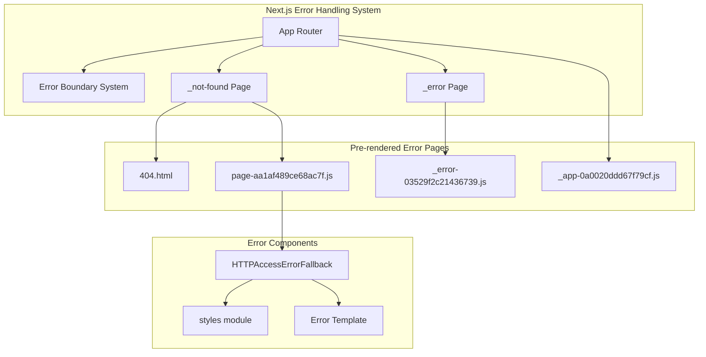
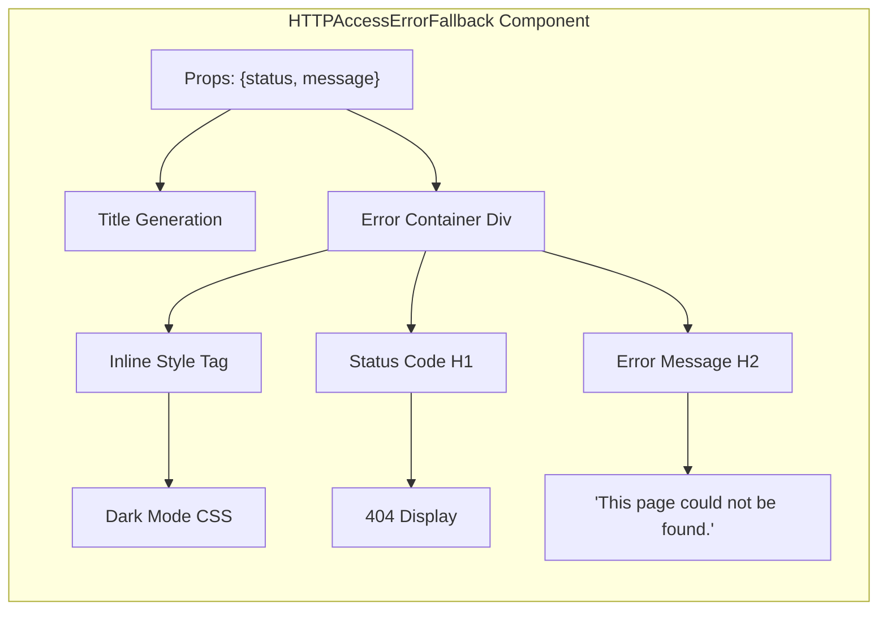
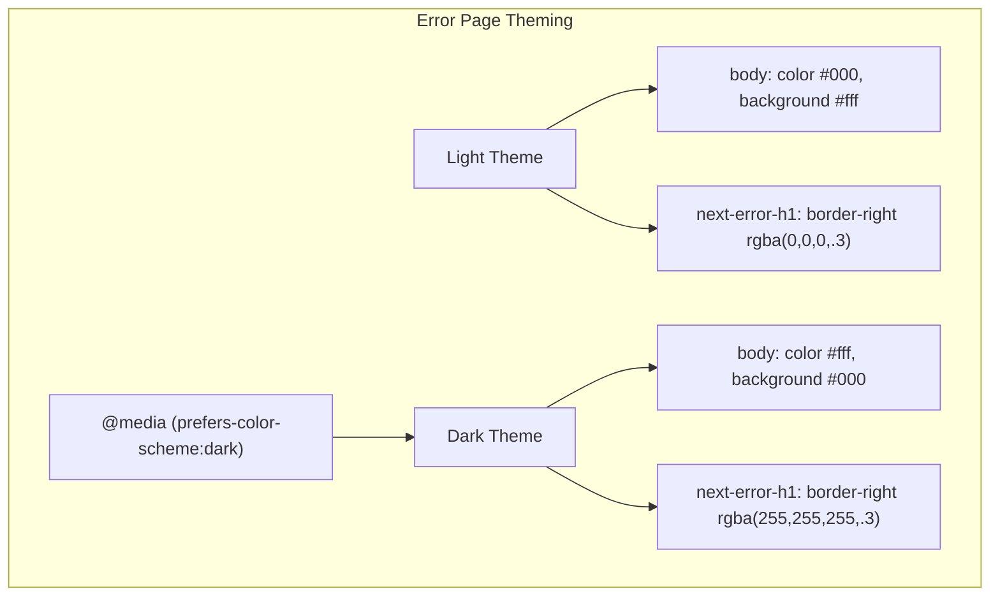
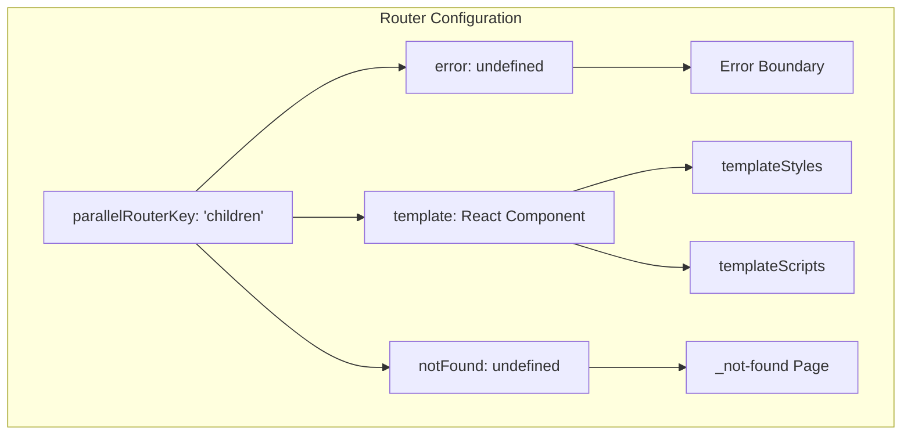
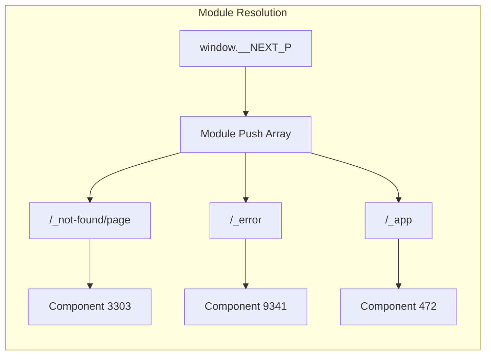

<!-- source: DeepWiki mcp.deepwiki.com · repo openai/gpt-5-coding-examples · extra page Error Handling & Routing · fetched 2026-10-26 -->

# Error Handling & Routing

Relevant source files

The following files were used as context for generating this wiki page:

- [apps/asteroid-game/404.html](apps/asteroid-game/404.html)
- [apps/asteroid-game/_next/static/chunks/app/_not-found/page-aa1af489ce68ac7f.js](apps/asteroid-game/_next/static/chunks/app/_not-found/page-aa1af489ce68ac7f.js)
- [apps/asteroid-game/_next/static/chunks/pages/_app-0a0020ddd67f79cf.js](apps/asteroid-game/_next/static/chunks/pages/_app-0a0020ddd67f79cf.js)
- [apps/asteroid-game/_next/static/chunks/pages/_error-03529f2c21436739.js](apps/asteroid-game/_next/static/chunks/pages/_error-03529f2c21436739.js)

This document covers the error handling mechanisms and routing infrastructure implemented in the asteroid game application. It details how the Next.js framework handles 404 errors, routing fallbacks, and error boundaries within the build system. For information about the overall Next.js framework integration, see [3.1.2](#3.1.2).

## Next.js App Router Error System

The asteroid game uses Next.js 14's App Router with built-in error handling and routing mechanisms. The application implements a comprehensive error handling system with pre-rendered error pages and client-side error boundaries.

### Error Page Architecture

Sources: [apps/asteroid-game/404.html:1-1](), [apps/asteroid-game/_next/static/chunks/app/_not-found/page-aa1af489ce68ac7f.js:1-1](), [apps/asteroid-game/_next/static/chunks/pages/_error-03529f2c21436739.js:1-1]()

## 404 Not Found Implementation

The application provides a fully styled 404 error page with both server-side pre-rendering and client-side functionality.

### Static HTML Generation

The `404.html` file is pre-rendered during build time and includes all necessary assets:

| Asset Type | Purpose | Examples |
|------------|---------|----------|
| CSS Preloads | Font optimization | `569ce4b8f30dc480-s.p.woff2`, `93f479601ee12b01-s.p.woff2` |
| JavaScript Chunks | Runtime and components | `webpack-272b44dd0cfe77c4.js`, `main-app-3a0ef5eeac81397d.js` |
| Stylesheets | Error page styling | `5e1ce93e93f76f4e.css` |

### HTTPAccessErrorFallback Component

The core error component is implemented in the `HTTPAccessErrorFallback` function:

Sources: [apps/asteroid-game/_next/static/chunks/app/_not-found/page-aa1af489ce68ac7f.js:1-1]()

## Error Styling System

### Style Object Architecture

The error pages use a modular styling system defined in the `styles` object:

| Style Key | Purpose | CSS Properties |
|-----------|---------|----------------|
| `error` | Main container | `height: 100vh`, `display: flex`, `align-items: center` |
| `desc` | Description wrapper | `display: inline-block` |
| `h1` | Status code heading | `fontSize: 24`, `fontWeight: 500`, `lineHeight: 49px` |
| `h2` | Error message | `fontSize: 14`, `fontWeight: 400`, `margin: 0` |

### Dark Mode Support

The error pages include comprehensive dark mode support through CSS media queries:

Sources: [apps/asteroid-game/_next/static/chunks/app/_not-found/page-aa1af489ce68ac7f.js:1-1]()

## Routing and Error Boundaries

### App Router Integration

The application uses Next.js App Router with parallel routing and error boundaries:

### Build-time Error Processing

The build system generates multiple error-related chunks:

| Chunk File | Purpose | Webpack Module |
|------------|---------|----------------|
| `page-aa1af489ce68ac7f.js` | Not found page component | `3303` |
| `_error-03529f2c21436739.js` | Generic error page | `9341` |
| `_app-0a0020ddd67f79cf.js` | App wrapper with error handling | `472` |

Sources: [apps/asteroid-game/404.html:1-1](), [apps/asteroid-game/_next/static/chunks/pages/_error-03529f2c21436739.js:1-1](), [apps/asteroid-game/_next/static/chunks/pages/_app-0a0020ddd67f79cf.js:1-1]()

## Webpack Module System Integration

### Module Loading Strategy

The error handling system integrates with Webpack's module loading:

### Chunk Dependencies

The error system maintains proper chunk dependencies for optimal loading:

- `_not-found`: Depends on chunks `[441,964,358]`
- `_error`: Depends on chunks `[636,593,792]` 
- `_app`: Depends on chunks `[593,792]`

Sources: [apps/asteroid-game/_next/static/chunks/app/_not-found/page-aa1af489ce68ac7f.js:1-1](), [apps/asteroid-game/_next/static/chunks/pages/_error-03529f2c21436739.js:1-1](), [apps/asteroid-game/_next/static/chunks/pages/_app-0a0020ddd67f79cf.js:1-1]()

---

