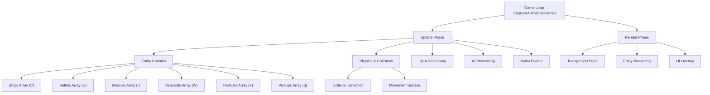
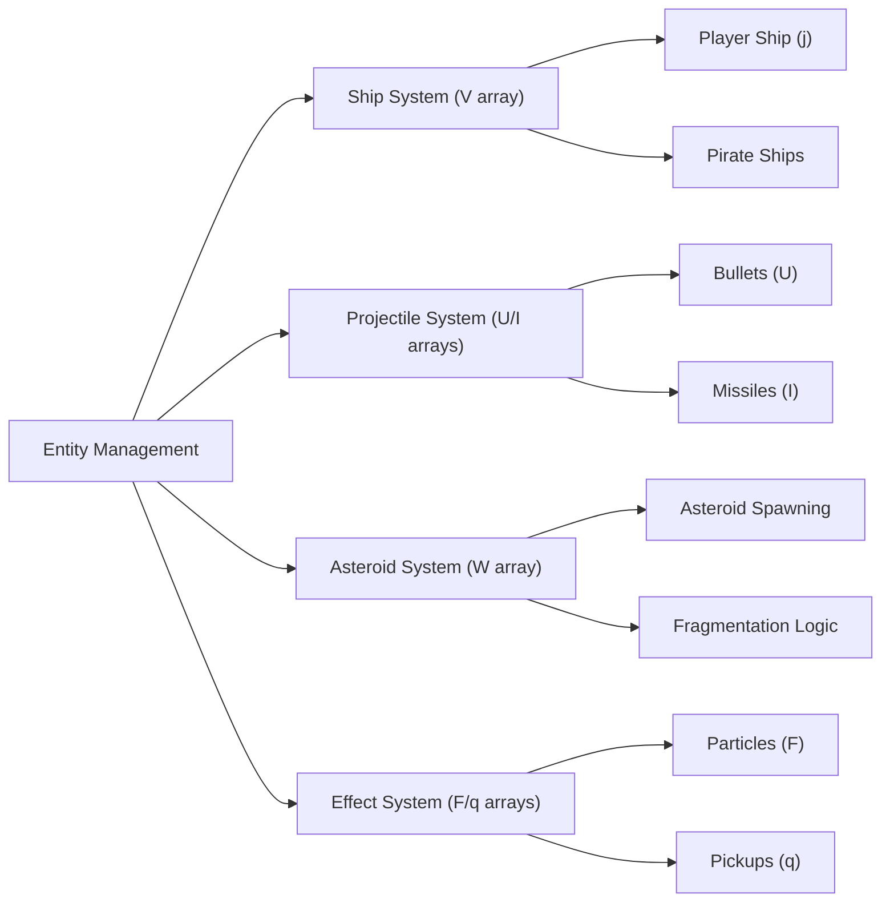
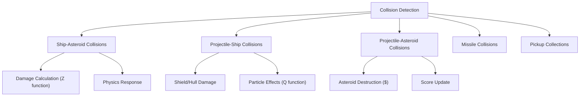
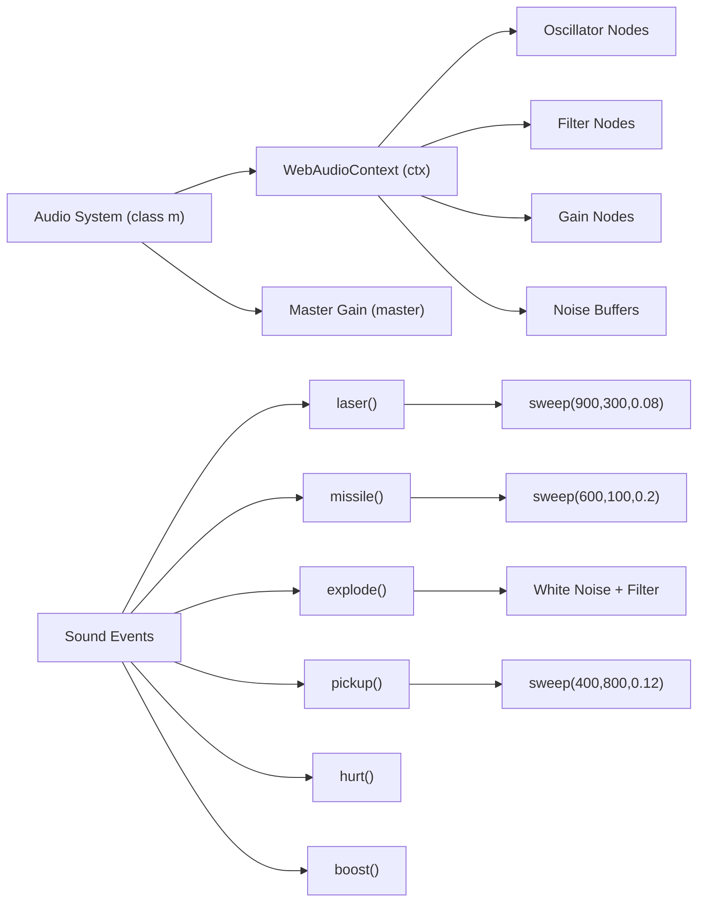
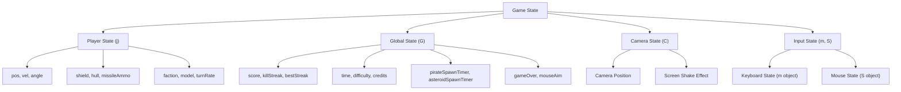
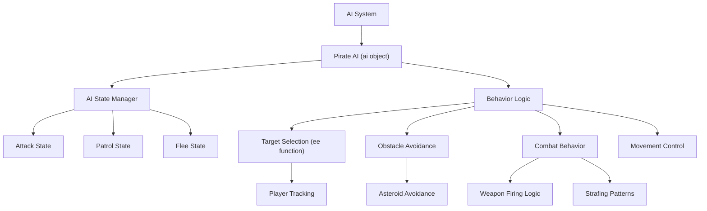
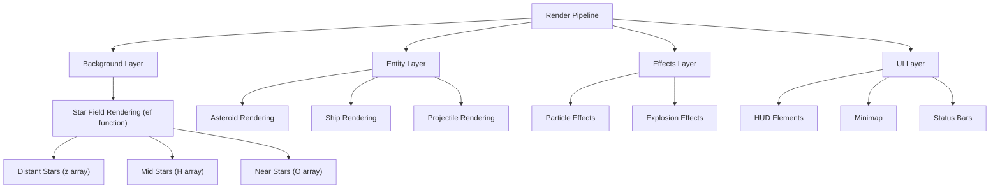

<!-- source: DeepWiki mcp.deepwiki.com · repo openai/gpt-5-coding-examples · extra page Game Architecture & Logic · fetched 2026-10-26 -->

# Game Architecture & Logic

Relevant source files

The following files were used as context for generating this wiki page:

- [apps/asteroid-game/_next/static/chunks/app/page-821595e72711e3a5.js](apps/asteroid-game/_next/static/chunks/app/page-821595e72711e3a5.js)

This document covers the core game systems, entity management, physics engine, and gameplay logic for the asteroid game. It focuses on the runtime architecture and game loop implementation found in the compiled game code.

For information about Next.js integration and React components, see [Next.js Framework Integration](#3.1.2). For build system and asset optimization details, see [Build System & Asset Management](#3.1.3).

## Core Architecture Overview

The asteroid game implements a traditional game loop architecture with entity-component-system patterns. The game runs entirely in the browser using Canvas 2D rendering and Web Audio API for sound.

**Sources:** [apps/asteroid-game/_next/static/chunks/app/page-821595e72711e3a5.js:1-1000]()

## Entity Management System

The game manages different entity types using separate arrays, each containing objects with position, velocity, and type-specific properties.

| Entity Type | Array Variable | Key Properties | Purpose |
|-------------|----------------|----------------|---------|
| Ships | `V` | `pos`, `vel`, `faction`, `model`, `hull`, `shield` | Player and enemy ships |
| Bullets | `U` | `pos`, `vel`, `life`, `dmg`, `faction` | Laser projectiles |
| Missiles | `I` | `pos`, `vel`, `targetId`, `turnRate`, `accel` | Homing missiles |
| Asteroids | `W` | `pos`, `vel`, `radius`, `hp`, `size`, `shape` | Destructible obstacles |
| Particles | `F` | `pos`, `vel`, `life`, `color`, `size` | Visual effects |
| Pickups | `q` | `pos`, `type`, `amount`, `life` | Collectible items |

**Sources:** [apps/asteroid-game/_next/static/chunks/app/page-821595e72711e3a5.js:1-1000]()

## Physics Engine

The physics system handles vector mathematics, collision detection, and movement for all game entities using 2D physics with wrapping coordinates.

### Vector Operations

The game implements core vector math functions for position and velocity calculations:

- `r(e)` - Calculate vector magnitude using `Math.hypot`
- `f(e)` - Normalize vector to unit length
- `d(e,t)` - Vector addition
- `c(e,t)` - Vector scalar multiplication
- `h(e,t)` - Vector rotation by angle
- `u(e)` - Angle normalization to [-π, π] range

### Collision Detection

The collision system uses distance-based detection with radius checking: `E(e,t)` function calculates wrapped distance between entities, accounting for the 6000x6000 world wrapping.

**Sources:** [apps/asteroid-game/_next/static/chunks/app/page-821595e72711e3a5.js:1-1000]()

## Audio System Architecture

The game implements a custom Web Audio API wrapper for procedural sound generation.

The audio system (`class m`) provides:
- `blip()` - Simple oscillator tones
- `sweep()` - Frequency sweeping sounds
- `explode()` - Filtered white noise
- Preset functions for game events (laser, missile, pickup, etc.)

**Sources:** [apps/asteroid-game/_next/static/chunks/app/page-821595e72711e3a5.js:1-1000]()

## Game State Management

The game state is managed through several key objects:

### Player Ship Object (`j`)

The player ship object contains:
- Physics: `pos`, `vel`, `angle`, `turnRate`, `accel`, `maxSpeed`
- Combat: `shield`, `hull`, `fireCooldown`, `missileCooldown`, `missileAmmo`
- Meta: `faction`, `model`, `name`, `color`, `scoreValue`

### Game State Object (`G`)

Global game state tracking:
- `score`, `time`, `difficulty` - Core progression metrics
- `killStreak`, `bestStreak` - Combat performance tracking
- `pirateSpawnTimer`, `asteroidSpawnTimer` - Enemy spawning logic
- `gameOver`, `mouseAim` - Game flow state

**Sources:** [apps/asteroid-game/_next/static/chunks/app/page-821595e72711e3a5.js:1-1000]()

## AI System

The enemy AI system controls pirate ships using a simple state machine with basic behaviors.

### AI Behavior Implementation

Each pirate ship has an `ai` object containing:
- `state` - Current AI state ("attack", "patrol", etc.)
- `patience` - Timer for state transitions
- `strafeTimer` - Strafing movement timing

The AI update logic:
1. **Target Selection**: `ee()` function finds nearest enemy within range
2. **Obstacle Avoidance**: Calculates repulsion forces from nearby asteroids
3. **Combat Logic**: Firing decisions based on angle to target and distance
4. **Movement**: Combines attack vector, avoidance, and strafing behaviors

**Sources:** [apps/asteroid-game/_next/static/chunks/app/page-821595e72711e3a5.js:1-1000]()

## Rendering Pipeline

The rendering system draws all game elements in layers using Canvas 2D API.

### Key Rendering Functions

- **Star Field**: `ef()` function renders parallax star layers with different depths
- **Ship Rendering**: Different ship models (KESTREL, VULTURE, WASP) with distinct shapes
- **Particle Effects**: `Q()` function creates impact particles, `K()` creates explosions
- **Screen Effects**: Camera shake, shield effects, engine trails

The rendering uses coordinate transformation (`er()` function) to convert world coordinates to screen coordinates, handling world wrapping and camera positioning.

**Sources:** [apps/asteroid-game/_next/static/chunks/app/page-821595e72711e3a5.js:1-1000]()

---

