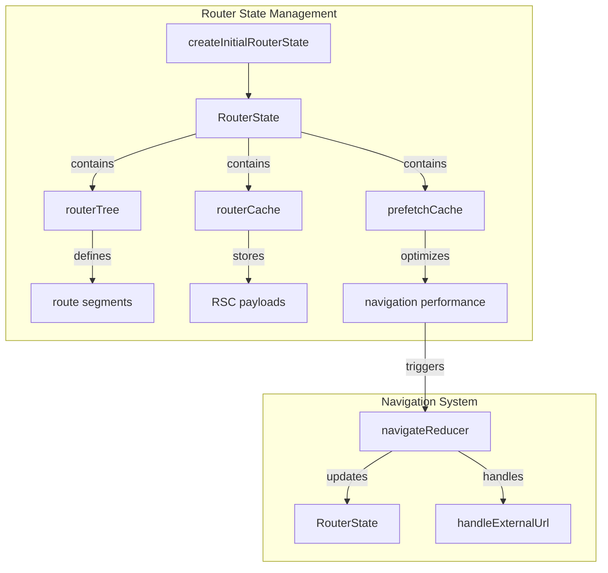
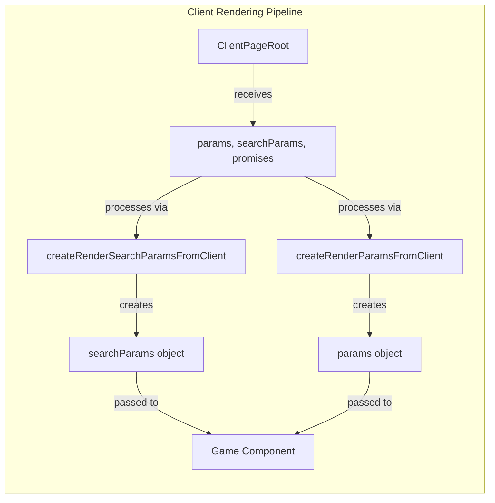
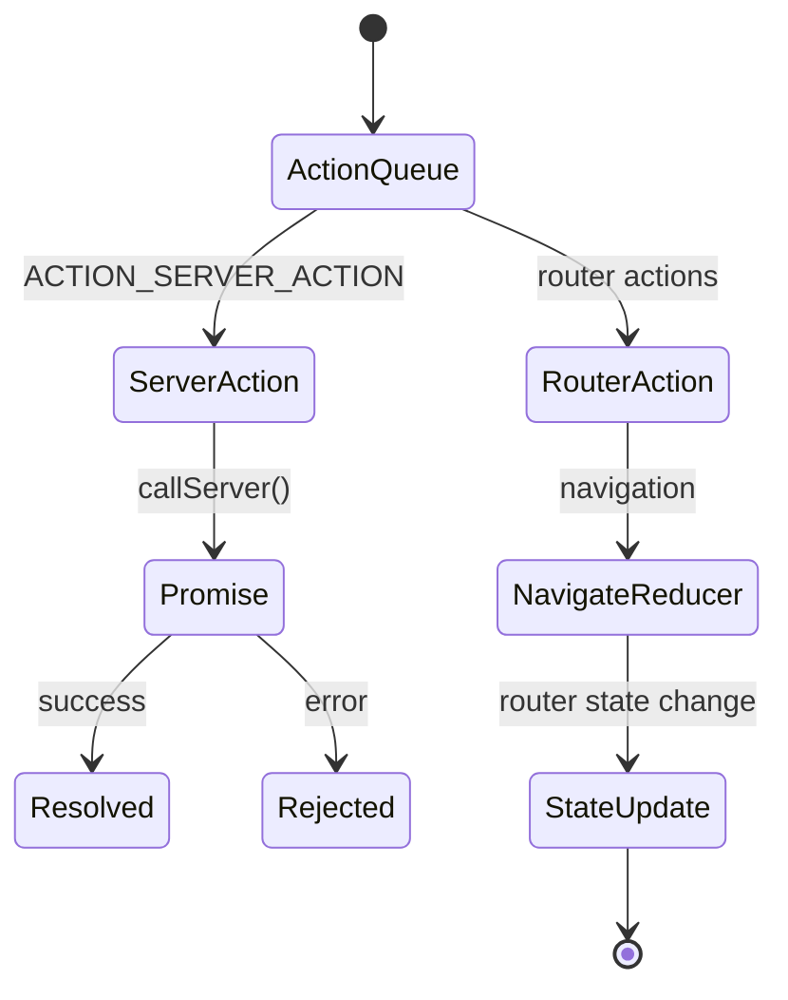
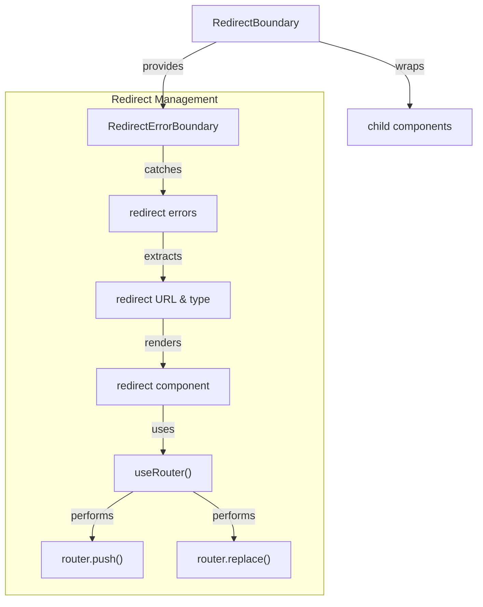
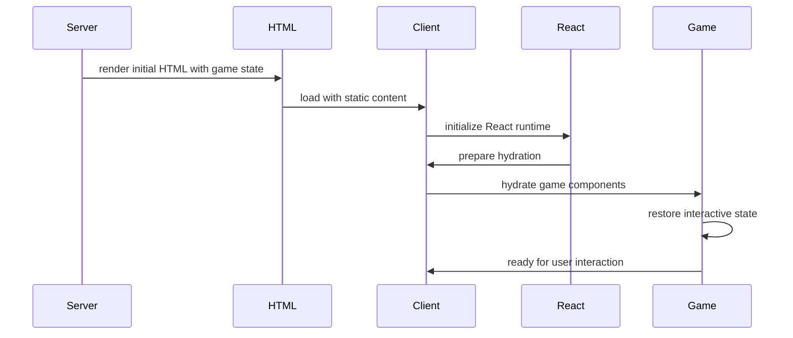
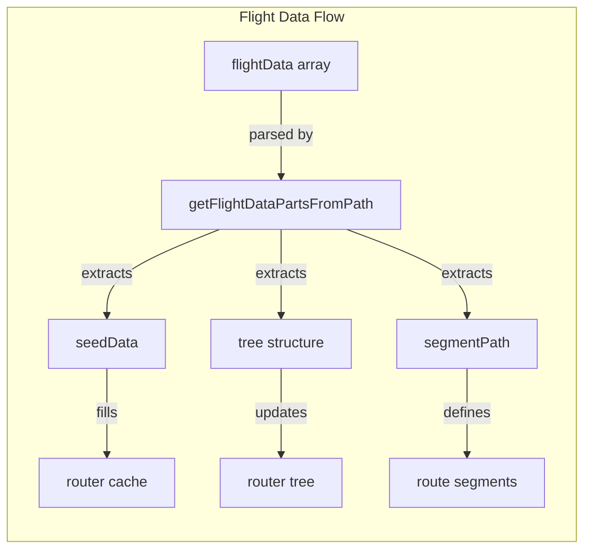
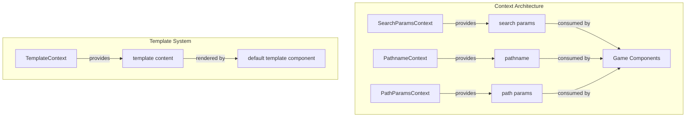
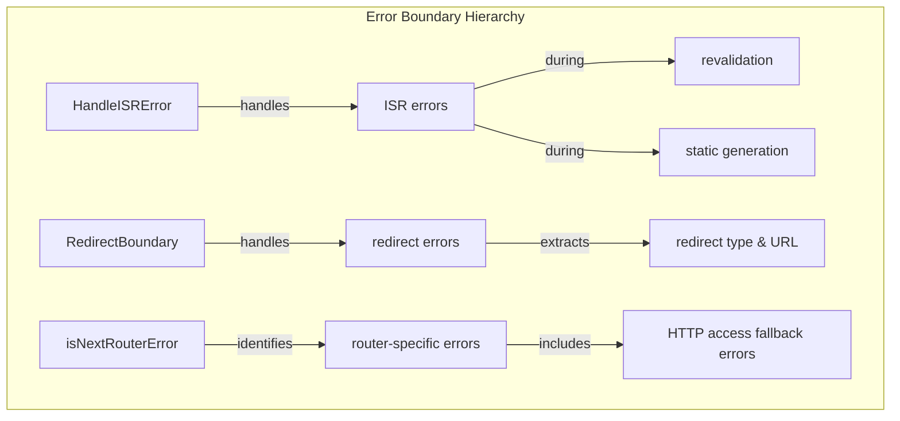
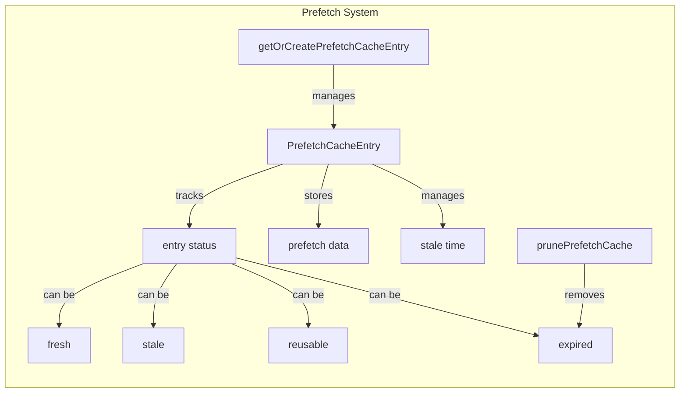
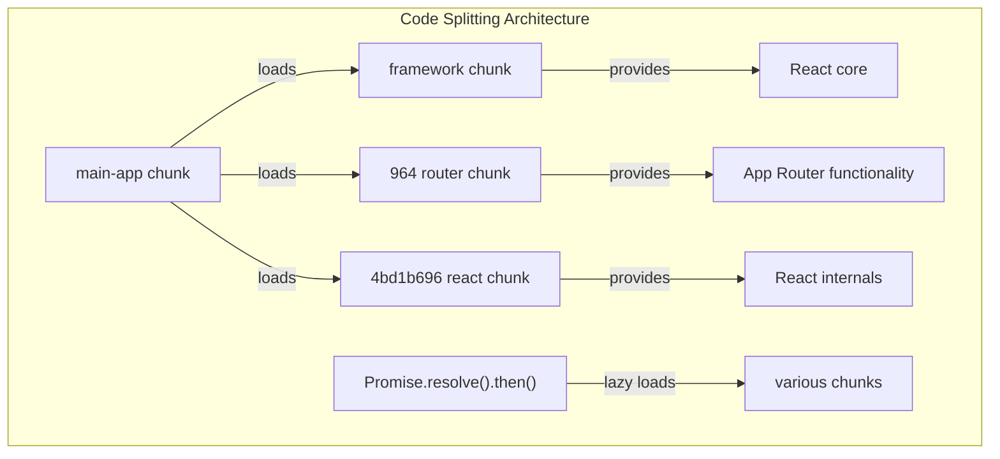

<!-- source: DeepWiki mcp.deepwiki.com · repo openai/gpt-5-coding-examples · extra page Next.js Framework Integration · fetched 2026-10-26 -->

# Next.js Framework Integration

Relevant source files

The following files were used as context for generating this wiki page:

- [apps/asteroid-game/_next/static/chunks/4bd1b696-cf72ae8a39fa05aa.js](apps/asteroid-game/_next/static/chunks/4bd1b696-cf72ae8a39fa05aa.js)
- [apps/asteroid-game/_next/static/chunks/964-830f77d7ce1c2463.js](apps/asteroid-game/_next/static/chunks/964-830f77d7ce1c2463.js)
- [apps/asteroid-game/_next/static/chunks/framework-7c95b8e5103c9e90.js](apps/asteroid-game/_next/static/chunks/framework-7c95b8e5103c9e90.js)
- [apps/asteroid-game/_next/static/chunks/main-app-3a0ef5eeac81397d.js](apps/asteroid-game/_next/static/chunks/main-app-3a0ef5eeac81397d.js)

This document explains how the asteroid game leverages Next.js framework features including the App Router, server-side rendering, client-side hydration, and React component integration. This covers the framework-level integration that enables the game to function as a modern Next.js application.

For details about the game's core logic and gameplay systems, see [Game Architecture & Logic](#3.1.1). For information about the build system and asset optimization, see [Build System & Asset Management](#3.1.3).

## App Router Architecture

The asteroid game uses Next.js 14's App Router to provide a modern routing experience with server-side rendering and client-side navigation. The App Router implementation centers around several key components that manage routing state, navigation, and page rendering.

### Router State Management

The application maintains router state through a sophisticated system that handles both server-rendered and client-side navigation states:

The `createInitialRouterState` function initializes the routing system with the initial flight data, canonical URL parts, and parallel routes. This state management system enables seamless transitions between server-rendered and client-rendered content.

Sources: [apps/asteroid-game/_next/static/chunks/964-830f77d7ce1c2463.js:3567]()

### Client Page Rendering

The `ClientPageRoot` component serves as the bridge between Next.js routing and the game's React components:

This component handles the transformation of server-provided parameters into client-side props, ensuring proper hydration and state management for the game.

Sources: [apps/asteroid-game/_next/static/chunks/964-830f77d7ce1c2463.js:894]()

## Navigation and Routing

### Action Queue System

The application implements an action queue system to handle user interactions and navigation events in a controlled manner:

The `useActionQueue` hook and `dispatchAppRouterAction` function work together to manage asynchronous actions, ensuring proper state transitions and error handling during navigation events.

Sources: [apps/asteroid-game/_next/static/chunks/964-830f77d7ce1c2463.js:1027]()

### Redirect Handling

The framework includes sophisticated redirect boundary management through `RedirectBoundary` and `RedirectErrorBoundary` components:

This system enables clean error boundaries for navigation errors and provides consistent redirect behavior throughout the application.

Sources: [apps/asteroid-game/_next/static/chunks/964-830f77d7ce1c2463.js:686]()

## Server-Side Rendering Integration

### Hydration Process

The asteroid game leverages Next.js SSR capabilities through a carefully orchestrated hydration process:

The hydration process ensures that the server-rendered HTML matches the client-side React tree, preventing hydration mismatches while maintaining game state continuity.

### Flight Data Processing

The framework processes "flight data" - serialized React Server Component payloads that enable efficient client-server communication:

This system enables efficient partial page updates and seamless navigation between different application states.

Sources: [apps/asteroid-game/_next/static/chunks/964-830f77d7ce1c2463.js:2561]()

## Component Integration

### Context Providers

The framework establishes several React contexts to provide routing and path information throughout the component tree:

These contexts enable components throughout the application to access routing information without prop drilling.

Sources: [apps/asteroid-game/_next/static/chunks/964-830f77d7ce1c2463.js:886](), [apps/asteroid-game/_next/static/chunks/964-830f77d7ce1c2463.js:1295]()

### Error Boundaries

The application implements multiple layers of error boundaries to handle different types of errors gracefully:

This error handling strategy ensures that the game continues to function even when encountering navigation or server-side errors.

Sources: [apps/asteroid-game/_next/static/chunks/964-830f77d7ce1c2463.js:1799](), [apps/asteroid-game/_next/static/chunks/964-830f77d7ce1c2463.js:2858]()

## Performance Optimizations

### Prefetch Cache Management

The framework implements an intelligent prefetch cache system to optimize navigation performance:

The cache automatically manages prefetch entries based on usage patterns and staleness, ensuring optimal performance while minimizing memory usage.

Sources: [apps/asteroid-game/_next/static/chunks/964-830f77d7ce1c2463.js:1518]()

### Code Splitting Integration

The framework leverages Webpack's code splitting capabilities through dynamic imports and chunk management:

This chunking strategy ensures that only necessary code is loaded initially, with additional functionality loaded on demand.

Sources: [apps/asteroid-game/_next/static/chunks/main-app-3a0ef5eeac81397d.js:1-1]()

---

