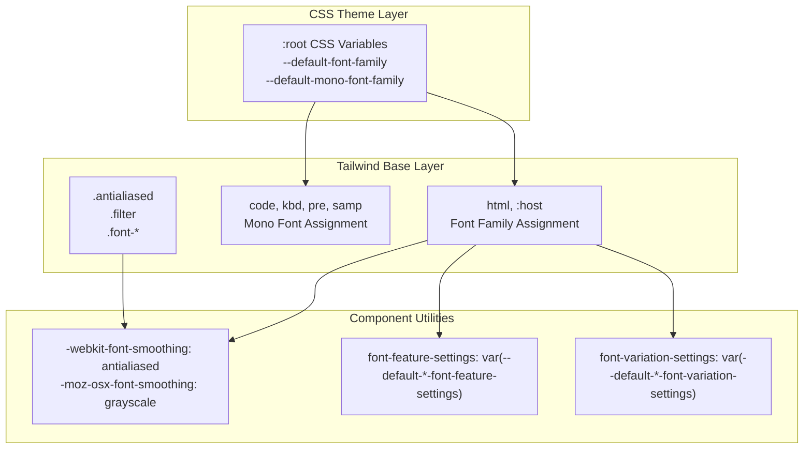
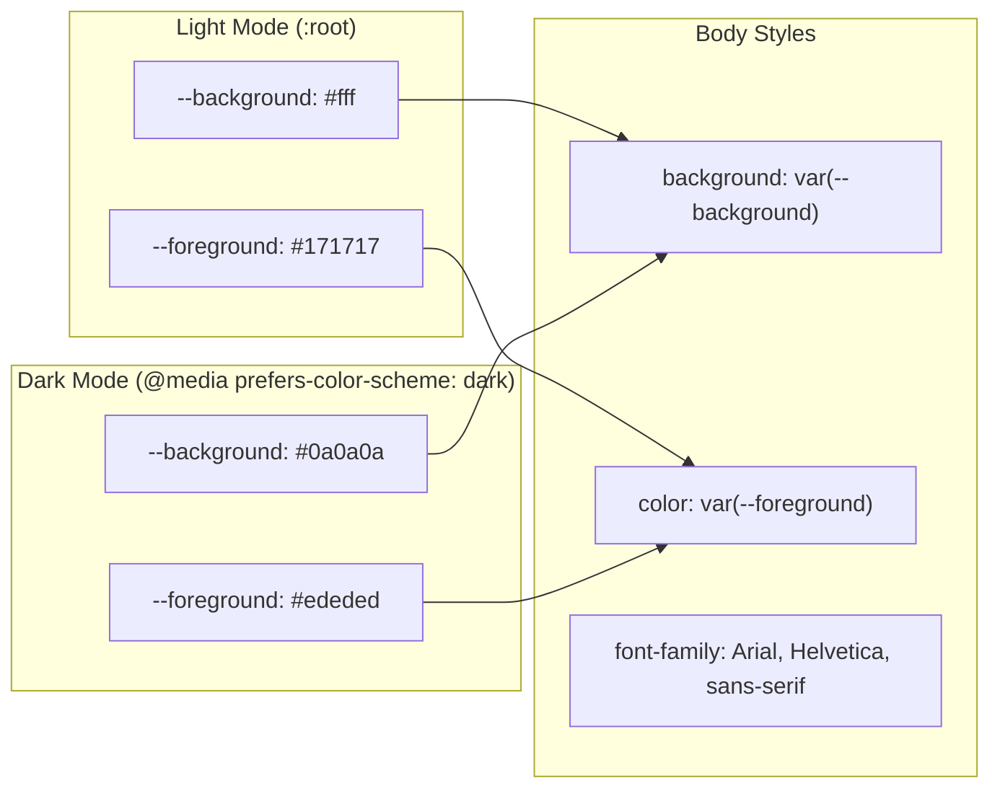

<!-- source: DeepWiki mcp.deepwiki.com · repo openai/gpt-5-coding-examples · extra page Typography & Styling System · fetched 2026-10-26 -->

# Typography & Styling System

<details>
<summary>Relevant source files</summary>

The following files were used as context for generating this wiki page:

- [apps/asteroid-game/_next/static/chunks/app/layout-60e610b524aa945b.js](apps/asteroid-game/_next/static/chunks/app/layout-60e610b524aa945b.js)
- [apps/asteroid-game/_next/static/css/5e1ce93e93f76f4e.css](apps/asteroid-game/_next/static/css/5e1ce93e93f76f4e.css)
- [apps/asteroid-game/_next/static/media/569ce4b8f30dc480-s.p.woff2](apps/asteroid-game/_next/static/media/569ce4b8f30dc480-s.p.woff2)
- [apps/asteroid-game/_next/static/media/93f479601ee12b01-s.p.woff2](apps/asteroid-game/_next/static/media/93f479601ee12b01-s.p.woff2)

</details>


This document covers the typography and font management system used in the asteroid game application, including the Geist font family implementation, CSS variable architecture, Tailwind CSS integration, and performance optimizations. For information about the broader build system that processes these assets, see [Build System & Asset Management](#3.1.3).

## Font Family Architecture

The typography system is built around the Geist font family, which provides both sans-serif and monospace variants with comprehensive Unicode support and optimized fallbacks.

### Geist Font Implementation

The system implements two primary font families through JavaScript module exports and CSS declarations:

```mermaid
graph TD
    subgraph "Font Module System"
        GeistSans["`__className_5cfdac`<br/>Geist Sans Font"]
        GeistMono["`__className_9a8899`<br/>Geist Mono Font"]
        GeistSansVar["`__variable_5cfdac`<br/>--font-geist-sans CSS Variable"]
        GeistMonoVar["`__variable_9a8899`<br/>--font-geist-mono CSS Variable"]
    end
    
    subgraph "CSS Font Face Definitions"
        GeistSansFaces["`@font-face` Geist Sans<br/>Unicode Ranges: Cyrillic, Latin-Ext, Latin"]
        GeistMonoFaces["`@font-face` Geist Mono<br/>Unicode Ranges: Cyrillic, Latin-Ext, Latin"]
        FallbackFaces["`Geist Fallback` & `Geist Mono Fallback`<br/>Arial-based with Metric Overrides"]
    end
    
    GeistSans --> GeistSansFaces
    GeistMono --> GeistMonoFaces
    GeistSansVar --> GeistSansFaces
    GeistMonoVar --> GeistMonoFaces
    FallbackFaces --> GeistSansFaces
    FallbackFaces --> GeistMonoFaces
```

Sources: [apps/asteroid-game/_next/static/chunks/app/layout-60e610b524aa945b.js:1-1](), [apps/asteroid-game/_next/static/css/5e1ce93e93f76f4e.css:1-1]()

### Unicode Range Segmentation

The font system uses strategic Unicode range segmentation to optimize loading performance:

| Range Type | Unicode Coverage | Purpose |
|------------|------------------|----------|
| Cyrillic | `U+0301, U+0400-045F, U+0490-0491, U+04B0-04B1, U+2116` | Eastern European language support |
| Latin Extended | `U+0100-02BA, U+02BD-02C5, U+02C7-02CC, U+02CE-02D7...` | Western European diacritics |
| Latin Core | `U+00??, U+0131, U+0152-0153, U+02BB-02BC...` | Basic Latin characters and common symbols |

Sources: [apps/asteroid-game/_next/static/css/5e1ce93e93f76f4e.css:1-1]()

## CSS Variable System

The typography system employs a cascading CSS variable architecture that enables theme-aware font selection and consistent typography across components.

```mermaid
graph LR
    subgraph "JavaScript Module Layer"
        JSGeistSans["`__variable_5cfdac`<br/>Geist Sans Variable"]
        JSGeistMono["`__variable_9a8899`<br/>Geist Mono Variable"]
    end
    
    subgraph "CSS Custom Properties"
        GeistSansVar["`--font-geist-sans`"]
        GeistMonoVar["`--font-geist-mono`"]
        DefaultFont["`--default-font-family`"]
        DefaultMono["`--default-mono-font-family`"]
    end
    
    subgraph "Tailwind Theme Layer"
        TailwindFont["`var(--default-font-family)`"]
        TailwindMono["`var(--default-mono-font-family)`"]
        SystemFallbacks["`ui-sans-serif, system-ui, sans-serif`"]
    end
    
    JSGeistSans --> GeistSansVar
    JSGeistMono --> GeistMonoVar
    GeistSansVar --> DefaultFont
    GeistMonoVar --> DefaultMono
    DefaultFont --> TailwindFont
    DefaultMono --> TailwindMono
    TailwindFont --> SystemFallbacks
```

Sources: [apps/asteroid-game/_next/static/css/5e1ce93e93f76f4e.css:3-3](), [apps/asteroid-game/_next/static/chunks/app/layout-60e610b524aa945b.js:1-1]()

### Font Fallback Strategy

The system implements metric-adjusted fallbacks to minimize layout shift during font loading:

| Font Family | Fallback | Ascent Override | Descent Override | Size Adjust |
|-------------|----------|-----------------|------------------|-------------|
| Geist | Arial | 95.94% | 28.16% | 104.76% |
| Geist Mono | Arial | 74.67% | 21.92% | 134.59% |

Sources: [apps/asteroid-game/_next/static/css/5e1ce93e93f76f4e.css:1-1]()

## Tailwind CSS Integration

The typography system integrates with Tailwind CSS v4.1.11 through CSS custom properties and utility classes.

### Tailwind Theme Configuration



Sources: [apps/asteroid-game/_next/static/css/5e1ce93e93f76f4e.css:3-3]()

## Dark Mode Implementation

The styling system includes CSS custom properties for theme-aware color management:



Note: The body element uses a fallback font stack (`Arial, Helvetica, sans-serif`) while the CSS custom properties reference the Geist font system through Tailwind's theme layer.

Sources: [apps/asteroid-game/_next/static/css/5e1ce93e93f76f4e.css:3-3]()

## Font Loading Performance

### WOFF2 Font Assets

The system uses optimized WOFF2 font files with strategic subsetting:

| Font File | Purpose | Size Optimization |
|-----------|---------|-------------------|
| `569ce4b8f30dc480-s.p.woff2` | Geist Sans primary subset | Unicode range segmentation |
| `93f479601ee12b01-s.p.woff2` | Geist Mono primary subset | Unicode range segmentation |

### Font Display Strategy

All font faces use `font-display: swap` to prioritize text rendering speed over layout stability:

```css
@font-face {
    font-family: Geist;
    font-display: swap;
    /* ... */
}
```

Sources: [apps/asteroid-game/_next/static/css/5e1ce93e93f76f4e.css:1-1](), [apps/asteroid-game/_next/static/media/569ce4b8f30dc480-s.p.woff2:1-1](), [apps/asteroid-game/_next/static/media/93f479601ee12b01-s.p.woff2:1-1]()

## CSS Property Registration

The system includes `@property` declarations for custom CSS properties to enable CSS transitions and improved browser optimization:

```mermaid
graph TD
    subgraph "Registered CSS Properties"
        BorderStyle["`@property --tw-border-style`<br/>syntax: '*', inherits: false"]
        FilterProps["`@property --tw-blur, --tw-brightness`<br/>Filter effect properties"]
        DropShadow["`@property --tw-drop-shadow-alpha`<br/>syntax: '<percentage>'"]
    end
    
    subgraph "Tailwind Utility Classes"
        FilterClass[".filter<br/>filter: var(--tw-blur) var(--tw-brightness)..."]
        BorderClass[".border<br/>border-style: var(--tw-border-style)"]
    end
    
    BorderStyle --> BorderClass
    FilterProps --> FilterClass
    DropShadow --> FilterClass
```

Sources: [apps/asteroid-game/_next/static/css/5e1ce93e93f76f4e.css:3-3]()

---

