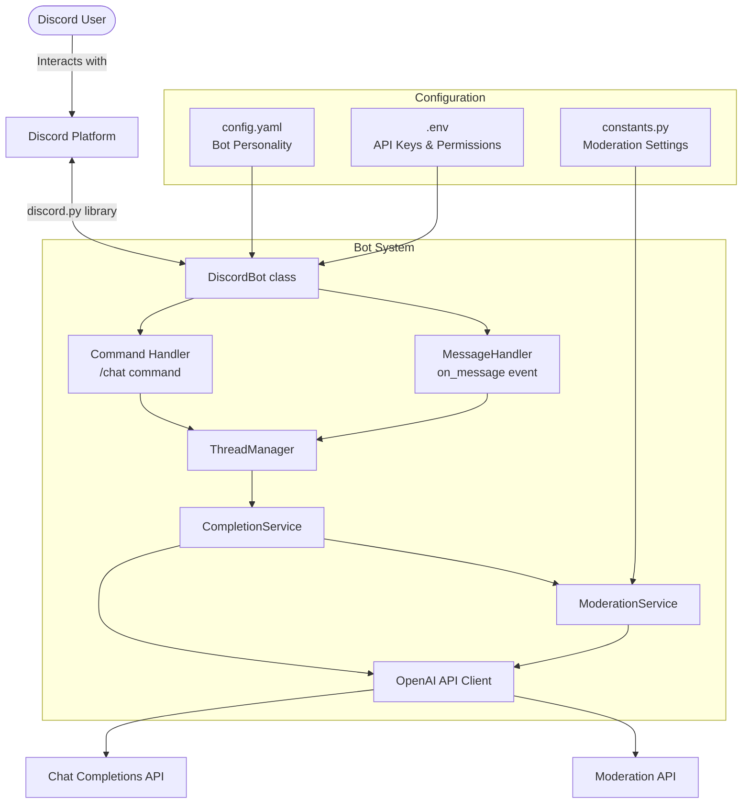
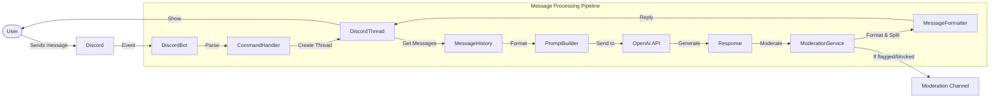
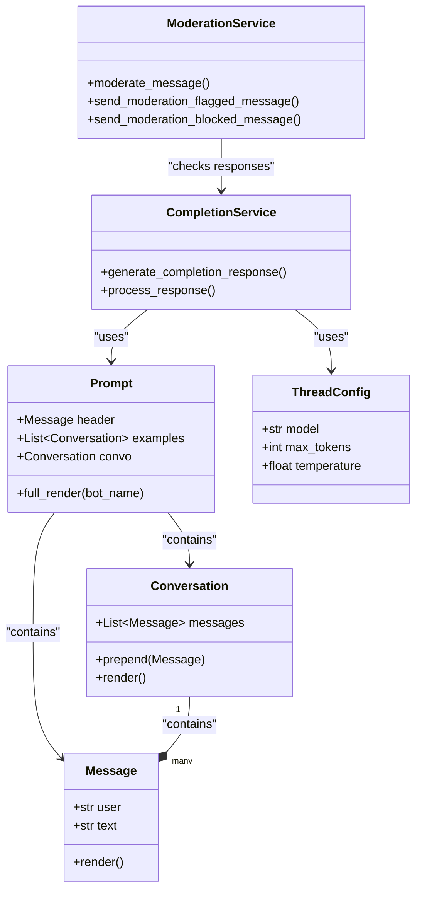
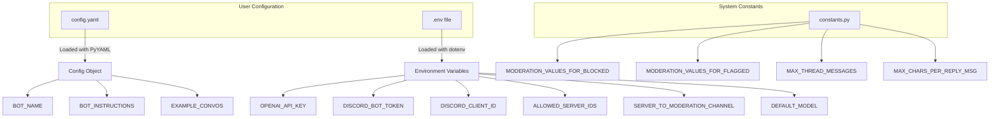
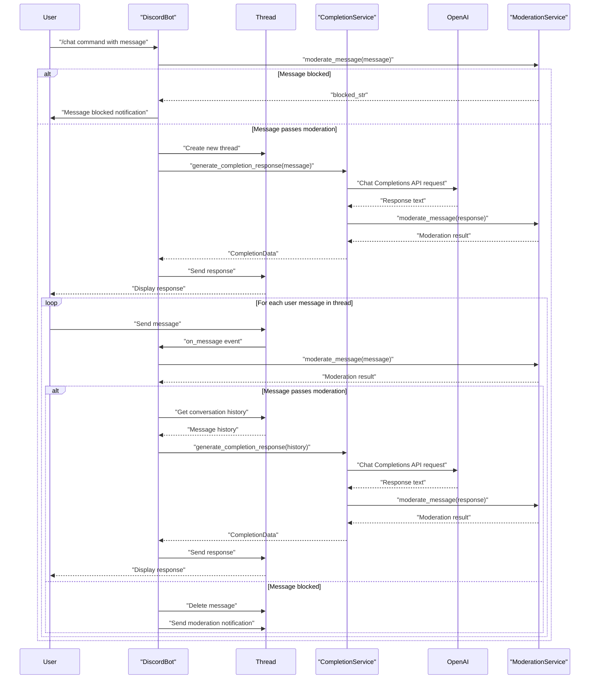

<!-- source: DeepWiki mcp.deepwiki.com · repo openai/gpt-discord-bot · page 1 Overview · fetched 2026-10-26 -->

# Overview

Relevant source files

The following files were used as context for generating this wiki page:

- [README.md](README.md)

This document provides a comprehensive introduction to the GPT Discord Bot, a Python-based Discord bot that integrates OpenAI's GPT models to enable conversational AI interactions within Discord servers. For installation instructions, see [Installation & Setup](#1.1).

## Purpose

The GPT Discord Bot enables Discord users to interact with OpenAI's GPT models directly within Discord servers, allowing for AI-assisted conversations in a familiar chat environment. The bot uses OpenAI's chat completions API for generating responses and the moderations API for content filtering.

Sources: [README.md:17-21]()

## Key Features

The bot provides several core capabilities:

| Feature | Description |
|---------|-------------|
| Conversation Threads | Creates dedicated conversation threads using the `/chat` command |
| Context Awareness | Maintains conversation history within threads for contextual responses |
| Content Moderation | Filters inappropriate content using OpenAI's moderation API |
| Customizable Personality | Allows customization of the bot's behavior through configuration |
| Parameter Control | Supports adjusting model parameters like temperature and max tokens |

Sources: [README.md:24-31]()

## System Architecture

The following diagram illustrates the high-level architecture of the GPT Discord Bot:

**System Architecture Diagram**

Sources: [README.md:17-21](), [README.md:52-56]()

## Core Data Flow 

The following diagram illustrates how user interactions flow through the system:

**Data Flow Diagram**

Sources: [README.md:24-31]()

## Core Components

The bot is structured into several key components that work together to process user inputs and generate responses.

### 1. Discord Integration

The bot integrates with Discord using the `discord.py` library, handling commands and messages through event listeners. For more details, see [Discord Integration](#2.1).

### 2. OpenAI Completion System

This component interfaces with OpenAI's API to generate responses using the configured GPT model. The default model is `gpt-3.5-turbo`. For more information, see [OpenAI Completion System](#2.2).

### 3. Moderation System

The moderation system filters inappropriate content using OpenAI's moderation API, with configurable thresholds for different categories. See [Moderation System](#2.3) for details.

### 4. Thread Management

The bot creates and manages Discord threads for ongoing conversations, tracking context and history. Learn more at [Thread Management](#2.4).

Sources: [README.md:24-31](), [README.md:52-56]()

## Key Components Relationship

The following class diagram shows how the core data structures and services interact:

**Component Relationship Diagram**

Sources: [README.md:24-31]()

## Configuration System

The bot is highly configurable through several mechanisms:

**Configuration Architecture**

For detailed configuration options, see [Configuration](#1.2).

Sources: [README.md:33-50](), [README.md:52-56]()

## Usage Requirements

To operate correctly, the bot requires specific Discord permissions:

- Send Messages
- Send Messages in Threads
- Create Public Threads
- Manage Messages (for moderation to delete blocked messages)
- Manage Threads
- Read Message History
- Use Application Commands

For detailed usage instructions, see [Usage Guide](#1.3).

Sources: [README.md:58-69]()

## Command Flow

The following sequence diagram illustrates the detailed flow when a user interacts with the bot:

**Command Flow Sequence**

Sources: [README.md:24-31]()

## Further Reading

For more detailed information about specific aspects of the GPT Discord Bot, refer to the following pages:

- [Installation & Setup](#1.1) - Instructions for installing and setting up the bot
- [Configuration](#1.2) - Detailed configuration options
- [Usage Guide](#1.3) - Guide on how to use the bot
- [Core Components](#2) - In-depth documentation of the major components
- [Data Structures](#3) - Details about the key data structures
- [Advanced Topics](#4) - Information for customization and advanced use cases

---

