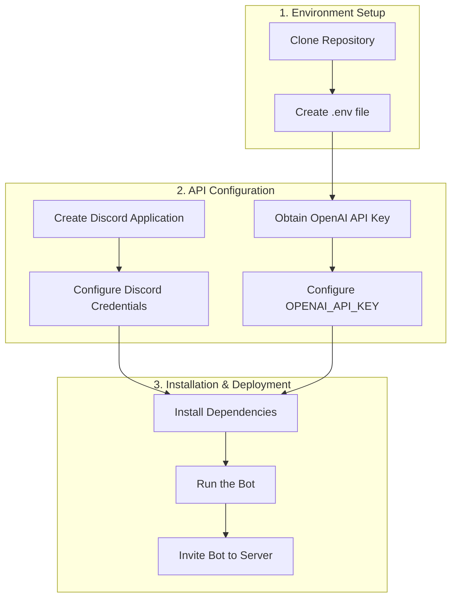
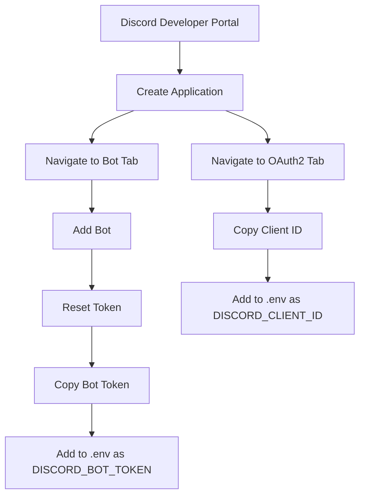
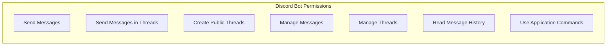
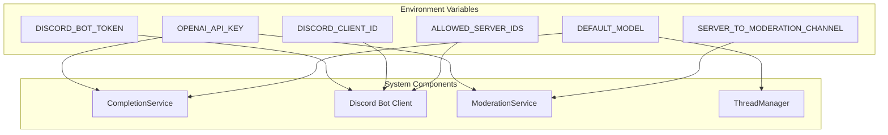

<!-- source: DeepWiki mcp.deepwiki.com · repo openai/gpt-discord-bot · page 1.1 Installation & Setup · fetched 2026-10-26 -->

# Installation & Setup

<details>
<summary>Relevant source files</summary>

The following files were used as context for generating this wiki page:

- [.env.example](.env.example)
- [README.md](README.md)
- [requirements.txt](requirements.txt)

</details>


This guide covers the complete installation and configuration process for the GPT Discord Bot. It provides step-by-step instructions for setting up the environment, obtaining necessary API keys, configuring the Discord application, and deploying the bot. For post-installation configuration options, see [Configuration](#1.2).

## Prerequisites

Before starting the installation, ensure you have the following prerequisites:

- Python 3.9 or higher
- A Discord account with permission to create applications
- An OpenAI account with API access
- Git (to clone the repository)

Sources: [README.md:49-50]()

## Installation Workflow

The following diagram illustrates the complete installation process:



Sources: [README.md:33-50]()

## Step 1: Clone the Repository

Clone the GPT Discord Bot repository to your local machine:

```bash
git clone https://github.com/openai/gpt-discord-bot.git
cd gpt-discord-bot
```

## Step 2: Environment Configuration

1. Copy the example environment file to create your own:

```bash
cp .env.example .env
```

2. Edit the `.env` file with your configuration values (we'll obtain these values in subsequent steps):

```
OPENAI_API_KEY=your_openai_api_key
DISCORD_BOT_TOKEN=your_discord_bot_token
DISCORD_CLIENT_ID=your_discord_client_id
ALLOWED_SERVER_IDS=server_id_1,server_id_2
SERVER_TO_MODERATION_CHANNEL=server_id_1:channel_id_1
DEFAULT_MODEL=gpt-3.5-turbo
```

Sources: [.env.example:1-7]()

## Step 3: OpenAI API Configuration

1. Log in to your OpenAI account at https://platform.openai.com/
2. Navigate to https://platform.openai.com/account/api-keys
3. Click "Create new secret key" 
4. Copy the generated API key
5. Paste the key as the value for `OPENAI_API_KEY` in your `.env` file

Sources: [README.md:36]()

## Step 4: Discord Application Setup

### 4.1 Create Discord Application



1. Go to https://discord.com/developers/applications
2. Click "New Application" and provide a name for your bot
3. Navigate to the "Bot" tab and click "Add Bot"
4. Under the "Bot" section:
   - Click "Reset Token" to generate a new token
   - Copy the token and set it as `DISCORD_BOT_TOKEN` in your `.env` file
   - Disable "Public Bot" (unless you want it to be publicly available)
   - Enable "Message Content Intent" under "Privileged Gateway Intents"
5. Go to the "OAuth2" tab and copy your "Client ID"
6. Set the copied Client ID as `DISCORD_CLIENT_ID` in your `.env` file

Sources: [README.md:37-43]()

### 4.2 Configure Server Access

1. To allow the bot in specific servers, right-click on your server icon in Discord and select "Copy ID"
2. Add this ID to the `ALLOWED_SERVER_IDS` field in your `.env` file
3. For multiple servers, separate IDs with commas (e.g., `server_id_1,server_id_2`)

Sources: [README.md:43]()

### 4.3 Set Up Moderation Channel (Optional)

If you want to receive moderation messages:

1. Create a channel in your server for moderation messages
2. Copy the channel ID by right-clicking on the channel and selecting "Copy ID"
3. Configure `SERVER_TO_MODERATION_CHANNEL` in the format: `server_id:channel_id`
4. For multiple servers, separate with commas: `server_id_1:channel_id_1,server_id_2:channel_id_2`

Sources: [README.md:54]()

## Step 5: Install Dependencies

Install the required Python packages:

```bash
pip install -r requirements.txt
```

The bot has the following dependencies:

| Package | Version | Purpose |
|---------|---------|---------|
| discord.py | 2.1.* | Discord API integration |
| python-dotenv | 0.21.* | Environment variable loading |
| openai | 1.2.0 | OpenAI API client |
| PyYAML | 6.0 | YAML configuration parsing |
| dacite | 1.6.* | Data class conversion |

Sources: [requirements.txt:1-5]()

## Step 6: Run the Bot

Start the bot with the following command:

```bash
python -m src.main
```

Upon successful startup, the console will display an invite URL. Copy and paste this URL into your web browser to add the bot to your configured server(s).

Sources: [README.md:45-49]()

## Required Discord Permissions

Ensure that your bot has the following permissions in the channels where it will be active:



- **Send Messages**: Allow the bot to send messages in channels
- **Send Messages in Threads**: Allow the bot to respond in conversation threads
- **Create Public Threads**: Allow the bot to create new threads for conversations
- **Manage Messages**: Required for moderation to delete blocked messages
- **Manage Threads**: Allow the bot to manage thread lifetime and behavior
- **Read Message History**: Allow the bot to access previous messages in the conversation
- **Use Application Commands**: Allow the bot to respond to slash commands

Sources: [README.md:61-69]()

## Environment Variables and System Components

The following diagram shows how environment variables connect to system components:



Sources: [.env.example:1-7]()

## Troubleshooting

If your bot isn't responding to commands, verify the following:

1. All environment variables are correctly configured in the `.env` file
2. The bot has been invited to your server using the generated invite URL
3. The bot has all the required permissions in the channels it needs to access
4. The server ID is correctly listed in your `ALLOWED_SERVER_IDS` variable
5. The Python version is 3.9 or higher (`python --version`)
6. All dependencies were successfully installed

For specific issues:
- For problems with this specific bot: Check the [Discord Project Post](https://discord.com/channels/974519864045756446/1055336272543092757)
- For OpenAI API questions: Check the [Discord API Discussions](https://discord.com/channels/974519864045756446/1037561178286739466)

Sources: [README.md:4-6](), [README.md:60-69]()

---

