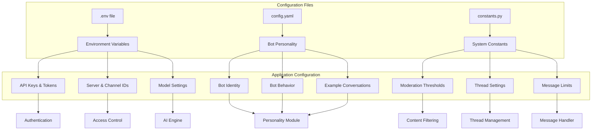
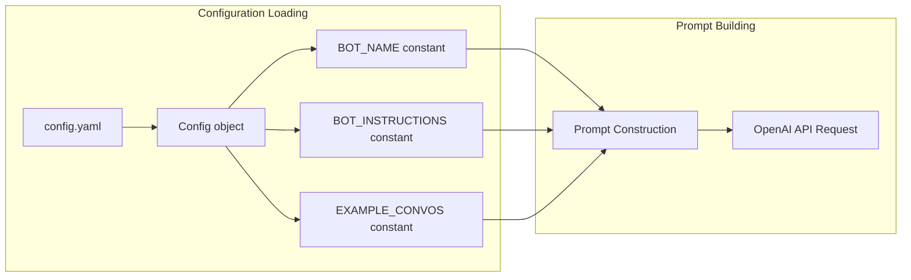
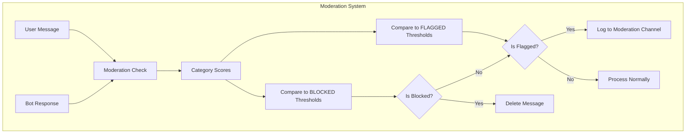
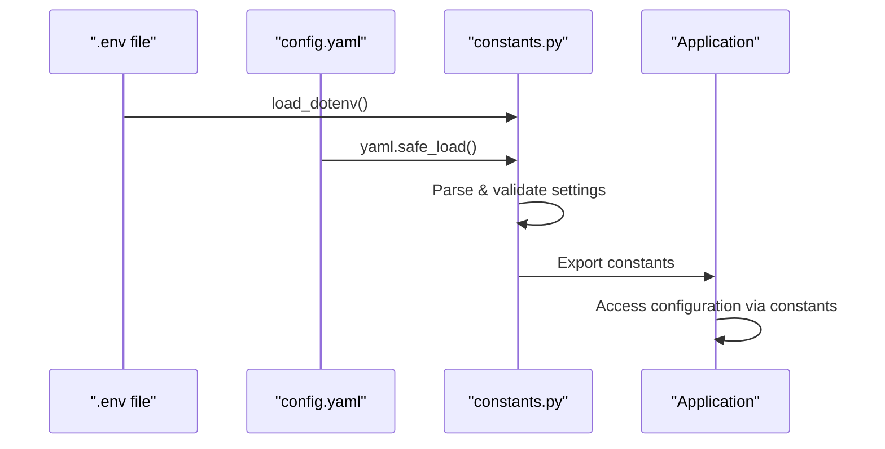
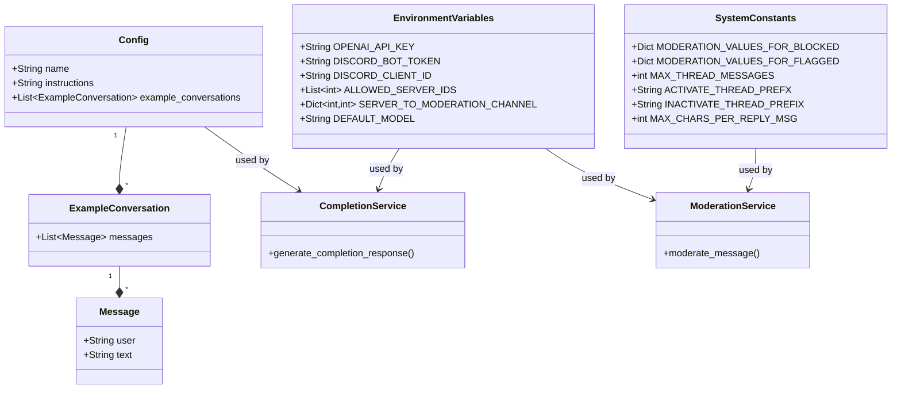

<!-- source: DeepWiki mcp.deepwiki.com · repo openai/gpt-discord-bot · page 1.2 Configuration · fetched 2026-10-26 -->

# Configuration

<details>
<summary>Relevant source files</summary>

The following files were used as context for generating this wiki page:

- [.env.example](.env.example)
- [README.md](README.md)
- [src/config.yaml](src/config.yaml)
- [src/constants.py](src/constants.py)

</details>


This page documents the configuration options for the GPT Discord Bot. It covers environment variables, bot personality settings, and system constants that control the bot's behavior, moderation settings, and integration with Discord and OpenAI APIs. For information about installing and setting up the bot, see [Installation & Setup](#1.1).

## Configuration Overview

The GPT Discord Bot uses a three-tier configuration system:

1. **Environment Variables** - API keys, tokens, and server IDs in a `.env` file
2. **Bot Personality** - Name, instructions, and example conversations in `config.yaml`
3. **System Constants** - Moderation thresholds and operational limits in `constants.py`



Sources: [.env.example](/.env.example), [src/constants.py](src/constants.py), [src/config.yaml](src/config.yaml)

## Environment Variables

Environment variables contain sensitive information and configuration settings that control which servers the bot can access and which OpenAI model it uses.

### Required Environment Variables

| Variable | Description | Example |
|----------|-------------|---------|
| `OPENAI_API_KEY` | Your OpenAI API key | `sk-abcdef123456` |
| `DISCORD_BOT_TOKEN` | Discord bot token from Developer Portal | `MTAxNTcyNjI5MTUwMzE2NTQ0MA.G3hxbL.abc123` |
| `DISCORD_CLIENT_ID` | Discord application client ID | `1015726291503165440` |
| `ALLOWED_SERVER_IDS` | Comma-separated Discord server IDs where the bot can operate | `1001245072314060810,1015726291503165440` |

### Optional Environment Variables

| Variable | Description | Default | Example |
|----------|-------------|---------|---------|
| `SERVER_TO_MODERATION_CHANNEL` | Maps server IDs to moderation channel IDs | None | `1001245072314060810:1016668746450912256` |
| `DEFAULT_MODEL` | Default OpenAI model to use | `gpt-3.5-turbo` | `gpt-4` |

The environment variables are loaded in [src/constants.py:1-36]() and made available throughout the application.

Sources: [.env.example](/.env.example), [src/constants.py](src/constants.py)

## Bot Personality Configuration

The bot's personality, name, and behavior are defined in `config.yaml`. This file contains:

1. **name**: The bot's display name
2. **instructions**: A prompt that defines the bot's personality and behavior
3. **example_conversations**: Sample dialogs that help shape the bot's conversation style

### Example Configuration

```yaml
name: Lenard
instructions: You're a regular Discord user. You talk casually, use emojis, and don't use capital letters. You talk in internet shorthand like np and lol and idk and nvm. You have many interests and love talking to people.
example_conversations:
  - messages:
    - user: bob
      text: how's it going today?
    - user: Lenard
      text: its going great, im watching youtube videos, hbu?
```

### Personality Configuration Flow



The bot personality configuration is loaded in [src/constants.py:12-20]() using the `dacite` library to convert the YAML structure into a `Config` object defined in the `base` module.

Sources: [src/config.yaml](src/config.yaml), [src/constants.py](src/constants.py)

## System Constants

System constants control various operational aspects of the bot, including moderation thresholds, thread management, and response formatting.

### Moderation Thresholds

The bot uses two sets of moderation thresholds:

1. **`MODERATION_VALUES_FOR_BLOCKED`**: Messages exceeding these thresholds are blocked completely
2. **`MODERATION_VALUES_FOR_FLAGGED`**: Messages exceeding these thresholds are flagged but still processed

These thresholds are defined for different categories like harassment, hate speech, self-harm, sexual content, and violence. Lower values result in stricter moderation.



### Thread and Message Settings

| Constant | Description | Default Value |
|----------|-------------|---------------|
| `SECONDS_DELAY_RECEIVING_MSG` | Delay before processing to catch multiple messages | 3 |
| `MAX_THREAD_MESSAGES` | Maximum number of messages in a thread before closing | 200 |
| `ACTIVATE_THREAD_PREFX` | Prefix for active threads | "💬✅" |
| `INACTIVATE_THREAD_PREFIX` | Prefix for inactive threads | "💬❌" |
| `MAX_CHARS_PER_REPLY_MSG` | Character limit per bot message (Discord limit is 2000) | 1500 |
| `AVAILABLE_MODELS` | Available OpenAI models for the bot | A Literal type with options |

Sources: [src/constants.py](src/constants.py)

## Configuration Loading Process

The following diagram illustrates how configuration is loaded and used throughout the application:



When the application starts:

1. `constants.py` loads environment variables using `load_dotenv()`
2. It then loads the bot personality from `config.yaml`
3. It processes server IDs and moderation channel mappings
4. It defines additional constants for moderation and thread management
5. All these settings are available as importable constants throughout the application

Sources: [src/constants.py](src/constants.py)

## Configuration Entity Relationships

The following diagram shows how configuration entities relate to code components:



Sources: [src/constants.py](src/constants.py), [src/config.yaml](src/config.yaml), [.env.example](/.env.example)

## Customizing the Configuration

### Modifying the Bot's Personality

To change the bot's personality:

1. Edit `src/config.yaml` to update the name, instructions, and example conversations
2. The changes will take effect the next time the bot is started

### Changing Environment Settings

To modify environment settings:

1. Edit the `.env` file to update API keys, tokens, or server IDs
2. For changes to take effect, restart the bot

### Adjusting Moderation Thresholds

To alter moderation sensitivity:

1. Edit the `MODERATION_VALUES_FOR_BLOCKED` and `MODERATION_VALUES_FOR_FLAGGED` dictionaries in `src/constants.py`
2. Higher values mean less strict moderation (1.0 = no moderation for that category)
3. Restart the bot for changes to take effect

For more detailed information about customizing the bot's personality, see [Customizing Bot Personality](#4.1). For information about adjusting moderation thresholds, see [Moderation Thresholds](#4.2).

Sources: [README.md](README.md), [src/constants.py](src/constants.py)

---

