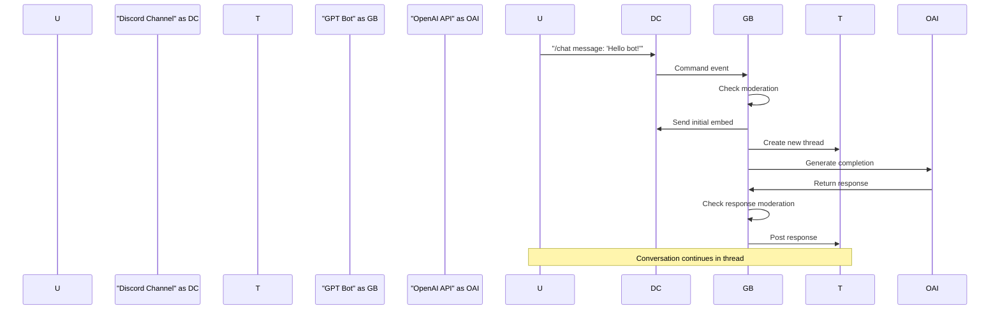
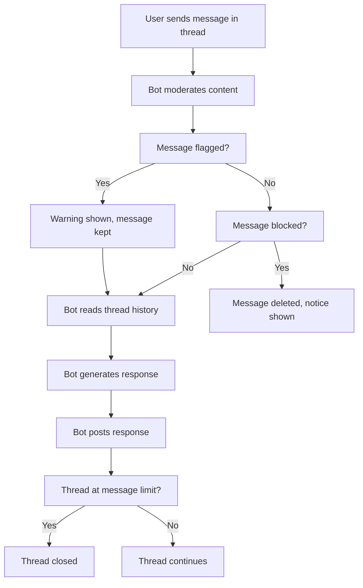
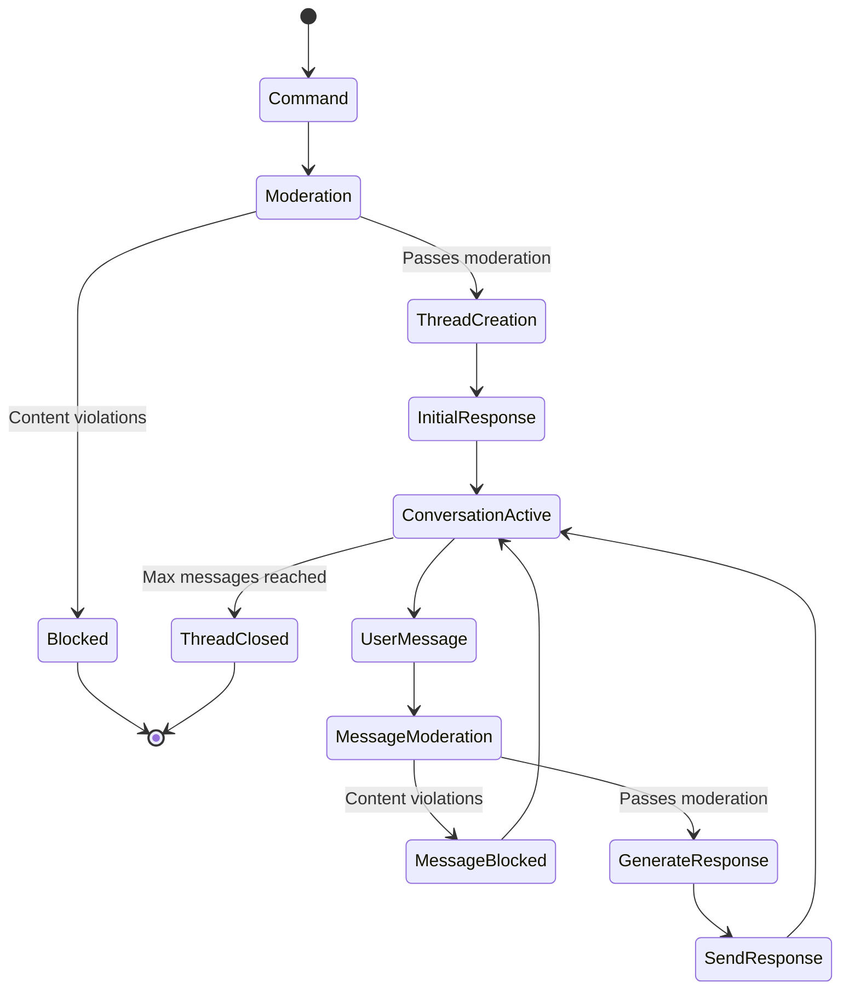
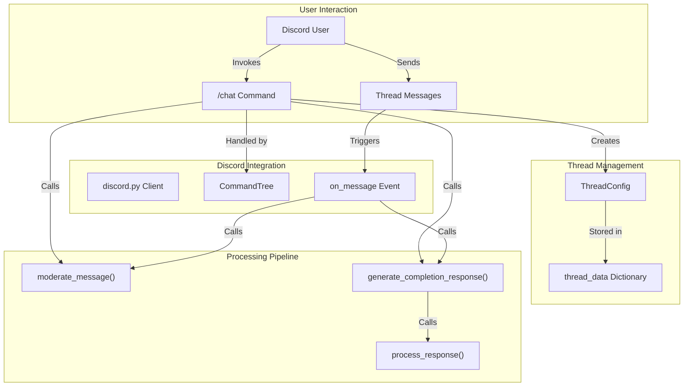

<!-- source: DeepWiki mcp.deepwiki.com · repo openai/gpt-discord-bot · page 1.3 Usage Guide · fetched 2026-10-26 -->

# Usage Guide

<details>
<summary>Relevant source files</summary>

The following files were used as context for generating this wiki page:

- [README.md](README.md)
- [src/main.py](src/main.py)

</details>


This document provides instructions for utilizing the GPT Discord Bot's features. It explains how to initiate conversations, use commands, and understand the bot's behavior in Discord servers. For installation instructions, see [Installation & Setup](#1.1), and for configuration options, see [Configuration](#1.2).

## 1. Command Reference

The bot currently supports one primary command:

```
/chat message:"Your message here" [model] [temperature] [max_tokens]
```

### Command Parameters

| Parameter | Description | Default | Constraints |
|-----------|-------------|---------|------------|
| `message` | The initial prompt to start the conversation | *Required* | Must pass moderation |
| `model` | The GPT model to use | gpt-3.5-turbo | Choices defined in `AVAILABLE_MODELS` |
| `temperature` | Controls randomness in responses | 1.0 | Between 0 and 1 |
| `max_tokens` | Maximum response length | 512 | Between 1 and 4096 |

Sources: [src/main.py:63-84](), [README.md:26-31]()

## 2. Starting a Conversation

To begin interacting with the bot:

1. Type `/chat` in any channel where the bot has access
2. Enter your initial message in the prompt field
3. Optionally, adjust model parameters
4. Submit the command

The bot will:
1. Create a new thread with your message
2. Process your prompt through content moderation
3. Generate a response using the OpenAI API
4. Reply in the newly created thread



Sources: [src/main.py:77-184](), [README.md:26]()

## 3. Continuing the Conversation

After a thread is created:

1. Simply type additional messages directly in the thread
2. The bot will process each message and respond
3. The entire conversation history is used for context
4. The bot maintains the persona specified in your config

### Thread Behavior

- Each thread maintains its own configuration (model, temperature, max_tokens)
- The bot responds to every user message in active threads it has created
- Threads are automatically closed when they reach the maximum message limit
- The bot briefly waits after receiving a message to allow users to complete multi-part thoughts



Sources: [src/main.py:188-310](), [README.md:28-29]()

## 4. Message Moderation

The bot uses OpenAI's Moderation API to screen content:

### Moderation Outcomes

| Outcome | User Message | Bot Response |
|---------|--------------|--------------|
| No issues | Processed normally | Processed normally |
| Flagged content | Warning shown, message kept | Warning shown, response sent |
| Blocked content | Message deleted (if bot has permission) | Not applicable (responses are regenerated) |

When content is flagged or blocked, a notification may also be sent to a designated moderation channel if configured.

```mermaid
classDiagram
    class "ModerationService" {
        +moderate_message()
        +send_moderation_flagged_message()
        +send_moderation_blocked_message()
    }
    
    class "CompletionService" {
        +generate_completion_response()
        +process_response()
    }
    
    class "ModeratedContent" {
        +String content
        +Boolean flagged
        +Boolean blocked
        +String flagged_categories
        +String blocked_categories
    }
    
    "ModerationService" -- "ModeratedContent" : produces
    "CompletionService" -- "ModerationService" : uses
```

Sources: [src/main.py:113-128](), [src/main.py:224-265]()

## 5. Thread Limitations

Discord threads have limitations that affect the bot's operation:

| Limitation | Description | Bot Behavior |
|------------|-------------|--------------|
| Message count | Maximum messages in a thread | Thread auto-closes when limit reached |
| Context limit | Maximum tokens for API context | Oldest messages might be excluded |
| Thread lifetime | Discord's archive settings | Thread may auto-archive based on server settings |

The bot's maximum thread message limit is defined in the constants and helps prevent hitting OpenAI's context window limitations.

Sources: [src/main.py:218-221](), [README.md:29]()

## 6. Troubleshooting

If the bot isn't responding as expected, check these common issues:

### Required Permissions

The bot needs these permissions in channels where it operates:

- Send Messages
- Send Messages in Threads
- Create Public Threads
- Manage Messages (for moderation)
- Manage Threads
- Read Message History
- Use Application Commands

### Common Issues

| Problem | Possible Cause | Solution |
|---------|---------------|----------|
| Bot doesn't respond | Missing permissions | Check channel permissions |
| Command not working | Invalid parameters | Ensure temperature is 0-1, max_tokens is 1-4096 |
| Messages being deleted | Content moderation | Adjust your message or review moderation settings |
| Thread closed unexpectedly | Message limit reached | Start a new conversation with `/chat` |

Sources: [README.md:60-69](), [src/main.py:97-110]()

## 7. Command Flow Visualization

This diagram represents the complete flow from issuing a command to receiving responses:



Sources: [src/main.py:77-184](), [src/main.py:188-310]()

## 8. Interactive Components Relationship



Sources: [src/main.py:43-44](), [src/main.py:63-184](), [src/main.py:188-310]()

By following this guide, you should be able to effectively use the GPT Discord Bot for conversations in your Discord server. The bot is designed to provide a seamless chat experience while maintaining content moderation standards.

---

