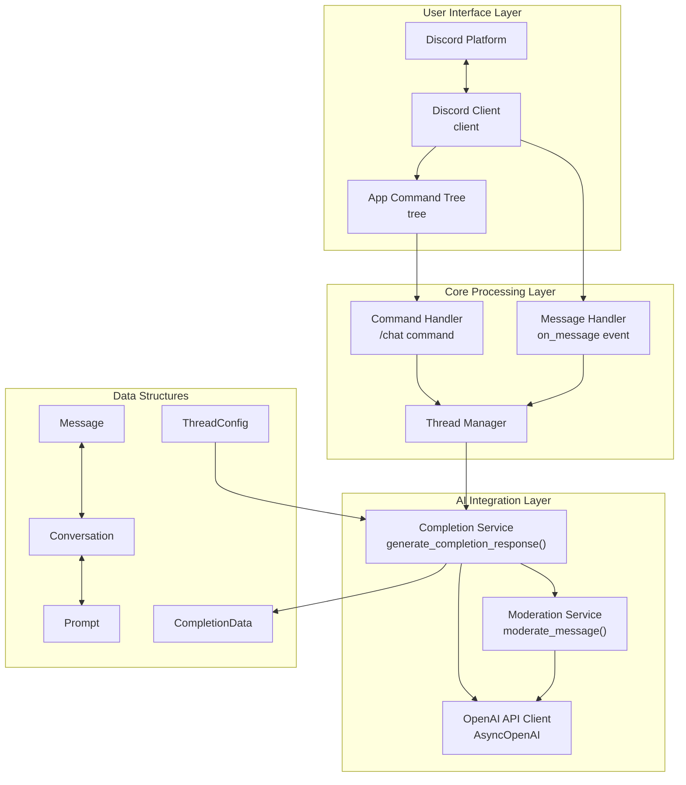
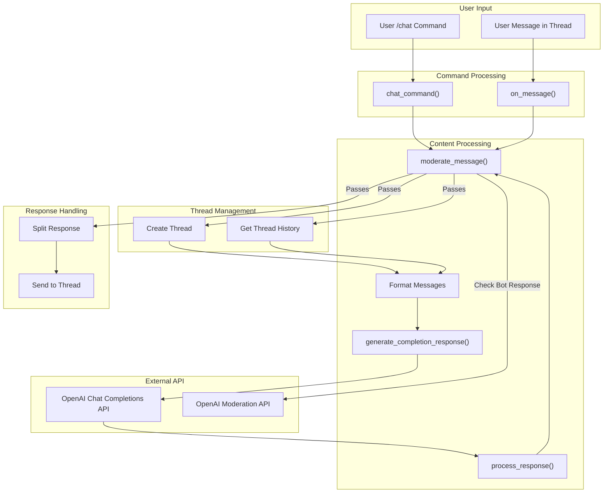
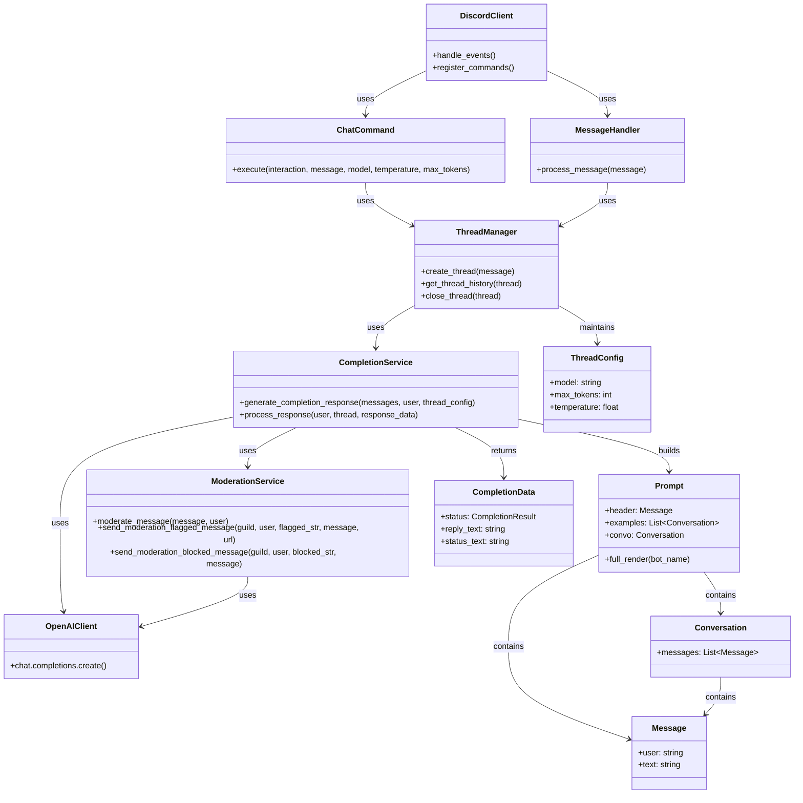
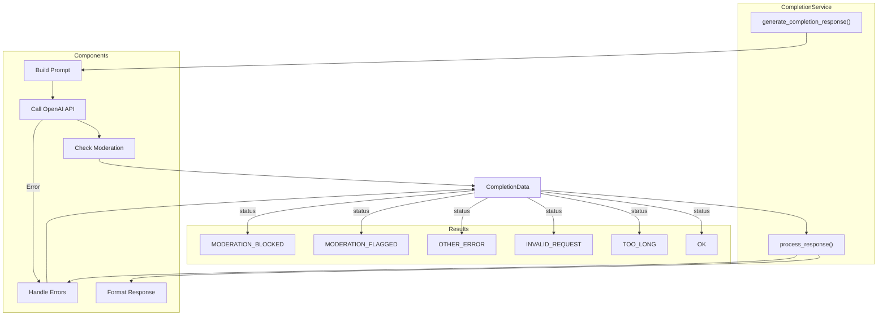
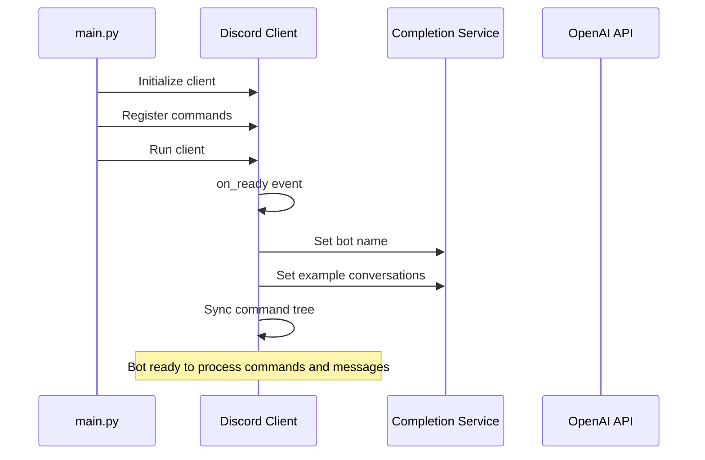
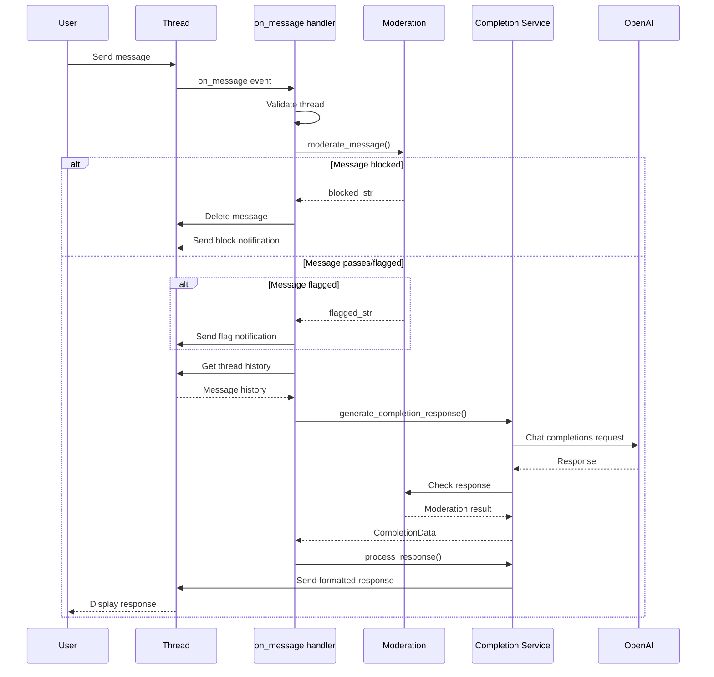

<!-- source: DeepWiki mcp.deepwiki.com · repo openai/gpt-discord-bot · page 2 Core Components · fetched 2026-10-26 -->

# Core Components

Relevant source files

The following files were used as context for generating this wiki page:

- [README.md](README.md)
- [src/completion.py](src/completion.py)
- [src/main.py](src/main.py)

This page provides an overview of the main architectural components that make up the GPT Discord Bot. It explores the system's structure, core modules, and how these elements interact to deliver the bot's functionality. For specific implementation details of individual components, see the related pages: [Discord Integration](#2.1), [OpenAI Completion System](#2.2), [Moderation System](#2.3), and [Thread Management](#2.4).

## System Architecture Overview

The GPT Discord Bot consists of several interconnected components that work together to process user messages, generate AI responses, and manage conversations in Discord threads.

Sources: [src/main.py:41-43](), [src/completion.py:41-42](), [src/main.py:45-185](), [src/main.py:188-310]()

## Core Components Description

### 1. Discord Integration Layer

The Discord integration layer handles all interactions with the Discord platform.

- **Discord Client**: Initialized with appropriate intents and maintains the connection to Discord
- **Command Tree**: Registers and processes slash commands
- **Event Handlers**: Processes events like `on_ready` and `on_message`

Sources: [src/main.py:38-43](), [src/main.py:46-59]()

### 2. Core Processing Layer

The core processing layer manages command handling, message processing, and thread orchestration.

- **Command Handler**: Processes `/chat` commands, creating new conversation threads
- **Message Handler**: Processes messages in existing threads, generating responses
- **Thread Manager**: Creates, tracks, and manages Discord threads for conversations

Sources: [src/main.py:77-185](), [src/main.py:188-310]()

### 3. AI Integration Layer

The AI integration layer manages all interactions with OpenAI's API.

- **Completion Service**: Generates AI responses using the OpenAI Chat Completions API
- **Moderation Service**: Filters inappropriate content using OpenAI's Moderation API
- **OpenAI API Client**: Handles API requests to OpenAI

Sources: [src/completion.py:24-102](), [src/completion.py:41-42]()

### 4. Data Structures

Several key data structures support the operation of the bot:

- **Message**: Represents a single message in a conversation
- **Conversation**: A collection of messages
- **Prompt**: Structures conversations for the OpenAI API
- **ThreadConfig**: Stores configuration for a specific conversation thread
- **CompletionData**: Contains response data from the completion service

Sources: [src/completion.py:34-39](), [README.md:25-31]()

## Data Flow

The following diagram illustrates how data flows through the system from a user message to a bot response:

Sources: [src/main.py:77-185](), [src/main.py:188-310](), [src/completion.py:44-102]()

## Component Integration Model

The following class diagram shows how the core components are structured and integrated:

Sources: [src/main.py:41-43](), [src/completion.py:34-39](), [src/completion.py:44-102](), [src/main.py:77-185](), [src/main.py:188-310]()

## Core Components Details

### Discord Client and Command Handler

The Discord client is the entry point for all interactions with the Discord API. It handles authentication, event processing, and command registration.

Key features:
- Discord client initialization with message content intents
- Command tree setup for slash commands
- Event handlers for message processing

The bot primarily responds to two key events:
1. `/chat` command invocations (starting new conversations)
2. Messages in active conversation threads (continuing conversations)

Sources: [src/main.py:38-43](), [src/main.py:46-59](), [src/main.py:77-185]()

### Completion Service

The completion service is responsible for generating AI responses using OpenAI's API.

Key features:
- `generate_completion_response`: Builds a prompt, sends it to OpenAI, and handles moderation of the response
- `process_response`: Processes the completion data and sends appropriate messages to the thread
- Comprehensive error handling for API errors and moderation issues

Sources: [src/completion.py:24-102](), [src/completion.py:105-168]()

### Moderation Service

The moderation service filters inappropriate content in both user messages and bot responses.

Key features:
- Message moderation using OpenAI's Moderation API
- Handling of flagged content (allowed but with warning)
- Handling of blocked content (not allowed)
- Logging of moderation events

Sources: [src/main.py:224-264](), [src/completion.py:66-81]()

### Thread Management

Thread management is responsible for creating, tracking, and managing Discord threads.

Key features:
- Thread creation when a user starts a chat
- Storing thread configuration (model, temperature, max tokens)
- Managing thread history
- Closing threads when they reach limits

Sources: [src/main.py:161-169](), [src/main.py:218-221]()

## Data Structures

The bot uses several key data structures to organize and process information:

| Data Structure | Purpose | Key Properties |
|----------------|---------|----------------|
| Message | Represents a single message | user, text |
| Conversation | Collection of messages | messages |
| Prompt | Format for OpenAI API | header, examples, convo |
| ThreadConfig | Thread-specific settings | model, max_tokens, temperature |
| CompletionData | Response from completion service | status, reply_text, status_text |
| CompletionResult | Enum of possible completion statuses | OK, TOO_LONG, INVALID_REQUEST, etc. |

Sources: [src/completion.py:24-39](), [src/base.py]() (referenced but not shown)

## System Initialization Flow

The following diagram shows the initialization flow of the bot when it starts up:

Sources: [src/main.py:46-59](), [src/main.py:312]()

## Message Processing Flow

The message processing flow shows how user messages are handled in existing threads:

Sources: [src/main.py:188-310](), [src/completion.py:44-102](), [src/completion.py:105-168]()

---

