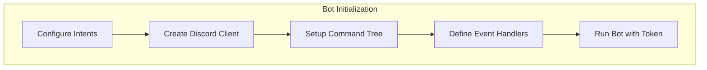
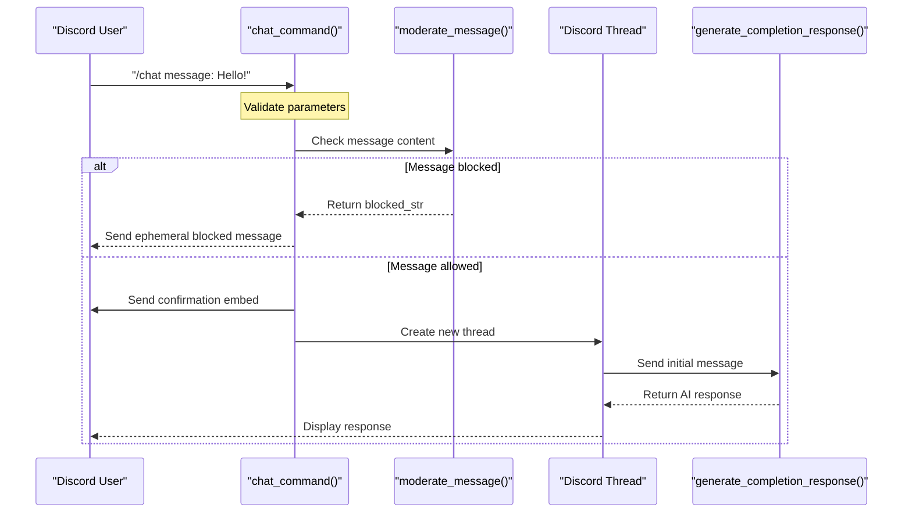
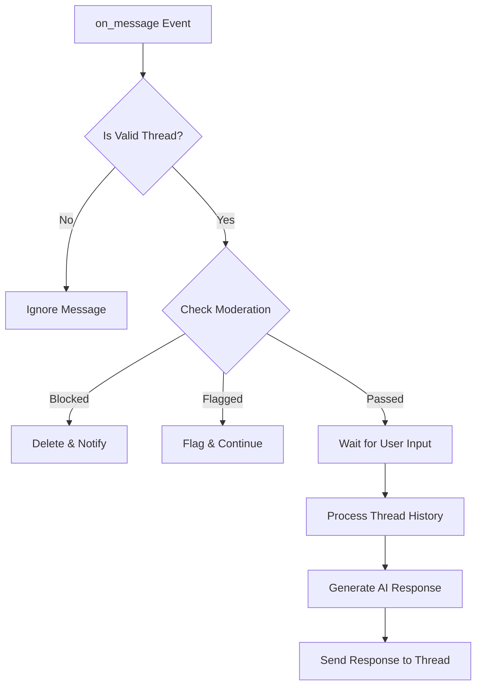
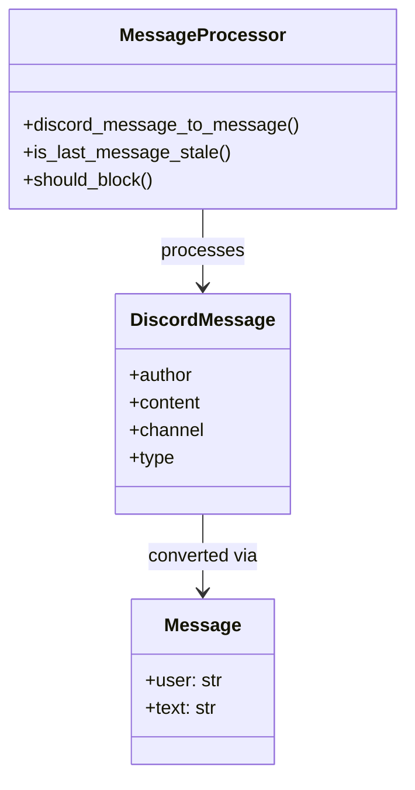
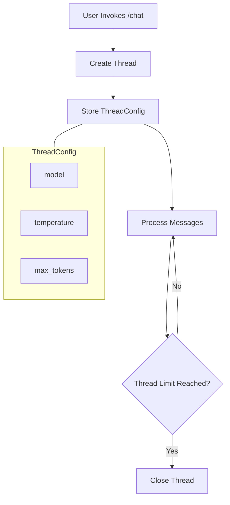
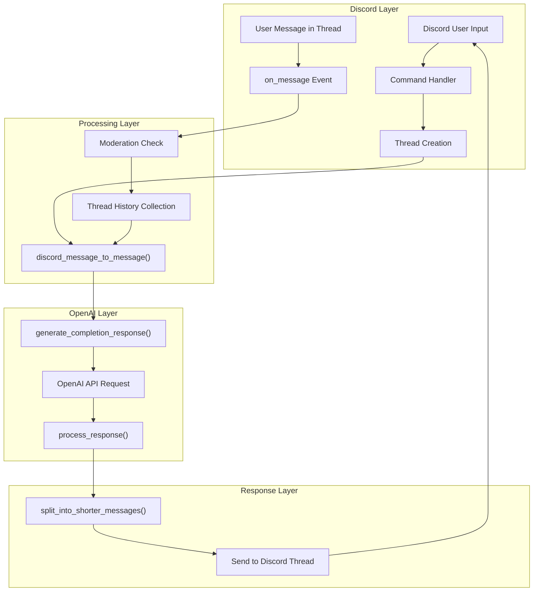
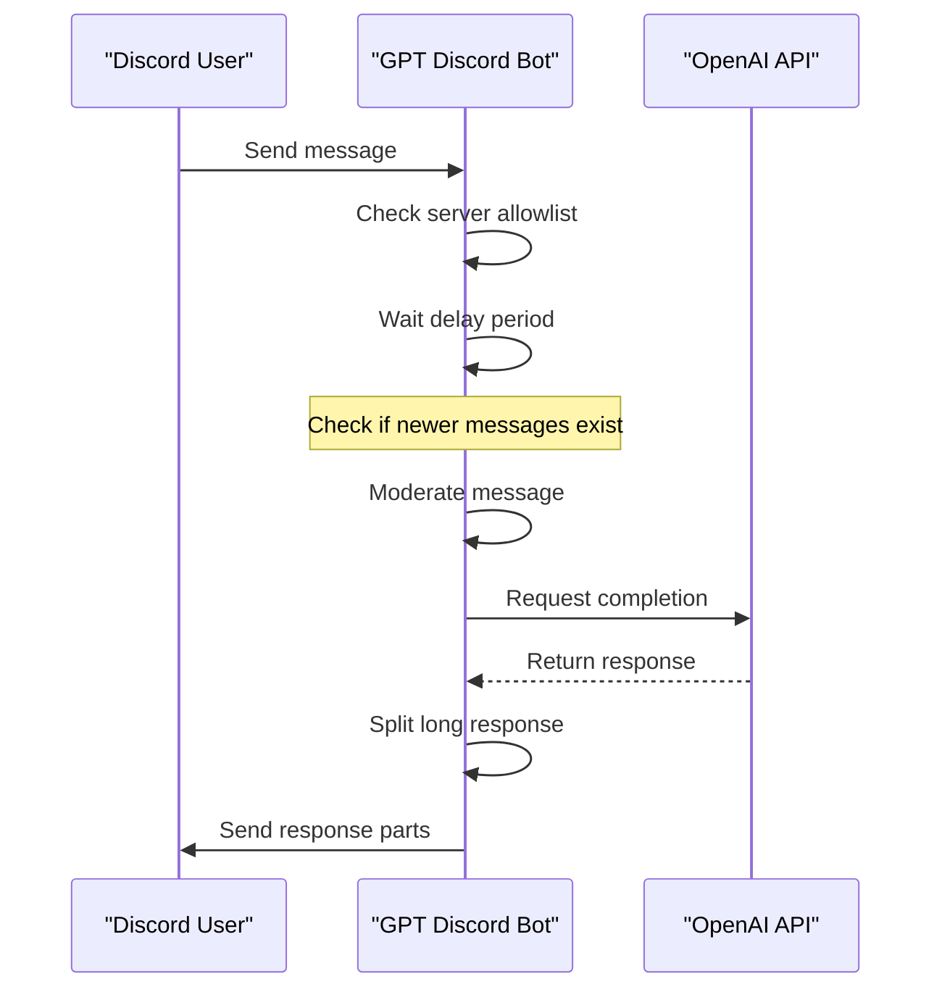
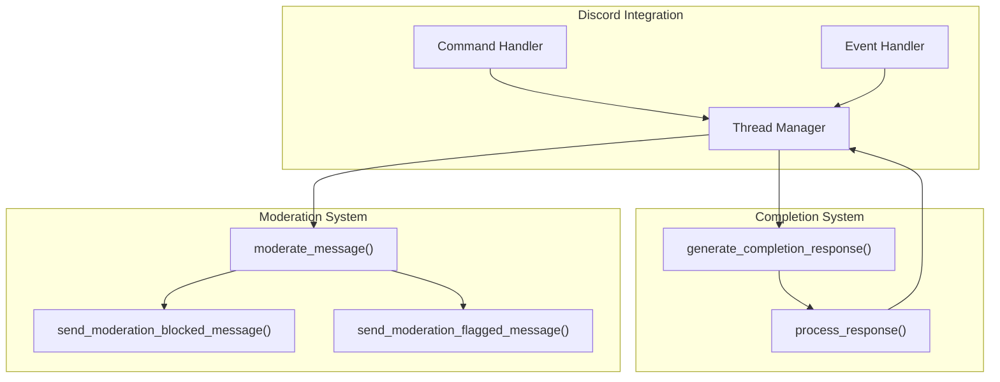

<!-- source: DeepWiki mcp.deepwiki.com · repo openai/gpt-discord-bot · page 2.1 Discord Integration · fetched 2026-10-26 -->

# Discord Integration

Relevant source files

The following files were used as context for generating this wiki page:

- [README.md](README.md)
- [src/main.py](src/main.py)
- [src/utils.py](src/utils.py)

## Purpose and Scope

This document explains how the GPT Discord Bot interacts with Discord, including the initialization process, command handling, message processing, and thread management. The integration uses the [discord.py](https://discordpy.readthedocs.io/) library to communicate with Discord's API and manage bot functionality. For information about how the bot generates responses using OpenAI's API, see [OpenAI Completion System](#2.2). For details on content moderation, see [Moderation System](#2.3).

## Discord Bot Initialization

The GPT Discord Bot is initialized using the `discord.py` library, which provides the framework for interacting with Discord's API.

Sources: [src/main.py:38-42](). [src/main.py:312]()

The bot requires specific intents and permissions to function properly:

| Intent/Permission | Purpose |
|-------------------|---------|
| `message_content` | Access message contents |
| `send_messages` | Send responses in channels |
| `send_messages_in_threads` | Reply in threads |
| `create_public_threads` | Create new conversation threads |
| `manage_messages` | Delete blocked messages |
| `manage_threads` | Archive or close threads |
| `read_message_history` | Retrieve conversation history |
| `use_application_commands` | Enable slash commands |

Sources: [README.md:62-69]()

## Command System

The bot implements Discord's slash command system using the application commands framework from discord.py.

### `/chat` Command

The primary interaction point is the `/chat` command which creates a new conversation thread.

Sources: [src/main.py:62-184]()

The `/chat` command accepts the following parameters:

| Parameter | Type | Description | Default |
|-----------|------|-------------|---------|
| `message` | String | Initial prompt for the conversation | Required |
| `model` | String | AI model to use | Based on DEFAULT_MODEL |
| `temperature` | Float | Controls randomness (0-1) | 1.0 |
| `max_tokens` | Integer | Maximum tokens per response | 512 |

Sources: [src/main.py:77-82]()

## Message Handling System

After thread creation, the bot processes further messages through the `on_message` event handler.

Sources: [src/main.py:188-309]()

### Message Processing Logic

The bot implements several checks before processing a message:

1. Ignores messages from itself
2. Only processes messages in threads
3. Only responds in threads it created
4. Checks if threads are archived or locked
5. Enforces message count limits

Sources: [src/utils.py:15-28](), [src/utils.py:38-46](), [src/utils.py:60-70]()

## Thread Management

The bot uses Discord's thread feature to maintain separate conversations with users.

Sources: [src/main.py:161-169](), [src/main.py:218-221]()

### Thread Configuration

Each thread has a dedicated `ThreadConfig` object stored in the `thread_data` dictionary, containing:

| Property | Description |
|----------|-------------|
| `model` | The OpenAI model used for this thread |
| `temperature` | The randomness parameter for responses |
| `max_tokens` | Maximum token limit for responses |

Sources: [src/main.py:43](), [src/main.py:167-169]()

### Thread Lifecycle

Threads progress through these states:

1. **Creation**: Thread is created with the `ACTIVATE_THREAD_PREFX` in its name
2. **Active**: Users can interact with the bot in the thread
3. **Closed**: When message limit is reached, the thread is renamed, archived, and locked

Sources: [src/utils.py:49-57]()

## Discord-OpenAI Integration Flow

The following diagram illustrates how data flows between Discord and the OpenAI API:

Sources: [src/main.py:172-179](), [src/main.py:289-307](), [src/utils.py:31-35]()

## Security and Rate Limiting

The bot implements several security measures:

1. **Server Allowlist**: Bot only responds in servers listed in `ALLOWED_SERVER_IDS`
2. **Message Delay**: Small delay (configurable) before processing messages to batch multiple user inputs
3. **Thread Limits**: Maximum number of messages per thread to prevent context overflow
4. **Message Size Limits**: Long responses are split into multiple messages

Sources: [src/utils.py:31-35](), [src/utils.py:60-70](), [src/main.py:266-275]()

## Core Discord.py Components

The bot leverages several key discord.py components:

| Component | Description | Usage in Bot |
|-----------|-------------|--------------|
| `Client` | Main interface to Discord API | Handles events and communication |
| `app_commands` | Slash command framework | Implements the `/chat` command |
| `Thread` | Discord thread object | Manages conversation contexts |
| `Embed` | Rich message format | Displays command results and notifications |
| `Intents` | Permission scopes | Defines what the bot can access |

Sources: [src/main.py:38-42](), [src/main.py:64-76]()

## Integration with Other Bot Components

The Discord integration layer connects with other components of the bot system:

Sources: [src/main.py:114-179](), [src/main.py:224-307]()

This diagram shows how the Discord integration (command handler, event handler, and thread manager) interfaces with the completion system and moderation system, forming the complete bot architecture.

---

