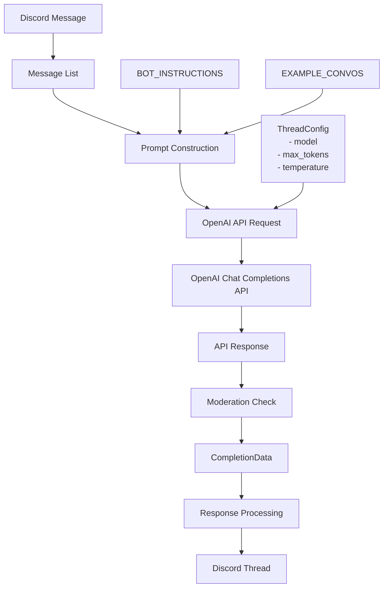
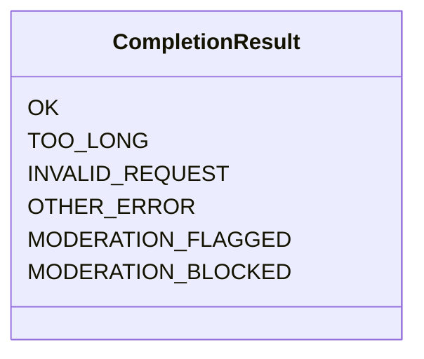
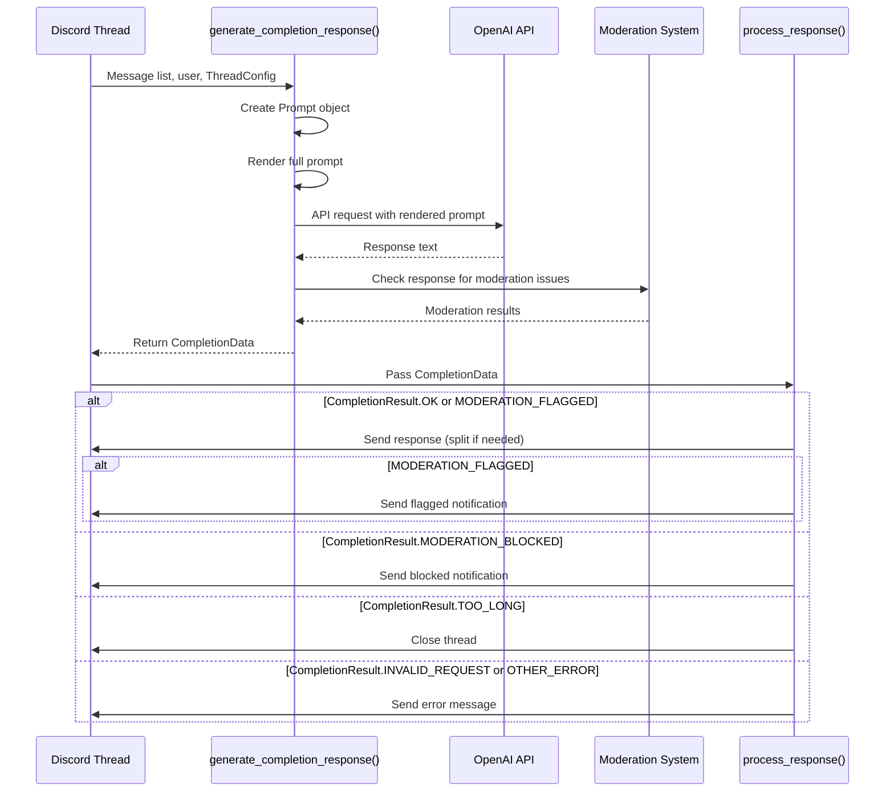
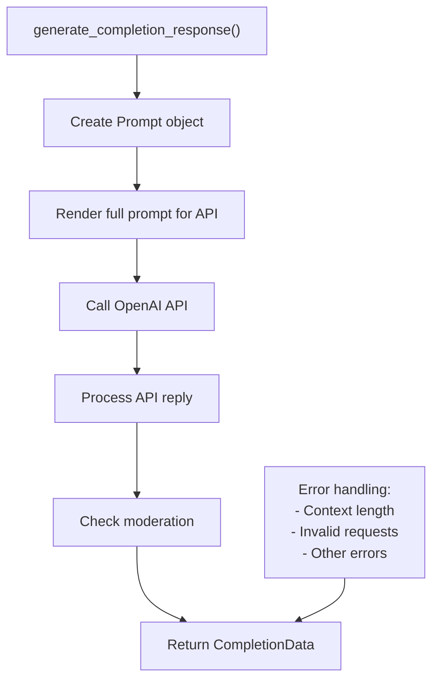
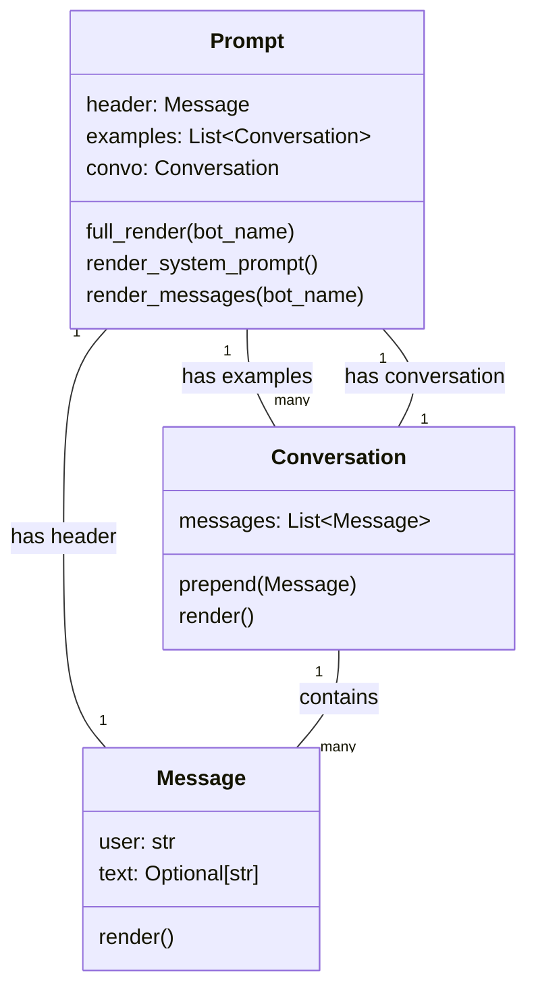

<!-- source: DeepWiki mcp.deepwiki.com · repo openai/gpt-discord-bot · page 2.2 OpenAI Completion System · fetched 2026-10-26 -->

# OpenAI Completion System

Relevant source files

The following files were used as context for generating this wiki page:

- [src/base.py](src/base.py)
- [src/completion.py](src/completion.py)
- [src/constants.py](src/constants.py)

## Purpose and Scope

The OpenAI Completion System is the core component responsible for generating AI responses by interfacing with OpenAI's Chat Completions API. This system handles the construction of prompts, API communication, and processing of responses. It works closely with the [Moderation System](#2.3) for content filtering and the [Thread Management](#2.4) system for Discord conversation handling.

Sources: [src/completion.py:1-169]()

## System Architecture

The Completion System transforms Discord messages into properly formatted OpenAI API requests and then processes the responses for delivery back to Discord users.

Sources: [src/completion.py:44-102](), [src/base.py:40-89]()

## Key Components

### Core Classes

The Completion System relies on several data classes to manage the flow of information:

| Class | Purpose | File |
|-------|---------|------|
| `CompletionResult` | Enum for different response statuses (OK, TOO_LONG, etc.) | [src/completion.py:25-31]() |
| `CompletionData` | Holds the response status, text, and any status messages | [src/completion.py:34-39]() |
| `Prompt` | Structures the conversation for the OpenAI API | [src/base.py:47-89]() |
| `ThreadConfig` | Contains model, max_tokens, and temperature settings | [src/base.py:40-45]() |

Sources: [src/completion.py:25-39](), [src/base.py:40-89]()

### Response Status Types

The `CompletionResult` enum defines the possible outcomes of a completion request:

Sources: [src/completion.py:25-31]()

## Data Flow Process

The OpenAI Completion System follows a specific flow for generating and processing responses:

Sources: [src/completion.py:44-168]()

## Key Functions

### `generate_completion_response()`

This function is the primary interface for generating responses from OpenAI:

1. Creates a `Prompt` object with:
   - System instructions for the bot
   - Example conversations
   - Current conversation history
2. Renders the prompt for OpenAI's API format
3. Makes the API request with specified model parameters
4. Handles the response, including moderation checks
5. Returns a `CompletionData` object with results

Sources: [src/completion.py:44-102]()

### `process_response()`

This function handles the `CompletionData` returned by `generate_completion_response()`:

1. Examines the completion status
2. For successful responses:
   - Splits long messages if needed
   - Sends the response to the Discord thread
3. For flagged content:
   - Sends the response but with warning notification
   - Reports to moderation channel
4. For blocked content:
   - Blocks the response
   - Reports to moderation channel
5. Handles various error conditions

Sources: [src/completion.py:105-168]()

## Prompt Construction

A critical aspect of the system is how prompts are constructed for the OpenAI API:

The `full_render()` method transforms the prompt into the format expected by OpenAI's API:
1. System message containing instructions and examples
2. User and assistant messages representing the conversation history

Sources: [src/base.py:47-89](), [src/completion.py:48-55]()

## Error Handling

The system handles several types of errors:

1. **Context Length Exceeded**: When conversations become too long for the model's context window, the system detects this and closes the thread.
2. **API Errors**: Invalid requests are caught and reported back to the user.
3. **General Errors**: Any other errors during API communication are logged and reported.

Each error condition results in an appropriate status message sent to the Discord thread.

Sources: [src/completion.py:86-102](), [src/completion.py:153-168]()

## Configuration

The Completion System relies on several configuration values:

1. **From Environment Variables**:
   - `OPENAI_API_KEY`: Authentication for OpenAI API
   - `DEFAULT_MODEL`: The default model to use for completions

2. **From config.yaml** (loaded into `CONFIG` object):
   - `BOT_NAME`: The name of the bot
   - `BOT_INSTRUCTIONS`: System instructions for the bot
   - `EXAMPLE_CONVOS`: Example conversations for few-shot learning

Sources: [src/constants.py:10-20](), [src/completion.py:48-54]()

## Integration with Other Systems

The OpenAI Completion System integrates with:

1. **Discord Integration**: Receives messages from and sends responses to Discord threads
2. **Moderation System**: Checks responses for inappropriate content
3. **Thread Management**: Works with thread configuration and status

For more details on these integrations, see the related wiki pages:
- [Discord Integration](#2.1)
- [Moderation System](#2.3)
- [Thread Management](#2.4)

Sources: [src/completion.py:6-15](), [src/completion.py:105-168]()

---

