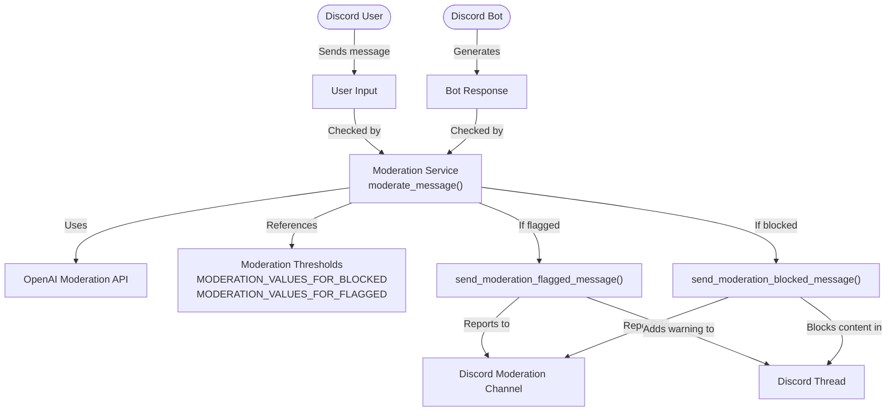
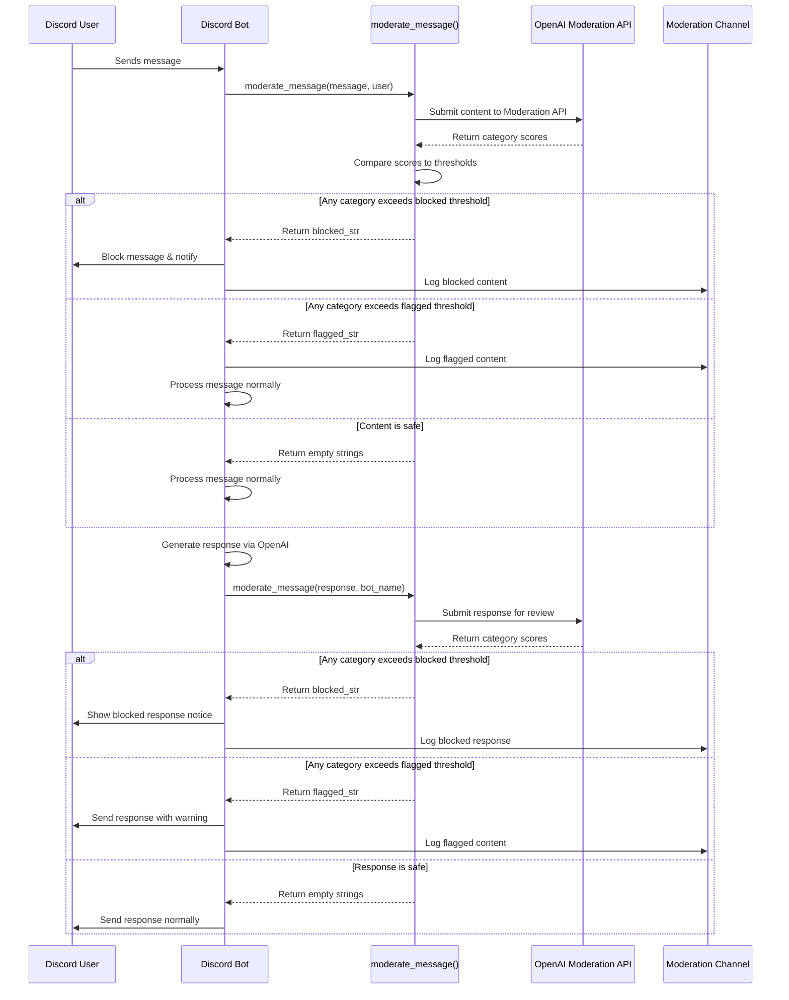
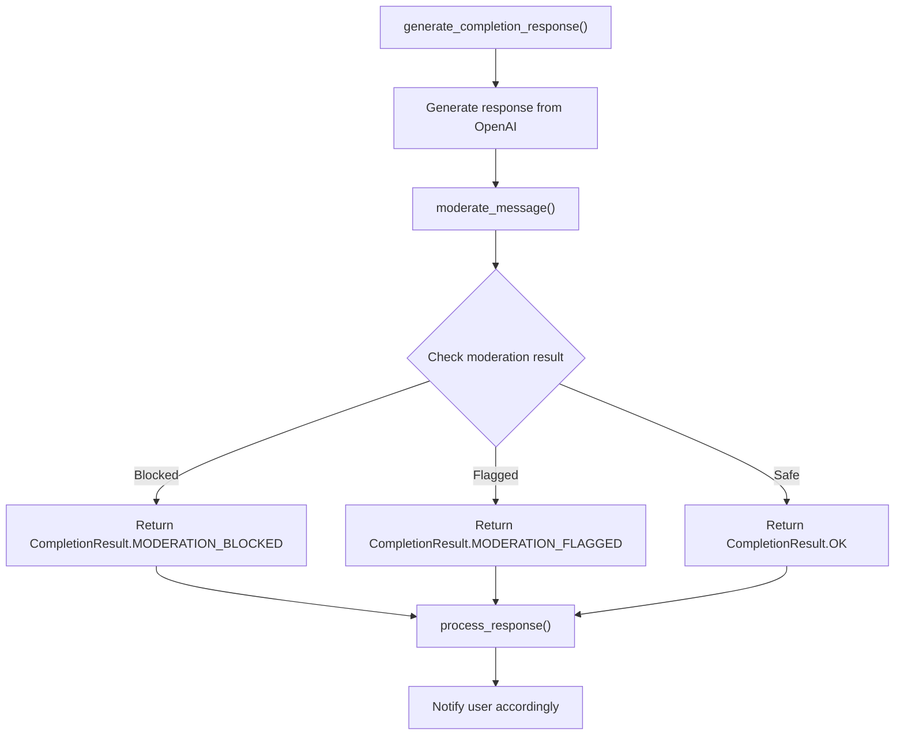
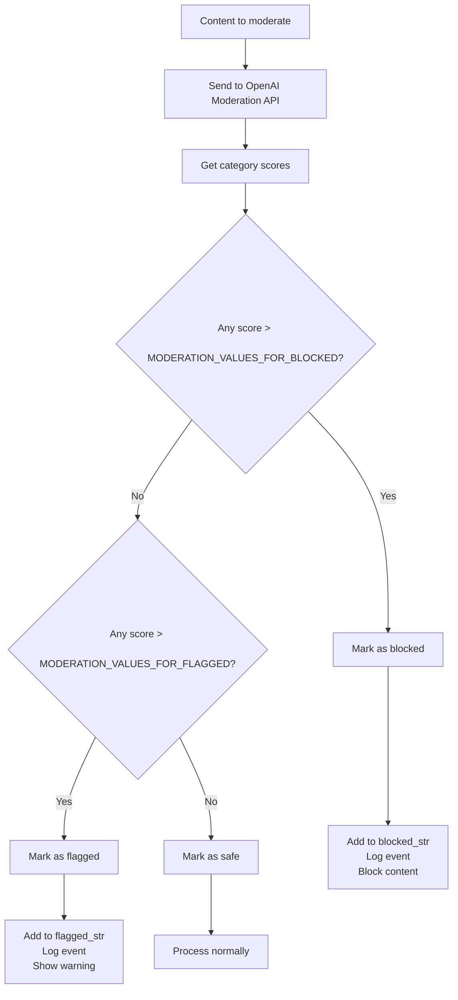
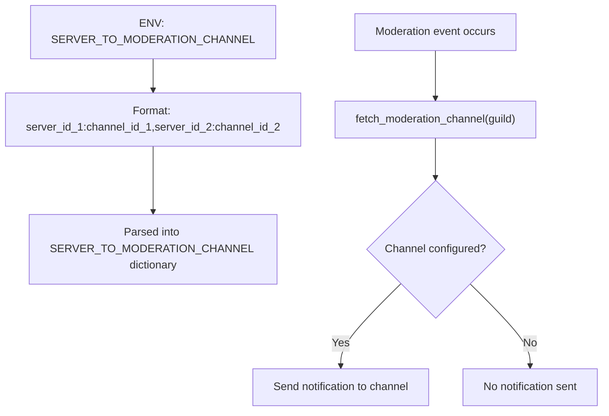
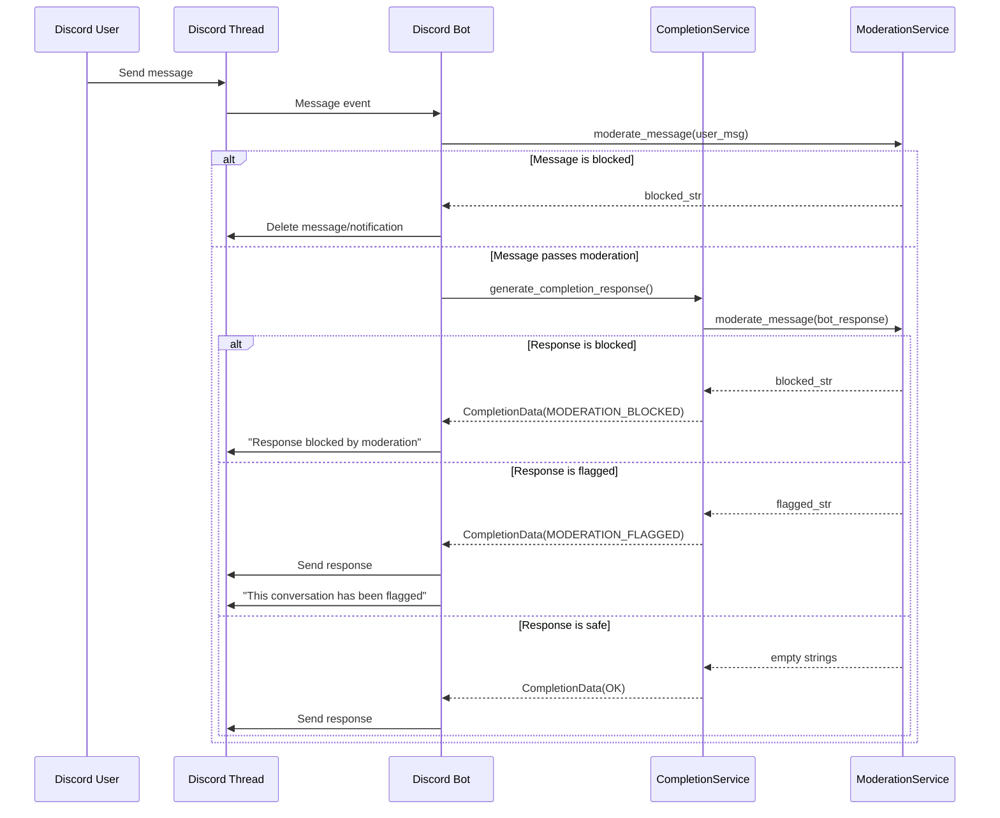

<!-- source: DeepWiki mcp.deepwiki.com · repo openai/gpt-discord-bot · page 2.3 Moderation System · fetched 2026-10-26 -->

# Moderation System

<details>
<summary>Relevant source files</summary>

The following files were used as context for generating this wiki page:

- [src/completion.py](src/completion.py)
- [src/constants.py](src/constants.py)
- [src/moderation.py](src/moderation.py)

</details>


The Moderation System provides content filtering for the GPT Discord Bot, ensuring both user inputs and bot responses adhere to content safety guidelines. This system leverages OpenAI's Moderation API to detect and handle potentially harmful content across various categories such as hate speech, violence, sexual content, harassment, and self-harm.

For information about how to adjust moderation sensitivity, see [Moderation Thresholds](#4.2).

## Architecture Overview



Sources: [src/moderation.py:1-78](), [src/completion.py:65-81]()

## Moderation Flow

The content moderation system operates in two key scenarios:

1. When a user sends a message to the bot
2. When the bot generates a response to send back



Sources: [src/moderation.py:16-36](), [src/completion.py:44-102](), [src/completion.py:105-168]()

## Core Components

### Moderation Function

The heart of the moderation system is the `moderate_message()` function:

```python
def moderate_message(message: str, user: str) -> Tuple[str, str]:  # [flagged_str, blocked_str]
```

This function:
1. Submits content to OpenAI's Moderation API
2. Analyzes the returned category scores
3. Returns two strings:
   - `flagged_str`: Non-empty if content exceeds flagging thresholds
   - `blocked_str`: Non-empty if content exceeds blocking thresholds

Sources: [src/moderation.py:16-36]()

### Notification Handlers

When content is flagged or blocked, these functions report the event:

```python
async def send_moderation_flagged_message(guild, user, flagged_str, message, url)
async def send_moderation_blocked_message(guild, user, blocked_str, message)
```

These functions send notifications to the server's designated moderation channel.

Sources: [src/moderation.py:51-77]()

## Integration with Completion System

Moderation is integrated into the bot's completion system in `generate_completion_response()`:



The code checks both the prompt and response by concatenating them and submitting the last 500 characters:

```python
flagged_str, blocked_str = moderate_message(
    message=(rendered[-1]["content"] + reply)[-500:], user=user
)
```

Sources: [src/completion.py:65-81](), [src/completion.py:105-168]()

## Moderation Categories and Thresholds

The moderation system uses two sets of thresholds defined in `constants.py`:

| Category | Blocked Threshold | Flagged Threshold |
|----------|------------------|------------------|
| harassment | 0.5 | 0.5 |
| harassment/threatening | 0.1 | 0.1 |
| hate | 0.5 | 0.4 |
| hate/threatening | 0.1 | 0.05 |
| self-harm | 0.2 | 0.1 |
| self-harm/instructions | 0.5 | 0.5 |
| self-harm/intent | 0.7 | 0.7 |
| sexual | 0.5 | 0.3 |
| sexual/minors | 0.2 | 0.1 |
| violence | 0.7 | 0.1 |
| violence/graphic | 0.8 | 0.1 |

When the OpenAI Moderation API returns scores for a piece of content, the system compares each category's score against these thresholds to determine whether to flag or block the content.

Sources: [src/constants.py:41-67]()

## Moderation Decision Flow



Sources: [src/moderation.py:16-36]()

## Moderation Channels Configuration

Discord servers can configure a dedicated channel to receive moderation notifications:



The environment variable `SERVER_TO_MODERATION_CHANNEL` maps server IDs to channel IDs where moderation notifications should be sent.

Sources: [src/moderation.py:39-48](), [src/constants.py:32-36]()

## Error Handling

The moderation system includes error handling for robustness:

1. Messages are truncated before sending to moderation channels
   - Flagged messages truncated to 100 characters
   - Blocked messages truncated to 500 characters
2. Guild and channel existence checks before sending notifications
3. All moderation events are logged with category scores and user information

Sources: [src/moderation.py:51-77]()

## Integration with Discord Bot Response Flow

The following sequence diagram shows how the moderation results affect the bot's response handling:



Sources: [src/completion.py:105-168]()

---

