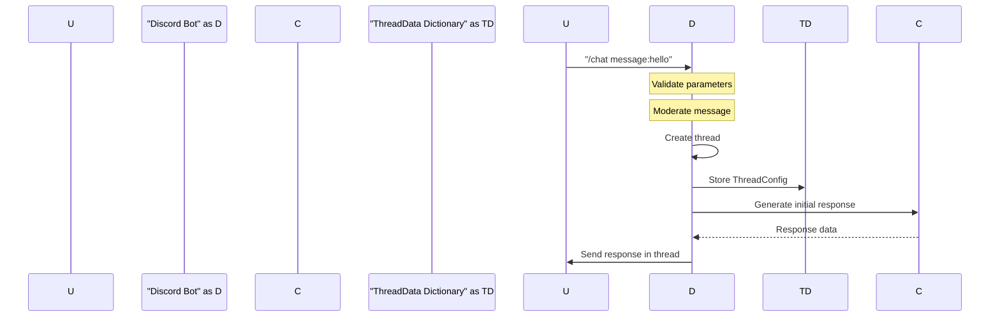
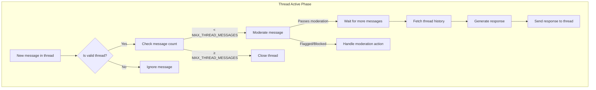
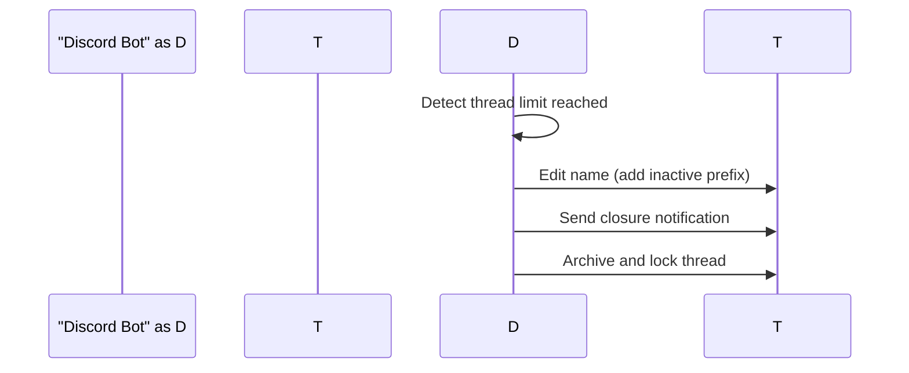
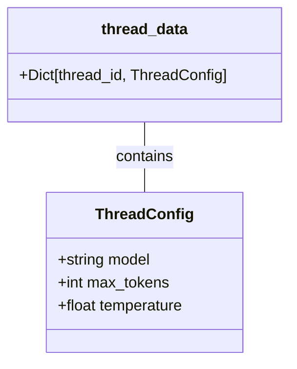
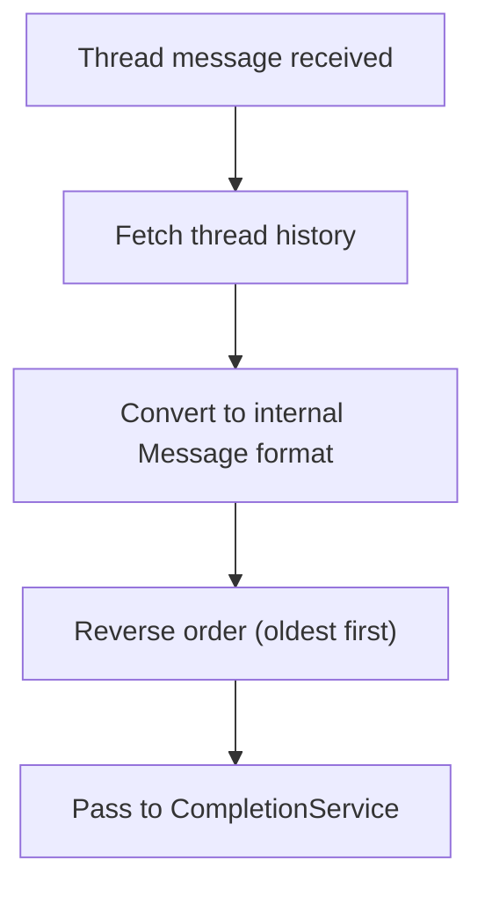
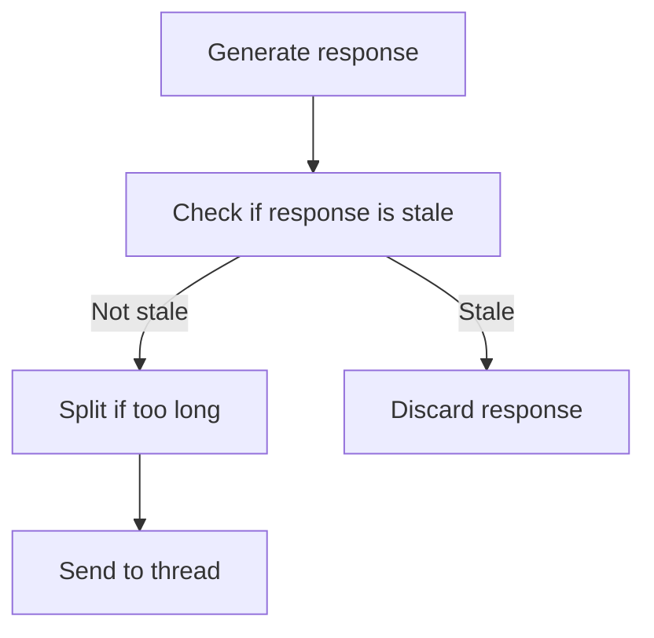
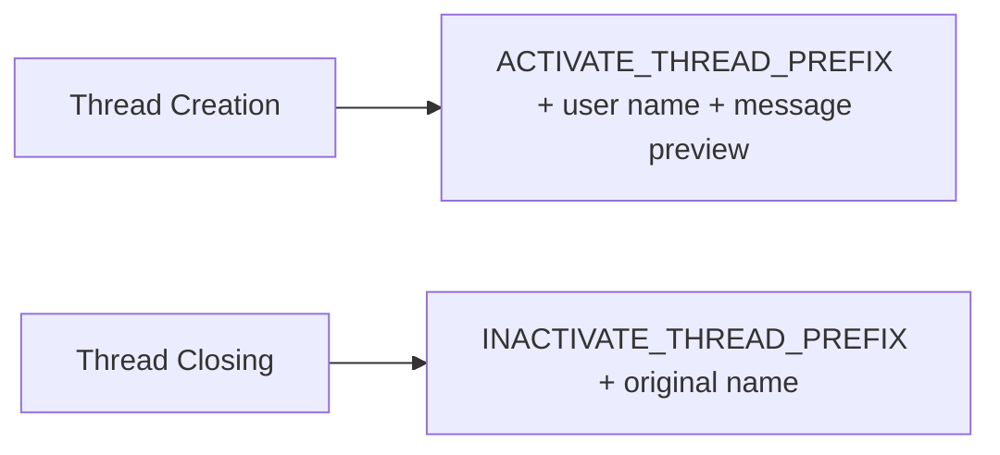
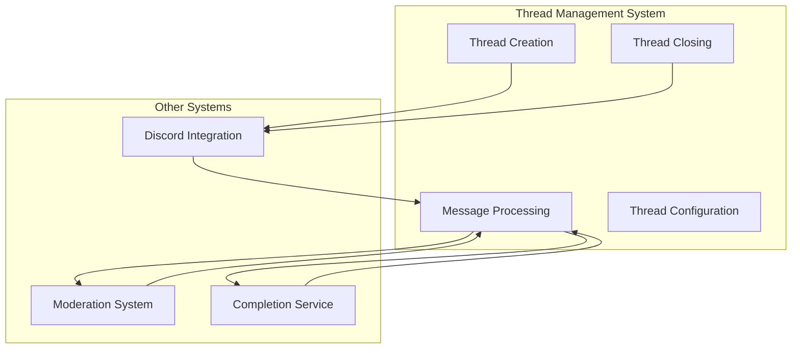

<!-- source: DeepWiki mcp.deepwiki.com · repo openai/gpt-discord-bot · page 2.4 Thread Management · fetched 2026-10-26 -->

# Thread Management

<details>
<summary>Relevant source files</summary>

The following files were used as context for generating this wiki page:

- [README.md](README.md)
- [src/main.py](src/main.py)
- [src/utils.py](src/utils.py)

</details>


## Introduction

This document details how the GPT Discord Bot creates, manages, and interacts with Discord threads to maintain coherent conversations with users. Thread management is a core component of the bot that allows for organized, persistent, and context-aware interactions between users and the GPT model.

The thread system handles the complete lifecycle of conversations, from creation to archiving, while maintaining the conversation context and managing configuration settings per thread.

For information about Discord integration more broadly, see [Discord Integration](#2.1). For details on how the OpenAI API processes the messages within threads, see [OpenAI Completion System](#2.2).

Sources: [README.md:18-31](), [src/main.py:1-6]()

## Thread Lifecycle

The thread management system handles three main phases in a conversation's lifecycle:

### Creation Phase

Threads are created when a user initiates a conversation using the `/chat` command with an initial message. The bot:

1. Validates and moderates the user's message
2. Creates a new thread with a standardized naming convention
3. Assigns thread-specific configuration parameters (model, temperature, max_tokens)
4. Generates and sends an initial response to the user's message



Sources: [src/main.py:63-86](), [src/main.py:162-179]()

### Active Phase

Once created, the thread enters its active phase where:

1. The bot monitors all messages in the thread
2. Each user message is moderated and processed
3. The bot retrieves the thread's conversation history
4. A response is generated based on this history and the thread's configuration
5. The response is sent back to the thread

The bot implements a brief waiting period after receiving a message to allow users to finish typing multi-part thoughts before responding.



Sources: [src/main.py:188-309](), [src/utils.py:38-46]()

### Closing Phase

Threads are automatically closed when they reach their limits:

1. When the message count exceeds `MAX_THREAD_MESSAGES` (defined in constants)
2. When the context limit is reached (mentioned in documentation)

When closing a thread, the bot:
1. Renames the thread to indicate it's inactive
2. Sends a closing message explaining why the thread was closed
3. Archives and locks the thread to prevent further interaction



Sources: [src/utils.py:49-58](), [src/main.py:218-221]()

## Thread Configuration

Each thread maintains its own configuration settings, stored in a global `thread_data` dictionary with thread IDs as keys.

### ThreadConfig Class

The `ThreadConfig` class stores thread-specific parameters that affect how the GPT model generates responses:

| Parameter | Type | Purpose | Default |
|-----------|------|---------|---------|
| model | string | The GPT model to use | gpt-3.5-turbo |
| temperature | float | Controls randomness (0-1) | 1.0 |
| max_tokens | int | Maximum token length for responses | 512 |

This configuration is created when a thread is initialized and referenced whenever generating responses within that thread.



Sources: [src/main.py:43](), [src/main.py:167-169]()

## Message Processing in Threads

The thread management system includes specialized handling for messages within threads:

### History Retrieval

When processing a message, the bot:
1. Retrieves the thread's message history (up to `MAX_THREAD_MESSAGES`)
2. Converts Discord messages to the internal `Message` format
3. Orders messages chronologically to maintain conversation flow



Sources: [src/main.py:281-286](), [src/utils.py:15-28]()

### Message Formatting and Delivery

For sending responses in threads:
1. Long responses are split into multiple messages (if they exceed `MAX_CHARS_PER_REPLY_MSG`)
2. The bot checks if newer messages have arrived before sending its response
3. Responses are properly formatted and sent to the thread



Sources: [src/utils.py:31-35](), [src/main.py:296-307]()

## Thread Data Storage

Thread configuration and state management rely on in-memory storage:

```mermaid
classDiagram
    class main {
        +defaultdict thread_data
        +on_message()
        +chat_command()
    }
    
    class ThreadConfig {
        +str model
        +int max_tokens
        +float temperature
    }
    
    class discord.Thread {
        +id
        +name
        +message_count
        +last_message
    }
    
    main -- ThreadConfig : creates
    main -- "discord.Thread" : interacts with
    ThreadConfig -- "discord.Thread" : configures for
```

The diagram above shows how thread data is stored and related to Discord threads. The `thread_data` dictionary maintains a mapping between thread IDs and their corresponding `ThreadConfig` objects.

Sources: [src/main.py:43](), [src/main.py:167-169]()

## Thread-Related Utility Functions

Several utility functions support the thread management system:

| Function | Purpose |
|----------|---------|
| `discord_message_to_message` | Converts Discord message objects to internal Message format |
| `split_into_shorter_messages` | Divides long responses into Discord-compatible chunks |
| `is_last_message_stale` | Determines if newer messages have arrived while processing |
| `close_thread` | Handles the thread closing procedure |

These utilities ensure that thread interactions are properly formatted, timely, and conform to Discord's requirements.

Sources: [src/utils.py:15-58]()

## Thread Initialization and Naming Conventions

Threads follow specific naming conventions to help identify their status:



These prefixes help the bot quickly determine which threads to monitor and respond in, without having to check thread metadata each time.

Sources: [src/main.py:162-166](), [src/utils.py:49-50]()

## System Integration

The thread management system integrates with other components of the bot:



This integration ensures that threads properly leverage the moderation system to filter content, the completion service to generate responses, and Discord's API for message delivery.

Sources: [src/main.py:114-152](), [src/main.py:224-264](), [src/main.py:289-294]()

---

