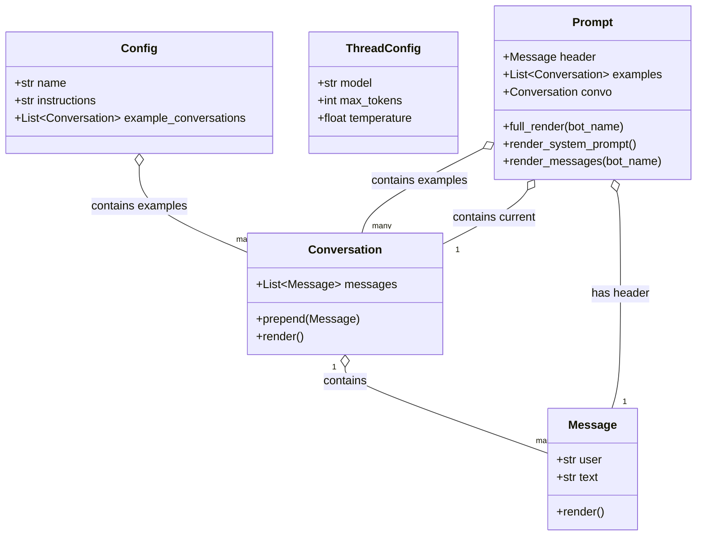
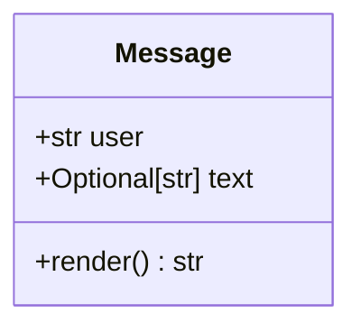
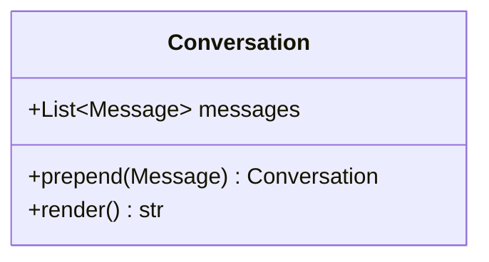
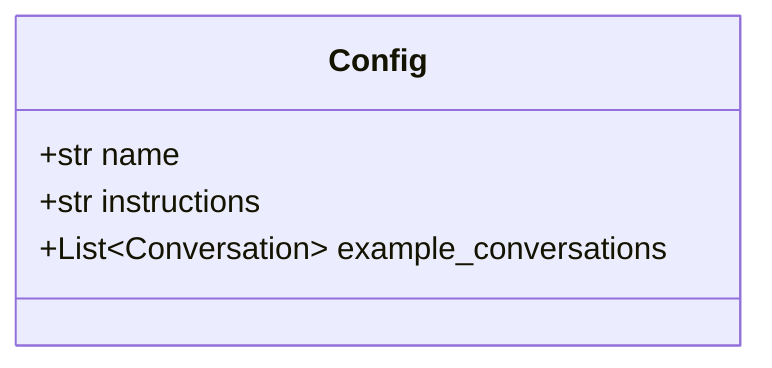
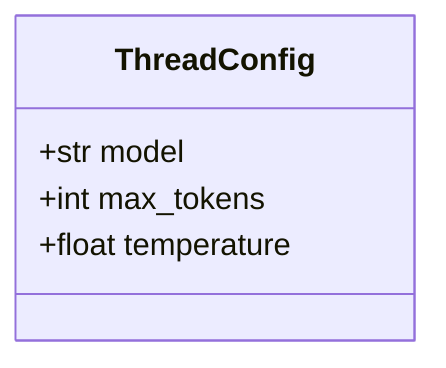
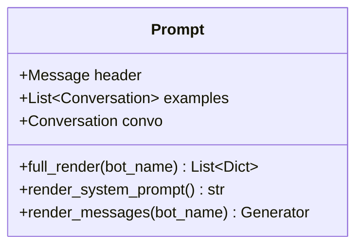
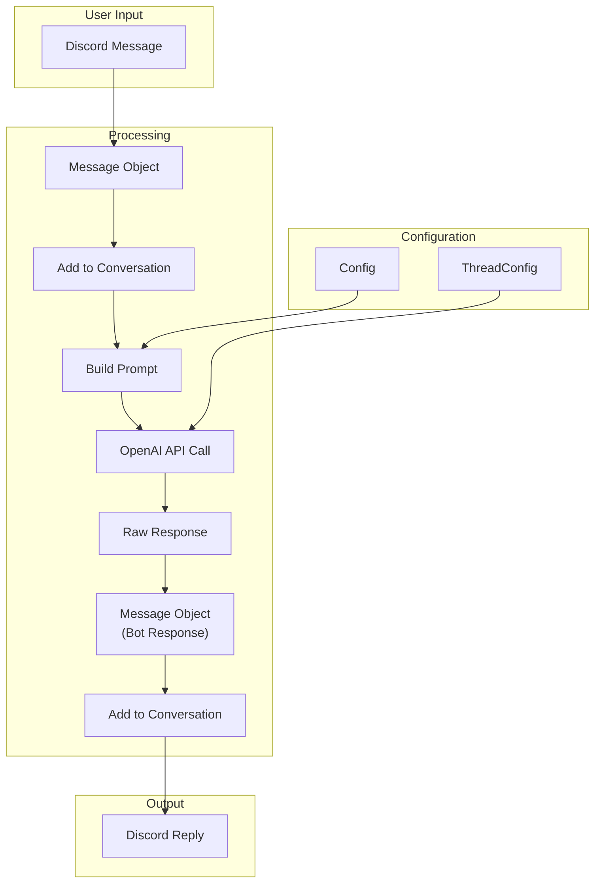
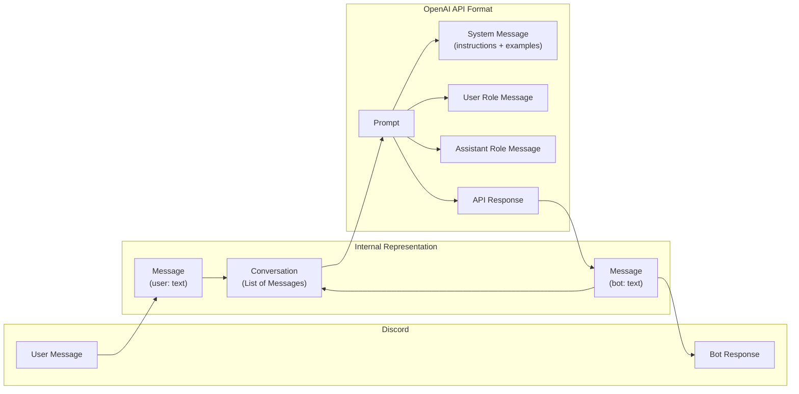
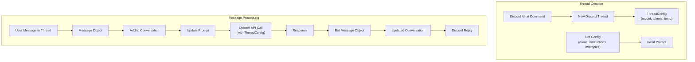
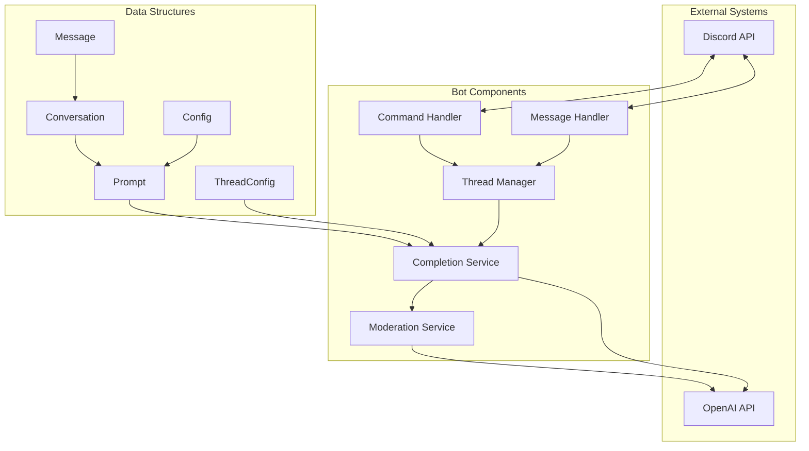

<!-- source: DeepWiki mcp.deepwiki.com · repo openai/gpt-discord-bot · page 3 Data Structures · fetched 2026-10-26 -->

# Data Structures

<details>
<summary>Relevant source files</summary>

The following files were used as context for generating this wiki page:

- [src/base.py](src/base.py)

</details>


This document provides a comprehensive overview of the core data structures that power the GPT Discord Bot. These data structures form the foundation for message handling, conversation management, configuration, and prompt construction throughout the system. For information about how these structures are used in conversation management, see [Thread Management](#2.4), and for details on how they facilitate prompt construction for the OpenAI API, see [Prompt Construction](#3.2).

## Core Data Model Overview

The GPT Discord Bot's architecture is built around several key data structures that enable it to process messages, maintain conversation context, and generate appropriate responses.



Sources: [src/base.py:7-89]()

## Message Structure

The `Message` class represents an individual message within a conversation, encapsulating both the sender's identity and the content.



**Properties:**
- `user`: The name or identifier of the message sender
- `text`: The content of the message (optional)

**Methods:**
- `render()`: Formats the message as "user: text" for display or API consumption

The `Message` class is implemented as a frozen dataclass, meaning it's immutable once created.

Sources: [src/base.py:7-16]()

## Conversation Structure

The `Conversation` class represents a sequence of messages between users and the bot.



**Properties:**
- `messages`: A list of `Message` objects representing the conversation history

**Methods:**
- `prepend(message)`: Adds a message to the beginning of the conversation
- `render()`: Converts the entire conversation to a formatted string with messages separated by the `SEPARATOR_TOKEN`

The `Conversation` class is mutable, allowing new messages to be added as the conversation progresses.

Sources: [src/base.py:19-30]()

## Configuration Structures

### Config

The `Config` class encapsulates the bot's personality and behavior settings.



**Properties:**
- `name`: The name of the bot
- `instructions`: The behavioral instructions for the bot
- `example_conversations`: A list of example conversations that guide the bot's responses

The `Config` class is implemented as a frozen dataclass to ensure configuration consistency.

### ThreadConfig

The `ThreadConfig` class defines parameters for OpenAI API calls within a specific conversation thread.



**Properties:**
- `model`: The OpenAI model to use (e.g., "gpt-4")
- `max_tokens`: The maximum number of tokens to generate
- `temperature`: Controls randomness in responses (lower values are more deterministic)

Sources: [src/base.py:33-44]()

## Prompt Structure

The `Prompt` class is responsible for constructing appropriate prompts for the OpenAI API.



**Properties:**
- `header`: A `Message` containing system instructions
- `examples`: A list of example `Conversation` objects
- `convo`: The current `Conversation` with the user

**Methods:**
- `full_render(bot_name)`: Generates the complete prompt for the OpenAI API
- `render_system_prompt()`: Creates the system portion of the prompt
- `render_messages(bot_name)`: Yields formatted messages from the conversation

The prompt structure follows OpenAI's Chat Completions API format:
1. A system message with instructions and examples
2. User and assistant messages from the actual conversation

Sources: [src/base.py:47-89]()

## Data Flow in Conversation Processing

This diagram illustrates how data flows through the structures during a typical conversation with the bot:



Sources: [src/base.py:7-89]()

## Message Transformation Pipeline

This diagram shows how a message is transformed from Discord input to OpenAI API format and back:



Sources: [src/base.py:7-89]()

## Constants and Separators

A key constant used throughout the data structures is the `SEPARATOR_TOKEN`:

```
SEPARATOR_TOKEN = "<|endoftext|>"
```

This token is used to separate messages when rendering conversations, particularly for constructing system prompts for the OpenAI API.

Sources: [src/base.py:4]()

## Message Format for OpenAI API

When the `Prompt` class renders messages for the OpenAI API, it formats them according to the required structure:

| Role | Content | Description |
|------|---------|-------------|
| system | Rendered system prompt | Contains instructions and examples |
| user | Message text | User messages from the conversation |
| assistant | Message text | Bot responses from the conversation |

The `full_render()` method creates a list of dictionaries with this structure, ready to be sent to the OpenAI API.

Sources: [src/base.py:53-89]()

## Data Structure Relationships in Thread Management

The following diagram illustrates how these data structures relate to the thread management system:



Sources: [src/base.py:7-89]()

## Data Structures in the Overall System Architecture

This diagram places the data structures in the context of the overall bot architecture:



Sources: [src/base.py:7-89]()

In summary, the data structures in the GPT Discord Bot provide a robust framework for managing conversations, configuring behavior, and interfacing with the OpenAI API to generate contextually appropriate responses.

---

