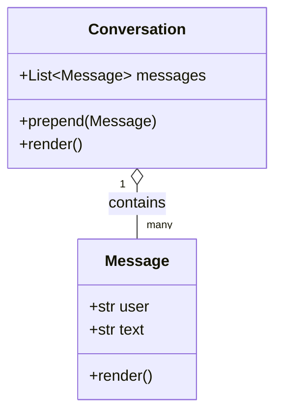
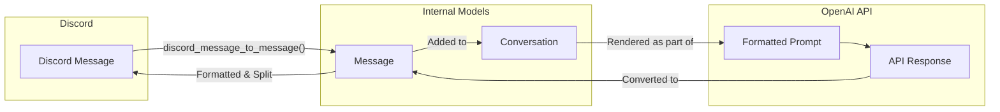
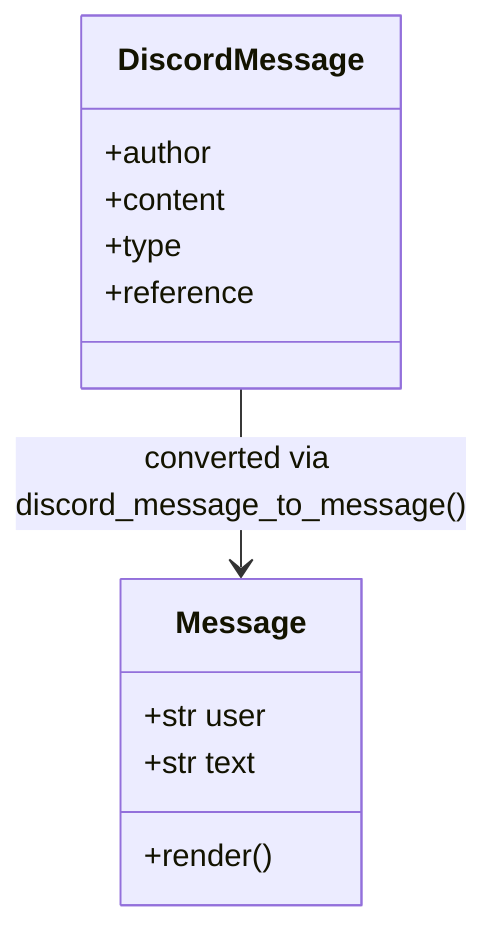
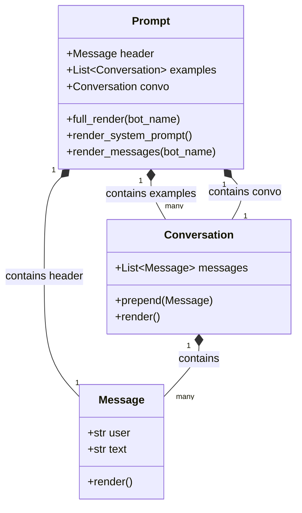
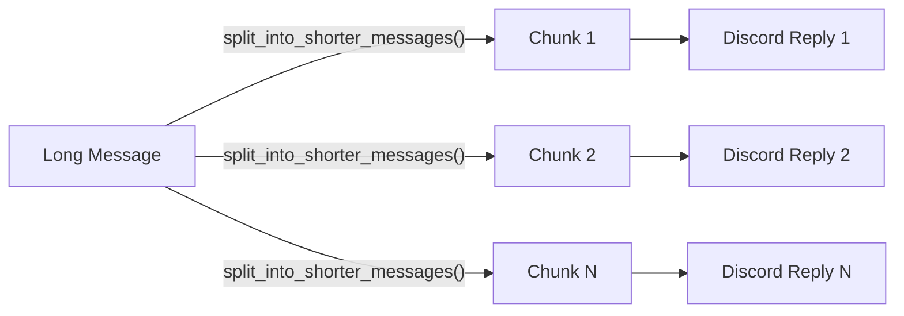
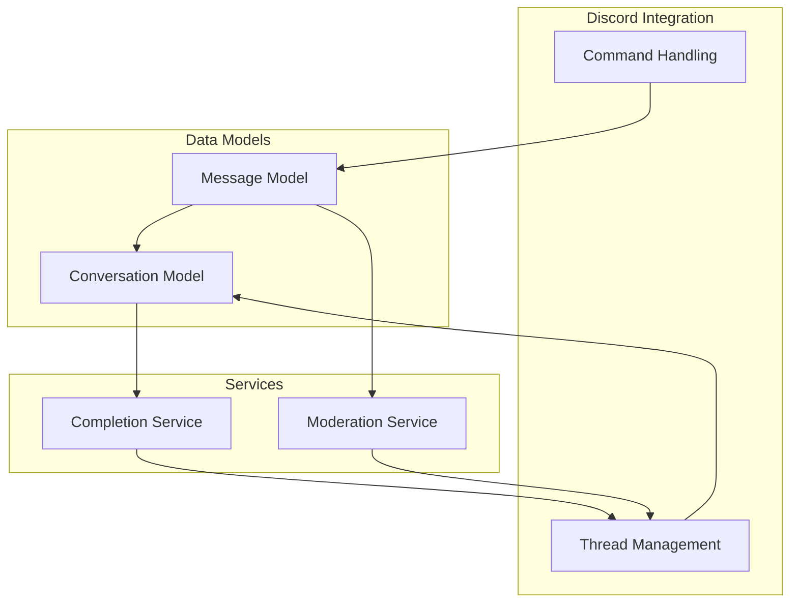

<!-- source: DeepWiki mcp.deepwiki.com · repo openai/gpt-discord-bot · page 3.1 Message and Conversation Models · fetched 2026-10-26 -->

# Message and Conversation Models

<details>
<summary>Relevant source files</summary>

The following files were used as context for generating this wiki page:

- [src/base.py](src/base.py)
- [src/utils.py](src/utils.py)

</details>


## Purpose and Scope

This document explains the core data structures used to represent and manage messages and conversations in the GPT Discord Bot. These models serve as the foundation for capturing user input, structuring bot responses, and maintaining conversation context for interactions with the OpenAI API. For information about how these models are used to construct prompts for the OpenAI API, see [Prompt Construction](#3.2).

## Core Data Models

The GPT Discord Bot uses two primary data structures to model conversations: `Message` and `Conversation`. These classes provide a clean abstraction layer between Discord's message representation and the format required by the OpenAI API.



Sources: [src/base.py:7-30]()

### Message Class

The `Message` class represents a single message in a conversation. It is a simple, immutable data structure implemented as a frozen dataclass.

#### Properties:
- `user`: The name of the user who sent the message
- `text`: The content of the message (optional)

#### Methods:
- `render()`: Formats the message as "user: text" for inclusion in prompts

#### Usage Example:
```python
# Create a user message
user_message = Message(user="John", text="Hello, how are you?")

# Create a bot message
bot_message = Message(user="GPTBot", text="I'm doing well, thank you!")

# Render the message for display or API submission
rendered = user_message.render()  # "John: Hello, how are you?"
```

Sources: [src/base.py:7-16]()

### Conversation Class

The `Conversation` class represents a sequence of messages between users and the bot. It maintains the conversation history and provides methods for manipulating and rendering the conversation.

#### Properties:
- `messages`: A list of `Message` objects in chronological order

#### Methods:
- `prepend(message)`: Adds a message to the beginning of the conversation
- `render()`: Converts the conversation to a string format with messages separated by `SEPARATOR_TOKEN`

#### Usage Example:
```python
# Create a new conversation
conversation = Conversation(messages=[
    Message(user="John", text="Hello"),
    Message(user="GPTBot", text="Hi there! How can I help you?"),
    Message(user="John", text="Tell me a joke")
])

# Add a system message at the beginning
conversation.prepend(Message(user="System", text="The following is a conversation with GPTBot."))

# Render the conversation for the OpenAI API
rendered_conversation = conversation.render()
```

Sources: [src/base.py:19-30]()

## Message Flow and Transformations

Messages flow through the system with various transformations occurring along the way. Discord messages are converted to the internal `Message` format, used to build conversations, and then formatted for the OpenAI API.



Sources: [src/base.py:7-30](), [src/utils.py:15-28]()

### Discord Message Conversion

The bot converts Discord messages to the internal `Message` format using the `discord_message_to_message` utility function:



The conversion function handles two main cases:
1. Regular user messages
2. Thread starter messages that may contain embedded content

This abstraction allows the bot to process messages consistently regardless of their original format in Discord.

Sources: [src/utils.py:15-28]()

## Message and Conversation in the Prompt Construction Process

The `Message` and `Conversation` classes are key components in building the prompts sent to the OpenAI API via the `Prompt` class.



The `Prompt` class uses these models to structure a complete prompt for the OpenAI API:

1. **Header**: A system message providing instructions to the model
2. **Examples**: Sample conversations demonstrating the desired interaction style
3. **Conversation**: The actual ongoing conversation between the user and the bot

When rendered for the API using `full_render()`, these components are formatted into the specific structure expected by OpenAI's Chat Completions API, with appropriate role mappings:
- User messages get the "user" role
- Bot messages get the "assistant" role
- The system prompt gets the "system" role

Sources: [src/base.py:47-89]()

## Message Handling and Processing

The bot includes several utilities for handling messages beyond the core models:

### Message Splitting

Long messages are split into smaller chunks to comply with Discord's character limits using the `split_into_shorter_messages` function:



This allows the bot to send responses that exceed Discord's per-message character limit by breaking them into sequential messages.

Sources: [src/utils.py:31-35]()

## Role in the Broader System

The Message and Conversation models serve as the foundation for several key components of the bot:



These models enable:
1. **Stateless processing**: By encapsulating message data in a consistent format
2. **Context preservation**: Through the Conversation class that maintains message history
3. **Clean integration**: Between Discord's message format and OpenAI's expected input format

Sources: [src/base.py:7-30](), [src/utils.py:15-28]()

## Technical Implementation Details

### Message Immutability

The `Message` class is implemented as a frozen dataclass, meaning that once created, its values cannot be changed. This ensures message integrity throughout the processing pipeline.

```python
@dataclass(frozen=True)
class Message:
    user: str
    text: Optional[str] = None
```

### Conversation Mutability

Unlike `Message`, the `Conversation` class is mutable, allowing new messages to be added. This is necessary for building conversation history incrementally as users interact with the bot.

```python
@dataclass
class Conversation:
    messages: List[Message]
```

### Separator Token

Messages within a conversation are separated by a special token `<|endoftext|>` when rendered. This token is used by language models to clearly delineate the boundaries between different messages.

Sources: [src/base.py:4](), [src/base.py:7-30]()

## Summary

The Message and Conversation models form the backbone of the GPT Discord Bot's data handling system. They provide:

1. A structured way to represent individual messages and their senders
2. A mechanism for organizing messages into coherent conversations
3. Methods for formatting these conversations for the OpenAI API
4. A clear separation between Discord's message representation and the bot's internal data model

Understanding these models is essential for working with or extending the bot's functionality, particularly when modifying how the bot processes messages or constructs prompts for the OpenAI API.

---

