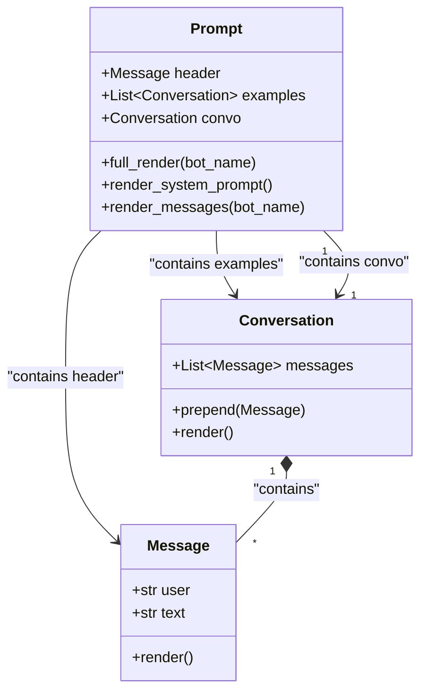
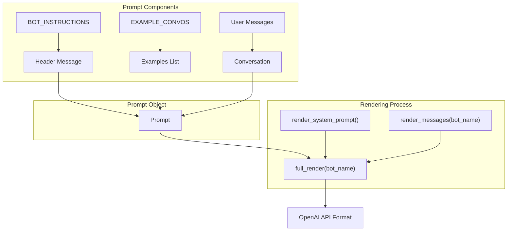
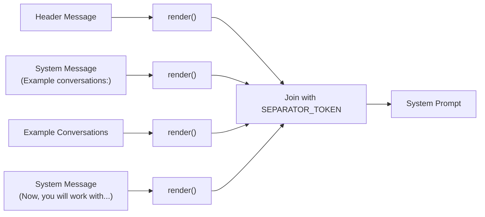
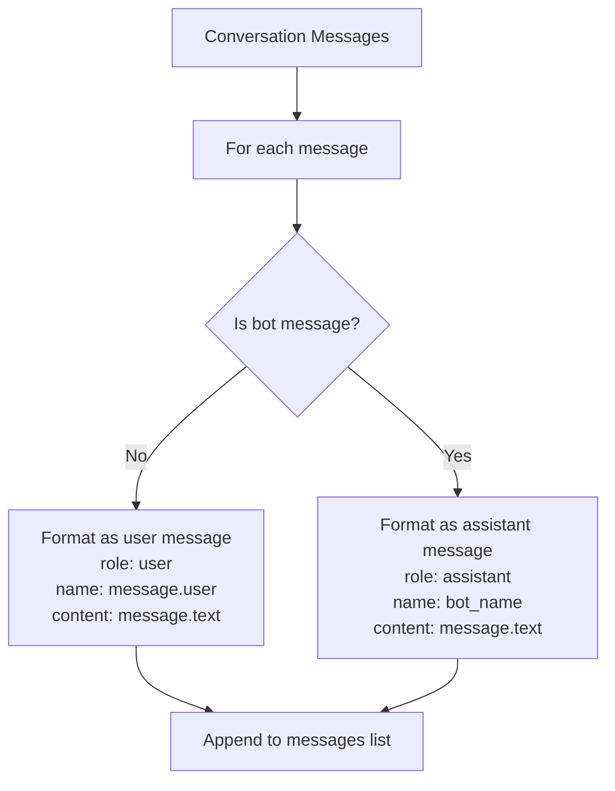
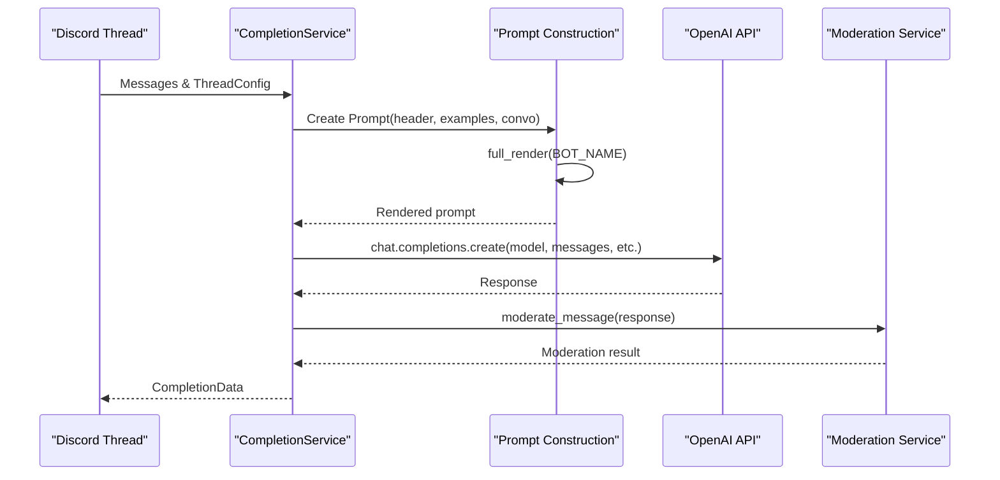
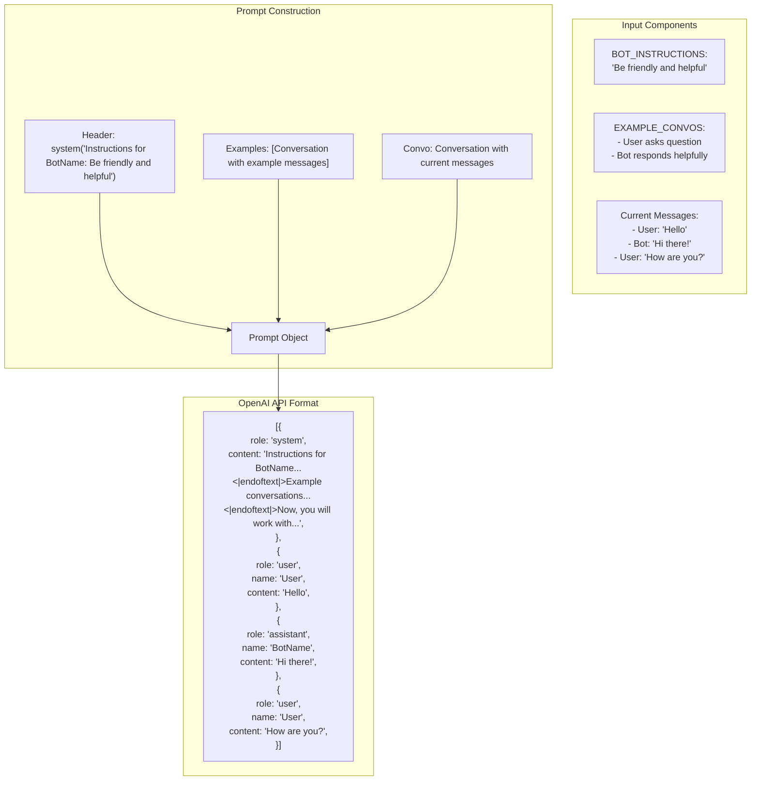

<!-- source: DeepWiki mcp.deepwiki.com · repo openai/gpt-discord-bot · page 3.2 Prompt Construction · fetched 2026-10-26 -->

# Prompt Construction

Relevant source files

The following files were used as context for generating this wiki page:

- [src/base.py](src/base.py)
- [src/completion.py](src/completion.py)

## Purpose and Scope

This document explains how prompts are constructed for the OpenAI API in the GPT Discord Bot. It covers the key data structures involved in prompt construction, the process of formatting conversations for the API, and how different components like system instructions, example conversations, and user interactions are combined to create effective prompts. For information about the broader OpenAI integration, see [OpenAI Completion System](#2.2), and for details about the underlying message structures, see [Message and Conversation Models](#3.1).

## Core Prompt Structure

The GPT Discord Bot uses a structured approach to construct prompts for the OpenAI API. The prompt construction is primarily handled by the `Prompt` class defined in the base module.

Sources: [src/base.py:47-89]()

## Prompt Components

A prompt in the GPT Discord Bot consists of three main components:

1. **Header** - A system message that contains the bot's instructions
2. **Examples** - A list of example conversations to guide the bot's behavior
3. **Conversation** - The actual current conversation between users and the bot

### Header

The header is a `Message` object with the user set to "system" and text containing instructions for the bot. This sets the overall personality and operational guidelines for the bot.

### Examples

Examples are provided as a list of `Conversation` objects. These demonstrate expected interactions and help the bot understand the desired response style.

### Conversation

The actual ongoing conversation between the user and the bot, represented as a `Conversation` object containing a list of `Message` objects.

Sources: [src/base.py:47-52](), [src/completion.py:48-54]()

## Prompt Construction Flow

The following diagram illustrates how a prompt is constructed from its components:

Sources: [src/base.py:53-62](), [src/completion.py:48-55]()

## Prompt Rendering Process

The `Prompt` class has methods to render the prompt into the format expected by the OpenAI API:

### System Prompt Rendering

The `render_system_prompt` method combines:
1. The header message
2. A system message announcing example conversations
3. All example conversations
4. A system message transitioning to the current conversation

These components are joined using the `SEPARATOR_TOKEN` ("<|endoftext|>") to create a clear separation between different parts of the prompt.

Sources: [src/base.py:64-74]()

### Message Rendering

The `render_messages` method converts each message in the conversation to the format expected by the OpenAI API:

1. User messages are assigned the "user" role
2. Bot messages are assigned the "assistant" role

Sources: [src/base.py:76-89]()

## Complete Prompt Structure

The final output of `full_render` is a list of message objects in the format expected by the OpenAI API, with the following structure:

| Position | Role | Content |
|----------|------|---------|
| First | system | The rendered system prompt |
| Subsequent | user/assistant | Individual messages from the conversation |

The system prompt contains:
- Bot instructions
- Example conversations
- Transition to current conversation

The subsequent messages maintain the flow of the actual conversation between the user and bot.

Sources: [src/base.py:53-62](), [src/completion.py:55-56]()

## Prompt Usage in Completion Generation

The prompt construction is used in the `generate_completion_response` function, which:

1. Creates a new `Prompt` object with:
   - Header containing bot instructions
   - Example conversations
   - Current conversation
2. Renders the prompt using `full_render`
3. Sends the rendered prompt to OpenAI's chat completions API
4. Processes and moderates the response

Sources: [src/completion.py:44-102]()

## Separator Token

The `SEPARATOR_TOKEN` ("<|endoftext|>") serves two important functions:

1. It clearly separates different parts of the system prompt during rendering
2. It's used as a stop sequence in the OpenAI API call to prevent the model from continuing beyond the response

This token helps maintain the conversation structure and prevents the model from generating content beyond what's requested.

Sources: [src/base.py:4](), [src/base.py:28-30](), [src/completion.py:62]()

## Integration with Bot Configuration

The prompt construction pulls key information from the bot's configuration:

- `BOT_INSTRUCTIONS` - Used in the header message
- `BOT_NAME` - Used for message role identification
- `EXAMPLE_CONVOS` - Used as examples in the prompt

This allows the bot's personality and behavior to be configured through these settings.

Sources: [src/completion.py:8-12](), [src/completion.py:21-22](), [src/completion.py:49-53]()

## Practical Example

Below is a representation of how a prompt flows from components to the final OpenAI API format:

Sources: [src/base.py:47-89](), [src/completion.py:48-55]()

---

