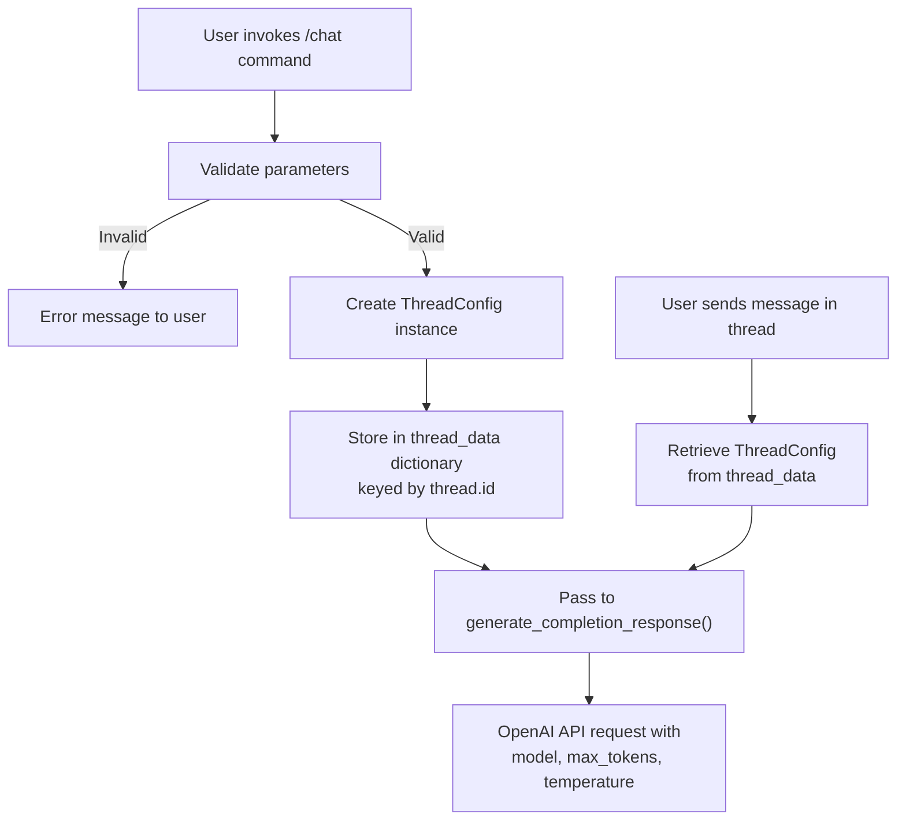
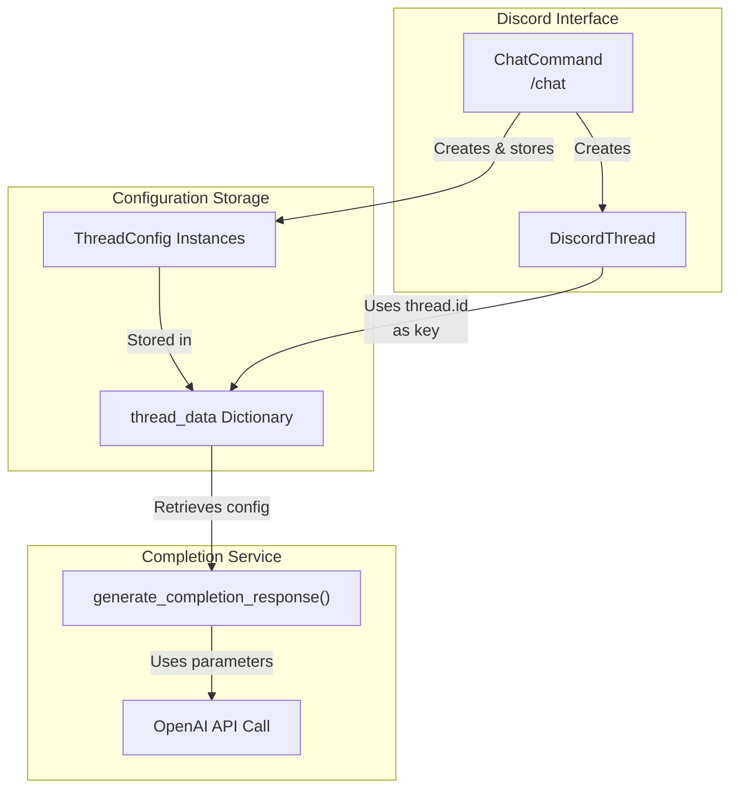
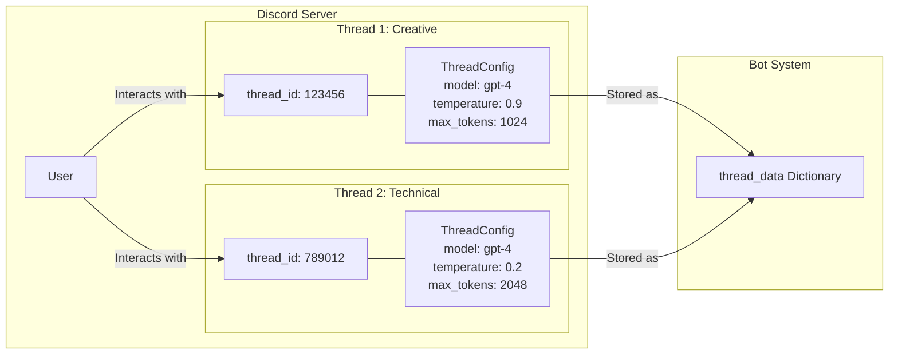

<!-- source: DeepWiki mcp.deepwiki.com · repo openai/gpt-discord-bot · page 3.3 Thread Configuration · fetched 2026-10-26 -->

# Thread Configuration

<details>
<summary>Relevant source files</summary>

The following files were used as context for generating this wiki page:

- [src/base.py](src/base.py)
- [src/main.py](src/main.py)

</details>


## Purpose and Scope

The Thread Configuration system manages the parameters that control how the GPT Discord Bot generates responses in each conversation thread. This document explains the `ThreadConfig` class, its parameters, and how thread configurations are created, stored, and used throughout the bot. The thread configuration serves as a bridge between Discord's interface and the OpenAI API by maintaining specific generation parameters for each active conversation thread.

For information about how threads are managed in Discord, see [Thread Management](#2.4). For details on how the completion system works, see [OpenAI Completion System](#2.2).

## ThreadConfig Class Structure

At the core of the thread configuration system is the `ThreadConfig` class, a frozen dataclass that encapsulates three key parameters for OpenAI API requests:

```mermaid
classDiagram
    class "ThreadConfig" {
        +str model
        +int max_tokens
        +float temperature
    }
```

The `ThreadConfig` class is immutable (frozen), ensuring that thread parameters remain consistent throughout a conversation's lifecycle.

Sources: [src/base.py:40-44]()

## Configuration Parameters

Each `ThreadConfig` instance contains three essential parameters that control response generation:

| Parameter | Description | Range | Default |
|-----------|-------------|-------|---------|
| `model` | OpenAI model identifier | Values from `AVAILABLE_MODELS` | `DEFAULT_MODEL` |
| `max_tokens` | Maximum tokens per generated response | 1-4096 | 512 |
| `temperature` | Randomness control (higher = more random) | 0.0-1.0 | 1.0 |

### Model

The model parameter determines which OpenAI language model will generate responses. The available options are defined in the `AVAILABLE_MODELS` constant, with `DEFAULT_MODEL` used when no specific model is requested.

### Max Tokens

The `max_tokens` parameter limits the length of generated responses. Higher values allow for more detailed replies but may consume more API tokens. The system enforces a range of 1-4096 tokens.

### Temperature

The `temperature` parameter controls the randomness of the model's output:
- Values closer to 0.0 produce more deterministic, consistent responses
- Values closer to 1.0 produce more creative, varied responses
- The default value is 1.0, which provides a good balance for casual conversation

Sources: [src/main.py:80-82](), [src/main.py:97-110]()

## ThreadConfig Lifecycle



Sources: [src/main.py:167-169](), [src/main.py:173-175](), [src/main.py:290-294]()

### Creation and Storage

When a user invokes the `/chat` command, they can optionally specify the model, temperature, and max_tokens parameters. The bot validates these parameters and then:

1. Creates a new `ThreadConfig` instance with the provided parameters (or defaults)
2. Stores this instance in the global `thread_data` dictionary using the Discord thread ID as the key
3. Uses this configuration for all completion requests in that thread

```python
thread_data[thread.id] = ThreadConfig(
    model=model, max_tokens=max_tokens, temperature=temperature
)
```

### Parameter Validation

The bot enforces parameter constraints to ensure valid OpenAI API requests:

- Temperature must be between 0 and 1
- Max tokens must be between 1 and 4096

If validation fails, the bot sends an error message and aborts thread creation.

Sources: [src/main.py:97-110]()

## Thread Configuration Integration



Sources: [src/main.py:43](), [src/main.py:167-169](), [src/main.py:173-175](), [src/main.py:290-294]()

### In Command Interface

Users can specify thread configuration parameters directly in the `/chat` command:

```
/chat message:"What is quantum computing?" model:gpt-4 temperature:0.7 max_tokens:1024
```

These parameters are displayed in the initial embed message when creating a thread, providing transparency about the configuration.

### Multiple Concurrent Configurations

A key feature of the thread configuration system is that it allows multiple concurrent conversations with different settings. Users can maintain:

- One thread with high temperature for creative writing
- Another with low temperature for precise factual information
- Different threads using different models based on task complexity



Sources: [src/main.py:43](), [src/main.py:167-169]()

## Usage in the Completion Process

The `ThreadConfig` instance is passed to the completion service for every response generation:

1. For the initial response when a thread is created:
```python
response_data = await generate_completion_response(
    messages=messages, user=user, thread_config=thread_data[thread.id]
)
```

2. For each subsequent user message in the thread:
```python
response_data = await generate_completion_response(
    messages=channel_messages,
    user=message.author,
    thread_config=thread_data[thread.id],
)
```

The completion service uses these parameters when calling the OpenAI API, ensuring consistency in response behavior within each thread.

Sources: [src/main.py:173-175](), [src/main.py:290-294]()

## Summary

The Thread Configuration system provides a clean, type-safe way to manage and pass generation parameters throughout the GPT Discord Bot. It ensures that:

1. Each conversation thread maintains consistent parameters
2. Users can customize the AI's response characteristics for different conversations
3. Parameters are validated before use
4. The OpenAI completion service receives the correct parameters for each request

This configuration system is fundamental to providing a flexible, customizable AI chat experience in Discord.

---

