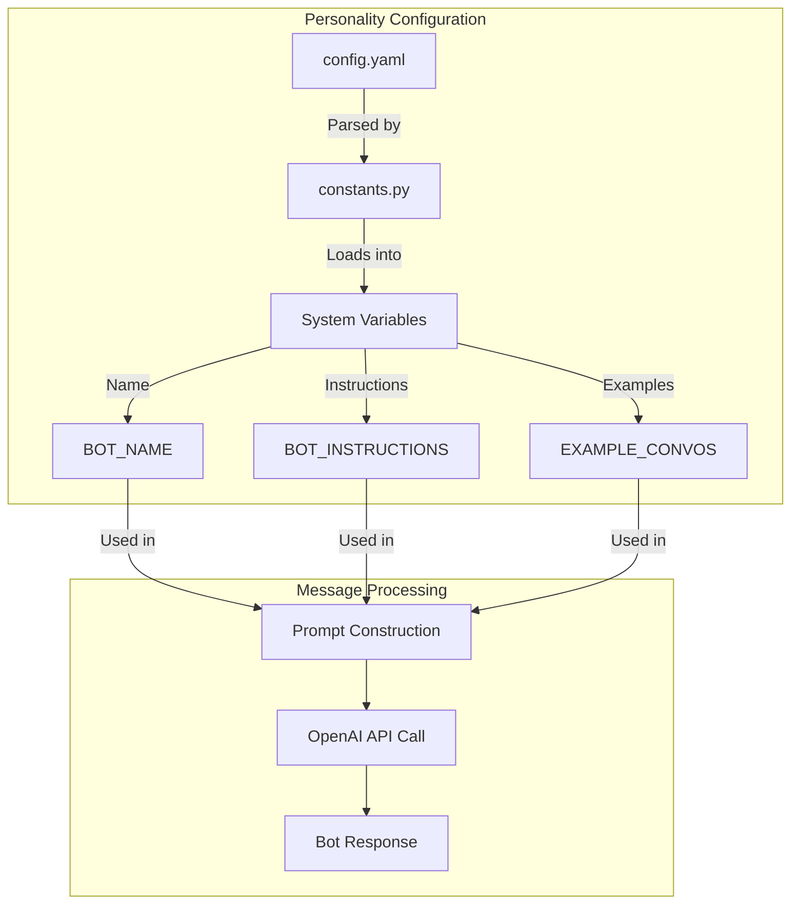
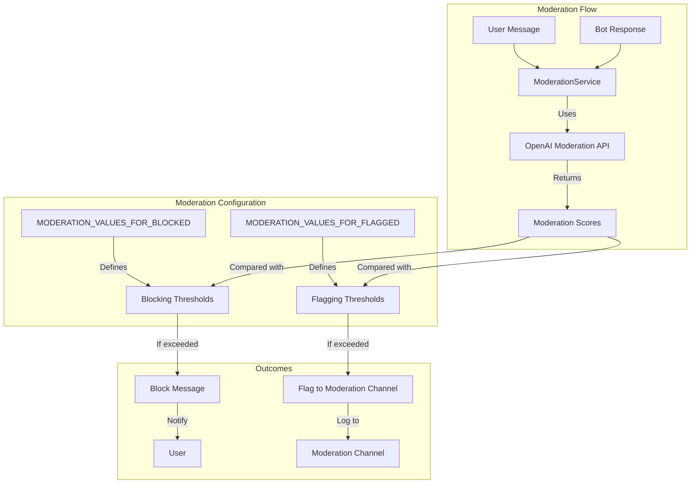
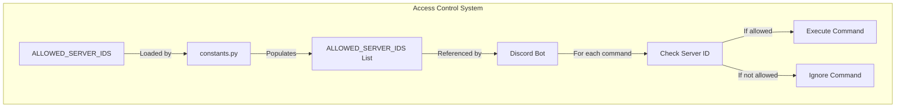
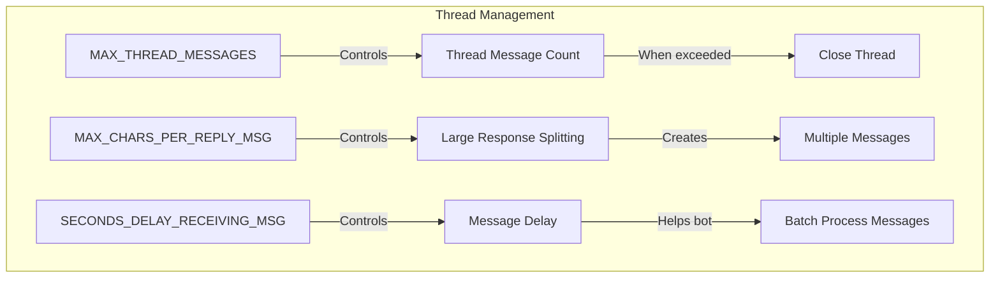
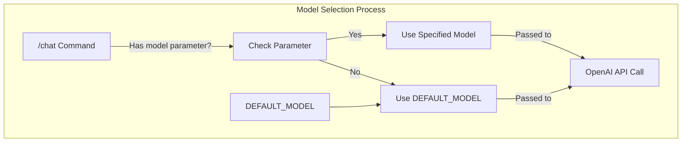

<!-- source: DeepWiki mcp.deepwiki.com · repo openai/gpt-discord-bot · page 4 Advanced Topics · fetched 2026-10-26 -->

# Advanced Topics

<details>
<summary>Relevant source files</summary>

The following files were used as context for generating this wiki page:

- [README.md](README.md)
- [src/config.yaml](src/config.yaml)
- [src/constants.py](src/constants.py)

</details>


This document covers advanced configuration and customization options for the GPT Discord Bot. It is intended for users who want to fine-tune the bot's behavior, adjust moderation settings, manage security, or understand legal considerations. For basic setup and usage, please refer to [Installation & Setup](#1.1) and [Usage Guide](#1.3).

## Customizing Bot Personality

The GPT Discord Bot allows extensive customization of its personality through configuration files. This allows you to tailor the bot's tone, behavior, and knowledge to suit your server's needs.

### Modifying the Bot's Identity

The bot's personality is defined in the `config.yaml` file. This file contains three primary components:

1. **Name**: The bot's identity name
2. **Instructions**: System prompt that defines the bot's core personality and behavior
3. **Example conversations**: Sample dialog demonstrating expected interaction patterns



Sources: [src/constants.py:12-20](), [src/config.yaml:1-27]()

### Effective Instructions Design

The instructions field (found in `config.yaml`) acts as the "system prompt" for the OpenAI model. This defines the bot's core personality and behavior pattern.

Example from default configuration:

```yaml
name: Lenard
instructions: You're a regular Discord user. You talk casually, use emojis, and don't use capital letters. You talk in internet shorthand like np and lol and idk and nvm. You have many interests and love talking to people.
```

Best practices for instructions:

| Aspect | Recommendation |
|--------|----------------|
| Length | Keep concise but descriptive (1-3 sentences) |
| Specificity | Provide clear behavioral patterns (e.g., "use emojis") |
| Tone | Define communication style (formal, casual, etc.) |
| Knowledge | Specify subject expertise or limitations if relevant |

Sources: [src/config.yaml:1-3]()

### Example Conversations

The example conversations section demonstrates to the model how the bot should interact. These examples are extremely powerful for shaping the bot's behavior.

Example conversations follow this structure:

```yaml
example_conversations:
  - messages:
    - user: bob
      text: how's it going today?
    - user: Lenard
      text: its going great, im watching youtube videos, hbu?
```

Effective example conversation practices:

- Include 2-5 examples showing different interaction styles
- Demonstrate expected responses to common questions
- Show the exact tone and style you want the bot to use
- Include examples of both short and lengthy exchanges

Sources: [src/config.yaml:3-27]()

## Moderation Thresholds

The GPT Discord Bot includes a robust content moderation system that filters both user messages and bot responses.

### Moderation System Architecture



Sources: [src/constants.py:41-67]()

### Understanding Moderation Categories

The moderation system checks content against the following categories:

| Category | Description | Default Block Threshold | Default Flag Threshold |
|----------|-------------|-------------------------|------------------------|
| harassment | General harassment content | 0.5 | 0.5 |
| harassment/threatening | Threatening harassment | 0.1 | 0.1 |
| hate | Hate speech | 0.5 | 0.4 |
| hate/threatening | Threatening hate speech | 0.1 | 0.05 |
| self-harm | Self-harm content | 0.2 | 0.1 |
| self-harm/instructions | Instructions for self-harm | 0.5 | 0.5 |
| self-harm/intent | Expressing intent to self-harm | 0.7 | 0.7 |
| sexual | Sexual content | 0.5 | 0.3 |
| sexual/minors | Sexual content involving minors | 0.2 | 0.1 |
| violence | Violent content | 0.7 | 0.1 |
| violence/graphic | Graphic violence | 0.8 | 0.1 |

Sources: [src/constants.py:41-67]()

### Adjusting Moderation Sensitivity

Moderation thresholds are defined in `constants.py`. Lower values make moderation more strict, while higher values make it more lenient. The range is between 0 and 1, where:

- `0` = Always block/flag content in this category
- `1` = Never block/flag content in this category

To modify these thresholds:

1. Edit the `MODERATION_VALUES_FOR_BLOCKED` dictionary to adjust when messages are completely blocked
2. Edit the `MODERATION_VALUES_FOR_FLAGGED` dictionary to adjust when messages are flagged but still allowed

Example adjustment to make the bot more permissive about general sexual content:

```python
MODERATION_VALUES_FOR_BLOCKED = {
    # Other values remain the same
    "sexual": 0.7,  # Increased from 0.5
    # Other values remain the same
}
```

Sources: [src/constants.py:41-67]()

### Setting Up Moderation Channels

To receive notifications about flagged content, you can set up dedicated moderation channels:

1. Create a channel in your Discord server dedicated to moderation logs
2. Copy the channel ID (right-click on the channel and select "Copy ID")
3. Add the server ID and channel ID to your `.env` file in the format:
   ```
   SERVER_TO_MODERATION_CHANNEL=server_id:channel_id,server_id_2:channel_id_2
   ```

The bot will then send detailed reports about flagged content to these channels, including the content, the user who sent it, and which moderation categories were triggered.

Sources: [src/constants.py:32-36](), [README.md:54]()

## Security and Access Control

### Server Allowlisting

The bot uses a server allowlisting system to control which Discord servers it can be used in:



To configure allowed servers:

1. Obtain the server ID by right-clicking on the server icon and selecting "Copy ID"
2. Set the `ALLOWED_SERVER_IDS` variable in your `.env` file, separating multiple IDs with commas:
   ```
   ALLOWED_SERVER_IDS=server_id_1,server_id_2
   ```

Sources: [src/constants.py:27-30](), [README.md:43]()

### Required Bot Permissions

For the bot to function properly, it needs specific permissions in Discord:

| Permission | Purpose |
|------------|---------|
| Send Messages | Allows the bot to reply to users |
| Create Public Threads | Needed for the `/chat` command to create conversation threads |
| Send Messages in Threads | Allows the bot to continue conversations in threads |
| Manage Messages | Required to delete messages that violate moderation rules |
| Manage Threads | Allows the bot to close threads when they reach limits |
| Read Message History | Enables the bot to maintain context in conversations |
| Use Application Commands | Required for slash commands like `/chat` |

The bot invite URL (generated in `constants.py`) automatically includes these permissions.

Sources: [src/constants.py:38-39](), [README.md:62-69]()

### Invitation Links with Proper Scopes

When inviting the bot to a new server, use the automatically generated invitation link that includes the correct permissions scope. The link follows this format:

```
https://discord.com/api/oauth2/authorize?client_id={DISCORD_CLIENT_ID}&permissions=328565073920&scope=bot
```

The permission integer `328565073920` corresponds to the required permissions listed above.

Sources: [src/constants.py:38-39]()

## Conversation Management

### Thread Limits and Handling

The bot manages conversation threads with several configurable limits:



Key configuration values:

| Setting | Default | Purpose |
|---------|---------|---------|
| `MAX_THREAD_MESSAGES` | 200 | Maximum messages in a thread before it closes |
| `MAX_CHARS_PER_REPLY_MSG` | 1500 | Character limit per message (Discord limit is 2000) |
| `SECONDS_DELAY_RECEIVING_MSG` | 3 | Delay to batch process multiple messages |

Sources: [src/constants.py:69-77]()

### Thread Status Indicators

The bot uses specific prefixes to indicate thread status:

- `💬✅` (ACTIVATE_THREAD_PREFX): Indicates an active conversation thread
- `💬❌` (INACTIVATE_THREAD_PREFIX): Indicates a closed/inactive conversation thread

These visual indicators help users identify which threads are still active and accepting messages.

Sources: [src/constants.py:73-74]()

## Model Configuration

### Available Models

The bot supports multiple OpenAI models with different capabilities:

| Model | Description | Use Case |
|-------|-------------|----------|
| gpt-3.5-turbo | Fast, cost-effective | General conversation |
| gpt-4 | More capable, slower | Complex reasoning |
| gpt-4-1106-preview | Latest GPT-4 preview | Access to newest features |
| gpt-4-32k | Extended context window | Very long conversations |

The default model is specified in the `.env` file as `DEFAULT_MODEL`.

Sources: [src/constants.py:25](), [src/constants.py:79]()

### Changing the Model

Users can:

1. Change the default model for all conversations by modifying the `DEFAULT_MODEL` in the `.env` file
2. Specify a different model when starting a conversation using the `/chat` command's options



Sources: [src/constants.py:25](), [src/constants.py:79](), [README.md:31]()

## License and Legal

### OpenAI API Usage

When using this bot, you are responsible for compliance with OpenAI's terms of service. Key considerations include:

1. API usage costs - all conversations will count toward your OpenAI API quota
2. Data privacy - conversations with the bot are sent to OpenAI's API
3. Content policy compliance - ensure your bot's instructions don't violate OpenAI's content policies

### Open Source License

The GPT Discord Bot is provided as an example application. For specific license information and limitations regarding usage, modification, and distribution:

1. Check the repository's license file
2. Note that the repository accepts only bug fix PRs, not feature requests
3. For feature development, you should fork the repository

Sources: [README.md:11-14]()

---

