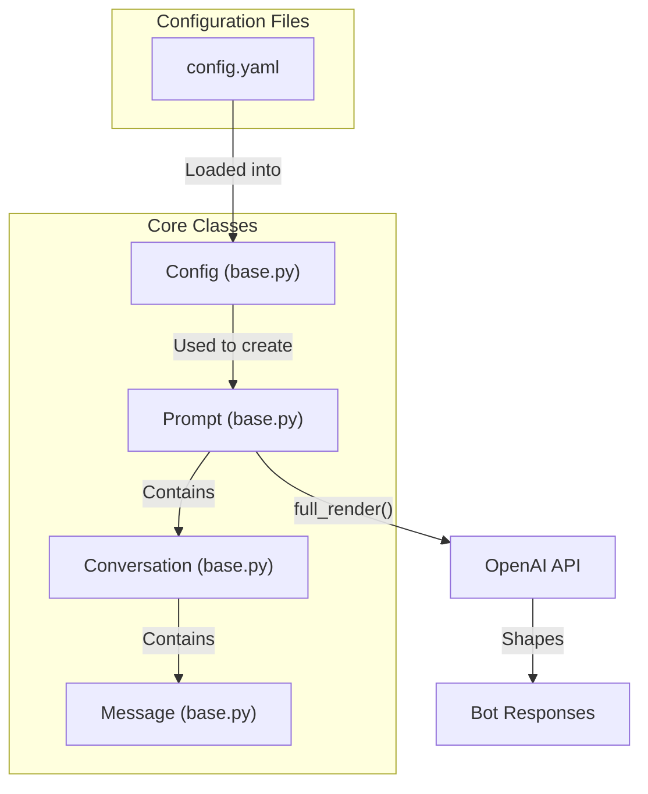
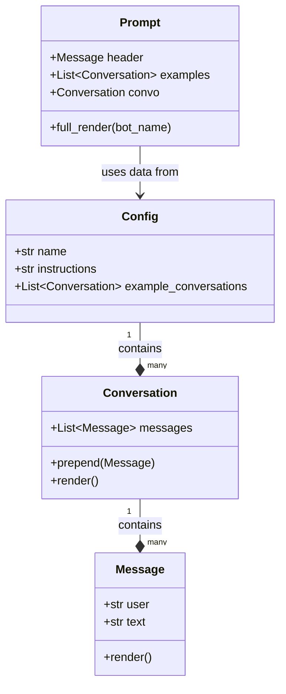
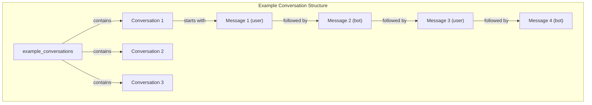
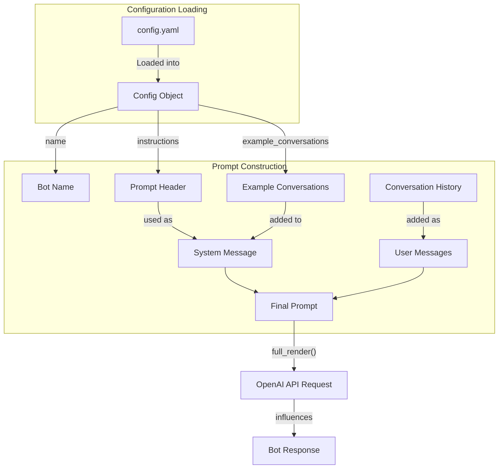

<!-- source: DeepWiki mcp.deepwiki.com · repo openai/gpt-discord-bot · page 4.1 Customizing Bot Personality · fetched 2026-10-26 -->

# Customizing Bot Personality

<details>
<summary>Relevant source files</summary>

The following files were used as context for generating this wiki page:

- [src/base.py](src/base.py)
- [src/config.yaml](src/config.yaml)

</details>


This document explains how to customize the personality and behavior of the GPT Discord Bot by modifying its configuration settings. By adjusting the bot's name, instructions, and example conversations, you can create a variety of personas with different communication styles that suit your community's needs.

For information about adjusting content moderation settings, see [Moderation Thresholds](#4.2). For general configuration options, see [Configuration](#1.2).

## Configuration Components for Bot Personality

The bot's personality is primarily defined in `config.yaml`, which contains three key components:

1. **Name**: The bot's identity in conversations
2. **Instructions**: Natural language directions that guide the bot's behavior
3. **Example conversations**: Sample interactions that demonstrate expected conversation patterns



Sources: [src/base.py:33-37](). [src/config.yaml:1-3]()

## Understanding the Configuration File

The `config.yaml` file contains the personality definition in a simple YAML format:

```yaml
name: Lenard
instructions: You're a regular Discord user. You talk casually, use emojis, and don't use capital letters. You talk in internet shorthand like np and lol and idk and nvm. You have many interests and love talking to people.
example_conversations:
  - messages:
    - user: bob
      text: how's it going today?
    - user: Lenard
      text: its going great, im watching youtube videos, hbu?
    - user: bob
      text: I'm doing great too!
    - user: Lenard
      text: cool cool
  # Additional example conversations follow...
```

Sources: [src/config.yaml:1-27]()

### Configuration Structure Relationship to Code



Sources: [src/base.py:7-52]()

## How to Modify Bot Personality

### Changing the Bot's Name

The `name` field in `config.yaml` sets how the bot identifies itself:

```yaml
name: Lenard  # Change this to your preferred bot name
```

**Important**: The bot name specified here must match the name used in example conversations to ensure proper message attribution.

Sources: [src/config.yaml:1](), [src/base.py:76-89]()

### Crafting Effective Instructions

The `instructions` field is where you define the bot's personality and communication style. This text is passed directly to the language model as part of the system prompt.

When writing instructions, consider including:

- **Communication style**: Formal vs. casual, emoji usage, capitalization patterns
- **Knowledge domain**: Specialties, interests, or role-specific knowledge
- **Response format**: Preferred length, structure, or specialized formatting
- **Behavioral traits**: Personality characteristics, humor style, tone

**Example Instructions for Different Personalities:**

| Personality Type | Sample Instructions |
|------------------|---------------------|
| Casual Discord User | You're a regular Discord user. You talk casually, use emojis, and don't use capital letters. You talk in internet shorthand like np and lol and idk and nvm. |
| Professional Assistant | You are a professional assistant with formal language. You write in complete sentences with proper grammar and punctuation. You provide thorough, helpful responses. |
| Fantasy Character | You are a wizard from the magical realm. You speak with archaic terms, make references to spells and magical concepts, and maintain a wise, mysterious demeanor. |
| Technical Expert | You are an expert programmer. You provide concise, technically accurate information with code examples when relevant. You prioritize clarity and precision. |

Sources: [src/config.yaml:2](), [src/base.py:54-58]()

### Designing Example Conversations

Example conversations demonstrate how the bot should interact with users. The language model will use these examples to infer appropriate response patterns, tone, and style.

Each example conversation consists of a list of messages, where each message has:
- `user`: The name of the speaker (either a user's name or the bot's name)
- `text`: The content of the message



**Guidelines for effective examples:**

1. **Variety**: Include different conversation topics and scenarios
2. **Consistency**: Maintain the same personality traits across all examples
3. **Realism**: Create natural-sounding dialog that represents actual Discord interactions
4. **Demonstration**: Show specific response patterns you want the bot to emulate
5. **Completeness**: Include full exchanges with user questions and bot responses

Sources: [src/config.yaml:3-27](), [src/base.py:19-30]()

## How Personality Configuration Works

The following diagram illustrates how the bot's personality configuration influences response generation:



The personality configuration flows through the system as follows:

1. The `config.yaml` file is loaded into a `Config` object
2. When a user message is received, a `Prompt` object is created
3. The `Prompt` combines the bot's instructions, example conversations, and the current conversation history
4. This formatted prompt is sent to the OpenAI API via the `full_render()` method
5. The API returns a response influenced by the personality defined in the prompt

Sources: [src/base.py:47-89]()

## Best Practices for Customization

### Testing Your Personality Configuration

After modifying the bot's personality, test various conversation scenarios to ensure the bot behaves as expected:

1. Start new conversations with different opening prompts
2. Test how the bot handles questions about itself
3. Verify the bot maintains its defined communication style
4. Check responses to different types of user messages

### Finding the Right Balance

When crafting instructions and examples:
- **Specificity**: Be specific about important traits but leave room for the model's capabilities
- **Conciseness**: Focus on key personality aspects rather than exhaustive descriptions
- **Consistency**: Ensure instructions align with example conversations

### Iterative Refinement

Refining a bot's personality typically requires multiple iterations:
1. Make changes to the configuration
2. Test the bot's behavior in different scenarios
3. Identify areas for improvement
4. Adjust the configuration accordingly

## Technical Implementation Details

The bot personality configuration is implemented through several key classes:

- `Config` class ([src/base.py:33-37]()) - Stores the name, instructions, and example conversations
- `Message` class ([src/base.py:7-16]()) - Represents individual messages in conversations
- `Conversation` class ([src/base.py:19-30]()) - Contains collections of messages
- `Prompt` class ([src/base.py:47-89]()) - Constructs the prompt sent to the OpenAI API

The system concatenates the instructions, example conversations, and current conversation into a structured prompt that guides the model's responses.

Sources: [src/base.py:7-89]()

## Advanced Customization Tips

### Example Conversation Strategies

1. **Progressive Complexity**: Start with simple exchanges, then include more complex interactions
2. **Persona Reinforcement**: Include interactions where users ask about the bot itself
3. **Edge Case Handling**: Show examples of how the bot should handle unusual or off-topic questions
4. **Contextual Memory**: Demonstrate the bot referencing earlier parts of the conversation

### Personality Depth

Create a more nuanced personality by including examples that show:
- Preferences and opinions (within appropriate boundaries)
- Consistent knowledge domains
- Characteristic phrases or speech patterns
- Appropriate humor or tone

Remember that the bot's personality is formed by both explicit instructions and implicit patterns in the example conversations. Both elements should work together to create a coherent persona.

---

