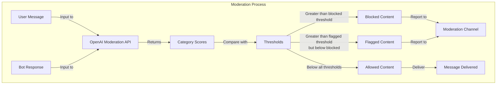
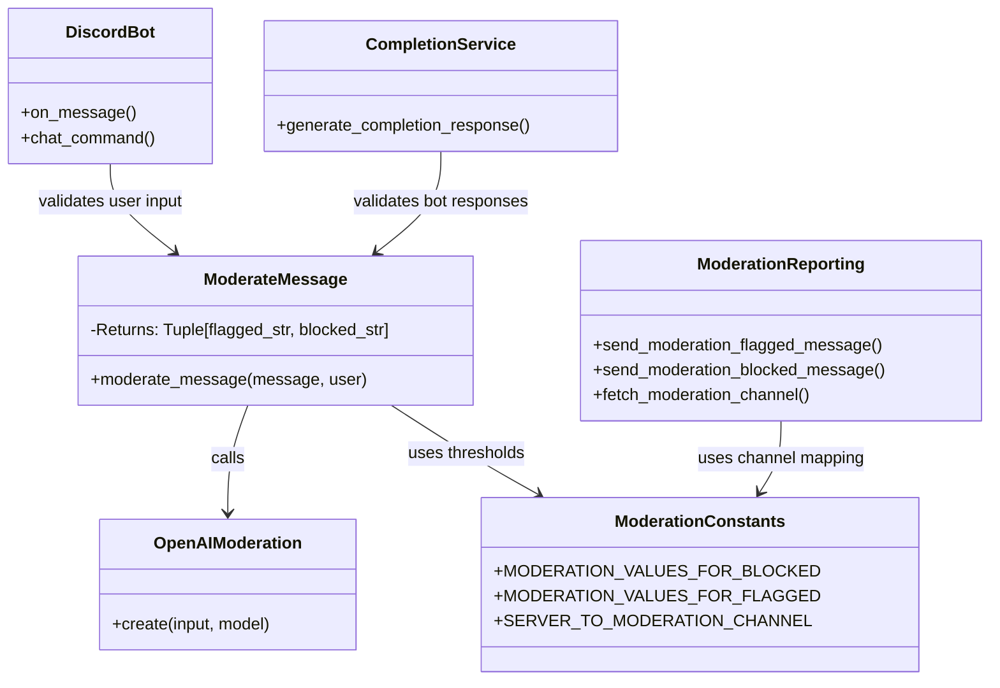
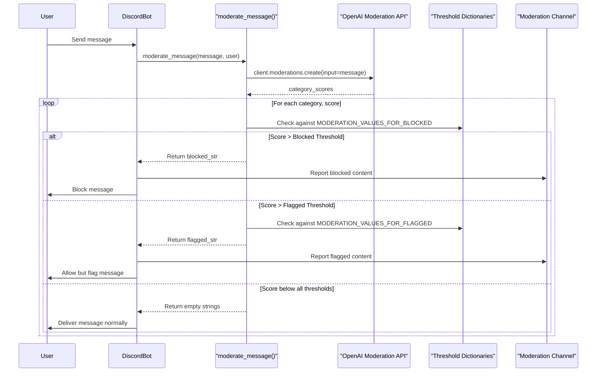
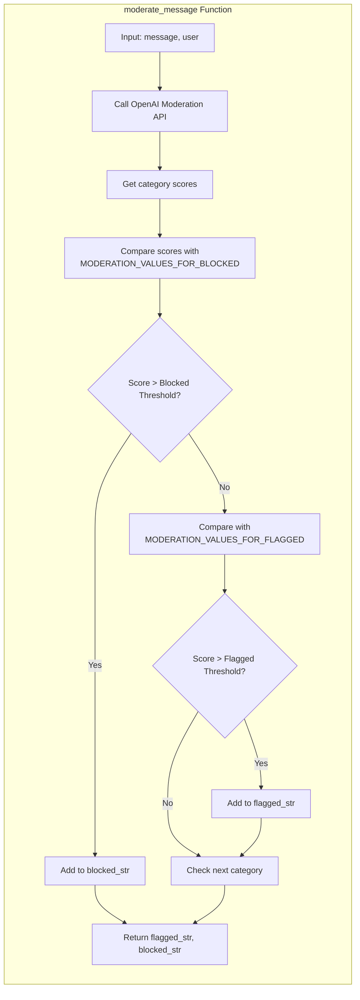

<!-- source: DeepWiki mcp.deepwiki.com · repo openai/gpt-discord-bot · page 4.2 Moderation Thresholds · fetched 2026-10-26 -->

# Moderation Thresholds

Relevant source files

The following files were used as context for generating this wiki page:

- [src/constants.py](src/constants.py)
- [src/moderation.py](src/moderation.py)

This document explains how content moderation sensitivity is controlled in the GPT Discord Bot. It covers the threshold values that determine when content is flagged or blocked, and how to adjust these settings to suit your moderation needs. For a broader overview of the entire moderation system, see [Moderation System](#2.3).

## How Moderation Works

The GPT Discord Bot uses OpenAI's moderation API to analyze all user input and bot responses for potentially harmful content. Each message is scored across multiple content categories, and these scores are compared against predefined thresholds to determine whether content should be flagged (for review) or blocked (prevented entirely).

Sources: [src/moderation.py:16-36]()

## Threshold Configuration

The moderation system uses two sets of thresholds defined in `constants.py`:

1. **Blocked Thresholds** - When a category score exceeds these values, the content is blocked entirely
2. **Flagged Thresholds** - When a category score exceeds these values (but is below blocked threshold), the content is delivered but flagged for review

### Default Threshold Values

The following table shows the default threshold values for each content category:

| Category | Blocked Threshold | Flagged Threshold |
|----------|------------------|------------------|
| harassment | 0.5 | 0.5 |
| harassment/threatening | 0.1 | 0.1 |
| hate | 0.5 | 0.4 |
| hate/threatening | 0.1 | 0.05 |
| self-harm | 0.2 | 0.1 |
| self-harm/instructions | 0.5 | 0.5 |
| self-harm/intent | 0.7 | 0.7 |
| sexual | 0.5 | 0.3 |
| sexual/minors | 0.2 | 0.1 |
| violence | 0.7 | 0.1 |
| violence/graphic | 0.8 | 0.1 |

Sources: [src/constants.py:41-67]()

## Understanding the Moderation System

The moderation system integrates with OpenAI's API and the Discord bot infrastructure as follows:

Sources: [src/moderation.py:1-78](), [src/constants.py:41-67]()

## Moderation Process Details

When content moderation is triggered by either user input or bot responses, the following process occurs:

Sources: [src/moderation.py:16-36](), [src/moderation.py:51-77]()

## Customizing Moderation Thresholds

To adjust the sensitivity of content moderation, modify the threshold dictionaries in `constants.py`:

### Adjusting Blocked Thresholds

To make blocking more strict (block more content), lower the threshold values in `MODERATION_VALUES_FOR_BLOCKED`. To make blocking more lenient (block less content), increase these values.

### Adjusting Flagged Thresholds

Similarly, adjust the values in `MODERATION_VALUES_FOR_FLAGGED` to control how much content gets flagged for review but still delivered.

### Threshold Scale

OpenAI's moderation API returns scores between 0.0 and 1.0:
- 0.0: No confidence that content belongs to the category
- 1.0: Maximum confidence that content belongs to the category

Setting a threshold of 0.0 would flag/block almost everything in that category, while 1.0 would allow almost everything.

### Important Considerations

1. **Category Hierarchies**: Some categories have subcategories (e.g., "harassment" and "harassment/threatening"). Consider the relationship between these when adjusting thresholds.

2. **Server-Specific Moderation**: The system is designed to report moderation events to server-specific moderation channels. Configure these channels in the environment variables using the `SERVER_TO_MODERATION_CHANNEL` setting.

3. **Moderation Feedback**: All moderation actions are logged. Monitor these logs to fine-tune your thresholds based on false positives or missed content.

Sources: [src/constants.py:41-67](), [src/moderation.py:39-48]()

## Implementation in the Codebase

The moderation threshold mechanism is implemented through the `moderate_message` function:

Sources: [src/moderation.py:16-36]()

## Best Practices for Adjusting Thresholds

1. **Start conservative**: Begin with the default thresholds and adjust gradually based on observation.

2. **Different thresholds for different contexts**: Consider that some categories may need different sensitivities depending on your community (e.g., educational contexts vs. general audiences).

3. **Monitor false positives**: Keep track of legitimate content that gets incorrectly flagged/blocked and adjust accordingly.

4. **Regular reviews**: The effectiveness of moderation systems can change over time as language patterns evolve. Periodically review your thresholds.

5. **Test changes**: After adjusting thresholds, test with sample content to ensure the changes have the intended effect.

Sources: [src/constants.py:41-67](), [src/moderation.py:16-36]()

---

