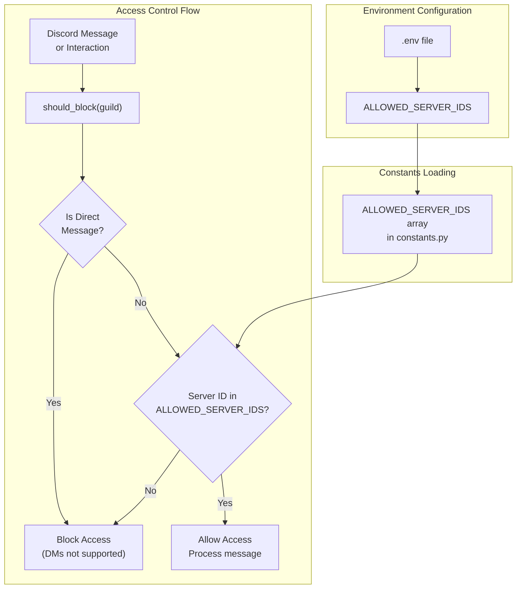
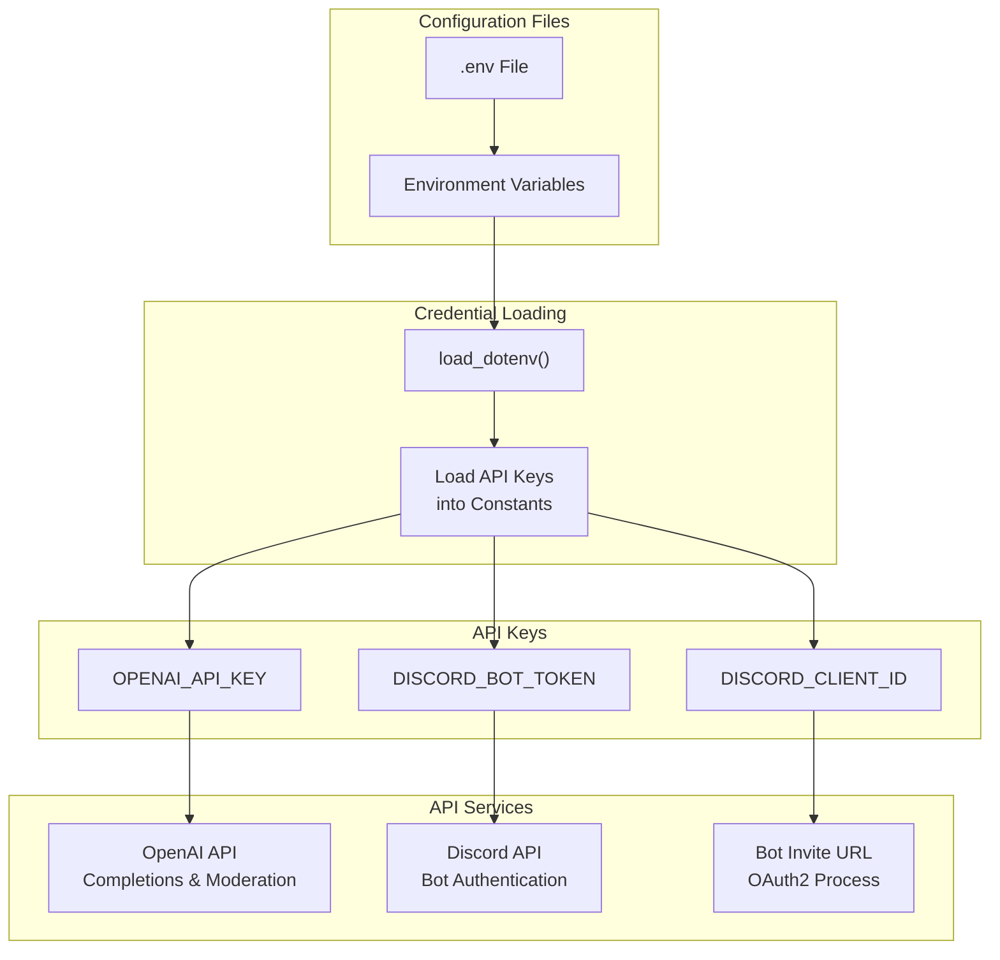
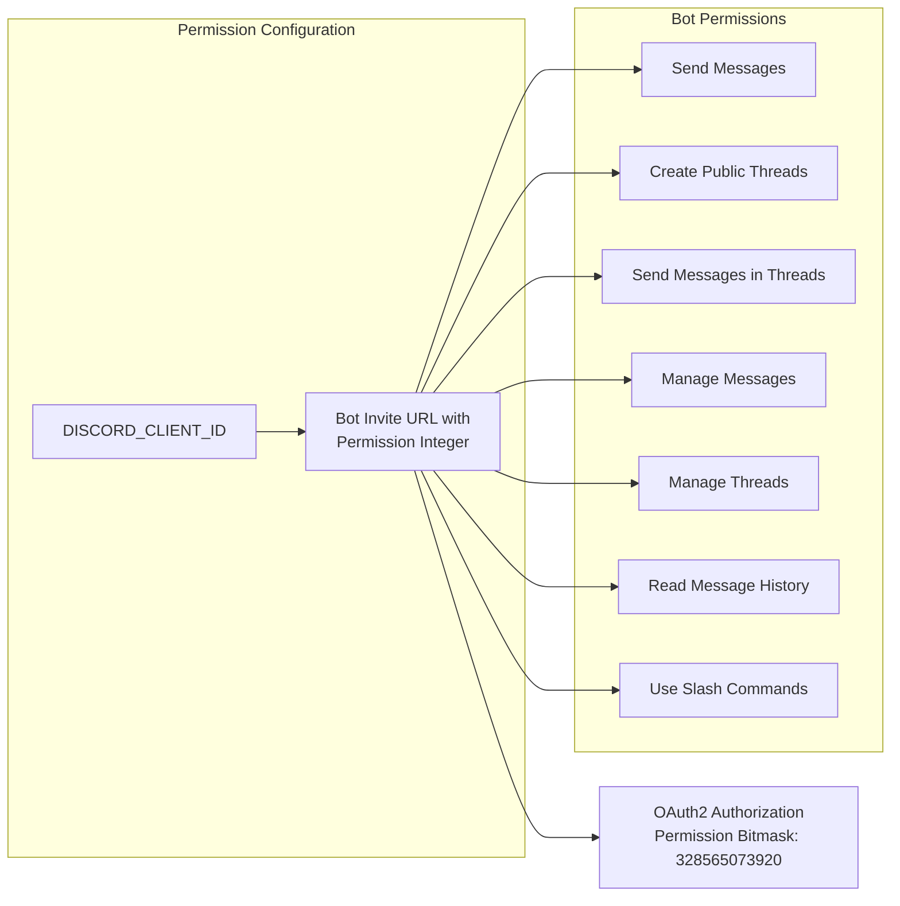
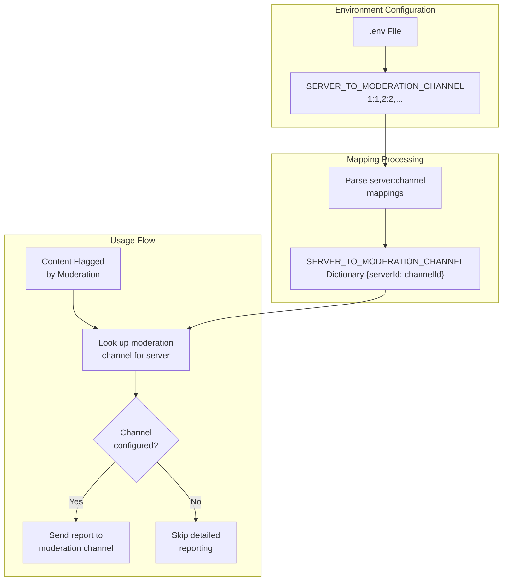
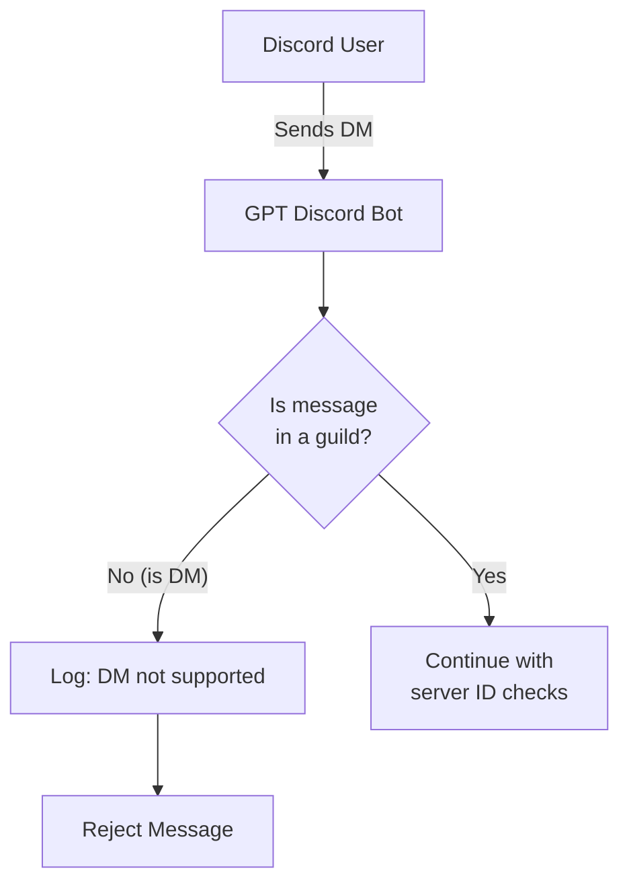

<!-- source: DeepWiki mcp.deepwiki.com · repo openai/gpt-discord-bot · page 4.3 Security and Access Control · fetched 2026-10-26 -->

# Security and Access Control

Relevant source files

The following files were used as context for generating this wiki page:

- [.env.example](.env.example)
- [src/constants.py](src/constants.py)
- [src/utils.py](src/utils.py)

This page documents the security features and access control mechanisms implemented in the GPT Discord Bot. It covers server access restrictions, API key management, bot permissions, and other security-related aspects of the system.

For information about content moderation and filtering, see [Moderation System](#2.3). For information about adjusting moderation sensitivity, see [Moderation Thresholds](#4.2).

## Server Access Restriction

The GPT Discord Bot implements server-level access control to ensure it can only be used in authorized Discord servers. This is a crucial security feature that prevents unauthorized use of the bot and the associated OpenAI API resources.

The server access restriction is implemented through:

1. **Configuration in Environment Variables**: Administrators specify allowed server IDs in the `.env` file.
2. **Loading into Application Constants**: The application loads these IDs at startup and converts them to integers.
3. **Access Control Check**: Each interaction is checked against this list before processing.

The `should_block()` function returns `True` if the message should be blocked:
- If the message is a direct message (DM)
- If the server (guild) ID is not in the `ALLOWED_SERVER_IDS` list

Sources: [.env.example:5](), [src/constants.py:27-30](), [src/utils.py:60-70]()

## API Key and Credentials Management

The bot uses environment variables to securely store API keys and other sensitive credentials.

Key security points:
- API keys are never hardcoded in the application
- The `.env` file should be excluded from version control (via `.gitignore`)
- The application loads credentials via environment variables at runtime using `dotenv`

Sources: [.env.example:1-3](), [src/constants.py:1-2](), [src/constants.py:22-24]()

## Bot Permission Management

The bot's Discord permissions are carefully controlled to provide necessary functionality while limiting potential security risks.

The bot requires specific Discord permissions to function properly:
- **Send Messages**: To respond to user queries
- **Create Public Threads**: To create conversation threads
- **Send Messages in Threads**: To continue conversations
- **Manage Messages**: For moderation purposes
- **Manage Threads**: To close threads when necessary
- **Read Message History**: To understand conversation context
- **Use Slash Commands**: To respond to `/chat` commands

These permissions are combined into a single permission integer (328565073920) used in the OAuth2 invitation URL.

Sources: [src/constants.py:38-39]()

## Server-Moderation Channel Mapping

The bot supports a mapping between servers and dedicated moderation channels where flagged content can be reported.

When content is flagged by the moderation system:
1. The bot looks up the appropriate moderation channel for the current server
2. If found, it sends a detailed report to that channel
3. This provides server administrators visibility into potentially problematic content

Sources: [.env.example:6](), [src/constants.py:32-36]()

## Direct Message Restrictions

The bot is designed to reject direct messages (DMs), limiting its use to authorized servers only.

Direct messages are rejected because:
- They can't be moderated by server administrators
- They may bypass server-based access controls
- They could potentially lead to abuse of API resources

Sources: [src/utils.py:60-65]()

## Permissions and Security Model

The following table summarizes the key security boundaries and access controls in the GPT Discord Bot:

| Boundary Type | Implementation | Purpose |
|---------------|----------------|---------|
| Server Access | `ALLOWED_SERVER_IDS` | Restrict bot to authorized servers only |
| API Security | Environment variables | Protect OpenAI and Discord credentials |
| Discord Permissions | Permission integer in invite URL | Limit bot capabilities to necessary functions |
| DM Prevention | `should_block()` check | Prevent unmonitored private interactions |
| Moderation Channels | Server-to-channel mapping | Enable oversight of flagged content |

To add a new server to the allowed list:
1. Add the server ID to the `ALLOWED_SERVER_IDS` environment variable
2. Optionally, configure a moderation channel using `SERVER_TO_MODERATION_CHANNEL`
3. Restart the bot to apply the changes

Sources: [.env.example:5-6](), [src/constants.py:27-36](), [src/utils.py:60-70]()

## Security Best Practices

When deploying and maintaining the GPT Discord Bot, follow these security best practices:

1. **API Key Protection**:
   - Never commit `.env` files to version control
   - Regularly rotate API keys
   - Use separate API keys for development and production

2. **Server Allowlist Management**:
   - Only add trusted servers to the allowlist
   - Regularly audit the allowed server list
   - Remove servers that no longer need access

3. **Moderation Channel Setup**:
   - Configure moderation channels with limited visibility
   - Ensure only trusted moderators have access to these channels
   - Regularly review moderation logs

4. **Bot Hosting Security**:
   - Host the bot on a secure server with access controls
   - Keep the hosting environment updated with security patches
   - Monitor for unusual activity or API usage spikes

Sources: [.env.example](), [src/constants.py]()

---

