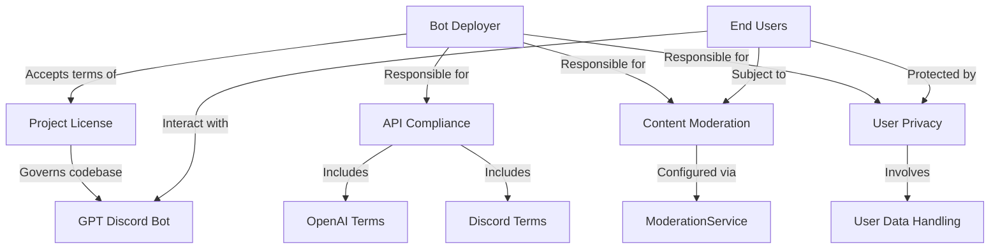
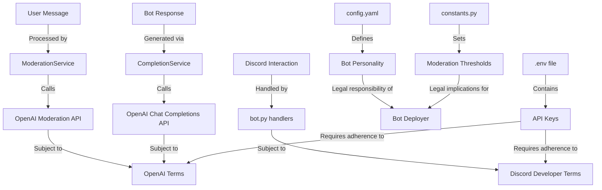

<!-- source: DeepWiki mcp.deepwiki.com · repo openai/gpt-discord-bot · page 4.4 License and Legal · fetched 2026-10-26 -->

# License and Legal

<details>
<summary>Relevant source files</summary>

The following files were used as context for generating this wiki page:

- [LICENSE](LICENSE)

</details>


This document outlines the licensing terms of the GPT Discord Bot project and addresses the key legal considerations when deploying and using the bot. It provides essential information about rights granted to users of the software, external API compliance requirements, and important legal aspects related to content moderation and privacy.

For information about security measures and access control mechanisms, see [Security and Access Control](#4.3).

## License Information

### MIT License

The GPT Discord Bot is released under the MIT License, a permissive open-source license that grants extensive freedoms to users while providing minimal restrictions. The full license text is available in the LICENSE file at the repository root.

The key aspects of the MIT License include:

- **Copyright Holder**: OpenAI (Copyright © 2022 OpenAI)
- **Permissions**: Users may use, copy, modify, merge, publish, distribute, sublicense, and/or sell copies of the software
- **Conditions**: The original copyright notice and permission notice must be included in all copies or substantial portions of the software
- **Limitations**: No warranty is provided; the software is offered "as is"

```
MIT License

Copyright (c) 2022 OpenAI

Permission is hereby granted, free of charge, to any person obtaining a copy
of this software and associated documentation files (the "Software"), to deal
in the Software without restriction, including without limitation the rights
to use, copy, modify, merge, publish, distribute, sublicense, and/or sell
copies of the Software, and to permit persons to whom the Software is
furnished to do so, subject to the following conditions:

The above copyright notice and this permission notice shall be included in all
copies or substantial portions of the Software.

THE SOFTWARE IS PROVIDED "AS IS", WITHOUT WARRANTY OF ANY KIND, EXPRESS OR
IMPLIED, INCLUDING BUT NOT LIMITED TO THE WARRANTIES OF MERCHANTABILITY,
FITNESS FOR A PARTICULAR PURPOSE AND NONINFRINGEMENT. IN NO EVENT SHALL THE
AUTHORS OR COPYRIGHT HOLDERS BE LIABLE FOR ANY CLAIM, DAMAGES OR OTHER
LIABILITY, WHETHER IN AN ACTION OF CONTRACT, TORT OR OTHERWISE, ARISING FROM,
OUT OF OR IN CONNECTION WITH THE SOFTWARE OR THE USE OR OTHER DEALINGS IN THE
SOFTWARE.
```

Sources: [LICENSE:1-21]()

## External API Legal Considerations

When deploying the GPT Discord Bot, you must comply with the terms of service for both OpenAI and Discord APIs, as the bot acts as an integration between these platforms.

### OpenAI API Terms

The bot relies heavily on OpenAI's services through API calls from the `completion_service.py` and other components. When using the bot, you must:

1. Have a valid OpenAI API key and account in good standing
2. Comply with OpenAI's usage policies regarding content generation
3. Adhere to rate limits and billing terms
4. Ensure proper moderation of generated content

### Discord API Terms

As the bot operates on Discord's platform, you must comply with Discord's Developer Terms of Service, which include:

1. Following Discord's rate limits and API guidelines
2. Respecting user privacy and data handling requirements
3. Adhering to Discord's bot verification process if deployed at scale
4. Not using the bot for prohibited activities outlined in Discord's terms

## Liability and Responsibility Framework

When deploying the GPT Discord Bot, it's essential to understand the distribution of legal responsibilities:



Sources: [LICENSE:1-21]()

## Legal Touchpoints in Code Architecture

The following diagram illustrates where legal considerations intersect with the codebase components:



Sources: [LICENSE:1-21]()

## Content Moderation Legal Implications

The bot includes a content moderation system that filters both user inputs and AI-generated outputs. This system has important legal implications:

| Component | Legal Consideration | Responsible Party |
|-----------|---------------------|------------------|
| User Input Moderation | Preventing harmful/illegal content | Bot deployer |
| AI Output Moderation | Ensuring generated content is appropriate | Bot deployer + OpenAI |
| Moderation Thresholds | Setting appropriate sensitivity levels | Bot deployer |
| Flagged Content Handling | Proper reporting and management | Bot deployer |
| Content Storage | Compliance with data retention laws | Bot deployer |

While the moderation system provides a baseline protection, bot deployers remain ultimately responsible for ensuring that the bot's operation complies with all applicable laws regarding content.

## Privacy Considerations

When operating the GPT Discord Bot, deployers should be aware of several privacy considerations:

1. **User Message Processing**: All messages are sent to OpenAI's API for processing
2. **Conversation History**: The bot maintains conversation history to provide context
3. **Moderation Logging**: Flagged content may be logged in moderation channels
4. **API Key Protection**: Credentials in the `.env` file must be properly secured

Depending on your jurisdiction and user base, you may need to:

- Provide clear privacy notices to users
- Obtain appropriate consent for data processing
- Implement data retention and deletion policies
- Comply with applicable privacy regulations (GDPR, CCPA, etc.)

## Compliance Checklist

When deploying the GPT Discord Bot, ensure you have addressed these key legal requirements:

- [ ] Include the MIT License notice with any distribution of the code
- [ ] Obtain and validate API keys for both OpenAI and Discord
- [ ] Review and comply with current OpenAI API terms of service
- [ ] Review and comply with current Discord Developer terms of service
- [ ] Configure appropriate moderation thresholds in `constants.py`
- [ ] Implement proper privacy notices for end users
- [ ] Secure API credentials and sensitive configuration data
- [ ] Establish a process for handling moderation flags and reports

Sources: [LICENSE:1-21]()