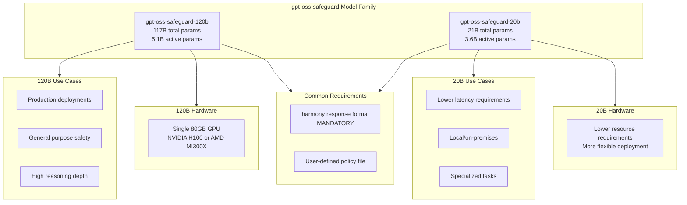
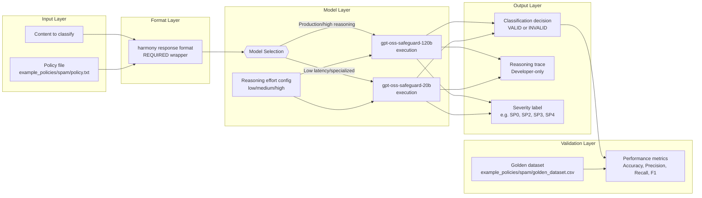
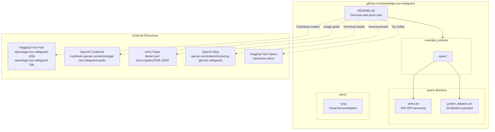
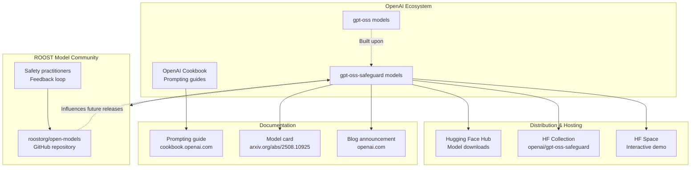

<!-- source: DeepWiki mcp.deepwiki.com · repo openai/gpt-oss-safeguard · page 1 Home · fetched 2026-10-26 -->

# Home

<details>
<summary>Relevant source files</summary>

The following files were used as context for generating this wiki page:

- [README.md](README.md)
- [docs/gpt-oss-safeguard.png](docs/gpt-oss-safeguard.png)

</details>


## Purpose and Scope

This wiki documents the **gpt-oss-safeguard** repository, which provides two open-source safety reasoning models (`gpt-oss-safeguard-120b` and `gpt-oss-safeguard-20b`) designed for classifying content based on user-defined safety policies. This page provides a high-level introduction to the system architecture, core capabilities, and how the models fit into the broader safety AI ecosystem.

For initial setup and usage instructions, see [Getting Started](#2). For detailed information about choosing between model variants, see [Model Variants](#3). For understanding core concepts like the harmony response format and policy-based classification, see [Core Concepts](#4).

**Sources:** [README.md:1-46]()

---

## What is gpt-oss-safeguard?

`gpt-oss-safeguard` is a pair of safety reasoning models built upon the [gpt-oss](https://github.com/openai/gpt-oss) foundation. Unlike traditional content moderation systems that rely on fixed rules or simple classification scores, these models provide **reasoned safety decisions** with detailed explanations based on **custom policies you define**.

The models are specifically trained for safety use cases and require the [harmony response format][harmony] to function correctly. They are not general-purpose language models—for non-safety applications, the standard gpt-oss models are recommended.

### Key Technical Characteristics

| Characteristic | Description |
|---------------|-------------|
| **Model Architecture** | Built on gpt-oss with safety-specific fine-tuning |
| **Input Format** | Requires harmony response format (mandatory) |
| **Classification Approach** | Policy-driven reasoning (user provides policy definitions) |
| **Output Type** | Binary classification (VALID/INVALID) with reasoning trace |
| **Reasoning Depth** | Configurable effort levels (low/medium/high) |
| **Deployment Models** | 120B variant (production) and 20B variant (edge/specialized) |

**Sources:** [README.md:14-21]()

---

## Model Variants Overview

The repository provides two distinct model variants optimized for different deployment scenarios:



**Model Selection Criteria:**

- **`gpt-oss-safeguard-120b`**: Choose for production systems, general-purpose safety tasks, or when reasoning depth is critical. Fits on a single 80GB GPU (NVIDIA H100 or AMD MI300X).

- **`gpt-oss-safeguard-20b`**: Choose for latency-sensitive applications, edge deployments, local/on-premises installations, or specialized safety tasks with narrower scope.

Both models share the same interface and policy format, making them interchangeable in workflows.

**Sources:** [README.md:17-18]()

---

## Core Capabilities

### 1. Trained to Reason About Safety

Unlike traditional classifiers that output numeric scores, these models generate **reasoning traces** that explain classification decisions. This transparency enables:
- Easier debugging of policy behavior
- Increased trust in safety decisions
- Developer insights into model logic (not intended for end-user display)

### 2. Bring Your Own Policy

The models implement a **policy-driven classification paradigm**. Users define:
- Safety categories and severity levels
- Concrete definitions of violating content
- Classification rules and ambiguity handling
- Output labels and escalation criteria

Example policy structure from [example_policies/spam/policy.txt]():
```
GOAL: Classify content as VALID or INVALID based on spam characteristics
DEFINITIONS: [Core concepts like "Spam", "Bulk Messaging", etc.]
SEVERITY LEVELS: SP0 (non-spam) → SP2 (likely spam) → SP3 (high-risk) → SP4 (malicious)
```

See [Working with Policies](#5) for detailed policy authoring guidance.

### 3. Configurable Reasoning Effort

Adjust reasoning depth to balance latency vs. accuracy:
- **Low effort**: Fastest inference, suitable for high-volume screening
- **Medium effort**: Balanced performance for most use cases
- **High effort**: Maximum reasoning depth for complex edge cases

See [Configurable Reasoning Effort](#4.4) for usage details.

### 4. Permissive Apache 2.0 License

The models are released under the Apache 2.0 license, enabling:
- Commercial deployment without restrictions
- Modification and redistribution
- No copyleft obligations
- Patent protection

See [Licensing and Governance](#9) for complete terms.

**Sources:** [README.md:22-28]()

---

## System Architecture

The following diagram shows how the key components interact in a typical classification workflow:



### Component Descriptions

| Component | Location/Reference | Description |
|-----------|-------------------|-------------|
| **Policy file** | `example_policies/spam/policy.txt` | User-defined text file containing safety definitions, severity taxonomy, and classification rules |
| **harmony response format** | Required input wrapper | Mandatory format for model input; models will not function correctly without it |
| **Model execution** | Hugging Face Hub downloads | Inference runs on downloaded model weights with configurable reasoning effort |
| **Golden dataset** | `example_policies/spam/golden_dataset.csv` | Validation dataset with labeled examples for measuring policy effectiveness |
| **Reasoning trace** | Model output | Detailed explanation of classification logic (for developers, not end-users) |

**Sources:** [README.md:14-36]()

---

## Repository Structure



**Sources:** [README.md:1-46]()

---

## Use Cases and Applications

The models are designed for safety practitioners building content moderation and trust & safety systems. Common applications include:

### Supported Use Cases

- **Content Moderation**: Classify user-generated content against custom community guidelines
- **Spam Detection**: Identify bulk messaging, unsolicited promotion, and malicious spam (see [Example: Spam Detection Policy](#6))
- **Policy Enforcement**: Enforce platform-specific safety rules with explainable decisions
- **Safety Research**: Experiment with novel safety taxonomies and evaluation methodologies
- **Multi-Policy Systems**: Combine multiple policies with cross-policy escalation rules

### Not Intended For

These models are **specifically trained for safety use cases**. For general-purpose language tasks (generation, summarization, question-answering, coding), use the standard [gpt-oss models](https://huggingface.co/collections/openai/gpt-oss) instead.

**Sources:** [README.md:14-15]()

---

## Ecosystem Integration

`gpt-oss-safeguard` is part of a broader open-source safety infrastructure:



### ROOST Model Community Partnership

`gpt-oss-safeguard` is a model partner of the **Robust Open Online Safety Tools (ROOST) Model Community**. This partnership enables:

- Collaborative development with safety practitioners
- Community feedback incorporated into future releases
- Shared best practices and policy examples
- Open governance model for safety AI

Visit the [RMC GitHub repository](https://github.com/roostorg/open-models) to participate. See [ROOST Model Community Partnership](#9.3) for details.

**Sources:** [README.md:42-46]()

---

## Quick Start

To begin using `gpt-oss-safeguard`:

1. **Download models** from [Hugging Face Hub](https://huggingface.co/collections/openai/gpt-oss-safeguard)
   - [`gpt-oss-safeguard-120b`](https://huggingface.co/openai/gpt-oss-safeguard-120b)
   - [`gpt-oss-safeguard-20b`](https://huggingface.co/openai/gpt-oss-safeguard-20b)

2. **Review the prompting guide** at [OpenAI Cookbook](https://cookbook.openai.com/articles/gpt-oss-safeguard-guide)

3. **Examine the spam policy example** at [example_policies/spam/policy.txt]() and [example_policies/spam/golden_dataset.csv]()

4. **Try the interactive demo** at [Hugging Face Space](https://huggingface.co/spaces/openai/gpt-oss-safeguard-20b)

For detailed setup instructions, see [Getting Started](#2). For inference examples and configuration, see [Deployment and Integration](#8).

**Sources:** [README.md:30-40]()

---

## Key Constraints and Requirements

### Mandatory Requirements

| Requirement | Impact if Not Met |
|-------------|-------------------|
| **harmony response format** | Models will not work correctly; classification will fail |
| **User-defined policy** | No default safety policy included; you must provide one |
| **Apache 2.0 compliance** | Usage must comply with license terms |
| **Usage policy adherence** | Must follow safe, responsible, and democratic use guidelines |

### Performance Considerations

- **Hardware**: 120B model requires single 80GB GPU; 20B model has lower requirements
- **Latency**: Varies by reasoning effort setting (low/medium/high)
- **Reasoning outputs**: Not intended for display to end-users (developer tool only)

See [Hardware Requirements](#8.1) for deployment specifications.

**Sources:** [README.md:20-21]()

---

## Additional Resources

| Resource | Link | Description |
|----------|------|-------------|
| **Model Downloads** | [Hugging Face Collection](https://huggingface.co/collections/openai/gpt-oss-safeguard) | Download 120B and 20B model weights |
| **Usage Guide** | [OpenAI Cookbook](https://cookbook.openai.com/articles/gpt-oss-safeguard-guide) | Detailed prompting guide and examples |
| **Model Card** | [arXiv Paper](https://arxiv.org/abs/2508.10925) | Technical documentation and evaluation |
| **Blog Post** | [OpenAI Blog](https://openai.com/index/introducing-gpt-oss-safeguard/) | Product announcement and overview |
| **Interactive Demo** | [Hugging Face Space](https://huggingface.co/spaces/openai/gpt-oss-safeguard-20b) | Try the 20B model online |
| **Community** | [ROOST GitHub](https://github.com/roostorg/open-models) | Join the safety practitioner community |

For topic-specific documentation, see [Additional Resources](#10).

**Sources:** [README.md:1-46]()

---

