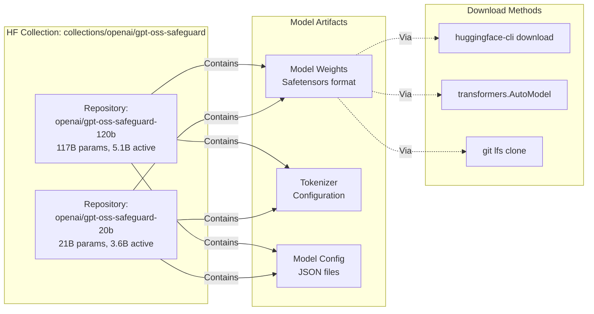
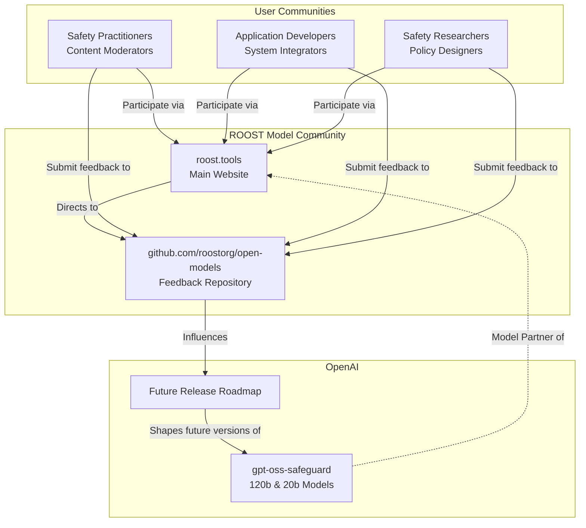
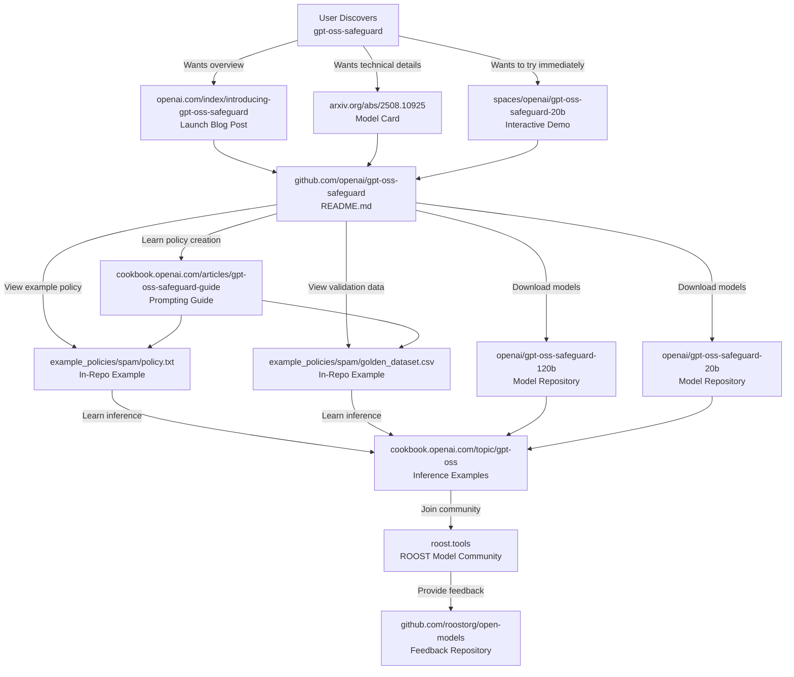

<!-- source: DeepWiki mcp.deepwiki.com · repo openai/gpt-oss-safeguard · page 10 Additional Resources · fetched 2026-10-26 -->

# Additional Resources

Relevant source files

The following files were used as context for generating this wiki page:

- [README.md](README.md)

This page provides a comprehensive directory of external resources for gpt-oss-safeguard users, including official documentation, community channels, model distribution platforms, and related projects. These resources support the full lifecycle from initial exploration to production deployment.

For information about repository-local examples, see [Example: Spam Detection Policy](#6). For deployment instructions, see [Deployment and Integration](#8).

---

## Resource Topology

The following diagram illustrates how external resources connect to the gpt-oss-safeguard repository and support different user workflows:

```mermaid
graph TB
    subgraph Repository["github.com/openai/gpt-oss-safeguard"]
        README["README.md"]
        POLICY_EXAMPLE["example_policies/spam/policy.txt"]
        GOLDEN_EXAMPLE["example_policies/spam/golden_dataset.csv"]
    end
    
    subgraph HuggingFace["Hugging Face Ecosystem"]
        HF_120B["openai/gpt-oss-safeguard-120b<br/>Model Repository"]
        HF_20B["openai/gpt-oss-safeguard-20b<br/>Model Repository"]
        HF_COLLECTION["collections/openai/gpt-oss-safeguard<br/>Unified Collection"]
        HF_SPACE["spaces/openai/gpt-oss-safeguard-20b<br/>Interactive Demo"]
    end
    
    subgraph OpenAICookbook["cookbook.openai.com"]
        COOKBOOK_GUIDE["articles/gpt-oss-safeguard-guide<br/>Prompting Guide"]
        COOKBOOK_TOPIC["topic/gpt-oss<br/>General gpt-oss Examples"]
    end
    
    subgraph Publications["Research & Announcements"]
        ARXIV["arxiv.org/abs/2508.10925<br/>Model Card"]
        BLOG["openai.com/index/introducing-gpt-oss-safeguard<br/>Launch Blog Post"]
    end
    
    subgraph Community["ROOST Model Community"]
        ROOST_MAIN["roost.tools<br/>Main Website"]
        ROOST_GITHUB["github.com/roostorg/open-models<br/>Feedback Repository"]
    end
    
    README -->|"Links to"| HF_120B
    README -->|"Links to"| HF_20B
    README -->|"Links to"| COOKBOOK_GUIDE
    README -->|"Links to"| ARXIV
    README -->|"Links to"| BLOG
    README -->|"Links to"| ROOST_GITHUB
    
    HF_COLLECTION -->|"Contains"| HF_120B
    HF_COLLECTION -->|"Contains"| HF_20B
    
    POLICY_EXAMPLE -->|"Example referenced in"| COOKBOOK_GUIDE
    GOLDEN_EXAMPLE -->|"Example referenced in"| COOKBOOK_GUIDE
    
    COOKBOOK_GUIDE -->|"Teaches policy creation for"| HF_120B
    COOKBOOK_GUIDE -->|"Teaches policy creation for"| HF_20B
    
    COOKBOOK_TOPIC -->|"Inference patterns for"| HF_120B
    COOKBOOK_TOPIC -->|"Inference patterns for"| HF_20B
    
    HF_SPACE -->|"Demonstrates"| HF_20B
    
    ARXIV -->|"Documents"| HF_120B
    ARXIV -->|"Documents"| HF_20B
    
    BLOG -->|"Announces"| HF_120B
    BLOG -->|"Announces"| HF_20B
    
    ROOST_MAIN -->|"Links to"| ROOST_GITHUB
    ROOST_GITHUB -->|"Feedback influences"| HF_120B
    ROOST_GITHUB -->|"Feedback influences"| HF_20B
```

**Sources:** [README.md:1-46]()

---

## Official Documentation Resources

The OpenAI team provides several documentation resources that cover different aspects of the gpt-oss-safeguard models.

### OpenAI Cookbook

The OpenAI Cookbook contains practical guides and code examples for using gpt-oss-safeguard models.

| Resource | URL | Purpose |
|----------|-----|---------|
| **gpt-oss-safeguard Guide** | `cookbook.openai.com/articles/gpt-oss-safeguard-guide` | Detailed prompting guide for policy creation and model usage |
| **gpt-oss Topic Page** | `cookbook.openai.com/topic/gpt-oss` | Inference examples applicable to both gpt-oss and gpt-oss-safeguard |

The cookbook guide is the primary resource for learning how to:
- Structure safety policies (see [Policy File Structure](#5.1))
- Create golden datasets for validation (see [Golden Datasets](#7.1))
- Configure reasoning effort parameters (see [Configurable Reasoning Effort](#4.4))
- Implement the harmony response format (see [Harmony Response Format](#4.2))

The general gpt-oss topic page provides inference patterns that apply to both `gpt-oss-safeguard-120b` and `gpt-oss-safeguard-20b`, since these models use similar inference APIs.

**Sources:** [README.md:7](), [README.md:32](), [README.md:36]()

### Research Publications

| Resource | URL | Content |
|----------|-----|---------|
| **Model Card** | `arxiv.org/abs/2508.10925` | Technical specifications, training methodology, evaluation results, limitations |
| **Launch Blog Post** | `openai.com/index/introducing-gpt-oss-safeguard` | High-level overview, use cases, policy examples, community announcement |

The arXiv model card provides comprehensive technical documentation including:
- Architecture details for the 117B and 21B parameter models
- Training data and methodology
- Benchmark results across safety classification tasks
- Known limitations and failure modes
- Ethical considerations

The OpenAI blog post serves as the announcement and provides:
- Strategic context for the release
- Target use cases and user personas
- Highlights of key capabilities
- Community partnership announcements

**Sources:** [README.md:8-9]()

---

## Model Distribution and Access

### Hugging Face Hub

All model artifacts are distributed through the Hugging Face Hub, which provides standardized access to model weights, tokenizers, and configuration files.

**Model Repository Links:**

| Model Variant | Hugging Face Repository | Parameters |
|---------------|------------------------|------------|
| `gpt-oss-safeguard-120b` | `huggingface.co/openai/gpt-oss-safeguard-120b` | 117B total, 5.1B active |
| `gpt-oss-safeguard-20b` | `huggingface.co/openai/gpt-oss-safeguard-20b` | 21B total, 3.6B active |
| **Unified Collection** | `huggingface.co/collections/openai/gpt-oss-safeguard` | Both models |

For detailed download instructions, see [Model Download and Setup](#8.2).

**Sources:** [README.md:3](), [README.md:17-18](), [README.md:40]()

### Interactive Demo

An interactive Hugging Face Space allows users to test gpt-oss-safeguard without local deployment:

| Resource | URL | Model |
|----------|-----|-------|
| **Interactive Demo** | `huggingface.co/spaces/openai/gpt-oss-safeguard-20b` | Uses `gpt-oss-safeguard-20b` |

The demo enables:
- Testing custom safety policies without code
- Experimenting with different severity taxonomies
- Observing model reasoning outputs
- Evaluating classification decisions

**Note:** The demo uses the 20B variant for lower latency in an interactive environment. For production deployments requiring higher reasoning capacity, use the 120B variant (see [Model Variants](#3)).

**Sources:** [README.md:6]()

---

## Community and Support

### ROOST Model Community Partnership

The gpt-oss-safeguard models are partners in the **Robust Open Online Safety Tools (ROOST) Model Community**, a collaborative network of safety practitioners and researchers.

**Community Resources:**

| Resource | URL | Purpose |
|----------|-----|---------|
| **ROOST Main Site** | `roost.tools` | Community overview, mission, participating models |
| **RMC GitHub Repository** | `github.com/roostorg/open-models` | Feedback submission, feature requests, community discussions |

As stated in [README.md:44-45]():
> "As an RMC model partner, OpenAI is committed to incorporating user feedback and jointly iterating on future releases in pursuit of open safety."

This partnership enables:
- **Direct feedback channels** for bug reports and feature requests
- **Community-driven roadmap** for future model capabilities
- **Shared best practices** across safety practitioners
- **Cross-organizational collaboration** on safety policy design

For governance details, see [ROOST Model Community Partnership](#9.3).

**Sources:** [README.md:42-46]()

---

## Related Projects and Ecosystems

### gpt-oss Base Models

The gpt-oss-safeguard models are built upon the [gpt-oss](https://github.com/openai/gpt-oss) base models and share similar inference patterns.

| Resource | URL | Relationship |
|----------|-----|--------------|
| **gpt-oss Repository** | `github.com/openai/gpt-oss` | Base model architecture |
| **gpt-oss Collection** | `huggingface.co/collections/openai/gpt-oss` | Non-safety variants for general use |

As noted in [README.md:14-15]():
> "gpt-oss-safeguard-120b and gpt-oss-safeguard-20b are safety reasoning models built-upon gpt-oss. [...] These models are intended for safety use cases. For other applications, we recommend using gpt oss models"

**Key differences from gpt-oss:**
- **Training objective:** Safety reasoning vs. general reasoning
- **Required format:** harmony response format mandatory for safeguard models (see [Harmony Response Format](#4.2))
- **Output structure:** Classification decisions with reasoning vs. open-ended responses
- **Use case:** Policy-based safety classification vs. general-purpose tasks

Both model families share:
- Inference API patterns
- Model download procedures
- Hardware requirements
- Deployment topologies

**Sources:** [README.md:14-15](), [README.md:32]()

---

## Documentation Flow for New Users

The following diagram illustrates recommended navigation paths through resources based on user goals:

**Recommended learning paths:**

1. **Quick start path:**  
   Blog Post → README → HF Space Demo → Cookbook Guide → Model Download

2. **Technical deep dive path:**  
   arXiv Model Card → README → Example Policy → Golden Dataset → Cookbook Examples

3. **Community engagement path:**  
   README → ROOST Main Site → RMC GitHub → Provide Feedback

**Sources:** [README.md:1-46]()

---

## In-Repository Examples

While external resources provide comprehensive documentation, the repository includes concrete implementation examples.

| Resource | Path | Purpose |
|----------|------|---------|
| **Spam Policy** | `example_policies/spam/policy.txt` | Complete policy definition with SP0-SP4 taxonomy |
| **Golden Dataset** | `example_policies/spam/golden_dataset.csv` | 39 labeled examples for validation |

These examples demonstrate:
- Policy file structure (see [Policy File Structure](#5.1))
- Severity level definitions (see [Spam Severity Taxonomy](#6.2))
- Dual-label system usage (see [Dual-Label System](#5.3))
- Ambiguity handling rules (see [Ambiguity Handling and Escalation Rules](#5.4))

For detailed analysis of these examples, see [Example: Spam Detection Policy](#6).

**Sources:** [README.md:36]()

---

## Quick Reference: Resource Categories

The following table organizes all resources by category for quick lookup:

| Category | Resource | URL/Path | Primary Use |
|----------|----------|----------|-------------|
| **Model Download** | 120B Model | `huggingface.co/openai/gpt-oss-safeguard-120b` | Production deployments |
| | 20B Model | `huggingface.co/openai/gpt-oss-safeguard-20b` | Lower-latency deployments |
| | Model Collection | `huggingface.co/collections/openai/gpt-oss-safeguard` | Browse all variants |
| **Interactive Tools** | HF Space Demo | `huggingface.co/spaces/openai/gpt-oss-safeguard-20b` | Test without deployment |
| **Learning** | Cookbook Guide | `cookbook.openai.com/articles/gpt-oss-safeguard-guide` | Policy creation tutorial |
| | Cookbook gpt-oss | `cookbook.openai.com/topic/gpt-oss` | Inference examples |
| | Model Card | `arxiv.org/abs/2508.10925` | Technical specifications |
| | Launch Blog | `openai.com/index/introducing-gpt-oss-safeguard` | Overview and use cases |
| **Examples** | Spam Policy | `example_policies/spam/policy.txt` | Policy file template |
| | Golden Dataset | `example_policies/spam/golden_dataset.csv` | Validation data format |
| **Community** | ROOST Main | `roost.tools` | Community overview |
| | RMC GitHub | `github.com/roostorg/open-models` | Feedback and discussions |
| **Related** | gpt-oss Repo | `github.com/openai/gpt-oss` | Base model documentation |
| | gpt-oss Collection | `huggingface.co/collections/openai/gpt-oss` | Non-safety variants |

**Sources:** [README.md:1-46]()